# 2026-10-09 요청 11건 계획 (Request1009Plan)

- 2026-10-11 추가 요청 8건은 §16 — ✅ N0~N9 완료(2026-10-11).
- 작성: 2026-10-09 · 상태: **📝 계획 — §13 결정 반영(2026-10-09), 진행 승인 대기**
- 근거: 이 문서의 "원인"은 실제 소스(`Assets/02. Scripts`, `Assets/Editor`)와 씬을 열어 확인한 값이다. 줄 번호는 작성 시점 기준.
- 작업 규칙(Claude.md): 코드 변경마다 컴파일·콘솔 확인 → Play Mode 실제 동작 확인 → 단계가 끝나면 §12 표에 ✅. 한국어 UI 문자열은 `\uXXXX`로 씬·프리팹·SO에 넣는다. 원본 음원은 `Source~`에 따로 보관.

## 요청 목록
| # | 요청 | 묶음 |
|---|---|---|
| 1 | 상자는 E를 **2초 꾹 누르면** 열림 + 동그란 진행 표시 — **상자와 장치**에 적용(Q4) | R1 |
| 2 | 상자가 열릴 때 "무언가 얻는" 소리 대신 **상자 여는 소리** | R1 |
| 3 | 로비(LobbyScene) 배경음이 유아틱 → 바꾸기. **결과 화면은 전용 곡을 따로 제작 → 승인 후 넣기**(Q3) | R2·R7 |
| 4 | 캔디숲 로켓 발사 소리가 유아틱 → **불꽃 점화 + 솟구치는 소리** | R2 |
| 5 | 대기실(GameLobbyScene) 마녀 집이 너무 어두워 멀리서 안 보임 | R3 |
| 6 | 베이커리 탈출 문(오븐)이 열렸을 때 너무 밝음 → **밝기 50% 줄이기** | R3 |
| 7 | 진저브레드: 관전 중 대상이 지하로 내려가면 환경음(바람·물방울)이 안 들림 | R4 |
| 8 | 놀이공원 회전목마가 반대로 돈다 | R3 |
| 9 | 탈출한 사람(스파이·괴물 제외)은 관전 시점 + **Space로 시점 전환** | R4 |
| 10 | 놀이공원: MeshCollider가 아니라 BoxCollider라서 막히는 곳 | R5 |
| 11 | 놀이공원: 쿠키가 점프해 구조물 위에 올라가면 괴물이 못 잡는 곳 | R5 |

---

## 1. 상자·장치 길게 누르기(2초) + 진행 동그라미 (Q4: 상자와 장치만)

**지금 코드**
- E 입력은 `CharacterInteractor.Update`(`Assets/02. Scripts/Interaction/CharacterInteractor.cs:45-52`)가 받는다. `PlayerInput.InteractPressed`(=`GetKeyDown`) 한 번이면 `focused.Interact()`를 바로 부른다. 누르고 있는 상태(`GetKey`)를 보는 입력이 없다(`Core/PlayerInput.cs:60`).
- E로 쓰는 사물(`IInteractable` 구현) 4종: 상자 `MaterialChest`, 탈출 장치 `EscapeDevice`, 스파이 로켓 `SpyRocket`, 문 `InteractableDoor`(+ 땅 위 재료 `GroundItemView`는 줍기).
  - 상자 `MaterialChest.Interact`(`Escape/MaterialChest.cs:59`) → `EscapeOp.OpenChest`. 방장 `EscapeAuthority.OpenChest`(`Escape/EscapeAuthority.cs:146-159`)가 거리·스파이 상자 잠금을 검사하고 열며 안의 재료를 곧바로 손에 쥐어 준다(`:157 Give`).
  - 장치 `EscapeDevice.Interact`(`Escape/EscapeDevice.cs:235-249`)는 한 번에 세 가지 중 하나: **재료 넣기**(`EscapeOp.Install`, 손 닿는 빈 칸), **빼앗기**(스파이, `EscapeOp.Steal`), 완성 뒤 **탑승**(`EscapeOp.Exit`, 스파이는 "들어갈 수 없음" 알림). 칸 선택은 누른 순간 `ActionSlot()`이 정한다.
  - 스파이 로켓 `SpyRocket.Interact`(`Escape/SpyRocket.cs:209-217`): 재료 넣기(`RocketInsert`) / 완성 뒤 탑승(`RocketBoard`). 스파이에게만 보인다.
- 안내 아이콘 `InteractionPromptUI`(`Interaction/InteractionPromptUI.cs`)는 동그라미 + 키 글자 + 이름뿐이고 진행 표시가 없다. 프리팹 `Resources/UI/Scene/InteractionPromptUI`, 만드는 도구 `Assets/Editor/Interaction/InteractionPromptBuilder.cs`.

**적용 범위(Q4 결정 + 이 계획의 해석)**
| 사물·동작 | 누르기 | 이유 |
|---|---|---|
| 상자 열기(일반·스파이 상자를 스파이가) | **2초** | 요청 |
| 장치에 재료 넣기 | **2초** | 요청(장치) |
| 장치에서 재료 빼앗기(스파이) | **2초** | 넣기와 같은 시간이어야 동작으로 스파이가 드러나지 않는다(D35와 같은 취지) |
| 장치 탑승(완성 뒤) | 즉시 | 탈출 순간을 늦추면 쫓기는 중에 불리 — 넣기·빼기와 다른 동작. 원하시면 2초로 바꾸기 쉬움(값 하나) |
| 스파이 로켓 넣기 / 탑승 | 2초 / 즉시 | 장치와 같은 규칙 |
| 문, 땅의 재료 줍기 | 즉시 | Q4: 상자와 장치만 |

**바꿀 것**
1. `Interaction/IInteractable.cs`에 선택 계약 추가 — `IHoldInteractable : IInteractable { float HoldSecondsFor(IGameCharacter c); }` (0이면 즉시 = 지금과 같음). 동작마다 시간이 다르므로(장치: 넣기 2초·탑승 0초) 사물이 지금 상태로 정한다.
2. `Core/PlayerInput.cs`에 `InteractHeld`(`GetKey`, 채팅·메뉴 중 억제) 추가.
3. 순수 계산 `Interaction/HoldProgress.cs`(새 클래스): `Begin(target, seconds, now)`, `Tick(target, held, canInteract, now)` → 진행률·완료·취소. EditMode 시험 대상.
4. `CharacterInteractor.Update`:
   - 괴물 잡기 우선(`:45`)은 그대로.
   - E를 누른 순간 대상이 `IHoldInteractable`이고 `HoldSecondsFor > 0`이면 누르기 시작, 아니면 지금처럼 즉시 `Interact`.
   - 누르고 있는 동안 진행률을 아이콘에 보내고, 1이 되면 `Interact()` 한 번 → 초기화. 떼거나 · 초점 사물이 바뀌거나(범위 밖·다른 상자) · `CanInteract`가 거짓이 되면(다른 사람이 먼저 엶, 잡힘·부서짐, 변장 시간) 취소.
   - 누르는 동안 이동은 막지 않는다(범위를 벗어나면 자연히 취소).
5. `MaterialChest`: `HoldSecondsFor` = 스파이 상자를 일반 쿠키가 보면 0(잠김 — 지금처럼 아무 일 없음), 그 밖 2초(직렬화 필드 `holdSeconds = 2f`).
6. `EscapeDevice`: 완성 전(넣기·빼기) 2초, 완성 뒤(탑승) 0. 2초 뒤 `Interact`가 그 순간 `ActionSlot()`을 다시 계산하므로 칸이 바뀌어도 맞는 칸에 들어간다(지금 로직 그대로).
7. `SpyRocket`: 재료를 들고 있으면(넣기) 2초, 탑승은 0.
8. `InteractionPromptUI`에 진행 링 추가 — 동그라미 둘레 `Image`(Filled, Radial360, 시계 방향, 12시 시작) + `SetProgress(float)`(0이면 숨김). `InteractionPromptBuilder`가 링을 프리팹에 넣고 다시 저장(이미 있으면 갱신만).
- 네트워크: 누르기는 각자 화면에서만, 2초가 지나면 지금처럼 요청 한 번 → 방장이 검사. 방장 규칙·`EscapeAuthority`는 바꾸지 않는다(동시에 둘이 누르면 먼저 도착한 요청).

**검증**: `HoldProgress` EditMode 시험(2초 완료·1초에 뗌·대상 바뀜·CanInteract 거짓). Play Mode(오프라인): 상자 E 2초 → 링이 차고 열림 / 1초에 떼면 안 열림 / 장치에 재료 넣기 2초 / 완성 장치 탑승은 즉시. 링 스크린샷.

## 2. 상자 여는 소리 + 획득 소리 (Q2: C 다음 A)

**지금 코드·음원**
- 상자가 열리면 `EscapeAudioPresenter.PlayDifferences`(`Audio/EscapeAudioPresenter.cs:42`)가 `ChestOpen`을, 같은 상태 변화에서 재료가 손으로 들어오면 `:52`가 `ItemPickup`을 **같은 프레임에** 낸다.
- `ItemPickup`(`SFX/Escape/ItemPickup.wav`)은 S8 그대로인 "팝 + 마림바 두 음(E5·A5)" — "무언가 얻은 소리". V5의 `ChestOpen`도 끝에 오르골 두 음이 있다. 이제 1번으로 상자는 2초 누른 **뒤에** 열리므로, 그 순간 들리는 소리가 "뚜껑이 열리는 소리"여야 한다.

**바꿀 것**
1. (C) `ItemPickup` 다시 만들기(같은 ID·파일): 음정 없이 **재료를 움켜쥐는 손 소리** — 천·종이 바스락 + 과자 부스러기 + 작은 나무 딸깍(약 0.25초). 땅에서 줍기·상자에서 받기·장치에서 빼앗기(스파이가 손에 쥠) 모두 이 소리.
2. `ChestOpen` 다시 만들기(같은 ID·파일): 음정 없이 **무거운 나무 뚜껑** — 걸쇠 딸깍(0.05초) → 경첩 삐걱(0.5초) → 뚜껑이 젖혀지며 나무 쿵 + 먼지 바스락(총 약 0.9초).
3. (A) 상자에서 재료가 나온 경우 `ItemPickup`을 **0.45초 늦춰** 뚜껑 소리 뒤에 붙인다: `EscapeAudioPresenter.PlayDifferences`에서 같은 차이 안에 열린 상자가 있고 그 재료가 그 상자의 것이면 지연(코루틴 하나, `PlayOnActor` 재사용). 땅에서 줍기·장치는 지금처럼 바로.
- 크기는 각각 S8 같은 소리의 LUFS. 지금 파일은 `Source~/s8_backup/`(이미 있으면 두지 않음 — `ChestOpen`은 S8 원본이 이미 백업됨), 새 원본 `Source~/twisted/final/`.

**검증**: Play Mode 소리 기록(`amon2.cs`)으로 [2초 누름] → 0초 `ChestOpen` → 0.45초 `ItemPickup` 순서, 땅에서 줍기는 `ItemPickup` 바로. 청취 묶음(지금 → 새).

## 3. 로비 배경음 + 결과 화면 전용 곡 (Q3)

**지금 코드**: `MusicRules.Select`(`Audio/MusicRules.cs:38`) 로비 씬 → `MusicId.Lobby`, 그리고 **결과 단계(`:46 GamePhase.Result`)도 `Lobby`**. 결과 단계에서는 `MusicDirector.PlayStingers`(`Audio/MusicDirector.cs:58-62`)가 먼저 결과 징글(`JgEscapeSuccess`·`JgEscapeFail`·`JgMonsterWin`)을 내고, 이어서 `Select`의 곡이 `ResultFadeSeconds`로 들어온다. `MusicId`(`Audio/SoundId.cs:123`)는 반복 곡이 1~20번(`MusicCatalogSO.IsLoopById` = 100 미만이면 반복). 카탈로그는 `AudioCatalogBuilder.BuildMusic`이 파일 이름 = ID 이름으로 연결. `AudioTests`(`Editor/Tests/AudioTests.cs:210-224`)가 결과 단계 = `Lobby`를 시험한다.

**3-1 로비 곡(이번에 교체)**: `twisted_final.py`에 `bgm_lobby()` — 다른 맵과 같은 "망가진 동화"지만 메뉴에 맞게 **덜 무섭고 기억에 남는 주제**: D단조 3/4 약 76 BPM, 오르골 주선율(지금 로비 선율 윤곽을 단조로 바꿔 기억 유지) + 낮은 현 + 아주 약한 바람, 테이프 흔들림 약하게(늘어짐 1번), 약 90초 이음매 없는 반복, −18 LUFS. 같은 파일 이름 `BGM/Lobby.ogg`로 교체, 지금 파일은 `Source~/s8_backup/BGM/Lobby.ogg`.

**3-2 결과 화면 곡(만들기 → 승인 → 넣기, 두 단계)**
- 만들기(R2): `bgm_result()` — 판이 끝난 뒤 결과표를 보는 동안의 곡: 징글 뒤에 이어지는 **차분하고 낡은 오르골 회상곡**(A단조→C장조로 끝나는 진행, 승패와 관계없이 쓰므로 너무 기쁘거나 슬프지 않게), 3/4 약 66 BPM, 약 60초 반복, −20 LUFS(징글보다 작게). 게임에 넣지 않고 `Source~/twisted/review/Result_candidate.ogg` + 징글 3개 뒤에 이어 붙인 청취 묶음 3개(성공/실패/괴물 승리 → 결과 곡)를 드린다.
- 승인 후 넣기(R7):
  1. `MusicId.Result = 4` 추가(반복 곡 번호대, 기존 번호는 그대로).
  2. `MusicRules.Select`의 `:46`을 `MusicId.Result`로.
  3. `AudioTests`의 기대값(`:217-219` 결과 단계)을 `Result`로.
  4. 파일 `BGM/Result.ogg` → `Build Catalogs`(새 항목 자동, 반복 = true).
  5. Play Mode: 결과 단계에서 징글 → 결과 곡 재생 기록.

**검증**: 이음매 수치, 청취 묶음, Play Mode에서 LobbyScene 재생 클립 확인(3-1). 3-2는 승인 후.

## 4. 캔디숲 로켓 발사 소리

**지금 코드**: 캔디숲 탈출 장치는 `CakeRocketSequence`(`Escape/Sequences/CakeRocketSequence.cs:54-59`). 완성: `CakeRumble`(0초)·`CakeCrack`·`CakeBurst`·`CakeRocketRise`(로켓이 올라옴), 출발: `CakeIgnite`(0초)·`CakeLaunch`(점화 뒤).
- `CakeRocketRise` = 하프 글리산도(C4→C7) + 금속 딸깍, `CakeLaunch` = 반짝이(sparkle) + 글로켄 G6 — 이 두 개가 유아틱한 원인. `CakeIgnite`도 휘파람 같은 상승음.
- 스파이 로켓(`SpyRocket.cs:126-127` `RocketIgnite`·`RocketLiftoff`)은 이미 음정 없는 불꽃·굉음이라 그대로.

**바꿀 것**(같은 ID·길이, 음정·반짝이 없음):
- `CakeRocketRise`(3초): 케이크 속에서 로켓이 밀려 올라오는 기계음 — 낮은 유압 신음 + 금속 걸림 + 부서지는 케이크 부스러기.
- `CakeIgnite`(2초): **도화선 지글거림 → 점화 "푸웅"**(불꽃 탁탁 + 가스 붙는 소리 + 낮은 울림).
- `CakeLaunch`(5초): **추진 굉음이 커지며 위로 솟구쳐 멀어짐**(저역 굉음 + 불꽃 탁탁 + 위로 갈수록 고역이 줄고 작아짐, 끝에 멀리서 퍼지는 메아리).
- 크기는 S8 같은 소리의 LUFS. 원본은 `Source~/twisted/final/`, 지금 것은 `s8_backup`(이미 없는 경우만).

**검증**: Play Mode 캔디숲 장치 완성·출발 재생 기록, 청취 묶음.

## 5. 대기실 마녀 집 밝기

**지금(측정)**: 출발점 `PlayerSpawnPos` (55, 31, 59) → 마녀 집 (0, 10, 0)까지 약 80 m. 안개는 **지수 제곱 0.03**(V1 `TwistedAtmosphere.GameLobby`에서 제가 0.025 → 0.03으로 올림) — 80 m에서 보이는 비율 e^−(0.03·80)² ≈ 0.3%. 집 주변 등불은 범위 5 m·강도 0.68(V1에서 ×0.75), 정문 조명 범위 8 m. 25·45·65 m에서 찍은 사진: 45 m부터 거의 검정(`images/r1009/lobby_now.jpg`).

**바꿀 것**(`Assets/Editor/Maps/TwistedAtmosphere.cs`의 `GameLobby` 값 + 대기실 전용 보강, 다시 실행해도 같은 결과):
1. 안개 0.03 → **0.012**(80 m에서 약 40% 보임). 등불 배율 0.75 → 1.0.
2. 집을 비추는 조명 추가(`TwistedAtmosphere`가 만든다, 이름 `TW_WitchHouse_*`): 앞·양옆 아래에서 올려 비추는 보라·주황 스포트 3개(범위 25 m, 그림자 없음) + 지붕 테두리를 비추는 약한 달빛 보강.
3. 창문 발광 재질은 대기실 전용 사본으로 발광 ×1.8(공유 재질은 건드리지 않음 — GingerbreadNeonDimmer와 같은 방식).
4. 색 보정 노출 +0.3 → +0.5.

**검증**: 같은 세 지점(25·45·65 m) 전후 사진과 화면 평균 밝기, 집 영역 밝기 비율. 점광원 수 증가 3개(프레임 영향 미미).

## 6. 베이커리 오븐(탈출 문) 밝기 50%

**지금 코드**: `OvenSequence.Tick`(`Escape/Sequences/OvenSequence.cs:111-120`)
- 문이 열리면 `Oven_Light`(재질 `ME_Glow_White`, 발광 (3.0, 2.91, 2.64) — **탈출 모델들과 공유하는 재질**)를 켜고 크기를 키운다.
- 점광원 `OvenGlow` 강도 = `power×2.5 + open×4 + burst×14`(최대 6.5, 출발 섬광 때 최대 20.5), 범위 30 m(섬광 때 55 m).

**바꿀 것**: `OvenSequence`에 `BrightnessScale = 0.5f` 상수를 두고
- `glow.intensity` 세 항(불 붙음·문 열림·섬광)을 모두 0.5배 — 요청대로 열렸을 때 밝기 전체를 50%로.
- `Oven_Light` 발광은 `MaterialPropertyBlock`으로 이 렌더러만 0.5배(공유 재질 `ME_Glow_White`는 그대로).
- 출발 섬광 파티클(`Flash`)은 개수 120 → 60.

**검증**: Play Mode 베이커리 장치 완성 상태에서 같은 시점 전후 사진, 화면 밝기 50% 근처.

## 7. 진저브레드 관전 중 지하 환경음

**지금 코드**
- 듣는 위치는 `AudioListenerAnchor.ListenPoint`(`Audio/AudioListenerAnchor.cs`) = `Camera_Ctrl.FocusPoint` = 따라가는 대상 + 눈높이. 관전(`SpectatorController`)도 같은 `Camera_Ctrl.SetFollowTarget`을 쓰므로 **구조상 관전 대상 위치를 듣는다.**
- 지하 소리 `AmbientZone`(`AMB_Underground`, `Assets/Editor/Audio/AmbientPlacer.cs:57`) 상자 2개: (−34, −5.75, 0) 크기 41.5×9.5×41.5, (−4.7, −5.75, 0) 크기 20.6×9.5×11.2 — 지하 구조물(`EscapeSetup/Body` x −55~6, z ±21, y −10~10)의 대부분을 덮는다. 땅 위 바탕음은 y > −1만.
- 동굴 소리 `AmbCave`는 파일 −26 LUFS + 환경음 묶음 −12 dB → 게임 안 약 **−38 LUFS**로 가장 작다(V5에서 바람 저역 260 Hz로 더 어둡게 만듦). 지하에 들어가면 배경음이 0.15배로 줄어 다른 소리가 거의 없지만, 추격음·발소리가 있으면 묻힌다.

**확인 절차(원인 확정 후 수정)** — 관전은 다른 사람 캐릭터가 있어야 해서 오프라인 한 명으로는 그대로 재현할 수 없다. 대신
1. Play Mode(진저브레드 오프라인)에서 지하 여러 지점에 빈 대상(`GameObject`)을 두고 `Camera_Ctrl.SetFollowTarget`으로 관전과 똑같이 따라가게 한 뒤, `AmbientZone` 진입·동굴 소리 칸의 음량을 기록한다.
2. 같은 지점에 실제 쿠키를 걸어 보내(`MapPlaytestDriver`) 비교.
3. 나선 통로·터널의 실제 걷는 바닥을 격자로 훑어 상자 밖인 칸이 있는지 센다.

**수정(확인 결과에 따라)**
- 상자 밖 칸이 있으면 `AmbientPlacer.Zones`의 지하 상자를 실제 바닥 범위에 맞춰 넓히고(땅 위 y > −1과 겹치지 않게) `Place Ambience` 다시 실행.
- 관전 경로에서만 안 바뀌면(예: 관전 대상 전환 직후 듣는 위치가 카메라로 떨어짐) `AudioListenerAnchor`·`SpectatorController`를 고친다.
- 공통: **`AmbCave`를 −26 → −22 LUFS**(다른 바탕음과 같은 수준) + 물방울을 조금 더 또렷하게 다시 만든다(V5 스크립트).

**검증**: 위 1·2의 기록에서 지하 모든 시험 지점에서 동굴 소리 음량 > 0, 청취.

## 8. 회전목마 방향

**지금 코드**: `MapSceneBuilder.BuildAnimated`(`Assets/Editor/Maps/MapSceneBuilder.cs:713`)가 `CUR_Carousel_Top`에 `Carousel_Top_Spin` 클립(`Assets/Maps/Common/Animations/Carousel_Top_Spin.anim`, `localEulerAnglesRaw.y` 0 → **+360**, 40초)을 붙인다. Unity의 +Y 회전은 위에서 볼 때 **시계 방향** — 말 머리 방향과 반대라 거꾸로 달리는 것처럼 보인다(실제 회전목마는 위에서 볼 때 반시계).

**바꿀 것**: `:713`의 부호 `1f` → `-1f`(0 → −360). 맵을 다시 만들지 않고 클립만 다시 쓰는 메뉴(`Tools/TagOfChaos/Maps/Fix Carousel Direction` — `WriteSpinClip`을 같은 값으로 호출)를 실행. 먼저 위에서 찍어 말 머리 방향을 확인한 뒤 적용.

**검증**: Play Mode에서 1초 간격 위에서 두 장 — 말이 머리 방향으로 이동.

## 9. 관전 대상 규칙 + Space 전환 (Q1: A + 부서진 쿠키는 스파이 포함)

**지금 코드**
- 관전에 들어가는 길 3개, 모두 `SpectatorController.EnterSpectatorMode()`(`Monster/SpectatorController.cs:40-50`):
  - 부서짐(괴물에게 잡힘) — `Unit/HideOrSeekPlayer.cs:153`(연출 중이면 `CookieLifeStatePresenter`가 부서지는 순간)
  - 마녀에게 죽음 — `HideOrSeekPlayer.cs:240`
  - 탈출·탈것 탑승·스파이 로켓 탑승 — `Escape/EscapeCharacterState.cs:43-47`(대기 중 `Waiting` 포함)
- 대상 후보: `IsCandidate`(`SpectatorController.cs:146-152`) = 살아 있고 다른 사람이며 `IsSpectatable`이고 역할이 `Cookie`(기본 `SpectateTargets.AliveCookies`) → **괴물은 이미 제외, 스파이는 쿠키 역할이라 포함**. 관전하는 사람이 왜 관전 중인지(부서짐/탈출)를 구분하지 않는다.
- Space: `InputBindings.asset`의 `spectateNextKey = Space`(점프와 같은 키). `Update`(`:57-84`)는 **탈것을 따라 보는 동안(`VehicleFocus()`) Space를 확인하기 전에 return**(`:60-69`) → 탑승해서 기다리는 동안·출발 연출 중에는 Space가 안 먹는다.

**규칙(결정)**
| 관전하는 사람 | 볼 수 있는 대상 | Space |
|---|---|---|
| **탈출한 쿠키**(탈출구·장치 탈것 탑승/대기) | 남은 일반 쿠키 — **스파이·괴물 제외** | 언제든 다음 대상(탈것을 보는 중이어도) |
| 스파이 로켓으로 탈출한 스파이 | 탈출한 쿠키와 같은 규칙(스파이·괴물 제외) | 같음 |
| **부서진 쿠키**(괴물에게 잡힘·마녀) | 남은 쿠키 — **스파이 포함**, 괴물 제외(지금과 같음) | 지금과 같음 |

**바꿀 것**
1. 순수 규칙 `Monster/SpectateRules.cs`(새): `enum SpectatorKind { Broken, Escaped }`, `static bool IsCandidate(SpectatorKind viewer, CharacterRole role, bool targetIsSpy, bool spectatable)` — 위 표 그대로. EditMode 시험.
2. `SpectatorController`
   - 관전 종류: 진입 때 받는다 — `EnterSpectatorMode(SpectatorKind kind)`로 바꾸고 세 호출부에서 넘긴다(부서짐·마녀 = `Broken`, `EscapeCharacterState` = `Escaped`). 마녀 처치는 이미 탈출한 사람만 빼고(`EscapeCharacterState.cs:81` — `HasEscaped`만 검사) **탈것에 타서 출발을 기다리던 쿠키는 죽을 수 있다** → 이미 관전 중이어도 `Broken`이 들어오면 종류를 바꾸고 후보를 다시 고른다.
   - `IsCandidate`에서 `SpectateRules.IsCandidate(kind, character.Role, RoomState.IsSpy(actor), character.IsSpectatable)` 사용. 기존 `SpectateTargets` 열거는 `SpectateRules`로 옮기고 프리팹 직렬화 값은 그대로 둔다(기본 `AliveCookies`에 해당).
   - `Update`: **`SpectateNextPressed`를 `VehicleFocus` 분기보다 먼저** 처리. 탈출한 사람이 Space를 누르면 탈것 보기를 끝내고(`vehicleDismissed = true`) 다음 쿠키로 — 그 뒤에는 탈것으로 다시 붙지 않는다. 누르지 않으면 지금처럼 탈것 → 출발 연출 → 쿠키 순서.
   - 볼 대상이 없으면(남은 사람이 스파이뿐 등) 지금처럼 마지막 위치에 머문다.
3. 관전 안내 `SpectatorLabel`(`Monster/SpectatorLabel.cs`)에 "Space 다음 사람" 줄 추가 — 한국어는 씬/SO에 `\uXXXX`로(관전 대상 이름 표시와 같은 오브젝트).
4. 점프 키와 같은 Space: 관전 중인 자기 쿠키는 숨겨진 키네마틱 상태라 점프가 일어나지 않는지 시험으로 확인(`HideOrSeekPlayer`).

**검증**: `SpectateRules` EditMode 시험(표 6칸). Play Mode(오프라인)는 다른 사람 캐릭터가 없어 실제 순환은 볼 수 없으므로, 탈출 처리 → `EnterSpectatorMode(Escaped)` → 탈것 보는 중 Space → `SwitchToNext` 호출과 탈것 해제까지 기록. 실제 순환(일반 쿠키만/부서지면 스파이 포함)은 두 사람 이상 멀티에서(남은 확인 목록).

## 10. 놀이공원 BoxCollider 때문에 막히는 곳

**지금(씬 확인)** 놀이공원 충돌체 중 BoxCollider:
| 출처 | 개수 | 원인 |
|---|---|---|
| 맵 `GameplayProps`의 작은 서커스 텐트 `CUR_CircusTent_Small_17·21·23·26` | 4 | `MapSceneBuilder`(`:264-274`)가 convex 껍질이 면 256개를 넘는 `GameplayProps`를 **메시 경계 상자**로 바꿈 → 원뿔 텐트의 빈 모서리(약 12×9×12 m 상자)가 투명 벽이 된다 |
| 제가 V3·V4에서 넣은 `TwistedProps` 소품 | 37 | `TwistedPropBuilder.AddColliders` = 부품마다 메시 경계 상자 + **최소 높이 2.6 m 투명 확장**(쿠키가 올라서지 못하게) → 떨어진 말 머리·바람 빠진 풍선·광대 간판 기둥 사이 등 빈 곳까지 막음 |
| 탈출 상자 자리·문짝 | 26 | 정상(상자 모양) |

그 밖에 convex MeshCollider 73개(볼록 껍질이라 차양·아치 아래 빈 곳을 메울 수 있음).

**바꿀 것**
1. 맵 빌더: `GameplayProps`에서 껍질 한도를 넘으면 상자 대신 **오목 MeshCollider**(정적이라 허용)로 — `MapSceneBuilder.cs:266-274` 수정. 지금 씬은 맵을 다시 만들지 않고 메뉴 `Fix Prop Box Colliders`로 해당 4개만 바꾼다(5개 맵 모두 같은 규칙으로 검사).
2. 내 소품: 부품마다 **자기 메시 그대로의 MeshCollider**(정적 오목)로 바꾸고 2.6 m 투명 확장은 없앤다. 대신 낮은 소품 위에 쿠키가 올라서는 문제는 11번(괴물이 위의 쿠키도 잡음) + 통행 검사로 막는다. 숨을 곳(`COL_*` 상자)은 벽·가구가 실제 상자 모양이라 그대로.
3. convex 73개 점검: 메뉴 `Report Convex Gaps`가 각 볼록 충돌체 안에서 "원래 메시 밖인데 바닥에서 2 m 이상 빈 곳"(차양 아래·아치 아래)을 격자로 찾아 목록을 낸다 → 목록에 나온 것만 오목으로 바꾼다(움직이는 회전목마·관람차는 제외).

**검증**: `MapCompactTests`(통행 검사) + `TwistedTests`(소품 충돌체 규칙을 새 규칙으로 고침) 통과, Play Mode에서 막히던 곳(텐트 모서리·소품 사이)을 `MapPlaytestDriver`로 지나가기.

## 11. 구조물 위 쿠키를 괴물이 못 잡음

**지금 코드**: `MonsterGrabKillTrigger.FindAimTarget`(`Monster/MonsterGrabKillTrigger.cs:35-73`)
- 화면 가운데에서 구(반지름 `GrabAimRadius`)를 쏘아 **쿠키보다 먼저 맞은 아무 물체가 있으면 막힘**(`:55 blockDistance`, `:64`). 쿠키가 구조물 위에 서 있으면 아래에서 올려다보는 시선이 **구조물 모서리·윗면에 먼저 맞아** 막힌다.
- 거리 조건은 수평만(`:68` — 몸 앞면 + `GrabReachFromFront` 2 m = 중심에서 3.87 m). 넓은 지붕 가운데에 서면 수평 거리 밖이다.
- 통행 검사(`MapPassabilityCheck`)는 쿠키가 **1.8 m**까지 올라간다고 가정한다(`:18 CookieRise`). 실제 점프가 더 높으면 검사에서 "쿠키만 닿는 곳"이 빠진다 — 테스트는 통과했지만 실제로는 올라갈 수 있는 구조물이 있다는 뜻.

**바꿀 것**
1. 잡기 판정 보강: 구에 맞은 쿠키가 막힘 거리보다 뒤에 있어도, **괴물 눈(eyeSocket)에서 쿠키 가슴까지 직선이 비어 있으면** 잡을 수 있다(자기·쿠키 충돌체 제외한 `Linecast`). 높이 상한은 괴물 키 기준 `MaxGrabHeight`(GameSettingsSO, 기본 6 m — 괴물 발 기준 쿠키 발 높이) 추가.
2. 실제 점프 높이 측정(Play Mode에서 쿠키 점프 최고점, 달리기 점프 포함) → `MapPassabilityCheck.CookieRise`를 실측값으로. 그러면 통행 검사가 실제로 올라설 수 있는 곳을 찾는다.
3. 그래도 "쿠키만 닿는 곳"(괴물이 수평 3.87 m 밖)이 남는 구조물 윗면은, 그 윗면 위에 **보이지 않는 경사 지붕 충돌체**(쿠키가 미끄러져 내려옴)를 놓는 도구(`Fix Perches`, 맵별 표 — 자동 검출 결과로 채움)로 막는다.

**검증**: EditMode — 통행 검사 실측 높이로 5개 맵 통과. Play Mode(놀이공원) — 쿠키를 구조물 위(검출된 자리)에 두고 괴물 조준 → `HasGrabAimTarget` 참 → 잡기 성공 기록.

---

## 12. 단계

| 단계 | 내용 | 결과물·검증 | 상태 |
|---|---|---|---|
| R0 | §13 결정 | 이 문서 갱신 | ✅ 2026-10-09 |
| R1 | 1·2 상자·장치 길게 누르기 + 상자 여는 소리·획득 소리(C) + 획득 소리 지연(A) | 코드·프리팹·음원, EditMode 시험, Play Mode 사진·소리 기록 | ✅ 2026-10-09 — §15 R1 |
| R2 | 3·4·7(소리 부분) 로비 곡·캔디숲 로켓 3개·동굴 소리 교체 + **결과 화면 곡 후보 제작(넣지 않음)** | 음원 교체(백업), 청취 묶음(결과 곡은 징글 3개에 이어 붙인 묶음), Play Mode 재생 기록 | ✅ 2026-10-09 — §15 R2(결과 곡은 R7 승인 대기) |
| R3 | 5·6·8 대기실 마녀 집·베이커리 오븐 50%·회전목마 방향 | 전후 사진·밝기 수치 | ✅ 2026-10-09 — §15 R3 |
| R4 | 7(원인)·9 관전 소리·관전 대상 규칙(탈출 = 스파이·괴물 제외, 부서짐 = 스파이 포함)·Space 전환 | 재현 기록, 규칙 시험, Play Mode | ✅ 2026-10-09 — §15 R4(실제 순환은 멀티 확인 목록) |
| R5 | 10·11 놀이공원 충돌체·잡기 | 도구·빌더 수정, MapCompactTests·TwistedTests, Play Mode | ✅ 2026-10-09 — §15 R5 |
| R6 | 전체 테스트·Play Mode·빌드·문서 | 테스트 결과, 빌드 한 판, README·관련 문서 갱신 | ✅ 2026-10-09 — §15 R6 |
| R8 | 청취 의견(2026-10-09): 탑승·탈출 성공·스파이 로켓·상자 소리 싱크·결과 징글·상자 z-fighting | 음원 교체, Play Mode 기록, 상자 면 간격 측정·사진 | ✅ 2026-10-09 — §15 R8 |
| R9 | 괴물 잡기 소리 그로테스크(후보 3개 → 3번째 승인 2026-10-10) | 음원 교체, Play Mode 소리 시점·사진 | ✅ 2026-10-10 — §15 R9 |
| R10 | 괴물 발소리 질척·그로테스크(후보 승인 2026-10-10) | 음원 교체, Play Mode 걷기 기록 | ✅ 2026-10-10 — §15 R10 |
| R7 | (결과 곡 승인 뒤) `MusicId.Result` 추가·규칙·시험·카탈로그 | Play Mode 결과 단계 재생 기록 | ✅ 2026-10-11 — §20.3(R2 후보 대신 새 후보 `Result_A`) |

순서 이유: R1은 코드 변경이 가장 크고 다른 것과 겹치지 않는다. R5는 충돌체를 바꾸므로 통행 테스트를 마지막에 한 번 더 돌린다. R7은 결과 곡 청취 승인 뒤에만.

## 13. 결정 — ✅ 2026-10-09
| # | 질문 | 결정 |
|---|---|---|
| Q1 | 9번 "스파이, 몬스터 제외" | **A** — 탈출한 쿠키의 관전 대상에서 스파이·괴물 제외, Space로 남은 일반 쿠키 사이를 돈다. **부서진 쿠키의 관전 대상에는 스파이 포함**(괴물은 제외 — 지금과 같음) |
| Q2 | 2번 상자에서 재료를 받을 때의 획득 소리 | **C 다음 A** — `ItemPickup`을 음정 없는 소리로 다시 만들고, 상자에서 받을 때는 뚜껑 소리 뒤 0.45초에 낸다 |
| Q3 | 결과 화면 곡 | 로비 곡을 쓰지 않고 **결과 화면 전용 곡을 따로 제작** → 들어 보고 승인 후 넣기(R7) |
| Q4 | 길게 누르기 범위 | **상자와 장치만**(스파이 로켓은 장치와 같은 규칙으로 봄). 장치 탑승·문·줍기는 즉시 — 탑승을 2초로 할지는 진행 중 바꿀 수 있음(값 하나) |

## 14. 위험
| 위험 | 대응 |
|---|---|
| 소품 충돌체를 메시 그대로 바꾸면 쿠키가 낮은 소품 위에 올라감 | 11번 잡기 보강 + 실측 점프 높이 통행 검사 + 경사 지붕 |
| 오목 MeshCollider 증가로 물리 비용 | 정적 오목은 비용이 작다. 메시는 로우폴리(소품 500~3,000 삼각형). 프레임 확인 |
| 대기실 조명 추가로 프레임 | 그림자 없는 스포트 3개, 점광원 총 17 → 20 |
| 상자 누르는 동안 다른 사람이 먼저 엶 | 방장 판정은 그대로(먼저 도착), 취소 처리 |
| 장치 넣기가 2초로 길어져 탈출 속도가 느려짐 | 실제 플레이 뒤 시간 조정(직렬화 값). 빼앗기도 같은 2초라 공정 |
| 관전 종류를 진입 때 넘기면서 호출부를 빠뜨림 | 세 호출부 모두 바꾸고, 인자 없는 옛 메서드는 지운다(컴파일 오류로 잡힘) |
| 회전목마 방향 판단 착오 | 위에서 찍어 말 머리 방향을 먼저 확인 |

## 15. 결과 기록

### R1 ✅ 2026-10-09
- 코드: `IHoldInteractable`·`HoldProgress`(새 파일)·`CharacterInteractor` 길게 누르기·`InteractionPromptUI.SetProgress` + 프리팹 `ProgressRing`(Filled Radial360, 위에서 시계 방향). 상자 2초(스파이 상자는 스파이가 아니면 0 → 원래 동작), 장치 설치·훔치기 2초, 장치 탑승·로켓 탑승은 바로. `EscapeAudioPresenter`가 상자에서 나온 물건 획득 소리를 0.45초 늦게 냄.
- 시험용 에디터 전용 입력 `PlayerInput.EditorInteractPress/Held`(빌드에는 없음). 누름은 GetKeyDown처럼 **그 프레임의 모든 읽기**에 보이도록 함(처음엔 한 번 읽으면 지워져 괴물 잡기 검사에 먹혔음 → 고침).
- 음원: `ItemPickup`(종이·천·나무, 음정 없음, −27.1 LUFS), `ChestOpen`(걸쇠·삐걱·쿵·먼지, −17.2 LUFS) 교체, 이전 파일은 `Source~/s8_backup/`, 원본 `Source~/r1009/final/`.
- EditMode: `Request1009Tests` 2/2 통과. 컴파일·콘솔 깨끗.
- Play Mode(놀이공원, 프레임 단위 기록):
  - 상자 계속 누름: 링 0.01 → 1.00이 0.2초에 0.1씩, **2.00초**에 열림·물건 손에 쥠.
  - 1초에 뗌: 링 0.30에서 꺼지고 상자 그대로(물건 안 나옴).
  - 장치 설치: 2.00초 누른 뒤 칸 3 → 4.
  - 소리 기록: `ChestOpen` 12.60 → `ItemPickup` 13.05(**+0.45초**), `DeviceInsert` 정상.
  - 화면: `images/r1009/r1_ring.jpg`(E 아이콘 둘레 노란 링이 채워지는 중).

### R2 ✅ 2026-10-09
- 스크립트 `request1009_sound.py r2`(공용 도구 `twisted_final.py` — 바퀴 길이가 정수 초가 아닐 때 바탕 질감 샘플 수를 맞추도록 한 줄 고침).
- **로비 곡** `BGM/Lobby.ogg`: 오르골 주선율을 빼고 **낮게 친 피아노 + 첼로 같은 낮은 현**이 선율을 받는 D단조 왈츠(3/4 76, A16–B16–A′8, 94.7초, −18.0 LUFS, 이음매 0.0010). 오르골은 A′에서 멀리 늘어진 메아리로만, B에 작은 합창. Play Mode LobbyScene: `current=Lobby`, 덱 클립 `Lobby 94.7s` 재생 중, 콘솔 깨끗.
- **캔디숲 로켓**(음정·반짝이 없음, 크기는 S8과 같음): `CakeRocketRise` 3초 = 모터 떨림(잡음) + 금속 걸림 3번 + 부스러기 + 김 빠짐(−13.8/S8 −13.5 LUFS) · `CakeIgnite` 2초 = 도화선 0.5초 → 점화 '푸웅' → 불꽃 커지는 차오름이 2초 발사로 이어짐(−15.3) · `CakeLaunch` 5초 = 추진 굉음이 커졌다가 고역부터 줄며 멀어짐 + 끝 메아리(−18.7). Play Mode 캔디숲 장치 완성·탑승·출발: `CakeRumble → CakeCrack → CakeBurst → CakeRocketRise`, 출발 `CakeIgnite → CakeLaunch` 모두 재생 기록.
- **동굴** `AmbCave`: −26 → **−22 LUFS**, 잔향 밖에 또렷한 물방울 22개 추가(60초 반복).
- 교체 5개: 바로 앞 파일 `Source~/r1009/before/`, S8 원본 `Source~/s8_backup/`(없을 때만), 새 원본 `Source~/r1009/final/`.
- **결과 화면 곡 후보(넣지 않음)**: A단조 → C장조로 끝나는 3/4 66, 24마디 65.5초, −20.0 LUFS, 이음매 0.0023 — 셀레스타 선율 + 아주 작은 오르골 겹침 + 현 패드 + 하프. `Source~/twisted/review/Result_candidate.ogg`, 청취 묶음 `reel_Jg{EscapeSuccess,EscapeFail,MonsterWin}_to_Result.ogg`, 교체 소리 묶음 `reel_R2.ogg`. → 승인되면 R7.

### R3 ✅ 2026-10-09
- **대기실 마녀 집**(`TwistedAtmosphere`): 안개 0.03 → 0.012, 노출 +0.3 → +0.5, 등불 배율 0.75 → 1.0(V1이 이미 들어간 씬에서 한 번만 되돌림 — 등불 14개, 깜빡이 기준 강도도 같이). `TW_WitchHouse` 아래 앞(주황)·양옆(보라) 바닥 스포트 3개(범위 25 m, 75°, 그림자 없음) + 지붕 달빛 스포트 1개. 창문 재질 2개는 `Assets/Maps/GameLobby/Materials/*_Lobby.mat` 사본(발광 ×1.8)을 집에만(12칸). 새 메뉴 `Tools/TagOfChaos/Maps/Apply Game Lobby Look`(전체 메뉴에도 포함).
  - 집 영역 평균 밝기(출발점 방향): 25 m 0.039 → **0.155**, 45 m 0.025 → **0.115**, 65 m 0.013 → **0.062**. 사진 `images/r1009/r3_lobby_before_after.jpg`(왼쪽 전, 오른쪽 후).
- **베이커리 오븐**(`OvenSequence.BrightnessScale = 0.5`): 점광원 세 항 모두 ×0.5, `Oven_Light` 발광은 이 렌더러만 MaterialPropertyBlock으로 ×0.5(공유 `ME_Glow_White` 그대로), 출발 섬광 입자 120 → 60. Play Mode(문이 다 열린 뒤 같은 자리): 점광원 6.50 → **3.25**, 화면 평균 0.642 → 0.493, 하얗게 날아간 화소 1.9% → 0%. 사진 `images/r1009/r3_oven_before_after.jpg`.
- **회전목마**: 앞에서 찍어 보니 앞쪽 말 머리가 −X(화면 오른쪽)인데 +Y 회전은 앞쪽을 +X로 보냄 → 거꾸로 확인. `MapSceneBuilder.CarouselSpinSign = −1`, 메뉴 `Fix Carousel Direction`으로 클립만 다시 씀(0 → −360°, 40초, 반복). Play Mode: 5초에 yaw 310.9° → 265.7°(−9°/초), 앞쪽 점이 −X로 이동 = 말 머리 방향. 콘솔 깨끗.

### R4 ✅ 2026-10-09
- **§7 지하 소리 원인 확인**:
  1. 지하 바닥 격자 검사(1 m, 땅 아래에서 쿠키가 설 수 있는 바닥 2,353칸 중 지형 아랫면·땅 위 모서리 제외): **모두 `AMB_Underground` 안**. 영역은 고칠 곳 없음. 회귀 시험 `TwistedTests.Gingerbread_UndergroundFloorsAreInsideCaveZone` 추가.
  2. Play Mode(진저브레드 오프라인): 지하 (−34, −7.4, 0)에 빈 대상을 두고 관전과 같은 `Camera_Ctrl.SetFollowTarget`으로 따라감 → 듣는 위치 (−34, −5.8, 0), `AMB_Underground` 안·재생 중(`AmbCave` 음량 0.55), 바탕음 꺼짐. **마녀에게 죽어 관전 모드에 들어간 뒤에도 같은 결과**.
  3. 그래서 관전 경로·영역은 정상이고, 남은 원인은 **동굴 소리가 작고 물방울이 묻힌 것** → R2에서 `AmbCave` −26 → −22 LUFS + 또렷한 물방울 22개로 고침. 실제 다른 사람을 따라 내려가는 확인은 멀티 확인 목록에 남긴다.
- **관전 규칙**: `Monster/SpectateRules.cs`(새) — `SpectatorKind { Escaped, Broken }`, `IsCandidate`(탈출 = 일반 쿠키만, 부서짐 = 스파이 포함, 괴물은 부서짐 + 프리팹 설정일 때만), `Merge`(부서짐이 이김). `SpectatorController.EnterSpectatorMode(SpectatorKind)` — 부서짐 3곳(`HideOrSeekPlayer` 잡힘·마녀, `CookieLifeStatePresenter`)은 `Broken`, `EscapeCharacterState`는 `Escaped`. 이미 관전 중에 `Broken`이 오면 종류만 바꾸고 보던 대상이 후보가 아니면 넘김.
- **Space**: 탈것 분기보다 먼저 읽음 → 탈것을 보는 중 Space = 탈것 보기 끝(`vehicleDismissed`) + 다음 사람. 탈것을 보는 동안 안내 `SpectatorLabel.vehicleText` = "탈것을 보는 중 (Space: 다른 사람 보기)"(`GameSceneCore.prefab`, `\uXXXX`로 입력). 관전 중인 자기 쿠키는 `IsMovementLocked`라 Space가 점프로 가지 않음(코드 확인).
- 덤으로 고침: 탈것에서 기다리던(키네마틱) 쿠키가 마녀에게 죽을 때 "Setting linear velocity of a kinematic body" 경고 → `HideOrSeekPlayer` 두 곳에서 키네마틱이면 속도를 건드리지 않음.
- 시험: `Request1009Tests` 10/10(관전 표 6칸 + 괴물·숨김 + 병합), `TwistedTests` 19/19. 에디터 전용 `PlayerInput.EditorSpectateNextPress` 추가.
- Play Mode(놀이공원, 프레임 기록): 탑승 대기 0.33초 `kind=Escaped, vehicle=True, follow=Car_0, 안내 보임` → 0.51초 Space → `vehicle=False, dismissed=True`(남은 사람이 없어 마지막 자리에 머묾, 안내 숨김) → 2.50초 대기 중 마녀 → `kind=Broken`. 콘솔 깨끗.

### R5 ✅ 2026-10-09
- **맵 물체 상자 → 오목**: `MapSceneBuilder` — 껍질 한도(면 256)를 넘은 메시는 분류와 상관없이 정적 오목 MeshCollider(메시 경계 상자를 만들지 않음). 메뉴 `Fix Prop Box Colliders`로 지금 씬을 고침: 놀이공원 `CUR_CircusTent_Small_17·21·23·26` 4개(다른 맵 0개).
- **내 소품**: `TwistedPropBuilder.AddColliders` — 부품마다 자기 메시 그대로의 오목 MeshCollider, 2.6 m 투명 확장 삭제(`MinColliderHeight` 없앰). 숨을 곳의 `COL_*` 상자는 그대로. 프리팹 21개 다시 만듦 → 5개 맵 소품 상자 0개(놀이공원 메시 13·COL 상자 24).
- **볼록 껍질 빈 곳**: `Editor/Maps/ConvexGapScanner.cs`(새) — 껍질 안인데 실제 메시로는 빈(바닥 위 2 m 이상 비고 닫힌 덩어리 속이 아닌) 칸 면적을 잰다. 메뉴 `Report Convex Gaps`·`Fix Convex Gaps`. 5개 맵에서 133개가 걸렸지만 집·나무·컵케이크는 바꾸면 괴물이 못 들어가는 숨을 곳(문 안·가지 밑)이 생기므로 **검토한 목록만** 고침: 놀이공원 네온 부스 17개(차양이 카운터보다 넓어 껍질이 옆 통로까지 비스듬히 막음) + 풍선 다발 2개. 소나무 9개는 제외(가지 밑 숨을 곳). 맵 빌더도 같은 목록 규칙.
- **괴물 잡기**(`MonsterGrabKillTrigger`): 조준선이 쿠키보다 먼저 구조물에 맞아도, 괴물 **눈 또는 손 높이(1.6 m)**에서 쿠키 가슴까지 직선이 비어 있으면 잡음. 높이 상한 `GameSettingsSO.MaxGrabHeight` = 6 m(쿠키 발 − 괴물 발). 수평 거리 규칙은 그대로.
- **점프 높이 실측**: 쿠키 `jumpPower` 6, 중력 −9.81 → 최고 **1.78 m** = 통행 검사의 `CookieRise` 1.8 m와 같아 그대로 둠. 통행 검사에서 쿠키만 닿는 3 m² 이상 무리가 5개 맵 모두 0개라 `Fix Perches`(보이지 않는 경사 지붕)는 만들지 않음.
- 통행 검사(놀이공원): 쿠키가 닿는 칸 65,605 → **66,748**, 괴물이 닿는 칸 46,935 → **48,593**, 쿠키만 닿는 칸 30(무리 0). 다른 4개 맵도 깨끗.
- 시험: `MapCompactTests` 25/25, `TwistedTests` 20/20(소품 충돌체 규칙을 "자기 메시 오목"으로 바꿈 + `Carnival_NoBoundingBoxPropsAndListedHullGapsAreConcave` 추가), `Request1009Tests` 11/11(`Grab_ReachIsHorizontalWithHeightCap` 추가).
- Play Mode(놀이공원):
  - 부스 카운터 위(1.67 m, 차양 아래) 쿠키 + 3.5 m 앞 괴물: 조준선이 0.72 m에서 부스에 먼저 맞음 → **이전 규칙은 막힘**, 새 규칙 `HasGrabAimTarget = True` → 잡기 → 쿠키 부서짐. 사진 `images/r1009/r5_grab_counter.jpg`(괴물 눈에서는 간판에 가려 다리만 보임 — 그래서 손 높이 선을 더함).
  - 5 m 벽 너머 3.5 m 쿠키: `HasGrabAimTarget = False`(벽 너머로는 여전히 못 잡음).
  - 쿠키 자동 걷기(`MapPlaytestDriver`)로 텐트 17·26의 예전 상자 모서리를 대각선으로 통과: 둘 다 도착, 다시 찾기 0번(7.7 m·7.2 m).
  - 콘솔 깨끗(도구 실행 중 Unity가 내는 "Convex Mesh … partial hull" 경고 1건은 껍질 한도 검사용 굽기에서 나온 것 — `Fix Prop Box Colliders`에서 다시 굽지 않도록 고침).

### R6 ✅ 2026-10-09
- EditMode 전체 **215개 중 209개 통과**. 실패 6개는 V6 때와 같은 `BuildSceneTests.ReleaseScene_HasNoDevScripts` — 대기실·5개 맵 씬에 저장된 사용자의 시험용 `GameObject`(OfflineModeBootstrap)라 손대지 않음(README 남은 확인).
- Play Mode 점검(대기실 + 5개 맵, 오프라인, 추격 단계): 모두 방 입장, 콘솔 오류·경고 0. 대기실 곡 `GameLobby`, 맵 바탕 환경음 켜짐(공장은 바탕음 없음 — 원래 설계).
- 빌드 `Builds/R1009Check/`(Windows 64, 씬 7개): **성공**, 오류 0, 경고 2(셰이더 `pow` 경고·PUN 재컴파일 알림 — 이번 변경과 무관), 319 MB, 53초. 실행 20초: 로비 진입·서버(kr) 연결, 로그 예외 0.
- 문서: README의 `Request1009Plan.md` 행 ✅, 남은 확인에 결과 곡 청취·멀티 관전 확인·대기실 조명 추가.
- **R7(결과 화면 곡 넣기)은 청취 승인 뒤** — 후보 `Assets/10. Audio/Source~/twisted/review/Result_candidate.ogg`, 묶음 `reel_Jg*_to_Result.ogg`.

### R8 ✅ 2026-10-09 (청취 의견 반영)
- 사용자 의견: 로비 곡은 이대로 확정. 캔디숲 로켓 탑승 소리·스파이 로켓·게임 끝 소리가 유아틱, 상자 소리가 열림과 안 맞음, 상자 z-fighting.
- **원인**: 탑승 `BoardHop`(마림바 도·미·솔)·`EscapeSuccessSelf`(마림바+셀레스타+반짝이)·스파이 로켓 `RocketInsert`(스프링 '뾰잉')·`RocketLiftoff`(휘파람처럼 오르는 음)·결과 징글 3개(오르골·셀레스타·하프·오르골 웃음)가 장난감 음색. 상자 뚜껑은 상태가 바뀌는 프레임에 바로 젖혀지는데(`MaterialChest`) R1 소리의 '쿵'이 0.56초 뒤.
- **교체**(`request1009_sound.py r8`, S8과 같은 크기):
  - `ChestOpen`: 걸쇠·뚜껑 쿵을 0초(시작 0.016초)에, 삐걱·먼지는 짧게. 상자에서 나온 물건 줍는 소리 지연 0.45 → **0.3초**(`EscapeAudioPresenter.ChestPickupDelay`).
  - `BoardHop`(탈것 공용): 금속 발판 → 좌석 쿵 → 안전 바 철컥. `RocketHatch`: 무거운 해치 손잡이 → 기압 → 닫힘. `RocketInsert`: 금속 끼움 + 래칫.
  - `EscapeSuccessSelf`: 낮은 현 A 5도 + 멀리 종 하나 + 바람이 걷힘.
  - 스파이 로켓 `RocketIgnite`·`RocketLiftoff` = 캔디숲 `CakeIgnite`·`CakeLaunch`(같은 2초 점화 → 발사 시간표).
  - 결과 징글: `JgEscapeSuccess` 낮은 현 Am→F→C + 금관 + 종 · `JgEscapeFail` 내려가는 현·콘트라베이스 + 멀리 종 + 바람 · `JgMonsterWin` 금관 B♭→A + 큰 북 + 합창 + 짐승 숨(오르골 웃음 삭제). 각 5초 −16 LUFS.
  - 청취: `Source~/twisted/review/reel_R8.ogg`(이전/새 번갈아, 순서 `reel_R8_order.txt`), 결과 곡 후보 묶음 `reel_Jg*_to_Result.ogg`도 새 징글로 다시 만듦.
- **상자 z-fighting**(`CHEST.fbx`): 받침이 몸통 옆면과 같은 평면(간격 0)이고 띠·뚜껑 테두리가 5 mm 안쪽. `EscapeModelImportPostprocessor`(버전 4)가 임포트 때 부품별로 키움 — 받침 수평 ×1.010, 몸통 띠 ×1.012, 몸통 걸쇠 ×1.022, 뚜껑 껍질 ×1.022, 뚜껑 띠 ×1.034(+아래로 4 mm), 뚜껑 걸쇠 ×1.060(+앞으로 6 mm), 기준점은 껍질 바닥 가운데. 처음엔 법선 방향으로 띄웠는데 각진 모서리가 갈라져 선이 보여 부품별 배율로 바꿈.
  - 측정: 서로 다른 부품의 같은 방향 면이 4 mm 안으로 겹치는 곳 270쌍 → 보이는 면에서는 0(바닥 밑 면만 남음). 사진 `images/r1009/r8_chest_after.jpg`(가까이서 갈라짐·깜빡임 없음), 3 m·10 m에서도 깨끗.
- **Play Mode**:
  - 상자: 뚜껑이 젖혀진 프레임 2270에 `ChestOpen`, 0.3초 뒤 `ItemPickup`.
  - 캔디숲 한 판: 탑승 `BoardHop`·`EscapeSuccessSelf` → `CakeIgnite` → `CakeLaunch` → 결과 징글 `JgEscapeSuccess`(5.00초 새 클립).
  - 스파이 로켓: `RocketInsert`×2 → 탑승 `RocketHatch`·`EscapeSuccessSelf` → `RocketIgnite` → `RocketLiftoff` → `JgEscapeSuccess`.
  - 콘솔 깨끗. `AudioTests` 58/58, `Request1009Tests` 11/11.

### R9 ✅ 2026-10-10 (괴물 잡기 소리)
- 의견: 잡을 때 소리가 부실함 → 촉수로 잡는 그로테스크. 후보 1(빨판 팝 위주)은 "공포와 안 어울림", 후보 2(낮은 충격·불협 현·숨), **후보 3(후보 2 + 목구멍 꾸르륵·질척 짓이김·힘줄처럼 늘어나는 촉수·반죽처럼 찢기는 과자·가루를 빨아들이고 삼킴) 승인**. 피·내장 소리는 없음(고어 기준). 스크립트 `request1009_sound.py r9c`, 청취 `Source~/twisted/review/reel_R9c_grab.ogg`(후보 2·3 원본 `Grab_candidates_horror/`·`Grab_candidates_grotesque/`).
- 교체(S8과 같은 크기): `MonsterGrab` 1.1 → **1.55초**(잡기 애니메이션 1.1~1.53초의 무음 구간을 채움) · `MonsterSquash` 0.45 → 0.8초 · `CookieCrumble` 1.0 → 1.8초(빨아들임·꿀꺽·여운). 이전 파일 `Source~/r1009/before/`.
- **`CookieGrab`은 되돌림**: 괴물 잡기가 아니라 다른 쿠키가 들어 올릴 때 나는 소리(`CookieAudio` — 괴물 처형 중에는 내지 않음)라 촉수 소리를 넣으면 안 됨. 처음 분석에서 잘못 묶었던 것. 원래 파일로 복구(0.13초).
- Play Mode(놀이공원, 괴물이 3.2 m 앞 쿠키 조준 → 잡기): `MonsterGrab` 0초 → 애니메이션 진행 0.58에서 `MonsterSquash`(0.80초 클립) → 0.63에서 `CookieCrumble`(1.80초 클립) → 애니메이션 끝. 사진 `images/r1009/r9_grab_play.jpg`(들림 → 눌림). 콘솔: 이번 변경과 무관한 에디터 내부 경고(JobTempAlloc) 1건 외 깨끗. `AudioTests` 58/58.

### R10 ✅ 2026-10-10 (괴물 발소리)
- 의견: 걷는 소리가 "툭툭"뿐 → 질척·그로테스크. 지금 구조(0.5초마다 `MonsterStep_1~3` 중 무작위, `MonsterAudio.WalkStepInterval`)는 그대로, 3종만 새로(각 0.5초, S8과 같은 크기): 묵직한 쿵 + 질척 짓눌림 + 발밑 과자 부스러기 → 끈적한 바닥에서 촉수 발이 떼어짐(공명이 끌려 올라가는 '쩌억', 음정 있는 팝 없음) → 걸음 사이 낮게 끌림, 2번에만 목구멍 꾸르륵. 스크립트 `request1009_sound.py r10`, 청취 `Source~/twisted/review/reel_R10_steps.ogg`·`Step_candidates/`. 이전 파일 `Source~/r1009/before/`.
- 시험용 에디터 전용 입력 `PlayerInput.EditorMove`(이동 키를 누른 것처럼, 빌드에는 없음) 추가.
- Play Mode(놀이공원, 괴물 앞으로 걷기 7초): 상태 `Walk` 진입과 동시에 첫 발소리, 이후 **0.50초 간격 10걸음**, 3종이 무작위로 섞임(2·3·2·3·3·1·1·1·3·2), 클립 0.50초. 본인 괴물이라 2D(다른 사람 화면에서는 같은 클립이 몸을 따라가는 3D). 콘솔: 에디터 그래프 창 내부 NullReferenceException(`UnityEditor.Graphs.Edge.WakeUp`, 게임 코드 아님) 외 깨끗.

---

# 16. 2026-10-11 추가 요청 8건 계획 (단계 N0~N9)

- 작성: 2026-10-11 · 상태: **✅ 완료 N0~N9 (2026-10-11)**
- 근거: 아래 "지금 코드"는 D: 프로젝트(`D:\3DClaudeTagOfChaos\TagOfChaos`)의 실제 소스·프리팹·애니메이션·씬을 Unity에서 열어 확인한 값이다. 줄 번호는 작성 시점 기준. 참고 사진 `CookieCarrying.png` 확인함.
- 작업 규칙은 위와 같다(컴파일·콘솔 → Play Mode → 단계 끝나면 §16.9 표에 ✅, 한국어 UI는 `\uXXXX`, 원본 음원은 `Source~`).

## 16.0 요청 목록
| # | 요청 | 단계 |
|---|---|---|
| 1 | 대기 시간에는 상자가 안 보이다가 끝나면 나타남 | N1 |
| 2 | 탈출용 아이템(재료)을 들면 두 손으로 드는 모션 | N4 |
| 3 | F로 다른 쿠키를 들 때 공중에 떠 보임(특히 달릴 때) → 두 손으로 안아 들기 | N3 |
| 4 | 아이템을 얻으면 인벤토리 칸에 아이템 그림 | N2 |
| 5 | 들고 걷기·달리기 모션 없음 → 한 손 아이템은 오른손에 쥐고, 두 손 아이템은 쿠키 들기 모션 | N4 |
| 6 | 설정에 소리 출력 장치(스피커·헤드폰·헤드셋) | N6 |
| 7 | 베이커리 탈출구 주변: 열리기 전엔 고장 난 소리 → 열리면 지금 소리 | N7 |
| 8 | 어두운 분위기 작업 때 생긴 시야 감소(화면 가장자리 어둡게) 제거 | N5 |

## 16.1 상자 — 대기 시간에는 숨기기 (요청 1)

**지금 코드**
- 상자는 방장이 판을 시작하면(`EscapeManager.CanInitialize` — `PaintPhaseEndTime`과 괴물이 정해진 순간, `Escape/EscapeManager.cs:134-135`) 상태가 만들어지고, `RefreshViews`(`:190-201`)가 곧바로 `MaterialChest.Show`(`Escape/MaterialChest.cs:32-39`)로 켠다. 그래서 **색칠(변장) 시간부터 상자가 보인다**.
- 이미 "행동 가능" 판정은 있다: `EscapeManager.ActionsAllowed => GamePhaseState.Current != GamePhase.Paint`(`:75`). 상자 `CanInteract`도 이것을 본다(`MaterialChest.cs:58-59`) — 보이기만 하고 못 여는 상태다.
- 단계 해석은 `Core/GamePhaseState.cs`: Lobby(판 전) → **Paint(변장 시간)** → AwaitingMonster → Hunt.

**바꿀 것**
1. `EscapeManager`에 `ChestsVisible => ActionsAllowed` 기준을 두고, `Update`에서 단계가 바뀐 순간(이전 값과 비교, 프레임마다 RoomProps를 다시 읽지 않도록 0.2초 간격) `RefreshViews()`를 다시 부른다. 모든 클라이언트가 각자 계산 — 네트워크 변경 없음.
2. `RefreshViews`: `ChestsVisible`이 거짓이면 모든 상자 `Hide()`(상태·재료 배치는 그대로, 보이기만 끔).
3. `MaterialChest.Show`에 "처음 나타남" 연출: 0.35초 동안 크기 0→1.08→1(살짝 튀어나옴) + 작은 먼지 파티클. 이미 보이던 상자(뚜껑 열림 갱신 등)에는 연출 없음. 판 중간에 들어온 사람은 연출 없이 바로 보임.
4. 나타나는 소리: 결정 질문 Q2.

**검증**: EditMode 시험(단계별 `ChestsVisible`). Play Mode — 방을 시작 상태로 만들고(Paint 종료 시각을 미래로) 상자 0개 보임 → 시각을 지나게 하면 상자 전부 보임·E 2초로 열림. 전후 사진.

## 16.2 인벤토리 칸 아이템 그림 (요청 4)

**지금 코드**
- HUD는 이미 그림을 지원한다: `EscapeHud.RefreshHotbar`(`Escape/EscapeHud.cs:265-283`)가 `item.Icon`이 있으면 그 그림, 없으면 흰 사각형에 `item.Tint` 색을 칠한다.
- **아이템 19개 전부 `icon = null`**(`Assets/03. SO/Escape/Items/Item_*.asset` 확인). 모델 프리팹(`ITEM_*`)은 모두 있다. 그래서 지금은 칸에 색 사각형만 보인다.

**바꿀 것**
1. 에디터 도구 `Assets/Editor/Escape/ItemIconBaker.cs`(새): 각 `ItemSO.ModelPrefab`을 빈 미리보기 장면(`PreviewRenderUtility`)에 놓고 3/4 각도·부드러운 조명·투명 배경으로 256×256 렌더 → PNG `Assets/08. Resources/ItemIcons/Icon_{ItemId}.png`(Sprite로 가져오기) → `ItemSO.EditorSetVisuals(sprite, 모델)`로 연결. 메뉴 "Tools/Escape/Bake Item Icons". 다시 실행하면 덮어쓰기.
2. 같은 모델을 색만 바꾼 것(알사탕 전지 4색·룬 4색)도 각자 렌더하므로 색이 그대로 보인다.
3. 칸 그림 자리가 정사각형이 아니면 `preserveAspect = true`.

**검증**: 도구 실행 뒤 19개 모두 icon 연결 확인(EditMode 시험: 모든 ItemSO에 icon이 있음). Play Mode에서 상자를 열어 재료·도구를 얻고 칸 스크린샷(그림 크기·색 확인). 그림 19개 한 장 모음 사진.

## 16.3 쿠키 들기 — 공중에 떠 보이는 문제 (요청 3)

**지금 코드 — 원인 3가지**
1. **붙는 위치가 손이 아니라 등 뒤 위**: 드는 쪽 `PlayerGrabController.carrySocket`(`Unit/PlayerGrabController.cs:13`, 주석 "캐릭터 등/어깨 위치")이 프리팹에서 루트 기준 **(0, 1.40, −0.20)** — 머리 높이·등 뒤다. 한편 드는 쪽 상체 레이어(`PlayerAnimator.controller`의 "Carry" 레이어, 마스크 `CarryUpperBody` = 몸통·팔·손가락, 클립 `Cookie_Carrying`)는 **두 손을 몸 앞 (±0.3, 1.05, 0.25)** 에 모은 자세다(클립을 샘플링해 측정). 손과 들린 쿠키가 1m 가까이 어긋나 있다.
2. **들린 쿠키가 위치만 따라감**: `PlayerCarryFollower.TryFollow`(`Unit/PlayerCarryFollower.cs:71-80`)는 FixedUpdate에서 `rb.position = CarrySocket.position`만 대입한다. 회전은 따라가지 않고, 들린 쿠키 자세는 `Held = Cookie_Hanging_Idle`(두 팔을 머리 위로 든 매달림 자세, 손 높이 1.85m)이라 "떠 있는" 모습이 된다.
3. **다른 화면에서는 이중 지연**: 들기 RPC는 들린 사람에게만 간다(`PlayerGrabController.cs:64` → `HideOrSeekPlayer.OnGrabbedByOwner`, `HideOrSeekPlayer.cs:80-85`). 들린 사람 화면이 드는 사람의 **보간된(늦은) 위치**를 따라가 자기 위치를 보내고, 다른 화면은 그것을 다시 보간한다(`UpdateRemote`, `HideOrSeekPlayer.cs:278-284`). 드는 사람 화면에서도 들린 쿠키는 원격 보간 위치라 달릴수록(약 5m/s) 뒤로 처진다 — 사진에서 왼쪽 위로 멀리 떨어져 보이는 이유.

**바꿀 것**
1. **누가 누구를 드는지 모든 화면이 안다**: `PlayerNetworkSync`(`Unit/PlayerNetworkSync.cs`)에 `CarrierViewId`(int, 안 들렸으면 −1) 한 필드 추가 — 들린 쿠키 소유자가 보낸다. (늦게 들어온 사람도 다음 전송에서 바로 앎. 방 프로토콜 변경은 이 필드 하나.)
2. **손 사이에 붙이기**: `PlayerGrabController`의 소켓을 고정 자식 대신 매 `LateUpdate`(애니메이션 적용 뒤)에 **두 손 뼈(`Animator.GetBoneTransform(RightHand/LeftHand)`)의 가운데**로 옮기는 `HandsCarryAnchor`(새 작은 클래스)로 바꾼다. 달릴 때 몸통이 흔들리면 들린 쿠키도 같이 흔들린다.
3. **모든 화면에서 같은 프레임에 붙이기**: 들린 쿠키는 소유자·원격 모두 `LateUpdate`에서 **자기 화면의 드는 쪽 손 위치·회전**에 위치+회전을 맞춘다(원격은 이때 `networkSync.Interpolate`를 건너뜀). 이중 지연·처짐이 없어진다. 소유자 쪽 물리(키네마틱) 대입은 지금처럼 FixedUpdate에도 유지해 충돌 판정이 어긋나지 않게 한다.
4. **들린 자세**: 들린 쿠키를 드는 쪽 팔 위에 **가로로 눕혀 안기**(엉덩이가 두 손 가운데, 몸은 드는 쪽 좌우 방향) — 결정 질문 Q1. 들린 쪽 애니메이션은 `Held`에서 축 늘어진 자세로 바꾼다(`Cookie_Idle` 첫 프레임 고정 또는 `Cookie_Hanging_Idle` 중 사진 비교로 고름). 괴물에게 잡힌 처형 연출의 `Held`(`HideOrSeekPlayer.cs:143-145`)는 그대로 둔다 — 쿠키끼리 들 때만 새 상태 `Carried`를 쓴다.
5. 드는 쪽 상체 "Carry" 레이어는 지금처럼 켠다(로컬 `PlayerGrabController.cs:68`, 원격 `RemoteIsCarrying`). 사진상 드는 쪽 팔이 들기 자세로 보이지 않는 경우가 있어 Play Mode에서 레이어 가중치·자세를 실제로 확인하고, 하체(걷기·달리기)와 섞이는지 본다.
6. 내려놓기 `Detach`(`PlayerCarryFollower.cs:44-67`)는 지금처럼 앞 1.2m — 회전을 원래대로(세움) 되돌리는 것만 추가.
7. 들린 사람 카메라: 위치가 매 프레임 바뀌므로 흔들림이 생기면 카메라 추적을 LateUpdate 이후 순서로 맞춘다(확인 후 필요할 때만).

**검증**: EditMode 시험(소켓 = 손 가운데 계산, CarrierViewId 직렬화). Play Mode(오프라인 + 원격 흉내 쿠키 하나): 서기·걷기·달리기 각각에서 들린 쿠키 엉덩이와 손 사이 거리 측정(목표 0.15m 이하), 옆·뒤 사진. 멀티(빌드 2개) 확인은 README 멀티 목록에 추가.

## 16.4 손에 든 아이템 — 한 손은 오른손, 두 손은 들기 자세 (요청 2·5)

**지금 코드**
- `HeldItemPresenter`(`Escape/HeldItemPresenter.cs`)가 쿠키 **루트**에 `CarriedItemSocket`을 만들고 고정 위치에 둔다: 두 손 `(0, 1.0, 0.45)`, 한 손 `(0.38, 0.95, 0.25)`(`:10-11, :64`). 뼈에 붙지 않고 애니메이션도 바꾸지 않아 걷거나 달려도 아이템이 몸 앞에 떠 있다.
- 아이템 종류: 두 손 16개(재료 전부), 한 손 3개(뿅망치·스턴건·물풍선 — 도구). `ItemSO.holdType`(`Escape/Data/ItemSO.cs`).
- 아이템을 든 손으로는 쿠키를 들 수 없다(`PlayerGrabController.cs:47`) → 두 가지 들기가 겹치지 않는다.
- 쿠키 뼈대는 Humanoid(Mixamo, `mixamorig:RightHand`) — `GetBoneTransform`으로 손 뼈를 찾을 수 있다.

**바꿀 것**
1. **한 손**: 소켓을 `RightHand` 뼈의 자식으로 붙이고, 아이템별 쥐는 위치·각도 `ItemSO.gripPosition / gripEuler`(새 필드, 기본값 0) — 도구 3개 값은 사진 보며 맞춤. 오른팔은 기본 걷기·달리기 클립을 그대로 따르므로 팔을 흔들면 아이템도 같이 흔들린다.
2. **주먹 쥐기**: 오른손 손가락만 덮는 마스크 `RightGrip.mask` + 손가락을 굽힌 짧은 클립 `Cookie_RightGrip.anim`(Humanoid 손가락 근육 값으로 에디터 도구가 생성)을 새 레이어 "Grip"으로 추가. 한 손 아이템을 들 때만 가중치 1.
3. **두 손**: 쿠키 들기와 같은 "Carry" 상체 레이어를 켜고, 소켓은 §16.3의 `HandsCarryAnchor`(두 손 가운데)를 같이 쓴다. 아이템 크기만큼 앞으로(`ItemSO.gripPosition`으로 미세 조정).
4. **레이어 가중치 한 곳에서**: `PlayerAnimationDriver.SetCarryLayerWeight` 대신 `SetCarry(reason, bool)`(쿠키 들기·두 손 아이템 두 이유의 OR)와 `SetGrip(bool)`. 원격 화면도 `HeldItemPresenter`가 상태(EscapeState·SelectedSlot)로 각자 계산하므로 네트워크 추가 없음. `UpdateRemote`의 매 프레임 덮어쓰기(`HideOrSeekPlayer.cs:283`)는 "쿠키 들기" 이유만 바꾸도록 수정.
5. 도구 사용 연출(`ToolShotFx` — 망치 휘두르기 등)이 소켓 위치를 기준으로 하면 오른손 기준으로 자연히 따라간다 — 확인만.

**검증**: Play Mode 사진 — 한 손 도구 3개·두 손 재료 2개를 들고 서기·걷기·달리기 각각(옆·앞). 아이템 중심과 손(가운데) 거리 측정. 아이템 바꾸기(칸 전환)·내려놓기·장치에 넣기 후 레이어 꺼짐 확인.

## 16.5 시야 감소(비네트) 제거 (요청 8)

**지금 코드**
- 어두운 분위기 작업(V1)에서 맵 5개 + 대기실의 후처리 프로필에 **비네트**(화면 가장자리 어둡게)가 들어갔다: `CandyForest 0.42 · ChocolateFactory 0.45 · CursedCandyCarnival 0.5 · GameLobby 0.42 · GingerbreadVillage 0.45 · HauntedBakery 0.45`(`Assets/Maps/*/*_PostFX.asset`, 확인값).
- 만드는 곳 두 군데: `Editor/Maps/TwistedAtmosphere.cs:49-83`(Look 값) + `:358-360`(적용), 옛 빌더 `Editor/Maps/MapSceneBuilder.cs:62-66`(Mood 값) + `:601-605`.
- 시험 `Editor/Tests/TwistedTests.cs:46`이 "비네트가 있어야 한다"고 검사한다.
- 실행 코드(`02. Scripts`)에는 비네트를 켜는 곳이 없다(검색 확인).

**바꿀 것**
1. 프로필 6개에서 비네트 설정을 지운다(색보정·안개·블룸은 그대로).
2. `TwistedAtmosphere`의 Look `Vignette` 값을 0으로, 적용 함수는 0이면 비네트를 지우게. `MapSceneBuilder` Mood 값도 0(0이면 원래 추가하지 않는 코드라 그대로 둠). 빌더를 다시 돌려도 되살아나지 않게.
3. 시험을 "비네트가 없어야 한다"로 바꾼다.
4. 가장자리가 밝아지면 화면 전체가 조금 밝게 느껴질 수 있다 — 전후 사진으로 비교만 하고 노출은 건드리지 않는다(필요하면 따로 말씀).

**검증**: TwistedTests. 맵 6곳 같은 카메라 위치 전후 사진(가장자리 밝기 수치 비교).

## 16.6 소리 출력 장치 설정 — 스피커·헤드폰·헤드셋 (요청 6)

**지금 코드**
- 소리 설정 창 `Audio/SoundSettingsPanel.cs`: 막대 4개(전체·배경음·효과음·UI)만. 값은 `Audio/AudioVolumeSettings.cs`가 PlayerPrefs(`TOC_Volume_*`)에 저장하고 `Changed` 이벤트로 재생 중인 소리에 바로 반영.
- 3D 소리 재생 칸은 `AudioRuntime.MakeSource`(`Audio/AudioRuntime.cs:112-131`)에서 `spread = 0`(좌우를 끝까지 나눔), 거리 감쇠는 코드(`SpatialGain`)가 직접 계산.
- 프리팹은 에디터 도구 `Editor/Audio/SoundSettingsInstaller.cs`가 만든다.

**설계** — 게임이 실제 장치를 알아낼 방법은 없으므로(Unity·OS가 알려 주지 않음) 사용자가 고르고, 고른 장치에 맞게 소리 방향감·음색을 바꾼다.
| 모드 | 좌우 방향감(3D 소리 `spread`) | 음색 | 의도 |
|---|---|---|---|
| 스피커 | 넓힘 60°(반대쪽에서도 일부 들림) | 그대로 | 스피커는 두 귀가 다 들으므로 너무 한쪽으로 쏠리지 않게 |
| 헤드폰(기본) | 0°(지금과 같음 — 방향 가장 또렷) | 그대로 | 괴물 위치를 소리로 가장 정확히 |
| 헤드셋 | 20° | 아주 낮은 저음 자르기(90Hz) + 효과음 −1dB | 작은 드라이버에서 저음이 뭉개지거나 찢어지지 않게, 마이크 쓰는 동안 피로 줄이기 |

**바꿀 것**
1. `AudioVolumeSettings`에 `OutputMode { Speaker, Headphones, Headset }` + `Get/SetOutputMode`(PlayerPrefs `TOC_OutputMode`, 기본 Headphones = 지금 소리와 동일) + 같은 `Changed` 이벤트.
2. 모드별 값은 순수 함수 `OutputProfile.For(mode)`(spread·저음 자르기 주파수·효과음 dB) — 시험 대상.
3. `AudioRuntime`이 `Changed`를 받아 3D 칸 전부의 `spread`를 바꾸고, 듣는 쪽(`AudioListener`) 오브젝트에 `AudioHighPassFilter` 하나를 두고 헤드셋일 때만 켠다.
4. 설정 창에 "출력 장치" 줄 — 버튼 3개(고른 것 강조), 누르면 바로 적용 + 짧은 미리 듣기(왼쪽→오른쪽으로 지나가는 효과음 1회). `SoundSettingsInstaller`로 프리팹 갱신, 문구는 `\uXXXX`.
5. `AudioSettings.speakerMode`(OS 출력 채널)는 바꾸지 않는다 — 바꾸면 모든 소리가 재시작된다.

**검증**: EditMode 시험(저장·불러오기·프로필 값). Play Mode: 모드 바꿀 때 재생 중인 3D 소리의 spread·필터 값 확인, 설정 창 사진, 다시 켜도 유지. 청취는 직접 들어 보셔야 함(헤드셋 차이는 작음 — 결정 질문 Q3).

## 16.7 베이커리 탈출구 — 열리기 전 고장 난 소리 (요청 7)

**지금 코드**
- 베이커리 탈출 장치는 `ESC_HauntedBakery_Root`(씬 `Game_HauntedBakery`, 위치 (0, 0, −26.2)) + `OvenSequence`. 소리는 시간표로만 난다(`Escape/Sequences/OvenSequence.cs:65-69`): 완성 뒤 톱니 반복음 `OvenGears`, 피스톤 `OvenPiston`, 3초에 문 굴러감 `OvenDoorRoll`, 출발 때 `OvenFlash`.
- 반복음 조건은 `(완성 뒤 초 c, 출발 뒤 초 d)`로 정하고, **완성 전에는 c = −1**(`Escape/EscapeSequence.cs:66`) → 지금은 완성 전에 탈출구 주변이 조용하다(씬에 이 근처 `AmbientEmitter` 없음 — 확인).

**바꿀 것**
1. 새 소리 `SoundId.OvenBroken`(724, 반복음): 고장 난 오븐 — 걸렸다 멈추는 톱니, 헛도는 모터, 가끔 "칙—" 꺼지는 불꽃·스파크·쇳소리, 4~6초 주기로 시동 실패. 공포 분위기 톤(유아틱 금지). 음원은 `request1009_sound.py`에 `n7` 묶음으로 합성, 원본 `Source~` 보관, 들어 볼 수 있게 묶음 파일 제공.
2. `OvenSequence.Awake`에 `AddLoop(SoundId.OvenBroken, (c, d) => c < 0f, gearA)` 한 줄 — 완성되는 순간 멈추고, 지금 소리(`OvenGears`·피스톤)가 이어서 난다. 완성 순간 "덜컹 — 시동 걸림" 연결음이 필요하면 `OvenPiston`으로 충분한지 들어 보고 결정.
3. 카탈로그(`SoundCatalogSO`)에 항목: 거리·음량은 `OvenGears`와 같게(가까이 가야 들리게), 실내 감쇠 그대로.
4. 다른 맵 탈출 장치는 요청 범위가 아니므로 그대로(원하시면 같은 방식으로 쉽게 확장).

**검증**: EditMode 시험(완성 전에만 고장 소리). Play Mode(베이커리): 완성 전 탈출구 근처에서 `OvenBroken` 재생·멀어지면 멈춤 → 재료를 다 넣어 완성 → 고장 소리 멈추고 `OvenGears` 시작(시간 기록 `Temp/audio_log.txt`). 청취 후보는 먼저 들려 드리고 승인 뒤 넣는다.

## 16.8 영향·위험
| 위험 | 대응 |
|---|---|
| 동기화 필드(`CarrierViewId`) 추가 → 옛 빌드와 섞이면 오류 | 같은 빌드끼리만 접속(지금도 같음). 멀티 확인 목록에 추가 |
| 손 뼈 기준으로 붙이면 애니메이션 흔들림이 커 보임 | 소켓 위치를 손 가운데 값과 몸통 값 사이로 섞는 비율(0~1) 하나 두고 사진 보며 조정 |
| 들린 쿠키 가로 자세가 벽·천장에 박힘 | 충돌은 지금처럼 꺼진 상태(키네마틱) — 보이기만 함. 내려놓을 때 세우고 앞 1.2m |
| 상자를 숨겼다 보이는 사이 상자 열기 요청 | 이미 Paint 동안 `CanInteract` 거짓 — 변화 없음 |
| 아이콘 렌더가 너무 어두움(어두운 분위기 재질) | 아이콘 전용 조명으로 렌더(맵 조명과 무관) |
| 비네트 제거로 화면이 밝아짐 | 사진 비교. 노출 조정은 별도 요청 시 |
| 헤드셋/헤드폰 차이가 작게 느껴짐 | Q3에서 둘을 합칠지 결정 |

## 16.9 단계

| 단계 | 내용 | 결과물·검증 | 상태 |
|---|---|---|---|
| N0 | §16.10 결정 | 이 문서 갱신 | ✅ 2026-10-11 |
| N1 | 요청 1 상자 대기 시간 숨김 + 나타남 연출 | EditMode 시험, Play Mode 전후 사진 | ✅ 2026-10-11 — §16.11 N1 |
| N2 | 요청 4 아이템 아이콘 19개 굽기·연결 | 아이콘 모음 사진, 칸 사진, 시험 | ✅ 2026-10-11 — §16.11 N2 |
| N3 | 요청 3 쿠키 들기(손 가운데 고정·모든 화면 같은 프레임·들린 자세) | 거리 측정(서기·걷기·달리기), 사진, 시험 | ✅ 2026-10-11 — §16.11 N3 |
| N4 | 요청 2·5 아이템 들기(오른손·주먹 레이어·두 손 들기 자세) | 도구 3·재료 2 사진, 레이어 꺼짐 확인 | ✅ 2026-10-11 — §16.11 N4 |
| N5 | 요청 8 비네트 제거(프로필 6·빌더 2·시험) | 맵 6곳 전후 사진, TwistedTests | ✅ 2026-10-11 — §16.11 N5 |
| N6 | 요청 6 소리 출력 장치 설정 | 시험, 설정 창 사진, 값 확인 | ✅ 2026-10-11 — §16.11 N6 → §17로 대체 |
| N7 | 요청 7 베이커리 고장 소리(후보 → 승인 → 넣기) | 청취 묶음, Play Mode 소리 기록 | ✅ 2026-10-11 — §16.11 N7(넣은 뒤 청취 확인 요청) |
| N8 | 전체 테스트·Play Mode·빌드 한 판 | 테스트 결과, 빌드 | ✅ 2026-10-11 — §16.11 N8 |
| N9 | 문서(README·멀티 확인 목록) | | ✅ 2026-10-11 |

순서 이유: N1·N2·N5는 서로 독립이고 작다. N3이 들기 기준점(`HandsCarryAnchor`)과 레이어 정리를 만들고 N4가 그것을 쓴다. N7은 청취 승인이 필요해 후보를 일찍 만들어 두고 승인 뒤 넣는다.

## 16.10 결정 — ✅ 2026-10-11
| # | 질문 | 결정 |
|---|---|---|
| Q1 | 다른 쿠키를 드는 자세 | **A** — 가로로 눕혀 두 팔로 안기 |
| Q2 | 상자가 나타날 때 소리 | **없음** — 크기 연출만 |
| Q3 | 헤드폰·헤드셋 차이 | Claude 판단에 맡김 → **3개 유지**(요청 그대로). 헤드셋은 저음 자르기 + 좌우 폭 약간 좁힘으로 헤드폰과 구별 |
| Q4 | "대기 시간" | **변장(색칠) 시간**이 맞음 |

## 16.11 결과 기록

### N1 ✅ 2026-10-11
- `EscapeManager.ChestsVisibleIn(phase)`(변장 시간만 거짓) + 0.2초마다 단계 확인 → 바뀌면 `RefreshViews`. 처음 그릴 때(판 중간 입장)는 연출 없이 바로 보임.
- `MaterialChest.Show(..., appear)`: 0.35초 0→1.08→1 크기 연출(`AppearScale`) + 바닥 먼지 14개. 소리 없음(Q2).
- Play Mode(베이커리, 오프라인): 변장 시간 동안 상자 0개·상호작용 등록 없음 → 끝나는 순간 3개 모두 나타나며 크기 0.00→1.08→1.01 기록. 사진 `images/n1_chest_appear.jpg`(변장 중 / 끝난 직후 / 0.4초 뒤). 콘솔 오류·경고 0.

### N2 ✅ 2026-10-11
- 새 에디터 도구 `Assets/Editor/Escape/ItemIconBaker.cs`(메뉴 Tools/Escape/Bake Item Icons): 미리보기 장면에서 모델을 2배 해상도로 찍어 256×256 투명 PNG로 줄이고 어두운 테를 두른다. 뒤 3/4·앞 3/4 두 각도 중 색이 더 보이는 쪽을 고른다(룬 무늬·기어 불빛이 앞면에만 있음).
- 결과 19개 `Assets/08. Resources/ItemIcons/Icon_{ItemId}.png` → 각 `ItemSO.icon` 연결(모델 빌더는 `modelPrefab`만 바꾸므로 다시 돌려도 유지). 모음 `images/n2_item_icons.jpg`.
- Play Mode(베이커리): 상자에서 기어를 받자 1번 칸과 오른쪽 위 필요 재료 목록에 그림 표시 — `images/n2_hotbar.jpg`. 콘솔 오류·경고 0.

### N3 ✅ 2026-10-11
- 새 `Unit/CarryPose.cs`(순수 계산: 두 손 뼈 가운데, 눕힌 방향, 엉덩이 자리) + `Unit/CarriedBodyPresenter.cs`(`[DefaultExecutionOrder(-50)]` — 애니메이션 뒤·카메라 앞 LateUpdate에서 들린 몸을 그 화면의 드는 쪽 손 위에 놓음).
- `PlayerNetworkSync`에 `RemoteCarrierViewId` 추가(들린 사람이 보냄). 원격 화면은 들린 몸을 보간하지 않는다. 그랩버 화면은 동기화가 오기 전 0.6초 동안 로컬 값(`SetLocalCarrierOverride`)을 쓴다.
- 등 뒤 `carrySocket` 사용 제거. `PlayerCarryFollower`는 같은 계산으로 물리 몸 위치·회전을 맞추고, 내려놓을 때 세워서 드는 쪽을 보게 한다.
- 새 상태 `PlayerMoveState.Carried`(enum 끝에 추가 — 기존 값 그대로) + 애니메이터 `Carried` 상태(에디터 도구 `Assets/Editor/Cookie/CookieAnimatorSetup.cs`). 클립은 `Cookie_Idle`과 `Cookie_Hanging_Idle`을 사진으로 비교해 **매달림 클립**을 골랐다(무릎이 굽어 팔 위에 안긴 모습). 괴물 처형의 `Held`는 그대로. 들림·내려짐 소리는 `CookieAudio`가 `Carried`로도 낸다.
- 상체 두 손 자세는 이유별로 켠다(`PlayerAnimationDriver.SetCarry(CarryReason, bool)` — 쿠키 들기·두 손 아이템).
- Play Mode(베이커리, 쿠키 2명): 들린 엉덩이와 목표점(드는 쪽 손 가운데 + 위 0.06·앞 0.22m) 차이가 서기 41·걷기(4.9m/s) 121·달리기(6.4m/s) 220프레임 모두 **0.000m**. 드는 쪽 상체 레이어 1. 내려놓으면 세워지고(up=(0,1,0)) 0.92m 앞, 잠금 해제·레이어 0. 사진 `images/n3_carry.jpg`(위: 서기 옆·앞 / 아래: 달리기). 시험용으로 두 쿠키 색을 임시로 바꿈.
- `RuleTests` 27개 통과(동기화 왕복 시험에 `RemoteCarrierViewId` 추가). 콘솔 오류·경고 0. 원격 화면(다른 컴퓨터)에서의 모습은 README 멀티 확인 목록에 추가 예정.

### N4 ✅ 2026-10-11
- `HeldItemPresenter` 다시 씀: 매 LateUpdate(애니메이션 뒤) 위치를 맞춘다. **두 손** = 두 손 뼈 가운데 + 상체 두 손 자세(`CarryReason.TwoHandedItem`), **한 손** = 오른손 뼈 위치, 아이템 아래쪽(손잡이)을 쥐도록 모델을 올리고 쥔 곳을 축으로 위쪽을 앞으로 35° 기울인다. 방향은 몸 방향을 따른다(손목 회전에 뒤집히지 않게). 원격 화면도 상태로 각자 계산 — 네트워크 추가 없음.
- `ItemSO`에 미세 조정 값 `holdOffset`·`holdEuler`(기본 0) 추가.
- **계획과 다른 점**: 주먹 쥐기 레이어(Grip)는 만들지 않았다 — 쿠키 뼈대에 손가락 뼈가 없다(`RightHand` 자식 0, 벙어리장갑 손). 레이어를 만들어도 움직일 뼈가 없다.
- Play Mode(베이커리): 기어(두 손) — 아이템 소켓과 두 손 가운데 거리 서기 109·걷기 588·달리기 710프레임 모두 0.000m, 상체 레이어 1. 망치(한 손) — 소켓과 오른손 거리 서기 104·걷기 597·달리기 769프레임 모두 0.000m, 상체 레이어 0(팔을 그대로 흔듦). 내려놓으면 레이어 0·소켓 비움. 사진 `images/n4_two_handed.jpg`·`images/n4_one_handed.jpg`. 콘솔 오류·경고 0.
- 스턴건·물풍선도 같은 한 손 규칙(자동 손잡이 위치)이다. 이번 판 상자에는 망치만 있어 사진은 망치만.

### N5 ✅ 2026-10-11
- 후처리 프로필 6개(맵 5 + 대기실)에서 비네트 설정·하위 에셋 삭제 — 새 메뉴 `Tools/TagOfChaos/Maps/Remove Vignette (All Profiles)`(`TwistedAtmosphere.RemoveAllVignettes`). 색보정·안개·블룸·노출은 그대로.
- 빌더가 되살리지 않게: `TwistedAtmosphere` Look 6개 `Vignette = 0` + 0이면 설정을 지우는 `RemoveVignette`, `MapSceneBuilder` Mood 4개 `Vignette = 0`(0이면 원래 추가하지 않음).
- 시험 반대로: `TwistedTests`가 맵 5곳·대기실에 비네트가 **없어야** 통과 — 20개 통과.
- 같은 카메라(씬 Main Camera) 가장자리/가운데 밝기(0~255): 캔디숲 34→122 / 118→123, 진저브레드 8→70 / 31→33, 초콜릿 22→110 / 124→128, 놀이공원 9→72 / 97→102, 베이커리 17→80 / 80→84, 대기실 9→41 / 20→21. 가운데는 거의 그대로이고 가장자리만 밝아졌다. 전후 `images/n5_vignette_before_after.jpg`(왼쪽 전·오른쪽 후). Play Mode 게임 화면(베이커리)도 가장자리 어둠 없음 — `images/n5_play_bakery.jpg`. 콘솔 오류·경고 0.

### N6 ✅ 2026-10-11 → **§17로 대체(2026-10-11)** — 아래 3모드는 지웠다. 실제 장치 선택은 §17.7
- `AudioVolumeSettings`: `OutputMode { Speakers, Headphones, Headset }` + `Output`/`SetOutput`(PlayerPrefs `TOC_OutputMode`, 기본 헤드폰 = 예전 소리 그대로) + 순수 값 `OutputProfile.For(mode)`. 효과음·환경음 묶음 이득에 장치별 dB를 더한다.
- `AudioRuntime`: 바뀌면 3D 칸 24개의 `spread`를 바꾸고, 듣는 쪽(Listener)의 `AudioHighPassFilter`를 헤드셋일 때만 켠다. `AudioSettings.speakerMode`는 건드리지 않는다.

| 모드 | 3D 좌우 퍼짐 | 저음 자르기 | 효과음 |
|---|---|---|---|
| 스피커 | 60° | 없음 | 0 dB |
| 헤드폰(기본) | 0°(지금과 같음) | 없음 | 0 dB |
| 헤드셋 | 20° | 90 Hz | −1 dB |

- 설정 창: 막대 4줄 아래 "출력 장치" 줄 + 버튼 3개(고른 것 캐러멜색). 누르면 바로 적용하고 듣는 위치 오른쪽 3m에서 짧은 소리를 들려준다. 줄은 `SoundSettingsInstaller.EnsureOutputRow`(메뉴 Tools/TagOfChaos/Audio/Add Output Device Row)가 프리팹에 넣고, 한글 문구(출력 장치·스피커·헤드폰·헤드셋)는 프리팹에 `\uXXXX`로 넣었다. 프리팹 하나라 ESC 메뉴(맵 5개)·대기실·로비 창에 모두 들어감(버튼 3개 확인).
- Play Mode(베이커리): 헤드폰(0°·0Hz) → 헤드셋 버튼 → 20°·90Hz·효과음 이득 0.891·저장값 2 → 스피커 60°·0Hz·1.000 → 다시 불러와도 스피커 유지 → 헤드폰으로 되돌림. 사진 `images/n6_output_device.jpg`. 콘솔 오류·경고 0. 실제 귀로 듣는 차이는 직접 확인 필요(헤드셋은 헤드폰과 차이가 작다 — Q3).

### N7 ✅ 2026-10-11 (넣은 뒤 청취 확인 요청)
- 새 소리 `SoundId.OvenBroken = 724`(8초 반복, `Assets/10. Audio/SFX/Device/OvenBroken.wav`, 원본 `Source~/r1009/final/SFX/Device/`): 걸렸다 꺼지는 모터(시동 실패 2번), 헛돌다 덜컥 걸리는 톱니 쇳소리, 전기 스파크, 새는 증기, 낮은 불협 저음, 삐걱임. 합성은 `request1009_sound.py n7`. 처음 만든 것은 80Hz 아래가 거의 전부라 노트북 스피커에서 고장 디테일이 안 들려 저음을 줄이고 중·고음을 키웠다(대역 비율 80Hz↓ −3dB, 80~300 −4.6dB, 300~1500 −10.3dB, 1.5~6k −13.1dB). −24.3 LUFS(피크 −6dB 제한) → 카탈로그 볼륨 0.75(톱니 0.5), 거리 8~60m·맵 연출 묶음(톱니와 같음).
- `OvenSequence.Awake`: `AddLoop(SoundId.OvenBroken, (c, d) => c < 0f, gearA)` — 완성 전에만. 완성 순간 멈추고 기존 `OvenGears`·피스톤·문 소리가 이어진다.
- Play Mode(베이커리): 탈출구 16m — `OvenBroken` 재생(볼륨 0.19), 21m 0.03, 90m 0(멀어지면 들리지 않음) → 다시 가까이 → 완성(CompletedAt 기록) 즉시 `OvenBroken` 멈춤·`OvenGears` 시작(17m 0.15), 3초 뒤 `OvenDoorRoll`. 콘솔 오류·경고 0.
- 청취 묶음 `Assets/10. Audio/Source~/r1009/review/reel_N7_oven_broken.wav`: ① 고장 소리 16초 ② 고장 → 완성(지금 소리)으로 넘어가는 부분. 마음에 안 드시면 이 파일만 바꾸면 된다.

### N8·N9 ✅ 2026-10-11
- 새 시험 `Assets/Editor/Tests/Request1011Tests.cs` 19개 통과(상자 단계별 표시·튀어나옴 크기, 아이콘 19개, 들린 몸 방향·엉덩이 위치·세우기, `Carried` 값 7·애니메이터 상태, 동기화 기본값, 두 손 자세 이유 합치기, 한 손 손잡이 위치, 출력 장치 값·저장·효과음 이득, 설정 창 버튼 3개, `OvenBroken` 카탈로그).
- 전체 EditMode 234개: 통과 227, 실패 6, 판정 보류 1. 실패 6개는 모두 `BuildSceneTests.ReleaseScene_HasNoDevScripts` — 씬 6곳에 원래 저장돼 있던 꺼진 시험용 `GameObject`(OfflineModeBootstrap, 씬 파일 수정 시각이 이번 작업 전) 때문이고 README "남은 확인"에 이미 있는 항목이다. 이번 작업으로 생긴 실패는 없다.
  - 중간에 `AudioTests` 2개가 새 출력 장치 버튼에 UI 클릭 소리가 없어 실패 → `Tools/TagOfChaos/Audio/Attach UI Sounds`로 붙였다. 도구가 GameSceneCore를 먼저 처리해 그 안의 버튼에 소리가 두 개씩 붙은 것을 확인하고 덧붙은 쪽을 지웠다(모든 곳 버튼당 1개).
- 빌드: Windows 64 `Builds/R1011Check/` — 성공, 오류 0·경고 0, 씬 7개, 323MB, 1분 10초.
- 문서: README 현재 문서 표·남은 확인(멀티에서 들기·아이템·상자 확인, 고장 소리·출력 장치 청취, 손가락 뼈 없음) 갱신.

---

# 17. 2026-10-11 출력 장치 다시 — 실제 장치를 골라서 소리 내기 (단계 D0~D6)

- 작성: 2026-10-11 · 상태: **✅ 완료 D0~D6 (2026-10-11)**
- 요청: N6의 스피커·헤드폰·헤드셋 3개는 **소리 성격만 바꾸는 값**이었다. 원하신 것은 이 PC에 연결된 **실제 출력 장치**(예: "Realtek 스피커", "USB 헤드셋", "모니터 HDMI")를 목록에서 골라 게임 소리를 그쪽으로 내는 것. N6을 이 기능으로 바꾼다.

## 17.1 지금 상태(확인한 값)
- Unity 6000.0.58f2, 스크립팅 Mono, 빌드 대상 Windows 64, 개발 PC Windows 11(26100).
- **Unity에는 출력 장치를 고르는 기능이 없다.** `AudioSettings`에 있는 것은 `GetConfiguration`·`SetConfiguration`·`Reset`·`OnAudioConfigurationChanged`(장치가 바뀌었다는 알림)뿐 — 늘 Windows의 기본 장치로 소리를 낸다(Reflection으로 전부 확인).
- 지금 설정 창 줄 `Row_Output`(버튼 3개)과 코드: `AudioVolumeSettings.OutputMode`·`OutputProfile`, `AudioRuntime.ApplyOutputMode`(spread·저음 자르기), `SoundSettingsPanel.outputButtons`, `SoundSettingsInstaller.EnsureOutputRow`, 시험 `Request1011Tests` 3개.

## 17.2 방법 — Windows "앱별 출력 장치"
Windows 설정 → 소리 → **앱 볼륨 및 장치 기본 설정**에서 앱마다 출력 장치를 정할 수 있다. 게임이 같은 기능을 스스로 부른다.
1. **장치 목록**: Windows Core Audio(`IMMDeviceEnumerator.EnumAudioEndpoints(eRender, ACTIVE)`)로 켜져 있는 출력 장치의 ID·이름(예: "스피커(Realtek(R) Audio)")을 읽는다. 공개 API.
2. **이 게임만 그 장치로**: Windows 내부의 앱별 기본 장치 설정(`Windows.Media.Internal.AudioPolicyConfig`의 `SetPersistedDefaultAudioEndpoint` — Windows 설정 화면과 EarTrumpet 같은 프로그램이 쓰는 것)으로 **이 프로세스만** 고른 장치로 보낸다. **PC 전체 기본 장치는 바꾸지 않는다**(다른 프로그램 소리는 그대로).
3. **Unity가 새 장치를 열게**: `AudioSettings.Reset(지금 설정)`으로 소리 엔진을 다시 시작 → 새 장치로 나온다.
4. Reset하면 **재생 중인 소리가 모두 멈춘다** → `AudioRuntime`이 직후에 배경음(지금 곡)·추격음·반복음(환경음·장치음은 다음 확인 때 자동으로 다시 시작)을 되살린다.
- C#만으로(플러그인 파일 없이) `combase.dll`·`ole32.dll` 함수를 직접 부른다. Mono에서 안전하게 COM 함수표를 직접 호출하는 방식.

## 17.3 바꿀 것
| 파일 | 내용 |
|---|---|
| `Audio/OutputDevices.cs`(새) | 장치 목록(ID·이름), 지금 장치, `TrySelect(id)`(앱별 장치 설정 + Reset), "시스템 기본"으로 되돌리기. Windows가 아니거나 실패하면 `IsSupported = false` |
| `Audio/WindowsAudioEndpoints.cs`(새) | Core Audio·AudioPolicyConfig 호출(COM 함수표 직접 호출). Windows 10 1803~21H1과 21H2 이후는 인터페이스 번호가 달라 둘 다 시도 |
| `AudioVolumeSettings` | N6의 `OutputMode`·`OutputProfile`·장치별 dB **삭제**. 대신 `OutputDeviceId`(문자열, 빈 값 = 시스템 기본) 저장 `TOC_OutputDevice` |
| `AudioRuntime` | `ApplyOutputMode`·저음 자르기 필터 **삭제**(소리 성격은 예전 그대로). 시작할 때 저장된 장치 적용, Reset 뒤 소리 되살리기, `OnAudioConfigurationChanged`(장치를 뽑음 등) 처리 — 고른 장치가 사라지면 시스템 기본으로 |
| `SoundSettingsPanel` | 버튼 3개 → **장치 드롭다운**(첫 줄 "시스템 기본" + 장치 이름들) + **새로고침** 버튼. 바꾸면 바로 적용하고 그 장치에서 짧은 확인음. 지원 안 되면 "시스템 기본"만 보이고 회색 |
| `SoundSettingsInstaller` | `Row_Output` 줄을 드롭다운·새로고침으로 바꿔 다시 만듦(UI 클릭 소리도 같이). 한글 문구 `\uXXXX` |
| 시험 | N6 시험 3개를 바꿈: 저장·불러오기, 없는 장치 ID면 기본으로, 목록 첫 줄 "시스템 기본", 드롭다운 연결 |

## 17.4 검증
- 에디터 Play Mode(이 PC): 목록에 실제 장치들이 나오는지(Windows 소리 설정의 목록과 비교), 다른 장치를 고르면 Windows "앱 볼륨 및 장치 기본 설정"에 Unity가 그 장치로 바뀌어 있는지, Reset 뒤 배경음·환경음이 다시 나오는지, "시스템 기본"으로 되돌리기. 콘솔 오류·경고 0.
- 빌드(.exe)에서 같은 확인 — 앱별 설정은 실행 파일마다 따로 저장된다.
- 장치가 하나뿐인 PC에서도 목록·선택이 오류 없이 동작.
- **실제로 다른 장치에서 소리가 나는지는 귀로 확인이 필요**하다(제가 들을 수 없음) — 헤드셋을 꽂고 골라 봐 주셔야 한다.

## 17.5 위험
| 위험 | 대응 |
|---|---|
| 앱별 장치 설정은 Windows 내부 기능(공식 문서 없음) — Windows 업데이트로 바뀔 수 있다 | 실패하면 오류 없이 "시스템 기본"으로 남고 창에 지원 안 됨 표시. 두 버전 인터페이스 모두 시도 |
| Reset 순간 소리가 0.1~0.3초 끊긴다 | 고를 때·장치가 바뀔 때만. 직후 곡·반복음 되살림 |
| 에디터에서 시험하면 **Unity 에디터**의 앱별 장치가 바뀐다 | 시험 끝에 "시스템 기본"으로 되돌린다 |
| Windows가 아닌 빌드(맥 등) | 목록 대신 "시스템 기본"만 |

## 17.6 단계·결정
| 단계 | 내용 | 상태 |
|---|---|---|
| D0 | 결정(아래) — ✅ Q1 지우기 · Q2 이 게임만 · Q3 Windows 전용 | ✅ 2026-10-11 |
| D1 | `WindowsAudioEndpoints` 장치 목록 — 먼저 이 PC에서 목록이 나오는지 확인(가능성 확인) | ✅ 2026-10-11 |
| D2 | 앱별 장치 설정 + Reset + 소리 되살리기 | ✅ 2026-10-11 |
| D3 | N6 3모드 삭제, 저장값 교체 | ✅ 2026-10-11 |
| D4 | 설정 창 드롭다운·새로고침, 프리팹 3곳 반영 | ✅ 2026-10-11 |
| D5 | 시험·Play Mode·빌드 확인 | ✅ 2026-10-11 |
| D6 | 문서(N6 기록에 대체 표시, README) | ✅ 2026-10-11 |

| # | 질문 | 제안 |
|---|---|---|
| Q1 | N6의 스피커·헤드폰·헤드셋(소리 성격) 3개는 지우나 | **지운다** — 장치 선택으로 대체, 소리는 예전 그대로 |
| Q2 | 장치를 고르면 이 게임만 바뀌게(앱별) vs PC 전체 기본 장치를 바꾸게 | **이 게임만** — 다른 프로그램 소리를 건드리지 않음 |
| Q3 | Windows 전용으로 해도 되나 | **예** — 게임 빌드가 Windows 64. 다른 OS는 "시스템 기본"만 |

## 17.7 결과 기록 ✅ 2026-10-11
- **D1 가능성 확인**: 새 `Audio/WindowsAudioEndpoints.cs`(Core Audio를 C#에서 COM 함수표 직접 호출, 플러그인 없음)로 이 PC의 켜진 출력 장치 6개를 읽었다 — 스피커(High Definition Audio Device, 시스템 기본), HDMI(NVIDIA), 이어폰(Hi-Res Audio), Digital Audio(S/PDIF), ED2431HF VA(모니터), Speakers(NVIDIA Broadcast).
- **D2 이 게임만 다른 장치로**: `SetAppOutput`(Windows 앱별 기본 장치, 재생·통신 두 역할) + `AudioSettings.Reset` → 이 프로세스의 **재생 중 소리 세션이 스피커에서 이어폰으로 옮겨 감**을 Windows 세션 목록(`IAudioSessionManager2`)으로 확인. 되돌리면 다시 스피커. PC 전체 기본 장치는 그대로.
  - `AudioRuntime.ReopenOutput`: Reset 직전 반복음(배경음·추격음·환경음·장치음) 위치를 기록해 직후 되살린다. 장치를 꽂고 뺄 때 Unity가 스스로 다시 열면(`OnAudioConfigurationChanged`) 직전 프레임 기록으로 되살리고 설정 창을 새로 그린다.
- **D3**: N6의 `OutputMode`·`OutputProfile`·장치별 dB·저음 자르기·spread 변경을 모두 지웠다(소리 성격은 N6 이전 그대로). 예전 저장값 `TOC_OutputMode`는 처음 읽을 때 지운다.
- **새 `Audio/OutputDevices.cs`**: 고른 장치 ID 저장(`TOC_OutputDevice`, 빈 값 = 시스템 기본), 시작할 때 다시 적용(그 장치가 없으면 저장값은 두고 시스템 기본으로 남) — 다시 꽂으면 다음 실행에 다시 쓰인다.
- **D4 설정 창**: "출력 장치" 줄 = 드롭다운(첫 줄 "시스템 기본" + 장치 이름, 긴 이름은 …) + "새로고침" 버튼. 고르면 바로 적용하고 새 장치에서 짧은 확인음. Windows가 아니면 시스템 기본만, 잠김. 프리팹 하나라 ESC 메뉴(맵 5개)·대기실·로비에 모두 반영(예전 버튼 줄 없음 확인). `SoundSettingsInstaller.EnsureOutputRow`가 예전 줄을 지우고 다시 만들며 새로고침 버튼에 UI 소리도 붙인다(`UiSoundInstaller.Attach` 공개). 한글 문구는 프리팹에 `\uXXXX`.
- **D5 Play Mode(베이커리)**: 드롭다운 7줄 → 이어폰 선택: 저장값·앱별 장치 = 이어폰, 이어폰 세션 재생 중·스피커 세션 쉼, 반복음 2개 계속 재생 → 시스템 기본: 스피커로 복귀·저장값 빈 값. 이어폰 고른 채 Play Mode를 끝내고 에디터 앱별 설정을 지운 뒤 다시 시작 → 시작하자마자 이어폰으로 다시 적용(세션 확인), 배경음 BakeryPaint가 장치를 바꾸는 동안 처음으로 돌아가지 않고 이어짐(9.8초 → 15.9초). 시험 뒤 에디터 앱별 설정·저장값은 시스템 기본으로 되돌림. 사진 `images/d_output_device.jpg`. 콘솔 오류·경고 0.
- 시험: `Request1011Tests` 20개(장치 없음 → 시스템 기본, ID 포장 형식, 이 PC 목록 읽기, 드롭다운·새로고침 연결·예전 버튼 없음), `AudioTests` 58개 통과.
- 전체 EditMode 235개: 통과 228, 실패 6(맵 씬의 옛 시험용 OfflineModeBootstrap — README 기존 항목, 이번 작업과 무관), 판정 보류 1. 빌드 `Builds/R1011Check/` 성공(오류 0·경고 0, 324MB).
- **직접 확인 부탁**: 실제로 이어폰·헤드셋에서 소리가 나는지는 귀로 들어 봐야 한다. 빌드(.exe)는 실행 파일마다 Windows가 따로 기억한다.

---

# 18. 2026-10-11 요청 6건 — 포탈·새 마녀·상자·마녀 등장 카메라·베이커리 곡·로비 곡 (단계 W0~W8)

- 작성: 2026-10-11 · 상태: **✅ 완료(2026-10-11) — 로비 곡 교체까지 완료(§18.9 W6)**
- 프로젝트 위치가 `F:\3DTagOfChaos\TagOfChaos`로 바뀐 것을 확인했다(이번 세션 작업 파일 모두 있음). 마녀 모델은 `F:\3DTagOfChaos\마녀FBX`.

## 18.1 진저브레드 포탈에 떠 있는 쿠키 (요청 1)
- **지금 코드**: 탄 쿠키의 진짜 몸은 이미 숨겨진다(`EscapeCharacterState.ApplyHidden`). 사진(`images/w_portal_floaters.jpg`)의 쿠키는 `RuneAltarSequence.UpdateFloating`(`Escape/Sequences/RuneAltarSequence.cs:145, 158-187`)이 일부러 만드는 **탑승객 인형**(`PassengerModel`, 0.55배)이다 — "포탈 안에서 둥둥 떠 기다린다"는 예전 연출.
- **바꿀 것**: 떠 있는 인형을 없앤다(`UpdateFloating`·`CreateFloater`·관련 필드 삭제). 빨려 들어가는 순간 연출(`BoardingFx.Suck`)은 그대로.
- **검증**: Play Mode(진저브레드) — 완성 → 쿠키 2명 탑승 → 포탈 주변에 인형 0개, 빨려 드는 연출은 보임. 사진.

## 18.2 새 마녀 — Blender 리깅 + 주먹으로 맵을 내리치기 (요청 2)
- **받은 모델**(`마녀FBX/Meshy_AI_Tattered_Witch_Scarec_...fbx`, 텍스처 4장): 뼈대 없는 정지 메시 1개, 정점 15.7만·삼각형 31.5만, **T자 자세**, 키 1.64·팔 폭 1.9(단위 m), 앞이 −Y. 허수아비 마녀(찢어진 옷·긴 머리·큰 모자·뾰족 손가락·말린 신발). 사진 `images/w_witch_source.jpg`.
- **지금 게임의 마녀**: 맵 5개 모두 맵 밖 `WITCH_Anchor`(EscapeSetup 자식)에 높이 90m. `WitchPresenter`(`Escape/WitchPresenter.cs`)가 5초 동안 투명→불투명, 타임어택 동안 뒤→앞으로 돌아서고, `WitchStrike`가 기록되면 `SlamArm` 하나를 0.5초 돌려 내리친다(카메라 흔들림·충격음). 남은 쿠키는 기록 순간 바로 죽는다(`EscapeCharacterState.OnWitchStrike`).
- **Blender 작업**(Claude 작업 환경의 Blender 4.5, 결과 .blend도 `마녀FBX/Witch_Rigged.blend`로 드림):
  1. 메시 정리: 정점을 약 4만 개로 줄임(멀리 90m로 보이지만 카메라 클로즈업(§18.4)이 있어 얼굴은 남김), 텍스처 2048로 줄여 연결(색·노멀·거칠기).
  2. 뼈대: 엉덩이·척추 3·목·머리·모자 끝 2·팔(어깨·위팔·아래팔·손)·**손가락**(주먹을 쥘 수 있게 손가락마다 2마디)·다리·발 + 치마·머리카락 흔들림용 몇 개. 자동 가중치 후 어깨·손가락·치마를 손으로 다듬음.
  3. 동작 3개: **Idle**(숨쉬기·몸 흔들림·머리카락·치마 펄럭임, 반복), **Rise**(나타날 때 고개를 들고 팔을 내림), **Strike**(두 팔을 머리 위로 들며 **주먹을 꽉 쥐고**(0.6초) → 두 주먹으로 맵을 내리침(0.35초, 충격 순간) → 땅을 짚은 채 잠시 → 천천히 일어섬).
  4. FBX로 내보내기 → `Assets/09. Environment/Escape/Models/WITCH_Rigged.fbx`(+ 텍스처 폴더). 원본은 그대로.
- **Unity**:
  - 가져오기 설정(Generic 리그, 동작 3개 분리), 애니메이터 `WitchAnimator.controller`(Idle → Strike 트리거).
  - `WitchPresenter`: `SlamArm` 돌리기 대신 애니메이터 `Strike`. **충격 순간(동작 안의 시각)에 카메라 흔들림·충격음**, 앞뒤 돌기·투명→불투명은 그대로. 예전 임시 마녀(도형)·`WITCH.fbx`는 남겨 두되 새 모델이 기본.
  - 맵 5개의 `WITCH_Anchor`에 새 모델을 높이 90m로 넣는다(에디터 도구로 한 번에).
- **검증**: Blender 렌더(서기·주먹 쥐기·내리침 장면 사진), Unity Play Mode에서 타임어택 끝 → 주먹 내리침 사진·충격 순간 기록, 콘솔 0.

## 18.3 스파이가 재료를 끼우면 열려 있던 상자에 다시 생김 (요청 3)
- **지금 코드**: 이미 비슷하게 되어 있다 — `RocketInsert`(`Escape/EscapeAuthority.cs:237`) → `RespawnInEmptyChest`(`:469`)가 **재료가 없는 일반 상자** 중 하나에 넣고 닫는다(`Opened = false`). 문제: 처음부터 비어 있던(**한 번도 안 열린**) 상자도 후보라, "열려 있던 상자"가 아닐 수 있다(상자 수 > 재료 수인 맵).
- **바꿀 것**: 후보를 **열려 있고 빈 일반 상자**로 먼저 고른다 → 없으면 빈 일반 상자 아무거나 → 그것도 없으면 지금처럼 장치 옆 바닥. 고른 상자는 닫힌 모습으로(이미 그렇게 됨). 순수 계산 `PickRespawnChest`로 빼서 시험.
- **검증**: EditMode 시험(열린 빈 상자 우선·없을 때 차례), Play Mode — 상자 열기 → 장치에 넣기 → 스파이로 빼서 로켓에 끼우기 → 열려 있던 상자가 닫히며 재료가 들어감.

## 18.4 마녀 등장 카메라 연출 (요청 4)
- **지금**: 스파이가 로켓을 타면(`SpyEscapedAt` + `TimeAttackEndTime`) 마녀가 5초 동안 서서히 나타나고 알림 글자가 뜬다. 카메라는 그대로.
- **설계**: 새 `Camera/WitchRevealCamera`(Main Camera에 붙음, 모든 카메라 스크립트 뒤에 실행 `DefaultExecutionOrder(1000)`).
  - 0~3초: 지금 내 시점 → 마녀 **얼굴 정면 클로즈업**(머리 뼈 위치 + 얼굴 방향 앞, 얼굴이 화면을 채우는 거리)으로 부드럽게 이동.
  - 3~4초: 마녀 얼굴 정면을 본 채 멈춤.
  - 4~7초: 원래 시점으로 부드럽게 돌아옴. 내 시점(3인칭·괴물 1인칭·관전)은 그 아래에서 계속 계산되므로 돌아오는 곳이 정확하다.
  - 마녀가 처음엔 뒤돌아 있다 → 카메라는 **얼굴이 향한 쪽 앞**으로 간다(맵 밖 쪽일 수 있음).
  - 대상: 괴물·남은 쿠키(관전자 포함 여부 Q4). 공통 시계 기준이라 늦게 들어온 사람은 지난 부분은 건너뛴다.
- **검증**: Play Mode(오프라인, 스파이 로켓 발사 흉내) — 시간별 카메라 위치·마녀 얼굴까지 거리 기록, 0·3·3.5·7초 사진.

## 18.5 베이커리 배경음 — 벨 소리 (요청 5)
- **지금**: `BakeryPaint`/`BakeryHunt`는 "차가운 유령 자장가" — 셀레스타·오르골(벨 같은 소리)·온음 음계 반짝임·합창·하프시코드(`twisted_final.py bgm_bakery`). 말씀하신 "고요한 도시의 크리스마스 느낌"은 셀레스타·오르골·반짝임 때문으로 보인다.
- **결정 Q5 (a)**: 벨 같은 소리(셀레스타·오르골·반짝임)를 빼고 더 어두운 유령 베이커리로 바꾼다. 실제로 재생되는 곡은 `BakeryPaint`뿐이다(`BakeryHunt`는 MusicRules에서 쓰지 않는 예전 임시 파일).

## 18.6 로비(LobbyScene) 배경음 — 조금 밝게, 후보 4개 (요청 6)
- **지금**: R2에서 넣은 D단조 왈츠(낮게 친 피아노 + 첼로, 76bpm, 약 95초, `request1009_sound.py bgm_lobby`).
- **후보 4개**(같은 길이·반복 가능, "망가진 동화" 느낌은 남기되 더 밝게):
  - **A 장조 왈츠**: 같은 왈츠를 D장조로, 피아노 + 현 + 멀리 오르골, 템포 84.
  - **B 모험의 시작**: F장조 6/8, 피치카토 현 + 클라리넷 선율 + 가벼운 북, 살짝 장난스러움.
  - **C 따뜻한 밤 마을**: G장조 느린 4/4, 어쿠스틱 기타·첼레스타 대신 마림바·부드러운 패드, 아늑함.
  - **D 신비로운 축제 전야**: 리디안(밝지만 묘한) 3/4, 하프 아르페지오 + 플루트 + 합창 패드.
- 청취 묶음(지금 곡 → A·B·C·D 각 앞 30초)과 전곡 파일을 `Source~/r1011/review/`에 두고, **고르신 뒤에만** 교체한다.

## 18.7 단계
| 단계 | 내용 | 상태 |
|---|---|---|
| W0 | §18.8 결정 — ✅ Q1~Q4·Q6 제안대로, Q5 (a) 벨 같은 소리 빼고 더 어둡게 | ✅ 2026-10-11 |
| W1 | 18.1 포탈 인형 삭제 | ✅ 2026-10-11 |
| W2 | 18.3 열린 상자 우선 | ✅ 2026-10-11 |
| W3 | 18.2 Blender 리깅·동작 3개·내보내기 | ✅ 2026-10-11 |
| W4 | 18.2 Unity 마녀 교체·주먹 내리침 | ✅ 2026-10-11 |
| W5 | 18.4 마녀 등장 카메라 연출 | ✅ 2026-10-11 |
| W6 | 18.6 로비 곡 후보 4개 → 승인 → 교체 / 18.5 베이커리 곡(Q5에 따라) | ✅ 베이커리 교체 · 로비 곡 `Lobby_Long1_25_Bass2`로 교체(한 번 재생) |
| W7 | 시험·Play Mode·빌드 | ✅ 2026-10-11 |
| W8 | 문서 | ✅ 2026-10-11 |

## 18.8 결정 질문
| # | 질문 | 제안 |
|---|---|---|
| Q1 | 쿠키가 죽는 시점: 주먹이 맵에 닿는 순간 vs 지금처럼 신호 즉시 | **닿는 순간**(신호 뒤 약 1초) — 보이는 것과 죽음이 맞음 |
| Q2 | 주먹: 두 주먹으로 함께 내리침 vs 한 주먹 | **두 주먹** — 90m 크기에서 가장 잘 보임 |
| Q3 | 카메라 연출 7초 동안 움직임 막기 + 그만큼 타임어택 7초 늘리기 | **둘 다 예** — 못 보는 동안 잡히거나 시간을 잃지 않게 |
| Q4 | 연출을 관전자(탈출·부서진 사람)에게도 보여 주나 | **예**(모두) |
| Q5 | 베이커리 곡: (a) 벨 같은 소리(셀레스타·오르골·반짝임)를 빼고 더 어두운 유령 베이커리로 / (b) 지금 그대로 둠 / (c) 반대로 그 크리스마스 느낌을 더 살림 | 말씀만으로는 확실하지 않아 골라 주세요. 제안은 **(a)** |
| Q6 | 마녀 나타나기 5초 투명→불투명이 카메라가 도착하는 3초보다 길어 클로즈업 때 반투명 | **나타나기를 3초로** 줄인다 |

## 18.9 결과 기록 ✅ 2026-10-11
- **W1 포탈 인형**: `RuneAltarSequence`에서 떠 있는 탑승객 인형(`UpdateFloating`·`CreateFloater`·관련 필드)을 지웠다. 탑승 순간 빨려 드는 연출(`BoardingFx.Suck`)은 그대로. Play Mode(진저브레드): 포탈 열림·2명 탑승 → `Float_` 자리 7개, 인형 0개. 사진 `images/w_portal_after.jpg`.
- **W2 열린 상자 우선**: `EscapeAuthority.PickRespawnChest` — 후보는 **열려 있고 빈 일반 상자** → 없으면 빈 일반 상자 → 없으면 장치 옆 바닥. 고른 상자는 닫는다. Play Mode: 상자 c0(안 열림·빈)·c1(열림·빈) 중 스파이가 로켓에 끼운 재료가 c1에 들어가고 c1이 닫힘.
- **W3 Blender 리깅**(Blender 4.5, `마녀FBX/Witch_Rigged.blend`): 정점 15.7만 → 3.98만, 뼈 52개(척추·목·머리·모자 3·팔·**손가락 3개×3마디 + 엄지 2마디**·다리·치마 4·머리카락 3). 자동 가중치 + 모자/얼굴은 규칙으로 다시 칠함(팔을 들 때 모자 챙이 휘던 문제). 동작 3개 — **Idle**(4초 반복), **Rise**(3초, 숙였다 일어섬), **Strike**(3.4초: 두 팔을 머리 위로 들며 주먹을 꽉 쥠 → 0.95초에 **두 주먹으로 맵을 내리침** → 짚은 채 잠시 → 일어섬).
- **W4 Unity 교체**: `Assets/09. Environment/Witch/`(FBX·텍스처·재질 `ME_WitchScarecrow`·`WitchAnimator`), 프리팹 `04. Prefabs/Escape/WITCH_Scarecrow`(키 90m, 발이 기준점에). 도구 `Tools/Escape/Setup Witch Model (Scarecrow)`로 맵 5개 `WITCH_Anchor`의 Model을 교체(5/5). 주의: `Escape/Models` 폴더는 가져오기 규칙이 애니메이션을 끄기 때문에 그 밖에 둔다.
  - `WitchPresenter`: 나타날 때 Rise, `WitchStrike` 때 Strike. 주먹이 닿는 순간 카메라 흔들림·충격음과 함께 **`WitchPresenter.Impacted`** 신호 → 쿠키·괴물이 그 순간 죽는다(Q1). 처음엔 1초 타이머로 죽였는데 Play Mode에서 주먹보다 약 0.3초 먼저 죽어서, 화면의 충격과 같은 프레임에 죽도록 신호로 바꿨다(마녀가 없거나 멈춘 화면 대비 1.95초 뒤 안전 처리).
  - Play Mode(베이커리) 기록: 신호 0초 → 주먹이 머리 위 80m(0.5초) → 0.93~1.0초 땅(2~4m)에 닿음 → **같은 프레임에 흔들림 시작·쿠키 파괴** → 3.5초 Idle. 사진 `images/w_witch_strike.jpg`(팔 듦·주먹 쥠·내리침·일어섬), `images/w_witch_unity.jpg`.
- **W5 마녀 등장 카메라**: 새 `Camera/WitchRevealCamera`(Main Camera, 모든 카메라 뒤에 실행). 0~3초 얼굴 정면 클로즈업으로 이동 → 3~4초 멈춤 → 4~7초 내 시점으로 복귀. 그동안 조작 잠금(`PlayerInput.CutsceneActive`), 타임어택은 7초 더 김(Q3), 관전자도 봄(Q4), 마녀 나타나기 3초(Q6).
  - 첫 Play Mode에서 이동 중 카메라가 마녀 몸 가까이(7m) 지나가고 화면이 엉뚱한 곳을 보는 구간이 있어 `BlendPose`로 고쳤다: 얼굴까지 거리는 클로즈업 거리(18m) 아래로 내려가지 않고, 시선은 위치보다 먼저 얼굴로 돈다. 다시 잰 값 — 거리 145m → 18m(2.3초) → 18m 유지 → 205m, 시선과 얼굴 각도 1.5~5.5초 0°, 7초에 잠금 해제. 사진 `images/w_reveal_camera.jpg`(0.3·1.5·3.3·3.8·5.5·7.6초).
- **W6 소리**:
  - 베이커리(Q5 a): `BakeryPaint`를 새로 만듦 — E단조 60bpm 24마디(96초 반복), 같은 주제를 **낮은 첼로**로, 떨리는 현·낮은 합창·드문 피치카토·콘트라베이스·오르간 저음. 셀레스타·오르골·반짝임 없음. 에너지 중심 316 → 173Hz, 셀레스타가 있던 1~2kHz 비율 13.6% → 0.5%. 예전 곡은 `Source~/r1011_backup/BGM/BakeryPaint.ogg`, 비교 `Source~/r1011/review/reel_bakery_before_after.ogg`. Play Mode(베이커리): 변장 시간에 `BakeryPaint`(96초) 재생 확인.
  - 로비 1차 후보 A~D(밝은 곡 4개)는 요청으로 **삭제**(2026-10-11).
  - 로비 2차 후보(96초 반복판)는 "너무 길다"는 요청으로 3차로 고쳤다(2026-10-11). 요청으로 2차 판도 같은 시드로 다시 만들어 **`BGM/Lobby_Long1~4.ogg`**로 함께 둔다(0~38초 밝게 → 38~70초 지지직·음 처짐 → 70~92초 공포 → 92~96초 되감기로 처음에 이어지는 반복판, 원본과 피크·크기 같음 확인).
  - **로비 3차 후보 4개** — `Source~/r1011/review/BGM/Lobby_Crash1~4.ogg`(각 30초, **한 번만 재생, 반복 없음**), 묶음 `reel_lobby_crash.ogg`(4곡 이어 붙임):
    - 흐름(5차, 2026-10-11 — 4차의 끝 나팔은 부자연스럽다는 의견으로 삭제): 0~10초 신나는 곡 → **10초부터 끝까지 점점** 지지직(레코드 먼지·라디오 잡음·전기 끊김·판 튐)이 커지고, 테이프가 늘어지듯 속도와 음이 함께 내려가며(끝쪽 약 −5~−7반음) 소리가 먹먹해지고, 공포(낮은 울림·불협 현·거꾸로 흐르는 합창 등)가 섞여 올라옴 → 27~30초 사라지며 **30초에 끝**(한 번 재생, 반복 없음). 측정: 5kHz 위 잡음 비율이 10~12초부터 오르기 시작해 24~26초에 가장 큼, 크기는 처음부터 끝까지 −20~−25dB로 고름.
    - 1 장난감 병정 행진곡 → 심장 박동, 2 사탕 가게 폴카 → 라디오 잡음·삐걱임, 3 생일 파티 오르골 왈츠 → 가장 깊게 처짐·속삭임, 4 오락실 칩튠 → 화면이 깨지듯 지직·찌그러진 저음.
    - 크기: 밝은 부분과 공포 부분 같은 크기(2초 평균 −20~−25dB), 끝은 0으로 닫힘. 스펙트로그램에서 10~13초에 음이 아래로 미끄러지는 것 확인.
  - **로비 6차 후보 `BGM/Lobby_Short_A~D.ogg`(각 25초, 한 번 재생)** — 요청: Lobby_Long1의 1:09~1:11처럼 끊어지되, 음이 오르내리지 않고 **점점 낮아지며 끊어지게**, 25초로 짧게, 기존 파일은 그대로. 묶음 `reel_lobby_short.ogg`.
    - 흐름: 0~9초 신나는 곡 → 9~20.5초 지지직이 커지며 **음이 한 방향으로만** 내려가고(떨림 없음) 공포가 섞임 → 20.5~23초 곡·공포·잡음이 **전축 전원이 꺼지듯 함께 쭉 내려가며 멈춤** → 23~25초 옅은 바늘 잡음이 사라지며 끝.
    - 오르내림 원인을 뺐다: 속도 떨림(wow)·끝 바닥에서 비틀거림 없음, 판 튐은 앞부분(10.5~15.5초)에만, 멈추기 직전 2.5초는 끊김 버스트 없음, 공포 바닥도 같은 속도로 함께 내려감.
    - A 장난감 병정 행진곡(Long1과 같은 곡), B 사탕 가게 폴카, C 생일 오르골 왈츠, D 오락실 칩튠. 측정: 20.5초부터 −21 → −25 → −30 → −38 → −50dB로 내려가 23초에 멈춤, 스펙트로그램에서 모든 음이 아래로 휘며 0으로.
  - **`BGM/Lobby_Short_A_Cut.ogg`(20.5초)** — 요청: Short_A가 낫지만 끝의 "띠요옹" 하며 꺼지는 부분이 애매하니 완벽하게 끊기게. Short_A와 같은 곡(20.4초까지 차이 −28dB, 크기 0.8% 차이)이고, "띠요옹"이 시작되던 **20.5초에 곡·공포·잡음·잔향이 한꺼번에 뚝 끊김**(15ms만 줄여 딸깍 소리 방지), 그 뒤 소리 없음·파일 끝. Short_A는 그대로 둠.
  - **`BGM/Lobby_A_Slow.ogg`(27.6초, 한 번 재생)** — 요청: 밝은 Lobby_A로 가다가 10~13초부터 두껍고 낮은 음으로 템포가 점점 느려지며 25~30초에 자연스럽게 끝나게.
    - 0~10.7초: 1차 후보 A(D장조 왈츠, 피아노·현·콘트라베이스, 84bpm) 그대로의 선율(같은 화음·시드).
    - 10.7~13초: 밝은 피아노 편성이 빠지고 낮은 편성이 들어옴 → 13초부터 선율을 첼로(한 옥타브 아래)·바순(두 옥타브 아래)이 받고 낮은 현·오르간·튜바·콘트라베이스·팀파니가 두껍게 받침. 화음 F#m → G → Bm → A → D.
    - 템포: 10.7초부터 MIDI 템포가 박마다 84 → 약 44bpm으로 점점 느려짐(음 높이는 그대로, 연주만 느려짐 — 테이프처럼 음이 처지지 않음).
    - 끝: 낮은 D 화음(팀파니 한 번)에 내려앉아 울리다 사라짐 → 27.6초 파일 끝.
    - 측정: 크기 밝은 부분 −20~−31dB(곡의 강약), 낮은 부분 −23~−24dB로 고름(넘어가는 곳에서 잔향이 겹쳐 커지던 것을 눌러 맞춤), 1kHz 위 비율 31% → 15%.
  - **`BGM/Lobby_Short_A_Slow.ogg`(27.7초, 한 번 재생)** — 요청: Lobby_A_Slow는 "아름다운 영화가 감동으로 끝나는 느낌"이라 아님, **Lobby_Short_A를 토대로** 10~13초부터 두껍고 낮은 음으로 템포가 점점 느려지며 25~30초에 자연스럽게 끝나게.
    - 0~9.5초: Short_A와 같은 장난감 병정 행진곡(실로폰 선율·튜바 쿵짝·피치카토·작은북, 같은 선율 시드).
    - 9.5~13초: 밝은 편성이 빠지고, 같은 행진곡을 바순·첼로(두 옥타브 아래)·트롬본 화음·튜바·콘트라베이스·팀파니·큰북·떨리는 낮은 현이 무겁게 이어받음. 화음은 단조로 일그러짐(Ab → Fm → G → Cm → G).
    - 템포: 9.5초부터 박마다 126 → 약 55bpm으로 점점 느려짐. Short_A처럼 음은 아래로만 살짝 처짐(약 −1.8반음, 떨림 없음), 넘어가고 5초 안에 먹먹하고 어두워짐. Short_A의 지지직(같은 종류)·공포 바닥(낮은 울림·불협 현·거꾸로 합창·심장 박동)이 함께 커짐.
    - 끝(22.5초): 낮고 불협한 C단조 화음(C2·G2·C3·E♭3·F♯3, 팀파니·큰북 "둥")이 울리며 공포·잡음과 함께 2.5초에 걸쳐 사그라짐 → 27.7초 끝. "띠요옹"·감동적인 마무리 없음.
    - 측정: 크기 1초 평균 −19~−26dB로 고름(넘어가는 곳 0.5초만 −27dB), 선율 음역 실로폰(약 520~1300Hz) → 바순·첼로(약 130~330Hz).
  - **`BGM/Lobby_Long1_Slow.ogg`(29.9초, 한 번 재생)** — 요청: Lobby_Long1을 끝까지 밝게 가져가 마지막까지 완벽하게 끝난 곡을 기준으로 25초로 줄이고, 10~13초부터 두껍고 낮은 음으로 템포가 점점 느려지며 30초쯤 자연스럽게 끝나게.
    - 기준 곡(밝은 완결판): Long1과 같은 장난감 병정 행진곡(C장조 126bpm, 같은 선율 시드) 13마디 = 약 24초 — C G C F | C G C C | F C G G | C "짠!".
    - 0~9.5초: 밝은 편성 그대로(실로폰·트럼펫·튜바 쿵짝·피치카토·작은북).
    - 9.5~13초: 밝은 편성이 빠지고 같은 행진곡을 튜바·바순(선율, 두 옥타브 아래)·낮은 트롬본 화음(작게)·튜바·콘트라베이스 쿵짝·팀파니·큰북이 이어받음. 화음은 장조 그대로, 지지직·공포는 섞지 않음(Long1 처음의 아주 옅은 레코드 먼지만). 낮은 편성은 1.2kHz 위를 덜어 내 먹먹하고 묵직하게.
    - 템포: 9.5초부터 126 → 59bpm으로 점점 느려짐(음 높이는 그대로).
    - 끝: 행진곡의 마지막 "짠!"(튜바·팀파니·큰북 한 번)이 28.0초 → 울림이 사라지며 29.9초 끝. 현·오르간 같은 영화 같은 긴 화음 없음.
    - 측정: 크기 1초 평균 −19~−25dB(넘어가는 10초쯤 −27dB), 뒷부분 1kHz 위 0.1%·150~400Hz 68%(앞부분은 1kHz 위 4%).
  - **`BGM/Lobby_Long1_25.ogg`(25초)** — 요청: Lobby_Long1이 딱 괜찮으니 그 곡을 25초쯤으로 줄이고, 마지막에 너무 시끄러운 "치이이익~"을 줄여 달라.
    - Long1과 같은 곡·같은 시드·같은 곡선을 시간 비율(25/96)대로 줄임: 0~9.9초 밝은 행진곡 → 9.9~18.2초 지지직·음 처짐 → 18.2~23.8초 공포 → 23.8~25초 되감기로 처음에 이어짐(반복 이음매 0.0005).
    - 끝 되감기("치이익"): 원본은 공포 부분보다 5dB 크고 69%가 3kHz 위 → 이번 판은 공포 부분보다 13dB 작고 3kHz 위 7%(크기 0.35배·높은 잡음 0.25 → 0.06·3.5kHz 위 깎음).
  - **`BGM/Lobby_Long1_25_End.ogg`(28.0초, 한 번 재생)** — 요청: Long1_25 그대로 두고, 마지막에 음이 올라가며 끊기는 부분(되감기)을 없애고 음을 더 길게 해도 되니 완벽하게 끝나게.
    - 0~23.8초: Long1_25와 같음(같은 곡선·잡음·공포 바닥, 차이 −21~−28dB).
    - 23.8초부터: 되감기 없음. 낮게 처진 곡·공포가 4.2초 더 이어지며 음은 아래로만 아주 조금 내려감(떨림 없음), 공포 바닥은 천천히 사라짐 → 마지막 2초에 잔향까지 모두 조용해져 28.0초에 완전히 끝(마지막 표본 0).
    - 측정: 22~28초 크기 −20 → −25 → −30 → −36 → −53 → −70dB.
  - **`BGM/Lobby_Long1_25_Bass.ogg`(28.0초, 한 번 재생)** — 요청: Long1_25_End에서 마지막 7초는 베이스음만 남기고 템포를 느리게 해 자연스럽게 끝내기.
    - 0~21초: Long1_25_End와 같음(차이 −33dB).
    - 21초부터: 선율·반주·북·공포·지지직이 1초 안에 빠지고 **튜바 베이스만** 남음(22.5초 뒤 300Hz 아래 99%). 베이스는 그 순간 처진 음 높이에 맞춰 일정하게(미끄러짐 없음) **E2 → D2 → C2로 내려가기만** 하고, 템포는 처음의 절반까지 느려짐(음 간격 1.8초 → 2.1초).
    - 끝: 낮은 C2가 길게 울리다 28.0초에 완전히 조용해짐(마지막 표본 0).
  - **`BGM/Lobby_Long1_25_Bass2.ogg`(28.0초)** — 요청: 16초에 나오는 "치이이익"이 13초쯤부터 나오게. 원인은 16.14초의 전기 끊김 버스트(0.46초, 60Hz 지직 + 곡이 잠깐 끊김) → 그 버스트만 13.0초로 옮기고 16초에서 나던 크기 그대로 맞춤. 나머지(판 튐·잡음 흐름·마지막 7초 베이스)는 Lobby_Long1_25_Bass와 같음.
  - **✅ 로비 곡 교체 완료(2026-10-11)** — 사용자 선택: `Lobby_Long1_25_Bass2`.
    - `BGM/Lobby.ogg` 내용을 교체(같은 .meta·GUID — 카탈로그 연결 그대로), 예전 곡(D단조 왈츠 94.7초)은 `Source~/r1011_backup/BGM/Lobby.ogg`, 새 곡 원본 사본은 `Source~/r1011/final/BGM/Lobby.ogg`.
    - **한 번만 재생**: `MusicCatalogSO.IsLoopById`에서 `MusicId.Lobby`만 반복 끔(다른 반복 곡·스팅어·징글 규칙은 그대로), 카탈로그 Lobby 항목 `loop = false`. 끝나면 `MusicPlayer`가 같은 곡을 다시 틀지 않아 조용해진다(로비 씬에 다시 들어오거나 결과 화면 뒤 로비 곡이 다시 고를 때만 처음부터).
    - 나머지 로비 후보(Crash1~4·Long1~4·Short_A~D·Short_A_Cut·A_Slow·Short_A_Slow·Long1_Slow·Long1_25·Long1_25_End·Long1_25_Bass·Long1_25_Bass2와 묶음 reel 2개, 총 24개)는 요청으로 삭제. 베이커리 비교 파일은 남김.
    - 작업 중 `Camera/WitchRevealCamera.cs` 38줄에 실수로 입력된 한글 자모("Proㅈㅇㅇㅇㅇㅁㅁ…jectOnPlane")로 컴파일 오류가 나 있어, 그 글자만 지워 `ProjectOnPlane`으로 되돌림(다른 줄 변경 없음 확인).
    - 시험: `Request1011Tests` 31개(새 `LobbyMusic_IsNewOneShotSong`), `AudioTests` 58개 통과. Play Mode(LobbyScene): `Lobby` 28.0초·loop 꺼짐으로 재생 → 26.5초로 건너뛰어 끝까지 → 재생 멈춘 뒤 다시 시작하지 않음, 콘솔 오류·경고 0.
- **W7 시험**: `Request1011Tests` 30개 통과(새로: 포탈 인형 없음, 열린 빈 상자 우선·차례, 마녀 FBX 동작 3개·애니메이터·프리팹·손가락 뼈, 카메라 가중치·클로즈업 자세·**이동 중 마녀를 뚫지 않음**, 연출 7초·나타나기 3초, 연출 중 조작 막힘, 새 베이커리 곡). 전체 EditMode 245개: 통과 238, 실패 6(맵 씬의 옛 OfflineModeBootstrap — 기존 항목), 판정 보류 1. 빌드 `Builds/R1011Check/`(새로 빌드) 성공 — 오류 0, 경고 1(TMP 동적 한글 글꼴 가져오기 경고, 기존). Play Mode 콘솔 오류·경고 0.

---

# 19. 2026-10-11 요청 4건 — 로켓 뒤 마녀 클로즈업·쿠키가 모두 탈출하면 마녀가 괴물·스파이를 없앰·훔치기 10초·대기실 강퇴 (단계 K0~K8)

- 작성: 2026-10-11 · 상태: **✅ 완료(2026-10-11) — 결과 §19.10**
- 요청
  1. 스파이가 로켓을 타고 날아가는 것을 보여 준 **다음에** 마녀 클로즈업 — **모두**(괴물·쿠키·관전자, Q1).
  2. 쿠키가 탈출구를 열고 **쿠키가 모두 탈출했을 때**, 스파이가 남아 있으면 **스파이·괴물 화면에서 탈출구(떠나는 탈것) 클로즈업 → 마녀 클로즈업**, 그 뒤 **마녀가 괴물과 스파이를 모두 없앤다**. 스파이가 없거나 이미 모두 잡혔으면 **지금처럼 바로 게임 끝**(Q2~Q4).
  3. 스파이가 장치에서 재료를 뺄 때 **E를 10초** 누르고 있어야 훔칠 수 있게.
  4. **GameLobbyScene에서 방장(호스트)이 플레이어를 강퇴** — 다시 들어오는 것은 막지 않음(Q6).

## 19.1 지금 코드(읽은 결과)
- **로켓 발사와 마녀**: `EscapeAuthority.TryLaunchRocket`(`Escape/EscapeAuthority.cs:373~391`)가 남은 스파이가 모두 타면 `SpyEscapedAt = 지금`, 남은 쿠키가 있으면 `TimeAttackEndTime = 지금 + 타임어택 + 7초`를 쓴다.
  - 마녀(`WitchPresenter.Update`, `:81`), 마녀 클로즈업(`WitchRevealCamera.TryElapsed`, `:62`), 멈춘 방 시간 표시(`PhaseCountdownDisplay`, `:39`)가 **모두 `SpyEscapedAt`을 시작 시각으로 쓴다** → 로켓이 막 점화될 때(0~2초) 이미 마녀가 나타나고 카메라가 마녀 얼굴로 간다. 로켓은 점화 2초 + 가속, 7초 뒤 사라진다(`SpyRocket`, `HideAfterSeconds = 7`).
  - 로켓을 따라 보는 카메라는 로켓에 탄 스파이 본인만(`SpectatorController.VehicleFocus`, `:121~129`).
- **쿠키 탈출**: 탈출구가 열리면(`Install` → `CompletedAt`) 쿠키가 타서 기다리고, 밖에 남은 쿠키(스파이 제외)가 없으면 한꺼번에 출발한다(`TryDepart`, `:282~291` → `DepartedAt`). 맵마다 출발 연출 `DepartureSeconds`(케이크 로켓·롤러코스터 7초, 오븐·포탈은 그보다 짧음)와 카메라가 따라 볼 곳 `DepartureFocus`(케이크 로켓·첫 차량·오븐 입구·포탈)가 이미 있다(`Escape/EscapeSequence.cs`, `Sequences/*.cs`).
- **출발 뒤 끝 판정**(`EscapeRules.Evaluate`, `Escape/EscapeRules.cs:28~53`): 출발 연출 중에는 미루고, 끝나면 "남은 쿠키·스파이가 모두 0"일 때만 끝(`EndAllResolved`). **스파이가 남아 있으면 방 제한시간까지 계속**된다(지금은 이때 마녀가 오지 않는다).
- **마녀가 내리칠 때 누가 죽나**: Room Prop `WitchStrike`(int 1) → 주먹이 닿는 순간(`WitchPresenter.Impacted`) 각 화면이 자기 캐릭터를 처리 — 탈출 안 한 쿠키(스파이 포함)는 죽음(`EscapeCharacterState.DieByWitch`), 괴물도 죽음(`MonsterEscapeState`). 지금은 **타임어택이 끝났을 때만** 방장(`GameRuleController`)이 쓴다.
- **훔치기**: `EscapeDevice.HoldSecondsFor`(`:238`)가 끼우기·빼기 모두 2초(`:8` "둘이 같은 시간이라 스파이가 드러나지 않게"). 방장(`EscapeAuthority.Steal`, `:220~235`)은 누른 시간을 검사하지 않는다. 길게 누르기는 `CharacterInteractor`가 진행 링을 그리고, 떼거나·다른 곳을 보거나·쓸 수 없게 되면 취소한다(`Interaction/CharacterInteractor.cs:50~81`).
- **대기실**: `GameLobbyController.RefreshPlayerList`가 `PlayerListItem`(이름만)을 입장 순서로 만든다. 시작 버튼 주인 = 호스트(가장 먼저 들어온 사람, `RoomState.HostActor`), 진행 권한 = Photon 방장(괴물이 아닌 사람) — 둘이 다를 수 있어 시작·방 설정은 "호스트 요청 → 방장 실행"(`NetEventCodes` 5·10). 강퇴 기능 없음. 확인 창 `GameManager/ConfirmDialog.cs`, 방 나가기 `GameManager/RoomExitController.cs`(나가면 LobbyScene, 로비 문구 `LobbyController.ShowError`)가 있다. PUN 2.55의 `CloseConnection`은 받는 쪽이 `EnableCloseConnection`을 켜야만 끊기는(본인 협조) 방식이다.

## 19.2 공통 — 마녀 등장 시각·연출 샷
- **새 Room Prop**(판마다 지움, `NetKeys` Round): `WitchAppearAt`(double) = 마녀가 나타나기 시작하는 시각, `WitchMode`(int) = 1 로켓 타임어택 / 2 탈출 뒤 스파이 처단.
- 마녀(`WitchPresenter`)·클로즈업 카메라·멈춘 시간 표시·마녀 등장 소리는 `SpyEscapedAt` 대신 `WitchAppearAt`을 기준으로 한다(로켓 발사 시각은 로켓 연출·관전 카메라에만).
- **카메라**: `WitchRevealCamera`를 "샷 목록 + 보는 사람" 방식으로 넓힌다(지금 섞기·얼굴까지 최소 거리·조작 잠금 그대로).
  - 샷 R(로켓): 로켓 발사부터 7초 — 로켓을 옆·아래에서 올려다보며 떠오르는 로켓을 따라감.
  - 샷 E(탈출구): 쿠키 출발부터 출발 연출 끝까지 — 그 맵의 `DepartureFocus`(떠나는 탈것)를 바라봄.
  - 샷 W(마녀): `WitchAppearAt`부터 3초 이동 → 1초 정면 → 3초 복귀(지금과 같음).
  - 앞 샷에서 다음 샷으로는 내 시점으로 돌아가지 않고 바로 이어서 옮겨 간다.

## 19.3 요청 1 — 로켓이 날아가는 것을 보여 준 뒤 마녀 클로즈업(모두)
- `TryLaunchRocket`: 남은 쿠키가 있으면(지금과 같은 조건) `WitchMode = 1`, `WitchAppearAt = 발사 + 7초`, `TimeAttackEndTime = WitchAppearAt + 7초 + 타임어택`(연출 14초 동안 잃는 시간 없음).
- 보는 사람: **모두**(괴물·남은 쿠키·관전자·탄 스파이). 샷 R 7초 → 샷 W 7초, 그동안 조작 잠금.
- 남은 쿠키가 없어 타임어택이 없으면(D10) 지금처럼 로켓만 떠나고 마녀는 없다.

## 19.4 요청 2 — 쿠키가 모두 탈출하면: 스파이·괴물 화면 탈출구 → 마녀 클로즈업, 마녀가 괴물·스파이를 없앰
- **방장 판정**(`EscapeAuthority`): 쿠키 탈것이 출발한 순간(`TryDepart`가 `DepartedAt`을 쓸 때, 방장 교체 뒤 `Reevaluate`에서도 한 번):
  - 살아 있고 로켓에 타지 않은 **스파이가 1명 이상**이고 로켓 타임어택 중이 아니면 → `WitchMode = 2`, `WitchAppearAt = DepartedAt + 출발 연출 길이`(샷 E가 끝나는 순간).
  - 스파이가 없거나 모두 잡혔으면 → 아무것도 쓰지 않는다 → 출발 연출 뒤 지금처럼 바로 끝(`EndAllResolved`).
- **보는 사람**: 남은 스파이와 괴물(Q4 — 쿠키는 다 탈출해 필요 없음). 샷 E → 샷 W, 그동안 조작 잠금(괴물이 스파이를 잡지 못하고, 스파이도 달아나지 못함).
- **내리침**: 방장(`GameRuleController`)이 `WitchAppearAt + 7초`(클로즈업이 끝난 순간)에 `WitchStrike = 2`를 한 번 쓴다 → 주먹이 닿는 순간 **괴물(모두)과 남은 스파이**가 죽는다(쿠키는 이미 탈출). 결과 사망 이유 "마녀에 의해 사망".
- **끝 판정**(`EscapeRules`): `WitchMode = 2`인 동안은 방 제한시간이 끝나도 기다리고(연출 도중 끝나지 않게), 내리친 뒤 2.5초에 `EndWitchStrike`로 끝. 쿠키 결과는 탈출 성공 그대로.
- **경계**: 연출 도중 스파이가 나가면 괴물만 처단하고 끝, 괴물이 모두 나가면 스파이만 처단하고 끝(괴물 이탈 복귀 경고보다 이 연출이 먼저 — `RoomLifecycleWatcher`가 `WitchMode = 2`면 대기실 복귀를 하지 않는다).

## 19.5 요청 3 — 훔치기는 E를 10초
- `EscapeDevice`: `[SerializeField] stealHoldSeconds = 10`, `HoldSecondsFor`가 지금 손댈 칸이 "빼기"면 10초, "끼우기"면 지금처럼 2초. 진행 링·취소 규칙은 `CharacterInteractor` 그대로.
- **Q5 제안 — 방장도 10초를 검사한다**:
  - 이유: 10초는 스파이 쪽 균형을 정하는 핵심 규칙인데, 화면 쪽에서만 세면 조작한 클라이언트가 바로 훔칠 수 있다. 추가 비용은 작다(요청 1개·몇 줄).
  - 방법: 누르기 시작할 때 `StealBegin(칸)` 요청을 하나 더 보내고, 방장은 그 시각·위치를 기억했다가 `Steal`이 왔을 때 **같은 칸·10초 − 0.5초(네트워크 여유) 이상 지남·여전히 장치 가까이**일 때만 허락한다. 중간에 떼면 기억을 버린다(다음 `StealBegin`이 덮어씀).
  - 다른 길: 화면 쪽만 세기(지금 2초와 같은 방식). 일반 플레이에는 차이가 없다.
- 바뀌는 점: 끼우기(2초)와 빼기(10초)의 시간이 달라 오래 서 있는 모습으로 스파이가 들킬 수 있다 — 훔치기를 어렵게 하려는 요청 의도와 맞다.

## 19.6 요청 4 — GameLobbyScene에서 강퇴(다시 들어오기는 막지 않음)
- **누가·언제**: 호스트(시작 버튼 주인, `RoomState.IsLocalHost`)만, 자기 자신 제외, 대기실 단계(`GamePhase.Lobby`)에서만 — 판이 진행 중일 때(괴물이 대기실에서 기다리는 동안 등)는 버튼이 없다.
- **화면**: 참가자 목록 줄(`PlayerListItem`)마다 오른쪽 "강퇴" 버튼(호스트 화면에만) → `ConfirmDialog`로 "○○님을 강퇴할까요?" 확인. 한글 문구는 프리팹·씬에 `\uXXXX`. 프리팹 수정은 에디터 도구로.
- **흐름**(시작 버튼과 같은 구조): 호스트 → 방장에게 `KickRequest`(새 이벤트 11, 대상 액터 번호; 호스트가 방장이면 바로 처리) → 방장 검증(보낸 사람 = 호스트, 대상이 방에 있음·호스트 아님, 대기실 단계) → **대상에게만 `Kicked` 이벤트(12)** → 대상은 방을 나가고(`RoomExitController` 경로) LobbyScene에서 "방장에 의해 강퇴되었습니다"를 본다(로비의 오류 문구 칸).
  - 대상이 응답하지 않는 경우(조작 등)를 위해 모두 `EnableCloseConnection = true`를 켜고 방장이 `CloseConnection`도 함께 보낸다 — PUN 2.55에서는 받는 쪽이 협조해야 하므로 정상 클라이언트는 둘 중 먼저 오는 것으로 나간다.
  - 괴물로 뽑혀 있던 사람을 강퇴하면 기존 "대기실에서 괴물이 나감" 처리(`MonsterAssignmentAuthority.OnPlayerLeftRoom`)가 다시 뽑는다.
- 다시 들어오기는 막지 않는다(Q6).

## 19.7 결정
| # | 질문 | 결정 |
|---|---|---|
| Q1 | 로켓이 날아가는 장면을 누가 보나 | ✅ **모두** |
| Q2 | 쿠키가 모두 탈출했을 때 스파이가 없거나 모두 잡혔으면 | ✅ **그대로 게임 끝** / 스파이가 있으면 마녀가 나와 스파이·괴물을 모두 없앰 |
| Q3 | 언제 시작하나 | ✅ **쿠키가 모두 탈출했을 때**(탈것 출발) — 스파이 화면: 탈출구(떠나는 탈것) 클로즈업 → 마녀 클로즈업 → 처단 |
| Q4 | 괴물·쿠키 화면 | ✅ **괴물은 봄**, 쿠키는 이미 탈출해 필요 없음 |
| Q5 | 10초를 방장도 검사하나 | ✅ **검사함**(`StealBegin` 요청 + 방장이 시간·위치 확인) |
| Q6 | 강퇴된 사람의 재입장 | ✅ **막지 않음** |

## 19.8 영향·위험
- `WitchAppearAt` 도입으로 마녀·카메라·멈춘 시간·마녀 등장 소리의 시작 시각이 바뀐다 — `Request1011Tests`의 카메라·마녀 시험은 새 기준으로 고친다.
- 로켓 경로는 연출이 14초로 늘어 그동안 모두 조작할 수 없다(타임어택은 그만큼 늘림).
- 탈출 뒤 처단 경로: 출발 연출(약 7초) + 마녀 클로즈업(7초) + 주먹(약 1초) + 결과까지 2.5초 — 쿠키가 모두 탈출한 뒤 약 18초 뒤에 결과 화면.
- 강퇴는 대기실 단계에서만이라 진행 중인 판에는 영향 없음.

## 19.9 단계
| 단계 | 내용 | 상태 |
|---|---|---|
| K0 | §19.7 결정(Q5 확인) | ✅ 2026-10-11 |
| K1 | `WitchAppearAt`·`WitchMode` 키, 마녀·카메라·시간 표시·소리 기준 바꾸기, 카메라 샷 목록(R·E·W)과 보는 사람 | ✅ 2026-10-11 |
| K2 | 요청 1: 로켓 발사 → 모두 샷 R 7초 → 샷 W 7초, 타임어택 14초 연장 | ✅ 2026-10-11 |
| K3 | 요청 2: 출발 순간 방장 판정(스파이 있음/없음), 스파이·괴물 샷 E → 샷 W, `WitchStrike = 2` 처단(괴물·스파이만), 끝 판정·괴물 이탈·방장 교체 | ✅ 2026-10-11 |
| K4 | 요청 3: 훔치기 10초(+ Q5에 따라 `StealBegin` 방장 검사) | ✅ 2026-10-11 |
| K5 | 요청 4: 강퇴 요청·검증·퇴장·로비 문구, 목록 버튼·확인 창(에디터 도구로 프리팹) | ✅ 2026-10-11 |
| K6 | EditMode 시험: 샷 시각·보는 사람, 출발 순간 판정(Q2), 처단 대상, 끝 판정(WitchMode 2), 훔치기 시간·방장 검사, 강퇴 검증(호스트·자기 자신·단계) | ✅ 2026-10-11 |
| K7 | Play Mode(오프라인 스파이·괴물 흉내): ① 로켓 발사 → 로켓 7초 → 마녀 클로즈업 ② 쿠키 출발 → 탈출구 → 마녀 → 주먹 → 스파이·괴물 사망 → 결과 ③ 스파이 없음 → 바로 결과 ④ 훔치기 10초 링·조기 요청 거부 ⑤ 대기실 강퇴 버튼·확인 창(실제 강퇴는 빌드 + 에디터 2인) · 전체 시험 · 빌드 | ✅ 2026-10-11 |
| K8 | 문서·README | ✅ 2026-10-11 |

## 19.10 결과 기록 ✅ 2026-10-11
- **공통(K1)**: 새 Room Prop `WitchMode`(1 로켓 타임어택 / 2 쿠키 탈출 뒤 처단)·`WitchAppearAt`(마녀 등장 시각), 판마다 지움(`NetKeys` Round). 새 `Escape/WitchTimeline.cs`(시각 계산·처단 시작 조건·보는 사람·죽는 대상 — 순수 함수). 마녀(`WitchPresenter`)는 `WitchAppearAt`부터 나타나고(처단은 나타나는 3초 동안 맵을 향해 돌아섬), 카메라(`WitchRevealCamera`)는 **앞 샷(로켓 / 떠나는 탈것) → 마녀 클로즈업 → 내 시점**을 이어서 보여 준다(앞 샷 2초 이동, 대상에서 14 m·높이 4 m, 로켓이 떠오르면 35% 따라 오름). 로켓 발사 시각(`SpyEscapedAt`)은 로켓 연출·관전·멈춘 방 시간에만 남겼다.
- **요청 1(K2)**: `TryLaunchRocket`이 `WitchAppearAt = 발사 + 7초`, `TimeAttackEndTime = 등장 + 7초 + 타임어택`(연출 14초 동안 잃는 시간 없음). Play Mode(베이커리): 0~2초 모든 화면이 로켓으로 이동 → 2~7초 떠오르는 로켓(0 → 60 m)을 정면(각도 0°)으로 → 7.1초 마녀 등장 → 8.9~11.7초 얼굴 클로즈업(18 m) → 14.2초 조작 풀림. 사진 `images/k_rocket_witch.jpg`(1·3.5·6.5·9·10.5·13.5·15초).
- **요청 2(K3)**: 쿠키 탈것이 출발한 순간(`TryDepart`, 방장 교체 뒤 `Reevaluate`) 남은 스파이가 있으면 `WitchMode = 2`, `WitchAppearAt = 출발 + 출발 연출 길이`. 보는 사람 = 스파이·괴물. `GameRuleController`가 클로즈업이 끝난 순간 `WitchStrike = 2` → 주먹이 닿는 순간 괴물과 스파이만 죽음(`EscapeCharacterState`가 일반 쿠키는 건너뜀). 처단 중에는 방 제한시간이 끝나도 기다리고(`EscapeRules`), 괴물이 모두 나가도 대기실로 돌아가지 않는다(`RoomLifecycleWatcher`).
  - Play Mode(베이커리, 나 = 스파이, 괴물은 방에 없는 번호): 1.1초 출발 → 1.6~3.1초 카메라가 오븐 입구(탈출구)로 → 4.6초 마녀 등장(오븐 출발 연출 3.4초 뒤) → 7.7~8.7초 클로즈업 → 11.7초 조작 풀림·`WitchStrike = 2` → 12.7초 주먹이 닿으며 스파이 사망 → 14.2초 결과(이유 WitchStrike). 사진 `images/k_purge.jpg`.
  - 스파이 없음(나 = 탈출한 쿠키): 마녀 없음, 출발 연출이 끝난 4.6초에 결과(AllResolved) — 지금처럼 바로 끝.
- **요청 3(K4)**: 빼기만 10초(`EscapeAuthority.StealHoldSeconds`), 끼우기 2초 그대로. 누르기 시작할 때 `StealBegin`(새 요청 11)을 보내고(`IHoldStartListener` — `CharacterInteractor`가 길게 누르기를 시작할 때 부름), 방장은 같은 칸·9.5초 이상·장치 가까이일 때만 `Steal`을 허락한다. Play Mode: 시작 요청 없이 보낸 `Steal`은 거절(재료가 장치에 그대로), E를 누른 지 10초(1.0초 → 10.6~11.1초)에 재료가 스파이 손으로, 진행 링 사진 `images/k_steal_hold.jpg`.
- **요청 4(K5)**: 새 `Lobby/LobbyKick.cs`(검증·메시지), 이벤트 `KickRequest`(11)·`Kicked`(12). 호스트 화면 목록 줄마다 빨간 "강퇴" 버튼(`PlayerListItem.kickButton`, 자기 줄·판 진행 중에는 숨김) → 대기실의 기존 확인 창("○○님을 강퇴할까요?") → 호스트가 방장이면 바로, 아니면 방장에게 요청 → 방장이 검증해 대상에게만 `Kicked` → 대상은 평소 나가기 경로로 LobbyScene, "방장에 의해 강퇴되었습니다." 표시. 3초 뒤에도 남아 있으면 방장이 `CloseConnection`(모두 `EnableCloseConnection = true`). 다시 들어오기는 막지 않음. 프리팹·씬 문구는 에디터 도구 `Tools/Lobby/Setup Kick Button`(`Assets/Editor/Lobby/LobbyKickInstaller.cs`, 한글 `\uXXXX`).
  - Play Mode(대기실, 오프라인 혼자): 내 줄에는 버튼 없음, 다른 참가자 줄 모양·클릭 연결 확인(임시 줄), `Kicked` 이벤트를 받으면 로그 "[LobbyKick] Kicked by the host" → LobbyScene, 문구 표시. 사진 `images/k_kick.jpg`. **실제 2명 이상 온라인 강퇴는 사람이 직접 확인 필요**(오프라인은 혼자).
- **시험(K6)**: `Request1011Tests` 47개 통과(새 16개: 시각표·처단 조건·보는 사람·죽는 대상·처단 끝 판정(방 시간 무시)·훔치기 10초/여유·앞 샷 자세·강퇴 검증·버튼 프리팹·로비 문구 한 번). 전체 EditMode 262개: 통과 255, 실패 6(맵 씬의 옛 OfflineModeBootstrap — 기존 항목), 판정 보류 1. 빌드 `Builds/R1011Check/`(새로 빌드) 성공 — 오류 0, 경고 1(TMP 동적 한글 글꼴, 기존). Play Mode 콘솔 오류·경고 0(글꼴 가져오기 경고 1개는 기존).
- **알려 둘 점**: ~~처단에서 마녀가 내리치는 순간은 카메라가 내 시점으로 돌아온 뒤라 멀리 보인다~~ → §19.11에서 내리치기 샷으로 해결. 로켓 앞 샷으로 옮겨 가는 2초 동안 카메라가 건물 벽을 지나갈 수 있다.

## 19.11 추가: 처단 때 내리치는 장면도 클로즈업 ✅ 2026-10-11
- 요청: "처단 때 마녀가 내리치는 장면도 클로즈업으로 보여줘" — 예전에는 얼굴 클로즈업 뒤 내 시점으로 돌아온 다음 내리쳐서 멀리 보였다(§19.10 알려 둘 점).
- 바꾼 것(`Camera/WitchRevealCamera.cs`, `Escape/WitchTimeline.cs`): 처단(`WitchMode = 2`)만 얼굴 클로즈업(4초) 뒤 **1.5초 동안 "내리치기 샷"으로 옮겨 가 결과 화면까지 그대로 머문다**(최대 20초 안전장치). 내리치기 시각 `PurgeStrikeAt = 등장 + 3 + 1 + 1.5`(= 등장 + 5.5초)로 카메라가 자리 잡은 뒤 내리친다. 주먹이 닿을 때 화면 흔들림은 5배.
  - 샷 자리(`StrikePose`, 마녀 키 × 비율): 마녀 앞 0.8·옆 0.8(정면에서 45°)·높이 0.8, 바라보는 곳 = 발 앞 0.25·높이 0.54. 위에서 비스듬히 내려다봐 **맵 가장자리 나무에 가리지 않고**, 몸을 숙여 내리치는 팔이 옆모습으로 보이며, 머리부터 주먹이 닿는 바닥까지 한 화면(가로세로 60° 기준 화면 끝에서 15% 안쪽).
  - 타임어택(`WitchMode = 1`)은 그대로(클로즈업 → 내 시점).
- 시험: `Request1011Tests.PurgeStrikeShot_ShowsWholeWitchAndImpactGround`(발·머리·주먹 닿는 곳이 화면 안, 앞쪽 45° 옆, 거리), `PurgeStrikeAt` 기대값 수정 — 48개 통과. 전체 EditMode 263개: 통과 256, 실패 6·보류 1(기존 항목 그대로). 빌드 `Builds/R1011Check/` 성공(오류 0, 경고 1 기존 글꼴).
- Play Mode(베이커리, 나 = 스파이): 4.4초 마녀 등장 → 7~8초 얼굴 클로즈업(18 m) → 9.3초 45° 옆 위 샷에서 마녀 전체 → 9.9초 내리치기(`WitchStrike = 2`) → 10.4초 팔 들어올림 → 10.9~11.3초 숙여 주먹이 맵에 닿음·스파이 사망(11.1초) → 12.5초 결과 화면에서 조작 풀림. 사진 `images/k_purge_strike.jpg`(4·7.5·9.3·10.4·10.9·11.3·12.5·13.6초). 처음 시도(정면 낮은 자리)는 앞 나무가 마녀를 가려 버렸다.
- 알려 둘 점: 밤 맵이라 마녀 몸이 어둡다(얼굴은 보임). 더 밝게 보이게 하려면 샷 동안만 마녀를 비추는 조명을 더할 수 있다(요청 시).

# 20. 2026-10-11 소리 후보: 게임 뒤 결과 화면 곡 4개 · 베이커리 고장 톱니 4개(넣지 않음 — 들어 보고 고르기)

## 20.1 게임 뒤 결과 화면 곡 후보 4개
- 지금: 판이 끝나면(결과 단계) `MusicRules.Select`가 로비 곡(`MusicId.Lobby`)을 튼다(징글 → 4초에 걸쳐 들어옴). 로비 곡은 이제 28초 한 번 재생이라 결과 화면에 어울리지 않는다.
- 후보(모두 −20 LUFS, 이음매 없는 반복, 승패와 관계없이 듣는 차분한 여운) — `Assets/10. Audio/Source~/r1011/review/ResultBGM/`:
| 후보 | 분위기 | 박자·길이 | 악기 |
|---|---|---|---|
| `Result_A` 남은 불빛 | E단조, 조용한 회고 | 3/4 60, 72초 | 낮은 피아노 선율 → 가운데는 첼로, 왈츠 반주·현 패드 |
| `Result_B` 다 감긴 오르골 | D단조, 태엽이 풀리듯 두 번 늘어짐 | 3/4 72, 60초 | 오르골 + 셀레스타, 하프 아르페지오, 따뜻한 패드 |
| `Result_C` 문 닫은 놀이공원 | F단조, 사람 떠난 뒤의 쓸쓸함 | 3/4 56, 77초 | 멀리 아코디언 왈츠 + 칼리오페 메아리, 튜바, 긴 잔향 |
| `Result_D` 마녀의 자장가 | A 도리아, 꿈결 같지만 불길 | 3/4 54, 80초 | 허밍 합창 + 하프 반복음, 플루트, 작은 종 |
- 청취 묶음: `reel_result_candidates.ogg`(각 40초 A→B→C→D), `reel_jingle_to_result.ogg`(실패 징글 → 각 후보, 게임에서 들리는 순서), 순서 `reel_result_order.txt`.
- 고르면: `MusicId.Result` 추가 → `MusicRules`의 결과 단계를 `Result`로, 카탈로그·시험·Play Mode 확인(R7과 같은 절차).

## 20.2 베이커리 고장 톱니 효과음 후보 4개
- 지금: 탈출구(오븐) 완성 전 반복음 `SFX/Device/OvenBroken`에 **쉭 하는 증기(`steam`)가 계속 깔려** 톱니보다 증기처럼 들린다(§16.7 N7).
- 후보(증기 없음, 8초 이음매 없는 반복, −21 LUFS로 지금 소리와 같은 크기) — `Assets/10. Audio/Source~/r1011/review/OvenGearSFX/`:
| 후보 | 소리 |
|---|---|
| `OvenBroken_GearA` 이 빠진 톱니 | 일정한 쇠 톱니 딸깍딸깍 → 한 바퀴(12이)마다 빠진 이 틈에서 "덜컥 쾅" + 힘겨운 모터 웅웅 |
| `OvenBroken_GearB` 걸렸다 튕기는 톱니 | 점점 느려지며 끼익 갈리다 걸림 → "탕" 풀리며 빠르게 헛돎(8초에 두 번) |
| `OvenBroken_GearC` 헛도는 래칫 | 멈춤쇠가 이를 못 잡고 "드르르륵" 미끄러지다 "탁" 걸림 + 헐거운 볼트 달그락 |
| `OvenBroken_GearD` 녹슨 큰 톱니 | 느리고 무겁게 "끼익… 쿵" 한 이씩 겨우 넘어감 + 한 번 이가 부러져 쇳조각이 떨어짐 |
- 청취 묶음: `reel_gears.ogg`(지금 소리 → A×2 → B×2 → C×2 → D×2), 순서 `reel_gears_order.txt`. 고음 잡음(3 kHz 이상) 비율·끊김 정도로 확인: 지금 소리는 평평한 잡음, 후보는 툭툭 끊기는 기계음.
- 고르면: `OvenBroken.ogg`를 백업(`Source~/r1011_backup/`) 뒤 교체(같은 GUID) → 베이커리 Play Mode에서 완성 전 재생 확인.
- **2차(2026-10-11 요청: "중간중간 퉁 소리 대신 철과 철이 부딪히는 소리")**: 1차의 덜컥·쿵에 섞인 낮은 쿵(`low_thud`)·낮은 주철 울림·저음 웅을 빼고 `steel_clash`(날카로운 딱 + 오래 울리는 높은 비조화 공명 두 벌이 어긋나 떨림 + 작게 두 번 튕김, 300 Hz 아래 자름)로 바꿈 → `OvenBroken_Gear{A,B,C,D}2.ogg`, 청취 `reel_gears2.ogg`(1차 A → A2·B2·C2·D2 각 2번). 200 Hz 아래 비율 A 96→28%, B 81→26%, C 91→10%, D 99→0%. A2·C2는 쇳소리 순간이 커서 평균 크기가 2 dB·0.6 dB 작다(넣을 때 맞춤).
- **결정**: 결과 화면 곡 = **`Result_A`**(사용자 2026-10-11). 넣기는 톱니 선택과 함께(§20.1 "고르면" 절차).
- 만든 코드: `audio/final/r1011_result.py`, `audio/final/r1011_gears.py`, `audio/final/r1011_gears2.py`.

## 20.3 넣기 결과 ✅ 2026-10-11 (결정: 결과 곡 `Result_A`, 고장 오븐 `OvenBroken_GearB2`)
- **결과 화면 곡**: `MusicId.Result = 4`(반복 곡 구간) 추가(`Audio/SoundId.cs`), `MusicRules.Select`가 결과 단계에 `Result`를 고름(로비 곡은 로비 씬에서만). 음원 `Assets/10. Audio/BGM/Result.ogg`(= `Result_A`, 72초 반복, −20 LUFS, 원본 `Source~/r1011/final/BGM/Result.ogg`), 카탈로그는 `Tools/TagOfChaos/Audio/Build Catalogs`로 다시 만듦(loop 켬, 볼륨 1).
- **고장 오븐**: `Assets/10. Audio/SFX/Device/OvenBroken.wav`를 `OvenBroken_GearB2`로 교체(같은 파일·GUID, 8초 반복, −21 LUFS). 예전 소리 백업 `Source~/r1011_backup/SFX/Device/OvenBroken.wav`, 원본 `Source~/r1011/final/SFX/Device/OvenBroken.wav`. 소리 쪽 코드(`OvenSequence.AddLoop`)는 그대로.
- **시험**: `AudioTests.Music_SelectTable`(결과 단계 = `Result`) 수정, 새 `Request1011Tests.ResultMusic_IsResultALoop`(규칙·반복·카탈로그 클립 72초)·`OvenBroken_IsGearB2Loop`(8초, 이웃 샘플 차이 비율 > 0.17 — 쇳소리처럼 밝음, 예전 증기·쿵 소리는 0.10). `Request1011Tests` 50개·`AudioTests` 58개 통과. 전체 EditMode 265개: 통과 258, 실패 6·보류 1(기존 항목 그대로). 빌드 `Builds/R1011Check/` 성공(오류 0, 경고 1 기존 글꼴). 컴파일 오류·경고 0.
- **Play Mode(베이커리, 나 = 스파이, 처단으로 끝냄)**: 시작부터 탈출구 완성 전까지 `OvenBroken`(새 톱니, 반복) 재생 → 23초 결과 단계: 실패 징글 `JgEscapeFail`과 함께 `Result`가 0.03 → 0.20(4초 동안 커짐) → 28초 징글이 끝난 뒤 `Result` 0.40으로 반복. 콘솔 오류는 검증용 감시 코드(MCPDynamicCode)의 것 1건뿐, 게임 코드 오류·경고 0.

# 21. 2026-10-12 요청 2건 — 스파이가 로켓으로 떠난 뒤 괴물이 모두 나가도 판 계속 · 대기실에서 기다리는 괴물끼리 서로 안 보임 (단계 L0~L5)

- 작성: 2026-10-12 · 상태: **✅ L0~L4 완료(2026-10-12) — L5 멀티 확인은 사용자 · 결과 §21.7** (결정 Q1 a, Q2 D)
- 요청
  1. 스파이가 로켓을 타고 떠나 **마녀 타이머(타임어택)가 켜진 뒤에는**, 괴물이 나가서 0명이 되어도 대기실로 돌아가지 말고 판을 끝까지 진행. 지금은 5초 뒤 GameLobbyScene으로 간다.
  2. 7명 이상(괴물 2명)에서 A·B가 가마솥에 들어가고 방장이 시작하면, **대기실에 남아 기다리는 A·B가 서로를 못 본다**(서로의 시점에서 없어진 것처럼 보임).

## 21.1 지금 코드(읽은 결과)

### 요청 1 — 괴물 전원 이탈
- **판정 위치**: `Monster/RoomLifecycleWatcher.cs` `OnPlayerLeftRoom`(13~36행, 방장만). 나간 사람이 괴물이면 남은 괴물 = `MonsterRoster.Remaining(방장이 마지막으로 보낸 목록, 방에 남은 사람)`.
  - 남은 괴물이 0명이고 `witchPurging`(쿠키가 모두 탈출한 뒤 마녀가 스파이·괴물을 처단하러 오는 중, 27행)이 **아니면** `MonsterDepartedAt = 지금`을 쓴다(30~31행).
  - 그러면 5초(`GameSettings.MonsterDepartureReturnDelay`) 뒤 `Update`(45~53행)가 `RoomSceneTransition.LoadLevelForRoom(GameLobby)`로 모두 대기실에 보낸다.
  - 각 화면은 `MonsterDepartureBanner`(`MonsterDepartedAt`을 받으면 "괴물이 나가 n초 뒤 대기실로" 배너)를 띄운다.
- **즉 예외는 "처단(Purge)"뿐**이다. 스파이가 로켓을 탄 뒤의 타임어택(`WitchMode.TimeAttack`)은 예외에 없어서 요청 1의 현상이 난다.
- **스파이가 떠난 표시**: `EscapeAuthority.TryLaunchRocket`(`Escape/EscapeAuthority.cs`)이 남은 스파이가 모두 타면 `SpyEscapedAt`(로켓 발사 시각)을 **항상** 쓴다.
  - 남은 쿠키가 있으면 `WitchMode = TimeAttack`, `WitchAppearAt`, `TimeAttackEndTime`을 함께 쓴다.
  - 남은 쿠키가 없으면 타임어택 없이 발사 연출 뒤 끝난다.
- **괴물 0명이어도 판 진행 자체는 된다**(코드 확인):
  - `GameRuleController.Update`(23~44행)는 `MonsterActorNumbers`가 **빈 배열**이어도 진행한다. 이탈 처리 때 `remaining`을 빈 배열(null 아님)로 쓰므로 키가 남는다.
  - 타임어택 판정 `EscapeRules.Evaluate`(`Escape/EscapeRules.cs:50~57`)는 괴물 수를 보지 않는다. 쿠키가 모두 탈출·부서지면 `EndAllResolved`, 시간이 다 되면 `StrikeWitch` → 주먹 → `EndWitchStrike`.
  - 마녀 사망 `WriteWitchDeaths`는 괴물이 없으면 그 부분만 건너뛴다.
  - 결과 화면(`ResultScreenController`, 100·133행)은 방에 남은 사람만 줄로 그리므로 나간 괴물은 목록에 없다.
  - 방장 정책(`RoomState.DesiredMasterActor` — 괴물이 아닌 최선 입장자)도 영향이 없다.
- 결론: **요청 1은 `RoomLifecycleWatcher`의 예외 조건 하나**만 넓히면 된다.

### 요청 2 — 대기실에서 기다리는 괴물끼리 안 보임
- **원인 1(직접 원인)**: `Monster/MonsterLobbyWaitController.cs` `EnterWaiting`(76~95행)이 시작 신호(`PaintPhaseEndTime` 변경)를 받는 순간 `RemoveOtherPlayersAvatars`(133~140행)를 부른다.
  - 이 함수는 **내 것이 아닌 쿠키 역할 캐릭터를 모두** 지운다.
  - 대기실 아바타는 괴물이 될 사람도 쿠키 캐릭터(`HideOrSeekPlayer`, `PlayerSpawner`)다. 그래서 **함께 기다리는 다른 괴물(B)의 아바타도 지워진다.** A·B 모두 같은 순간에 서로를 지우므로 "서로 시점에서 없어진" 것처럼 보인다.
  - 이 함수는 원래 괴물 1명 규칙 때, 맵으로 떠난 쿠키들의 굳은 아바타를 치우려고 만든 것이다.
- **원인 2(지우지 않아도 남는 한계)**: 같은 함수 94행에서 **메시지 큐를 멈춘다**(`IsMessageQueueRunning = false`).
  - 멈추는 이유(파일 머리말 7~16행): 쿠키들이 맵에서 만든 캐릭터(Instantiate)와 **색칠 스트로크 이벤트**를 괴물이 맵에 도착할 때까지 쌓아 두었다가 맵에서 재생하기 위해서다.
  - 큐가 멈춘 동안에는 **B의 이동 동기화도 받지 못한다.** 그래서 B를 지우지 않아도 A 화면의 B는 **출발 신호 순간의 자리·자세로 굳는다**(B가 걸어도 A에게는 안 보임). 반대도 같다.
  - 색칠은 이벤트로만 오가고 늦게 온 사람에게 다시 보내는 기능이 없다(`ColorTag/PlayerPaintCanvas.cs` — 다시 보내기·기록 없음). 그래서 큐 멈춤을 없애면 괴물이 쿠키 위장을 못 보게 된다. 큐 멈춤은 유지해야 한다.
  - PUN 소스 확인(`PhotonNetwork.NetworkInstantiate` 2538~2600행): 다른 사람이 만든 캐릭터는 받는 즉시 현재 씬에 생기고, 활성화된다. 받는 쪽에서 미뤄 둘 공식 방법이 없다(관심 그룹은 이미 지나간 이벤트를 다시 주지 않음).

## 21.2 수정 방안

### 요청 1 — `Monster/RoomLifecycleWatcher.cs`
- 27행의 예외를 넓힌다. 괴물이 0명이 되어도 **대기실로 돌려보내지 않는** 경우:
  - ① 처단 중(지금과 같음)
  - ② **스파이 로켓이 떠났음** — `RoomState.TryGetDouble(NetKeys.SpyEscapedAt, out _)`. 마녀 타이머(`WitchMode.TimeAttack`)가 켜졌거나, 남은 쿠키가 없어 곧 끝나는 경우 둘 다 포함.
  - 결과가 이미 났으면(`GameResult` 있음) 원래대로 아무것도 하지 않는다(결과 화면이 대기실로 보낸다).
- 판단은 순수 함수로 뺀다: `MonsterRoster.ReturnWhenMonstersGone(bool spyRocketLaunched, bool witchPurging, bool resultDecided)` — EditMode 시험.
- 이 경우에도 **괴물 목록 갱신**(나간 괴물을 빼고 빈 배열로)은 그대로 쓴다. 그래야 마녀 사망 처리·추격 음악·결과 화면이 "괴물 없음"을 정확히 본다. `MonsterDepartedAt`만 쓰지 않는다 → 배너도 뜨지 않는다.
- 로그: `[RoomLifecycle] All monsters left after the spy rocket launched — the round continues (time attack).`
- **범위 밖(지금 그대로)**: 로켓이 떠나기 **전**(사냥 중)에 괴물이 모두 나가면 지금처럼 5초 경고 뒤 대기실로 간다. 요청이 "마녀 타이머가 켜졌을 때"이므로 바꾸지 않는다(결정 Q1).
- 경계: 괴물이 나가 5초 경고가 시작된 **뒤에** 로켓이 떠나는 경우는 경고대로 대기실로 간다(이미 쓴 `MonsterDepartedAt`을 되돌리지 않음). 경고 5초 안에 스파이가 모두 타는 일은 드물다. 바꾸려면 Q1-b.

### 요청 2 — `Monster/MonsterLobbyWaitController.cs` (+ 아바타 고정 보조)
큐 멈춤(원인 2)은 유지해야 하므로, **"서로 보인다 + 두 화면이 같은 장면"**을 목표로 한다.
- **A안(최소)**: `RemoveOtherPlayersAvatars`에서 주인이 **괴물 목록에 있는 아바타는 지우지 않는다**(맵으로 떠난 쿠키의 굳은 아바타만 지움).
  - 결과: 서로 보인다. 다만 상대는 출발 신호 순간의 자리에서 굳어 있고, 나는 계속 걸을 수 있어 화면이 서로 다르다.
- **B안(추천)**: A안 + 기다리는 동안 **괴물 아바타를 제자리 대기 자세로 고정**.
  - 내 캐릭터: `PlayerInput.IsGameplaySuppressed`(채팅·연출과 같은 입력 억제)를 대기 시작에 켜고, 출발·나가기·파괴 때 끈다. 정적 값이라 `OnDestroy`·`LoadLevel` 직전에 반드시 되돌린다(채팅 `GameManager`와 같은 규칙).
  - 상대 괴물 아바타: 마지막 동기화 상태가 "달리기"면 굳은 채 달리는 자세가 되므로 `NetworkTransformSync`에 `HoldAs(state)`(수신 상태를 대기 자세로 고정, 위치 보간 멈춤)를 추가하고 대기 시작 때 `PlayerMoveState.Idle`로 고정한다.
  - 결과: 두 화면 모두 "괴물 둘이 서서 기다리는" 같은 장면. 시점 회전(마우스)은 그대로.
- **C안**: B안 + 기다리는 괴물들을 **정해진 대기 자리**(가마솥 옆, 괴물 목록 순서대로 0·1번 자리)로 옮겨 세운다.
  - 대기실에 자리 표시 `MonsterWaitSpot_00/01`을 에디터 스크립트로 추가한다. 각 화면이 같은 순서로 계산하므로, 출발 신호 순간의 동기화 지연으로 생기는 자리 차이(수십 cm~수 m)도 없어진다.
- **D안(비추천)**: 큐를 멈추지 않는 구조로 바꿔 대기 중에도 서로 움직임까지 보이게 한다.
  - 필요한 것: 쿠키 캐릭터를 비활성 보관했다가 맵 도착 때 켜는 전용 PrefabPool, 색칠 스트로크를 따로 모아 맵에서 재생하는 버퍼, 대기 중 도착하는 RPC·이벤트(들기·기절·알림)를 미루는 처리.
  - PUN 내부 흐름에 깊게 기대고, 놓친 이벤트가 생기면 괴물이 위장·캐릭터를 못 보는 큰 회귀가 난다. 이번 요청 범위에 비해 위험이 크다.
- 대기 중 상대 괴물이 방을 나가면 큐가 멈춰 있어 그 사실을 모른다(아바타가 남음). 출발하면 씬이 바뀌어 사라지므로 그대로 둔다(지금도 참가자 목록을 숨기는 같은 이유).

## 21.3 결정이 필요한 질문
| # | 질문 | 선택지 | 추천 |
|---|---|---|---|
| Q1 | 로켓이 떠나기 **전**에 괴물이 모두 나가면 | a 지금처럼 5초 뒤 대기실 / b 이것도 계속 진행 | ✅ **a** — 마녀 타이머가 켜진 뒤(스파이 로켓 탑승·발사 뒤)에만 계속 진행 |
| Q2 | 대기실에서 기다리는 괴물끼리 어떻게 보일지 | A / B / C / D | ✅ **D — 서로 보이고 움직임까지 보여야 함** → 21.6 설계 |

## 21.4 영향·위험
- 요청 1:
  - 괴물이 없는 타임어택은 마녀 시간까지 쿠키가 탈출만 하면 된다(잡힐 위험 없음). 규칙상 의도한 결과다.
  - 결과 화면에 나간 괴물 줄이 없다(지금 처단 경로와 같음).
  - 괴물 승리 조건(`monsterWins` = 탈출 0명 & 잡은 수 > 0)은 바뀌지 않는다.
- 요청 2:
  - 입력 억제는 정적 값이라, 되돌리지 않으면 맵에서 괴물이 못 움직인다 → 출발(`LoadLevel` 직전)·나가기·`OnDestroy` 세 곳에서 되돌리고, 맵 도착 시 `MonsterJoinController`에서도 한 번 더 확인한다.
  - 괴물 1명 판은 지울 대상·고정 대상이 바뀌지 않아 영향이 없다.

## 21.6 Q2-D 설계 — 기다리는 동안 큐를 멈추지 않고 "맵에서 온 것"만 보관했다가 맵에서 꺼낸다
큐 멈춤이 하던 일 두 가지(맵 캐릭터 보존·색칠 재생)를 **필요한 것만 골라** 대신하고, 나머지 메시지(다른 괴물의 이동 등)는 정상 처리한다.
1. **보관 풀** — 새 `Core/NetHold.cs`(대기 괴물만 켬, 씬과 무관하게 남는 오브젝트).
   - `PhotonNetwork.PrefabPool`을 감싸, 보관 중에 **남이 만든** 캐릭터(쿠키들이 맵에서 Instantiate)는 꺼진 보관 루트(DontDestroyOnLoad) 아래에 만든다.
   - PUN 소스 확인: ViewID를 넣는 순간 등록되고(`PhotonView.ViewID` setter), `SetActive(true)`는 부모가 꺼져 있어 Awake·Start·Update가 돌지 않는다. 그래서 대기실 장면에 나타나지 않고, 씬이 바뀌어도 사라지지 않는다.
2. **동기화 값 보관** — PUN은 꺼진 컴포넌트에도 `OnPhotonSerializeView`·RPC를 부른다(PUN 소스: `DeserializeView`·`ExecuteRpc`에 enabled 검사 없음).
   - 보관 중에는 그 PhotonView의 관찰 목록을 보관 기록기 하나로 바꿔, **마지막으로 받은 값**만 저장한다.
   - 꺼낼 때 원래 목록으로 돌리고 저장한 값을 한 번 넣는다 → 숨어 있던 쿠키가 처음 위치가 아니라 **지금 위치**에 나타난다.
   - RPC: 쿠키 캐릭터 RPC는 대부분 주인에게만 가서(들기·놓기·거절) 괴물에게 오지 않는다. 모두에게 가는 `RequestGrabKill`은 사냥 때만 쓰이지만, 보관 중 도착해도 예외가 나지 않게 `pv == null` 가드를 둔다.
3. **색칠 이벤트 보관** — 보관 중 도착한 `PaintStroke`·`ClearColor`를 받은 시각의 색칠 시간 판정과 함께 모아 둔다.
   - 꺼낸 직후 해당 캔버스에 같은 순서로 재생한다(캔버스는 Awake에서 만들어져 바로 그릴 수 있다).
   - 판정은 **받은 시각** 기준이라, 맵 로딩이 2초를 넘어도 버려지지 않는다.
   - ⚠ 지금 코드의 회귀: P4에서 넣은 "색칠 시간 + 2초" 검사는 큐 멈춤 방식에서 맵 로딩이 2초를 넘으면 괴물이 받은 색칠을 모두 버린다. 이 설계로 함께 해소된다.
4. **꺼내기** — 괴물이 맵 씬을 다 불러온 순간(`sceneLoaded`, PUN이 큐를 다시 돌리기 전 프레임)에 실행한다.
   - 보관한 오브젝트를 맵 씬으로 옮겨 켠다 → 저장한 동기화 값 적용 → 색칠 재생.
   - 방을 나가면 보관한 것을 버린다.
5. **대기 컨트롤러** — `MonsterLobbyWaitController`:
   - 큐를 멈추지 않는다(`IsMessageQueueRunning=false`·`KeepAliveInBackground` 연장 삭제). 보관을 시작한다.
   - `RemoveOtherPlayersAvatars`는 괴물 목록에 있는 아바타를 **지우지 않는다**(맵으로 떠난 쿠키의 굳은 대기실 아바타만 지움).
   - 다른 괴물은 정상 동기화되어 움직임까지 보인다.
- 남는 차이: 대기 중 채팅은 지금처럼 막아 둔다(맵의 채팅 PhotonView와 겹침).

## 21.5 단계
| 단계 | 내용 | 상태 |
|---|---|---|
| L0 | §21.3 결정(Q1·Q2) | ✅ 2026-10-12 (Q1 a, Q2 D) |
| L1 | 요청 1: `RoomLifecycleWatcher` 예외 넓히기 + `MonsterRoster.ReturnWhenMonstersGone` | ✅ 2026-10-12 |
| L2 | 요청 2(Q2-D, 21.6): `Core/NetHold.cs` 보관 풀·동기화 값 보관·색칠 보관·맵에서 꺼내기, `MonsterLobbyWaitController` 큐 멈춤 삭제·괴물 아바타 남기기, `PlayerPaintCanvas` 재생 진입점, `HideOrSeekPlayer` RPC 가드 | ✅ 2026-10-12 |
| L3 | EditMode 시험: `ReturnWhenMonstersGone` 표(로켓 전·후, 처단, 결과 뒤), 대기 아바타 지울 대상 고르기(괴물 목록에 있는 사람 제외) | ✅ 2026-10-12 (판단 표 5개; 지울 대상은 Play Mode·멀티로) |
| L4 | Play Mode(오프라인): 스파이 로켓 발사 → 가짜 괴물 퇴장(`OnPlayerLeftRoom`에 시험용 Player) → 배너 없음·`MonsterDepartedAt` 없음·마녀 내리침·결과 화면까지 진행 / 로켓 전 퇴장은 5초 뒤 대기실. 대기실: 괴물로 정해진 뒤 시작 신호 → 입력 억제·되돌림, 출발 뒤 맵에서 이동 가능 | ✅ 2026-10-12 |
| L5 | 멀티(사용자): ① 5명 이상(스파이) — 로켓 발사 뒤 괴물이 게임을 끔 → 판 계속·마녀·결과 ② 7명 이상(괴물 2) — A·B 가마솥 → 시작 → 서로 보임·대기 자세 → 맵 도착 후 정상 이동. 문서·README | ⬜ |

## 21.7 결과 기록 ✅ 2026-10-12
- **요청 1**: `Monster/RoomLifecycleWatcher.cs` — 괴물이 모두 나가도 `MonsterRoster.ReturnWhenMonstersGone(로켓 발사, 처단 중, 결과 남)`이 false면 판 계속. 목록은 빈 배열로 갱신하고 `MonsterDepartedAt`은 쓰지 않는다(배너 없음).
  - Play Mode(캔디숲, 가짜 괴물 퇴장):
    - 로켓 발사 뒤 → 경고 없음, 타임어택 계속 → 16초 마녀 내리침 → 19초 결과(`WitchStrike`) → 결과 화면 뒤 대기실.
    - 로켓 전 → 1초 퇴장, 6초에 대기실(지금과 같음).
- **요청 2(Q2-D)**:
  - 새 `Core/NetHold.cs`·`Core/HeldSyncRecorder.cs`.
  - `MonsterLobbyWaitController`: 큐 멈춤·`KeepAliveInBackground` 연장 삭제 → `NetHold.Begin()`, 함께 기다리는 괴물 아바타는 지우지 않음.
  - `PlayerPaintCanvas.ApplyRemote`(실시간·보관 공용, 받은 시각 판정), `HideOrSeekPlayer` RPC 4개 `pv == null` 가드.
  - Play Mode:
    - ① 보관: 만든 쿠키가 꺼진 채 등록됨, 동기화 값 기록 → 맵을 다시 불러오면 맵 씬으로 옮겨 켜짐, 관찰 목록 복구, 위치 (5,1,5) 적용, 색칠 스탬프 적용(알파 1.0).
    - ② 대기실(나 = 괴물): 시작 신호 → 대기 중에도 메시지 큐가 돈다, 보관 시작 → 6초 뒤 맵 → 꺼내기 → 괴물 스폰. 콘솔 오류·경고 0.
- **시험**: EditMode 288개 모두 통과(`AuditFixTests` 23 — `ReturnWhenMonstersGone` 5개 추가).
- **멀티 확인(L5, 사용자)**:
  - ① 5명 이상(스파이 1) — 로켓 발사 뒤 괴물이 게임을 끔 → 배너 없이 판 계속 → 마녀 → 결과.
  - ② 7명 이상(괴물 2) — A·B가 가마솥 → 시작 → 대기실에서 서로 보이고 움직임까지 보임 → 맵 도착 뒤 쿠키가 숨은 자리·위장 그대로 보임(보관한 위치·색칠 적용), 괴물 둘 모두 정상 이동.

## 21.8 멀티 시험에서 찾은 문제 — 대기실로 돌아오면 시점이 남의 캐릭터로 (2026-10-12) ✅ 수정 반영
- **현상**(사용자, 8명·에디터 방장): 에디터 = Player2806인데 카메라가 Player5842를 따라가고, 방향키 이동이 이상하다.
- **확인(실행 중인 에디터를 그대로 조사)**:
  - 내 쿠키(actor 1)의 `SpectatorController`가 대기실에서 관전 중이었다(`isSpectating=True`, 이유 `Broken`). 카메라 대상은 actor 4의 쿠키.
  - 그때 내 HitCount는 이미 지워져 있었다.
- **원인(P3 회귀)**:
  - P3에서 `CookieLifeStatePresenter.Reconcile`이 "부서짐"이면 관전으로 넘어가게 바꿨다(방장 확정이 처형 연출보다 늦게 오는 경우 대비).
  - 판 키(HitCount)는 P2부터 **방장이** 지운다(`RoundStateResetter` → `AuthorityProps.SetPlayer`). 그래서 대기실로 돌아온 직후 서버 응답이 올 때까지 이전 판 HitCount = 2가 잠깐 남는다.
  - 이 사이 새로 생긴 대기실 쿠키의 첫 `Reconcile`이 "부서짐"을 보고 관전에 들어갔다. 관전은 한 번 들어가면 풀리지 않는다.
  - 같은 이유로 대기실 쿠키가 잠깐 이동 잠금·부서진 모습이 될 수 있었다.
- **수정**(사용자가 Play Mode를 끈 뒤 반영):
  - 파괴는 맵에서만 본다(`PaintPhaseController.IsPaintScene`). 맵이 내려가는 순간 false가 되어 대기실에는 이전 판 값이 영향을 주지 않는다.
  - 적용한 곳: `HideOrSeekPlayer.IsBroken`, `CookieLifeStatePresenter.Reconcile`·`EnterSpectatorIfConfirmed`, `PlayerGrabController.TryGrab`(대상 `target.IsBroken`).
- **확인**:
  - 컴파일 오류·경고 0, EditMode 전체 통과.
  - 오프라인 Play Mode — 내 HitCount = 2로 만들었을 때:
    - 대기실: 부서짐 아님·잠금 없음·관전 아님·카메라는 내 캐릭터.
    - 캔디숲: 부서짐·잠금·관전(지금과 같음). 콘솔 오류·경고 0.
- **멀티 확인 예정**: 이전 판에 잡힌 사람이 대기실로 돌아와서도 자기 캐릭터 시점·이동이 정상인지.


# 22. 2026-10-12 8인 멀티 시험에서 나온 3건 — 대기실 상호작용·탈출 재료/칸 전수 검사·들린 쿠키가 길을 막음 (단계 M0~M7)

- 작성: 2026-10-12 · 상태: **✅ M0~M6 구현·검증 완료(2026-10-12), M7 멀티 확인 대기** — 결과 §22.9 — 코드·씬은 아직 바꾸지 않았다(조사·검사·설계만). 결정은 §22.4, 다시 검토한 문제는 §22.5, 상세 설계는 §22.6.

## 22.1 요청 1 — 게임 시작 뒤 대기실에 남은 괴물이 상호작용을 못 함

**조사**
- GameLobbyScene의 상호작용 사물은 **문 4개(`InteractableDoor`)뿐**이다(씬 전수 확인).
- 문은 E를 누르면 방장에게 "이 문을 열어 달라"(`DoorStateRequest`)를 보내고, 방장이 `DoorStates`(방 속성)를 써야 열린다(`Environment/InteractableDoor.cs` `RequestState`·`OnEvent`).
- 방장의 `OnEvent`는 **방장 씬에 있는 문**만 받는다(`id != DoorId`면 무시).

**원인(§21 Q2-D의 회귀)**
- 게임이 시작되면 방장(쿠키)은 맵에 있고, 맵에는 대기실 문이 없다 → 요청이 아무에게도 처리되지 않는다.
- 예전에는 기다리는 괴물의 메시지 큐가 멈춰 있어, `RequestState` 첫 줄(`!IsMessageQueueRunning`)에서 **자기 화면에서만** 열고 닫았다.
- §21에서 큐를 멈추지 않게 바꾸면서 이 분기를 타지 않게 됐다.

**수정안**(확정 설계는 §22.6 M1 — 문제 4 보강)
- 기다리는 괴물(`MonsterLobbyWaitController.IsLocalWaiting`)이 문을 쓰면, 내 화면에서 바로 열고 닫은 뒤 **새 이벤트 `LobbyDoorState`(문 ID, 상태)를 다른 사람에게 보낸다**.
- 받은 쪽은 그 문이 자기 씬에 있을 때만 적용한다(대기실에서 함께 기다리는 괴물끼리 같은 문 상태). 맵에 있는 쿠키는 그 문이 없어 무시한다.
- 보낸 사람이 괴물 목록에 있을 때만 받는다(조작 차단). 판이 끝나면 지금처럼 `DoorStates` 초기화로 모두 맞춰진다.

## 22.2 요청 2 — 모든 맵 탈출 재료·칸 전수 검사(결과)

**검사 방법(에디터에서 실제 씬·데이터로)**
- 맵 5개 씬을 열어 다음을 모았다: 장치 칸 자리(`Slot_00~`), 상자 자리 20개, 레시피, 카탈로그, 인원표.
- 각 자리마다 "쿠키가 **걸어 다니는 바닥**에 서서 E를 누를 수 있는가"를 검사했다.
  - E 조건(`CharacterInteractor`): 수평 범위 안 + 높이 차 ≤ 2.5 m + 쿠키가 설 공간.
  - 지붕·차체 위는 설 수 없는 곳으로 본다. 기준 바닥 = 주변 5~8 m 바닥 높이 중앙값.
- 인원 4~8명마다 실제 배치 코드(`RecipePlanner.Plan` + `EscapeAuthority.Initialize`의 재료 목록)를 **500번씩** 돌렸다.
  - 확인한 것: 필요 칸이 닿는 자리인지, 필요한 재료가 모두 상자에 들어가는지, 카탈로그에 없는 재료가 없는지.

**결과**

| 맵 | 방식 | 장치 칸 | 상자 자리 20 | 4~8명 배치(각 500판) |
|---|---|---|---|---|
| 캔디숲 | 개수(전지 4색) | 5칸 모두 닿음 | 모두 닿음 | 문제 없음 |
| 진저브레드 | 개수(룬 4색) | 5칸 모두 닿음(지하 −8.2 m) | 모두 닿음 | 문제 없음 |
| **초콜릿 공장** | 칸 | **Slot_04·05(초콜릿 원유) 닿지 않음** — 기관차 지붕 높이 2.9 m(바닥에서 2.9 m > 2.5 m) | 모두 닿음 | **원유가 필요한 판은 탈출 불가: 4~5명 31% · 6~7명 57% · 8명 79%** |
| 놀이공원 | 칸 | 8칸 모두 닿음 | 모두 닿음 | 문제 없음 |
| 베이커리 | 칸 | 8칸 모두 닿음(Slot_00은 2.1 m로 여유가 적음) | 모두 닿음 | 문제 없음 |

- 공통: 필요한 재료는 모든 판에서 상자 수 안에 들어갔다(최대 8명 = 재료 5 + 공구상자 1 + 뿅망치 3 = 9개 ≤ 일반 상자 15개). 카탈로그에 없는 재료도 없다.

**확정 1 — 공장 원유 칸(치명)**
- `Slot_04`·`Slot_05`는 모델(`ESC_ChocolateFactory.fbx`) 안 `Loco`의 자식으로 **지붕 위(로컬 y 2.8)**에 있다.
- 원유를 들고 다가가면 장치의 상호작용 위치가 그 칸이 되는데, 높이 차 2.5 m를 넘어 E가 아예 뜨지 않는다.

**확정 2 — "기어 1개가 없다"는 배치 누락이 아니라, 스파이 로켓에 넣은 재료가 조용히 다른 상자로 옮겨 간 것**
- 방장(에디터) 로그: 공장 두 판 모두 `Initialized ChocolateFactory: cookies=5 spies=1 deviceSlots=5 chests=17 items=11`.
  - 11 = 필요 재료 5 + 공구상자 1 + 뿅망치 3 + 스파이 도구 2. 기어 2개 모두 상자에 들어갔다.
  - 두 판 모두 `Rocket launched`.
- 공장 스파이 로켓 칸 = **초콜릿 원유 1 + 기어 1**. 이 재료는 쿠키 재료와 같은 묶음에서만 나온다.
- 스파이가 재료를 로켓에 넣으면(`EscapeAuthority.RocketInsert`) 그 재료는 사라지지 않고 `RespawnInEmptyChest`로 **이미 열린 빈 일반 상자 중 무작위 하나에 다시 생긴다**. 그 상자는 닫힌 모습으로 돌아간다(`PickRespawnChest`).
  - 알림·연출이 없어(주석 "로켓에 끼울 때는 알리지 않는다"), 이미 상자를 다 열어 본 쿠키에게는 누락으로 보인다.

**지금 구조(Q1 c)의 문제 — 2026-10-12 정정·상세**

| # | 문제 | 근거 | 심각도 |
|---|---|---|---|
| B1 | 로켓에 넣은 재료가 알림·연출 없이 이미 열어 본 상자 중 무작위 하나(맵 어디든)로 옮겨 감 → 누락처럼 보임 | `RocketInsert`·`RespawnInEmptyChest`, 뚜껑은 `MaterialChest.Show`에서 즉시 닫힘 | 높음(이번 신고의 원인) |
| B2 | 스파이 로켓을 완성할 수 없는 판이 많음 — 로켓 재료를 따로 놓지 않아 이번 판 필요 칸에 그 종류가 없으면 구할 곳이 없음(처음부터 채워진 칸은 훔칠 수 없음) | 1,000판 시뮬레이션 — 로켓 완성 가능 비율: 공장 5명 0%·6~7명 28%·8명 60% / 놀이공원·베이커리 5명 51%·6~7명 80%·8명 95% / 캔디숲·진저브레드 100% | 높음 |
| B3 | 스파이가 들고만 있으면(인벤토리 4칸) 잡혀서 떨어뜨릴 때까지 쿠키는 그 재료가 부족함(다시 생기는 것은 로켓에 넣을 때만) | `RespawnInEmptyChest` 호출 위치 | 중간(의도한 방해일 수 있음) |
| B4 | 맵마다 스파이 난이도 편차가 큼 | B2 표 | 중간 |
| B5 | 다시 생길 빈 상자가 없으면 장치 중심 좌표 그대로 바닥에 놓임(`SnapToGround` 없음 — 모델 안에 묻힐 수 있음). 지금 인원표에서는 빈 상자가 늘 남아 실제로 일어나지 않음 | `RespawnInEmptyChest` 바닥 분기 | 낮음 |

- c를 유지한다면 B1(알림·다시 닫히는 상자 연출·남은 수량 표시)과 B2(로켓 재료 종류 보장)가 필요하다. B5는 어느 안이든 함께 고친다.

## 22.3 요청 3 — B가 C를 들고 있을 때 A가 지나가지 못함(`막힘현상.png`)

**조사**
- 쿠키 프리팹 충돌체는 두 개다:
  - ① 몸 캡슐(`CapsuleCollider`, Cookie 레이어, 지름 0.92 m·높이 2 m)
  - ② 칠하기용 `Mesh_0`의 **볼록하지 않은 MeshCollider**(Default 레이어)
- 레이어 행렬은 Default·Cookie·Monster가 모두 서로 충돌한다.
- 들릴 때(`PlayerCarryFollower.TryAttach`) 충돌을 끄는 것은 **드는 사람(B)과 들린 사람(C) 사이뿐**이다(`PlayerGrabController.SetCollisionIgnored`).

**원인**
1. C는 B의 두 팔 위에 **눕혀서** 들린다. 그래서 C의 캡슐(2 m)이 가로로 누워 B 앞뒤로 약 1 m씩 튀어나오고, A·괴물·다른 쿠키와는 그대로 충돌한다(사진의 초록 캡슐).
2. `Mesh_0`는 칠하기 레이캐스트(`paintableCollider.Raycast` — 레이어와 무관)만을 위한 것인데 물리 충돌에도 참여한다.
   - 키네마틱 몸(남의 화면의 모든 쿠키, 들린·부서진 쿠키)에서는 볼록하지 않은 MeshCollider가 단단한 벽이 된다.
   - 모양이 애니메이션을 따르지 않는 **바인드 포즈**라, 너비 1.88 m(팔 벌린 자세, 캡슐의 2배)이고 절반이 발 아래에 있다.
   - 그래서 남의 쿠키 옆에 보이지 않는 벽이 있고, 들릴 때는 몸과 함께 돌아 길을 막는다.

**수정안**(처음 안 — 확정 설계는 §22.6 M5. (a)는 §22.5 문제 5로 `excludeLayers` 방식으로 바뀜)
- (a) `Mesh_0`을 새 레이어 `PaintSurface`로 옮기고, 이 레이어는 **아무것과도 물리 충돌하지 않게** 레이어 행렬을 정한다.
  - 칠하기는 `Collider.Raycast`라 그대로 동작한다.
  - 적용 전에 레이어 마스크로 몸 표면을 찾는 다른 레이캐스트(카메라 가림·괴물 조준·붓 커서)가 이 콜라이더에 기대는지 전수 확인한다.
- (b) 들려 있는 동안에는 **모든 클라이언트에서** 들린 쿠키의 충돌체와 **다른 모든 캐릭터** 사이 충돌을 끈다.
  - 본인 화면: `TryAttach`/`Detach`에서 처리한다.
  - 남의 화면: 동기화 값 `RemoteCarrierViewId`가 바뀌는 순간 처리한다.
  - 내려놓을 때는 지금처럼 잠시 뒤 되돌린다(겹침 튕김 방지).
  - 들린 동안 새로 생기는 캐릭터(괴물 합류)도 `CharacterRegistry` 등록 때 같이 적용한다.
  - 괴물 잡기는 트리거·겹침 검사라 영향이 없다.

## 22.4 결정(2026-10-12)

| # | 결정 | 내용 |
|---|---|---|
| Q1 | **A — 로켓 재료 종류를 매 판 필요 칸에 반드시 넣는다** | 스파이는 쿠키 재료를 훔쳐 로켓에 쓴다. 장치가 완성되면 더 훔칠 수 없고 잡히기만 기다린다(지금 설계 그대로). 로켓에 넣은 재료는 지금처럼 다른 빈 상자에 다시 생긴다. |
| B1 | **알림을 넣는다** | 로켓에 넣은 재료가 다른 상자(또는 바닥)에 다시 생기면 쿠키에게 알린다. |
| B5 | **빈 상자가 없으면 바닥에 맞춰 놓는다** | 장치 옆, 쿠키가 닿는 바닥 높이로. |
| Q2 | **a — 모델에서 원유 주입구를 옮기고 FBX를 다시 내보낸다** | Blender 스크립트 `escape_devices.py`의 `device_factory()`. |
| Q3 | **예 — 들린 쿠키는 어떤 캐릭터와도 부딪히지 않는다** | 괴물 포함. 잡기·조준은 영향 없음(§22.6 M5). |
| Q4 | **다 — 공장 레시피 데이터에서 쿠키바퀴 고정을 1 → 0** | §22.5 문제 1. 고정 칸 규칙·필요 수(= 쿠키 수)는 그대로. A를 지키는 코드(§22.6 M3)는 여전히 필요하다 — 다는 그 코드가 공장 3쿠키에서도 **가능하게** 만드는 데이터 수정이다. |

## 22.5 다시 검토하며 찾은 문제(소스·데이터 기준)

레시피 데이터(에디터에서 읽음):

| 맵 | 방식 | 묶음(칸 수·고정 수) | 로켓 칸 |
|---|---|---|---|
| 캔디숲 | 개수 | 전지 4색 | 아무 색 2 |
| 진저브레드 | 개수 | 룬 4색 | 아무 색 2 |
| 초콜릿 공장 | 칸 | 마카롱바퀴 2·고정1 / 쿠키바퀴 2·고정1 / 원유 2·고정0 / 기어 2·고정0 | 원유 + 기어 |
| 놀이공원 | 칸 | 빨간 버튼 1·고정1 / 안전벨트 1·고정1 / 배터리 3·고정0 / 공구상자 3·고정0 | 안전벨트 + 배터리 |
| 베이커리 | 칸 | 빨간 버튼 1·고정1 / 기어 1·고정1 / 배터리 3·고정0 / 공구상자 3·고정0 | 기어 + 배터리 |

필요 칸 수 = 쿠키 수(3~5). 칸 모드의 필요 칸 = 고정 칸 + 남은 자리 중 무작위(`RecipePlanner.Plan`).

**문제 1(치명) — 공장 3쿠키(4·5명 방)에서는 A가 산술적으로 불가능**
- 고정 2(바퀴 둘) + 무작위 1. 그런데 로켓은 원유와 기어 **둘 다** 필요하고, 둘 다 고정이 아니다.
- 무작위 1칸으로는 둘 중 하나만 넣을 수 있다.
- 놀이공원·베이커리는 로켓 재료 하나(안전벨트/기어)가 이미 고정이라 무작위 1칸에 배터리를 넣으면 된다(가능).
- 개수 모드(캔디숲·진저브레드)는 필요 칸이 아무 색이나 받으므로 필요 수(3 이상) ≥ 로켓 칸 수(2)면 늘 가능하다.

| Q4 선택지 | 결과 | 장단점 |
|---|---|---|
| 가 로켓 보장을 고정보다 앞세운다 — 모자라면 로켓 재료가 아닌 고정 칸을 무작위로 '채워진 칸'으로 돌린다 | 공장 3쿠키: 바퀴 1(무작위) + 원유 + 기어 = 3개 | 필요 수 = 쿠키 수 유지. 4쿠키 이상은 지금처럼 바퀴 둘 다 필요. 규칙이 코드 하나로 모든 맵에 적용된다. |
| 나 | 필요 재료 수를 늘린다(공장 3쿠키만 4개) | 고정 칸 의미 유지. 그 판만 쿠키 부담이 커진다. |
| **다(결정 ✅ 2026-10-12)** | 공장 레시피 데이터를 고친다(쿠키바퀴 고정 1 → 0) | 고정 칸·필요 수 규칙을 바꾸지 않는다. 바퀴는 마카롱 하나만 확정. 3쿠키 판은 늘 마카롱바퀴 + 원유 + 기어. |

**문제 2 — 로켓 재료를 넣은 순간 알림이 "훔침" 알림과 겹친다**
- 훔침 알림은 훔친 순간 + `StealNoticeDelaySeconds` 뒤에 뜬다(`AnnounceStolen`).
- 다시 생김 알림(B1)을 넣는 순간 바로 띄우면, 훔침 알림보다 먼저 뜰 수 있다. 또 스파이가 로켓 앞에 있다는 사실이 바로 드러난다.
- → 같은 지연을 넣는 순간부터 다시 센다. 넣기는 늘 훔친 뒤라 순서가 보장된다.

**문제 3 — 다시 생긴 상자가 순간적으로 닫힌다**
- `MaterialChest.Show`는 뚜껑 각도를 즉시 대입한다. 열려 있던 상자가 '탁' 하고 바로 닫혀 보인다.
- 알림만 있고 어느 상자인지 단서가 없으면, 다 열어 본 쿠키가 다시 맵을 돌아야 한다.
- → 열림 → 닫힘으로 바뀔 때만 뚜껑을 0.4초 동안 닫는 연출을 넣는다(근처에 있으면 보임). 알림 문장에는 위치를 넣지 않는다(맵 이름표 체계가 없음).

**문제 4 — 대기 괴물이 연 문을 방 속성 갱신이 도로 닫는다(M1 보강)**
- 문은 `OnRoomPropertiesUpdate`에서 `DoorStates` 표로 자기 상태를 다시 맞춘다. 표에 자기 ID가 없으면 '닫힘'이다.
- 맵에 있는 방장이 문 상태를 쓰거나 판 초기화로 표가 바뀌면, 대기실에서 혼자(또는 괴물끼리) 연 문이 갑자기 닫힌다.
- → 보관 중(`NetHold.IsHolding`)에는 `DoorStates` 갱신을 대기실 문에 적용하지 않는다. 대기실로 돌아오는 순간(`Start`의 `SyncFromRoom`) 다시 맞춰진다.

**문제 5 — `Mesh_0` 레이어를 옮기는 방법(§22.3 수정안 a)은 부작용이 넓다 → 방법을 바꾼다**
- 괴물 조준 `SphereCast`·시야 `Raycast`(`MonsterGrabKillTrigger`)와 `SnapToGround`는 `DefaultRaycastLayers`를 쓴다. 지금 `Mesh_0`(Default)를 맞힌다.
- 레이어를 옮기면 조준이 몸 표면 대신 캡슐만 맞히게 되어 잡기 판정이 미묘하게 바뀐다.
- → 레이어는 그대로 두고 **`Collider.excludeLayers`**(Unity 2022.2+, 물리 접촉만 거르고 레이캐스트 같은 검사는 그대로)를 쓴다.
  - TagManager·충돌 행렬을 고치지 않는다.
  - 칠하기(`Collider.Raycast`)·조준·시야 검사는 지금과 같다.
  - 트리거(`VoidKillZone`·`Cauldron`·`CauldronSplash`)는 모두 `GetComponentInParent`/`attachedRigidbody`로 루트 캡슐도 받으므로 영향이 없다.
- 확인 필요: 접촉 한쪽만 `excludeLayers`를 가져도 그 쌍이 걸러지는지 Play Mode 물리 시험으로 먼저 확인한다(M5 첫 단계). 안 되면 원래 방법(새 레이어)으로 돌아가고 위 검사 목록을 다시 본다.

**문제 6 — 들린 쿠키의 캡슐에서 Default 레이어까지 빼면 안 된다**
- 본인 화면에서는 내려놓는 순간 물리가 다시 켜진다(`Detach` → `isKinematic=false`).
- 그때 바닥(Default)과의 접촉까지 꺼져 있으면 바닥을 뚫고 떨어진다.
- → 들린 캡슐은 **Cookie·Monster 레이어만** 뺀다. 다른 쿠키의 `Mesh_0`(Default)는 문제 5에서 모두 꺼지므로 따로 뺄 필요가 없다.
- 되돌리는 시점:
  - 본인 화면: 내려놓는 즉시.
  - 남의 화면: 0.5초 뒤(지금 `RestoreCollisionDelay`와 같음). 내려놓은 위치 동기화가 도착하기 전 겹침으로 밀려나지 않게.

**문제 7 — 섞인 빌드 방지**
- 새 알림 종류(5)와 새 이벤트 코드(13)는 옛 빌드가 모르고 무시한다.
- 같은 방에 옛 빌드가 섞이면 문·알림이 어긋난다. → `LobbyController.GameVersion` "2" → "3".

**문제 8 — 처음 배치에서 상자가 모자랄 때도 바닥 높이를 맞추지 않는다**
- `Initialize`에서 일반 상자보다 재료가 많으면 `장치 위치 + 무작위 3 m`에 그대로 놓는다(`SnapToGround` 없음).
- 지금 인원표로는 일어나지 않지만(재료 최대 9 ≤ 일반 상자 15) B5와 같은 함수로 고친다.

**확인했지만 문제 없음**
- 훔치기는 `CompletedAt > 0`(완성)·`Prefilled`(처음부터 채워진 칸)·로켓에 안 맞는 재료를 거절한다 → A와 그대로 맞는다.
- 로켓 재료가 고정 칸에만 있는 경우(놀이공원 안전벨트·베이커리 기어 각 1개): 스파이가 훔쳐 로켓에 넣으면 다른 상자에 다시 생기므로 쿠키도 다시 구할 수 있다.
- 상태 형식(`EscapeState`)은 바뀌지 않는다(알림은 이벤트). `FormatVersion` 그대로.
- 기존 시험 `EscapeTests`(Plan 3곳)·`Request1011Tests`(PickRespawnChest)는 인자를 추가 선택값으로 두면 그대로 통과해야 한다.

## 22.6 상세 설계

### M1 — 대기실 문(요청 1)
파일: `Environment/InteractableDoor.cs`, `Core/NetEventCodes.cs`
- `NetEventCodes.LobbyDoorState = 13` 추가.
- `RequestState`:
  - 첫 분기 조건에 `|| NetHold.IsHolding` 추가 → 내 화면에서 바로 적용.
  - 보관 중이면 이어서 `RaiseEvent(LobbyDoorState, {DoorId, state}, Others, Reliable)`.
- `OnEvent`에 `LobbyDoorState` 처리 추가. 다음 조건을 모두 만족할 때만 `ApplyState(target, instant:false)`:
  - 나도 보관 중(`NetHold.IsHolding`).
  - 보낸 사람이 괴물(`RoomState.IsMonster(sender)`).
  - ID가 이 문.
  - 값이 범위 안.
- `OnRoomPropertiesUpdate`: 보관 중이면 무시(문제 4).
- 시험: 오프라인 흉내로는 "보관 중 → 로컬 적용 + 이벤트 내용"과 "보관 중 방 속성 무시"를 확인한다.

### M2 — 공장 원유 칸(Q2 a)
파일: `Assets/Maps/Source~/Scripts/escape_devices.py`, `Assets/09. Environment/Escape/Models/ESC_ChocolateFactory.fbx`

**모델 변경**
- 지붕의 원유 받침 두 개(`(±0.5, -0.05, 2.35)`)를 지운다.
- 보일러 앞쪽 양옆에 원유 받침 선반을 만든다(예: `(±1.08, -2.45, 1.25)`, 크기 `(0.3, 0.6, 0.16)`).
- `Slot_04`·`Slot_05`를 그 위로 옮긴다: `(+1.12, -2.45, 1.45)` / `(-1.12, -2.45, 1.45)`.

**위치 근거**
- 바퀴 `Slot_00~03`(y −1.9/−0.2, z 0.3)·기어 `Slot_06/07`(y −1.05, z 0.95)과 겹치지 않는다.
- 높이: 승강장(0.3 m)에서 약 1.3 m, 선로 쪽 바닥에서 약 1.6 m → E 조건(≤ 2.5 m) 안.
- 수평: 승강장 끝(x 1.6)에서 약 0.5 m.

**진행**
- 기존 방식(에디터에서 Blender 실행 스크립트)으로 FBX를 다시 내보낸다.
- Unity 다시 가져오기 뒤 씬의 `Loco` 아래 `Slot_04/05` 위치를 확인한다.
- 원유를 끼운 모습과 출발 연출(기차가 움직일 때 원유가 따라감)을 스크린샷으로 확인한다.
- 맵 5개 도달 검사를 다시 돌린다.

### M3 — 로켓 재료 보장(Q1 A + Q4 다)
파일: `03. SO/Escape/Recipes/Recipe_ChocolateFactory.asset`, `Editor/Escape/EscapeAssetsBuilder.cs`, `Escape/RecipePlanner.cs`, `Escape/EscapeAuthority.cs`

**M3-1 공장 데이터(Q4 다)**
- 에셋: 묶음 1(`CookieWheel`, 칸 2)의 `fixedRequired` 1 → 0.
  - `SerializedObject`로 바꾼다(에셋의 다른 값·참조는 그대로).
- 만드는 도구 `EscapeAssetsBuilder.cs:77`: `G(cookieWheel, 2, 1)` → `G(cookieWheel, 2, 0)`.
  - 메뉴 `Build Data Assets`를 다시 돌려도 되돌아가지 않게 한다.
- 결과(공장, 켜진 칸 5 = 최대 쿠키 수):

| 쿠키 | 필요 칸 | 나머지 켜진 칸(채워진 채 시작) |
|---|---|---|
| 3 | 마카롱바퀴(고정) + 원유 + 기어(로켓 몫) | 무작위 2 |
| 4 | 위 3 + 무작위 1 | 무작위 1 |
| 5 | 위 3 + 무작위 2 | 없음 |

- 무작위 후보는 남은 7자리: 마카롱바퀴 1, 쿠키바퀴 2, 원유 1, 기어 1.

**M3-2 `Plan` 인자**
- `Plan(recipe, required, rng, capacity = 0, IList<string[]> mustCover = null)`.
- 기존 호출(시험 3곳)은 `mustCover` 없이 그대로 동작한다. 지금과 같은 결과.

**M3-3 칸 모드 순서(`RecipePlanner.cs` 47~89행 자리)**
1. 지금처럼 묶음에서 `all`·`fixedSlots`·`freeSlots`를 만든다.
2. 로켓 몫 정하기 — `mustCover`의 로켓 칸마다 차례로(`used` 집합으로 한 칸을 두 로켓 칸이 나눠 쓰지 않게):
   - 필요로 정해진 칸(고정 + 이미 강제) 중 `used`에 없고 그 재료를 받는 칸이 있으면 그 칸을 `used`에 넣는다.
     - 놀이공원 안전벨트, 베이커리 기어가 이 경우다.
   - 없으면 `freeSlots` 중 그 재료를 받고 아직 강제가 아닌 자리 하나를 `rng`로 고른다. 그 자리를 강제(필요 + 켜짐) + `used`로 정한다.
   - 고를 자리가 없거나, 고정 + 강제가 `required`를 넘으면 그 로켓 칸은 건너뛰고 `Debug.LogWarning`을 남긴다.
     - 레시피 데이터 오류다. M6 시험이 모든 맵 × 인원에서 이 경고가 없음을 확인한다.
     - 다른 처리(고정 칸 강등·필요 수 늘리기)는 하지 않는다 — Q4 다.
3. 켜진 자리 = 고정 + 강제 + (`FillsCapacity`면) 나머지 자유 자리 중 무작위로 `capacity`까지. `FillsCapacity`가 아니면 모든 자리.
4. 남은 필요 수(`required − 고정 − 강제`)만큼 켜진 자유 자리 중 아직 필요가 아닌 칸에서 무작위로 고른다.
5. 결과 목록은 지금처럼 모델 자리 순서(`Anchor`)를 지킨다. `PlannedSlot` 모양은 바꾸지 않는다.

**M3-4 개수 모드**
- 필요 칸은 모든 색을 받는다. 그래서 `required ≥ 로켓 칸 수`이고 로켓 칸의 받는 색이 `CounterItems`와 겹치면 저절로 지켜진다.
- 아니면 경고만 남긴다. 지금 데이터는 필요 3 이상 ≥ 로켓 2.

**M3-5 `EscapeAuthority.Initialize`(57~60행)**
- 로켓 칸 목록(`recipe.RocketSlots`의 `accepts` → ID 배열)을 먼저 만들어 `Plan`에 넘긴다.
- 지금은 로켓 칸을 `Plan` 뒤 62~67행에서 만든다. 이 목록을 위로 올려 `s.RocketSlots` 만들기와 함께 쓴다(중복 계산 없음).
- 초기화 로그에 필요 칸 재료 목록을 덧붙인다(멀티 시험에서 바로 확인할 수 있게).

**M3-6 함께 확인할 것**
- 놀이공원·베이커리: 3쿠키 판은 늘 빨간 버튼 + 안전벨트/기어 + 배터리가 된다. A의 당연한 결과다.
- 공장 바퀴 모습: 켜지지 않은 칸 자리에는 부품이 보이지 않는다(`EscapeDevice.EnsureSlots` — 받침만). 지금도 바퀴 자리 2곳이 비는 판이 있다.
  - 바퀴 고정이 하나로 줄면 바퀴가 1~3개만 보이는 판이 생긴다(지금은 2~4개).
  - 기능 문제는 아니다. 출발 연출 스크린샷으로 어색한지 확인해 보고만 한다.
- `GameVersion` 3(문제 7)으로 옛 빌드(쿠키바퀴 고정 1)와 섞이지 않는다. 배치는 방장만 하고 결과를 방 상태로 보내므로 데이터 차이로 어긋날 일은 없다.

### M4 — 다시 생김 알림(B1) + 바닥 맞춤(B5, 문제 8)
파일: `Escape/EscapeNet.cs`, `Escape/EscapeAuthority.cs`, `Escape/EscapeHud.cs`, `Escape/StolenNotice.cs`, `Escape/EscapeTextsSO.cs` + 에셋, `Escape/MaterialChest.cs`, `Escape/EscapeManager.cs`

**알림 보내기**
- `EscapeNoticeKind.Respawned = 5` 추가.
- `RespawnInEmptyChest`가 끝나면 `AnnounceRespawn(item, onGround)`를 부른다.
  - 내용 `{kind, itemId, item, showAt, onGround}`.
  - 받는 사람은 괴물이 아닌 사람 — `AnnounceStolen`과 같다.
  - `showAt = 지금 + StealNoticeDelaySeconds`(문제 2).

**알림 받기**
- `EscapeHud`가 받아서 대기 목록에 넣는다.
  - `StolenNotice`에 `Kind`(훔침/다시 생김)와 `OnGround`를 더한다.
  - `Decide`는 그대로 쓴다(그 사이 장치에 다시 끼워졌으면 취소).

**문장(`EscapeTextsSO` 새 필드 4개)**
- 값은 에셋에 `\uXXXX`로 넣는다. 코드에는 한글을 쓰지 않는다.
- 받침에 따라 고르는 것은 `KoreanText.HasFinalConsonant`.

| 필드 | 문장 |
|---|---|
| `respawnedInChestWithFinal` | 스파이가 로켓에 쓴 {0}이 다른 상자에 다시 생겼습니다 |
| `respawnedInChestNoFinal` | 스파이가 로켓에 쓴 {0}가 다른 상자에 다시 생겼습니다 |
| `respawnedOnGroundWithFinal` | 스파이가 로켓에 쓴 {0}이 탈출 장치 옆에 떨어졌습니다 |
| `respawnedOnGroundNoFinal` | 스파이가 로켓에 쓴 {0}가 탈출 장치 옆에 떨어졌습니다 |

**상자 연출(문제 3)**
- `MaterialChest.Show`에서 이전 표시가 '열림'이고 새 값이 '닫힘'이면 뚜껑을 0.4초 동안 닫는다.
- 처음 표시·나타남은 지금처럼 즉시 맞춘다.

**바닥 맞춤(B5)**
- `EscapeManager.DeviceDropPoint(int roll)`을 새로 만든다.
  - 이번 판에 쓰는 장치 칸 자리 중 하나를 고른다.
  - 그 수평 위치를 장치 중심에서 바깥쪽으로 0.8 m 민다.
  - `SnapToGround`로 바닥 높이를 맞춘다.
  - 칸 자리는 M2 뒤 모두 닿는 곳이라, 그 옆 바닥도 닿는다.
- 쓰는 곳:
  - `RespawnInEmptyChest`의 바닥 분기.
  - `Initialize`에서 상자가 모자랄 때(문제 8).

### M5 — 들린 쿠키 충돌(Q3)
파일: `Unit/HideOrSeekPlayer.cs`, `Unit/CarriedBodyPresenter.cs`

**0단계 — 먼저 확인**
- Play Mode 물리 시험: 움직이는 캡슐(Rigidbody)이 `excludeLayers = 모두`인 키네마틱 MeshCollider와 키네마틱 캡슐을 지나가는지 본다.
- 실패하면 문제 5의 대안(새 레이어)으로 바꾸고 계획을 다시 보고한다.

**`Mesh_0`(모든 쿠키, 늘)**
- `HideOrSeekPlayer`의 기존 `IgnoreCollision` 자리에서 `bodyMeshCollider.excludeLayers = ~0`.
- 칠하기용 표면이라 물리 접촉이 필요 없다.

**들린 동안(모든 화면)**
- `CarriedBodyPresenter.LateUpdate`가 이미 매 프레임 모든 화면에서 `CurrentCarrierViewId`를 본다.
- 값이 −1 ↔ ≥0으로 바뀔 때 루트 캡슐의 `excludeLayers`를 바꾼다.
  - 들림: `excludeLayers = Cookie | Monster`.
  - 풀림: 본인 화면은 즉시, 남의 화면은 0.5초 뒤 원래 값으로.
  - 그 사이 다시 들리면 되돌리기를 취소한다.
- 들린 동안 새로 합류한 괴물: 접촉을 거르는 쪽이 들린 쿠키의 캡슐이라 따로 처리할 것이 없다.
- 기존 B–C `SetCollisionIgnored`는 그대로 둔다(드는 쪽 내려놓기 타이밍 로직이 기대고 있음).

**영향 없음**
- 쿠키 들기 `OverlapSphere`(Cookie 마스크)·괴물 조준·대시 정지 검사는 모두 검사(쿼리)라 들린 쿠키를 지금처럼 찾는다.
- 괴물이 들린 쿠키를 잡는 것도 지금과 같다.

## 22.7 재발 방지(시험)

**EditMode**
- `RecipePlanner`
  - 맵 5개 × 쿠키 3~5 × 1,000 시드에서 로켓 칸마다 그 재료를 받는 필요 칸이 따로 하나씩 있다.
  - 필요 수 = 쿠키 수, 고정 칸은 모두 필요(Q4 다 — 고정 규칙 그대로).
  - 로켓 몫 경고가 한 번도 나오지 않는다(`LogAssert.NoUnexpectedReceived`).
  - 공장 3쿠키는 늘 마카롱바퀴·원유·기어.
  - 공장 데이터: 쿠키바퀴 `fixedRequired == 0`(에셋과 만드는 도구 둘 다).
  - 기존 3개 시험은 그대로 통과(`FixedAnchors`가 에셋에서 읽으므로 바뀐 고정 수를 따른다).
- `DeviceDropPoint`/바닥 분기: 빈 상자가 없을 때 바닥 위치가 장치 칸 옆이고, 높이가 바닥에 맞는다(씬 사용).
- `StolenNotice` 다시 생김 종류: 대기 → 표시, 장치에 다시 끼우면 취소.
- `EscapeReachabilityTests`(새): 이번 전수 검사를 시험으로 옮긴다.
  - 맵 5개의 모든 장치 칸·상자 자리가 걸어 다니는 바닥에서 E 조건(수평 범위·높이 ≤ 2.5 m) 안에 있다.
  - 인원 4~8명 배치에서 로켓 재료가 처음부터 불가능한 판이 0%다.
- 문: 보관 중 로컬 적용·방 속성 무시.

**Play Mode(오프라인)**
- 접촉 거르기 물리 시험(M5 0단계).
- 더미 셋으로 B가 C를 든 옆을 A가 지나간다.
- 공장에서 원유를 새 자리에 끼운다.
- 스파이로 로켓에 넣으면 지연 뒤 알림이 뜨고 상자 뚜껑이 닫힌다.

**전체 시험**: 전체 EditMode 시험 통과. Console에 Exception·Warning 없음.

## 22.8 단계

| 단계 | 내용 | 상태 |
|---|---|---|
| M0 | 결정 Q1~Q3 ✅ · B1·B5 ✅ · Q4 다 ✅ | ✅ 2026-10-12 |
| M1 | 대기실 문: 보관 중 로컬 적용 + `LobbyDoorState` + 방 속성 무시 | ✅ 2026-10-12 |
| M2 | 공장 원유 주입구 모델 이동·FBX 다시 내보내기·도달 검사 | ✅ 2026-10-12 |
| M3 | 공장 데이터(쿠키바퀴 고정 0) + 로켓 재료 보장(`RecipePlanner` + `Initialize`) | ✅ 2026-10-12 |
| M4 | 다시 생김 알림·뚜껑 닫힘 연출·바닥 맞춤 | ✅ 2026-10-12 |
| M5 | `Mesh_0` 접촉 끄기 + 들린 쿠키 접촉 끄기(모든 화면) | ✅ 2026-10-12 |
| M6 | 시험(§22.7)·Play Mode 확인·`GameVersion` 3·문서 | ✅ 2026-10-12 |
| M7 | 멀티 확인(사용자, 8명): 대기실 문, 공장 원유, 로켓 재료·알림, 들고 지나가기 | ⬜ |

- 코드 반영·컴파일은 **사용자 에디터가 Play Mode(멀티)가 아닐 때만** 한다. 컴파일하면 PUN 연결이 끊긴다.

## 22.9 결과 기록 ✅ 2026-10-12

**바뀐 파일**

| 단계 | 파일 | 내용 |
|---|---|---|
| M1 | `Environment/InteractableDoor.cs`, `Core/NetEventCodes.cs` | 보관 중(`NetHold.IsHolding`)이면 내 화면에서 바로 열고 닫고 `LobbyDoorState`(13)를 다른 사람에게 보냄. 받는 쪽은 자기도 보관 중 + 보낸 사람이 괴물 + 값이 맞을 때만 적용. 보관 중에는 `DoorStates` 갱신 무시 |
| M2 | `Source~/Scripts/escape_devices.py`, `ESC_ChocolateFactory.fbx` | 지붕 원유 받침 삭제. 보일러 앞쪽 양옆 받침 `(±1.1, −2.1, 1.05)`. `Slot_04/05` → `(±1.2, −2.1, 1.5)`. 씬 실측: 원유 칸이 바닥에서 1.41 m(승강장 쪽)·1.64 m(선로 쪽) |
| M3 | `Recipe_ChocolateFactory.asset`, `EscapeAssetsBuilder.cs`, `RecipePlanner.cs`, `EscapeAuthority.cs` | 쿠키바퀴 고정 1 → 0(에셋·만드는 도구). `Plan(…, mustCover)`: 로켓 칸마다 필요 칸 하나를 로켓 몫으로(고정 칸 우선, 없으면 그 재료 자리 중 무작위). 초기화 로그에 `needs=` 추가 |
| M4 | `EscapeNet.cs`, `EscapeAuthority.cs`, `EscapeHud.cs`, `StolenNotice.cs`, `EscapeTextsSO.cs` + `Resources/Escape/EscapeTexts.asset`, `MaterialChest.cs`, `EscapeManager.cs`, `EscapeDevice.cs` | `EscapeNoticeKind.Respawned = 5`. 넣은 순간 + `StealNoticeDelaySeconds` 뒤에 괴물이 아닌 사람에게 알림. 문장 4개는 SO에 한국어로. 다시 닫히는 상자는 뚜껑 0.4초 닫힘 + 먼지. `EscapeManager.DeviceDropPoint`: 칸 자리에서 바깥으로 0.8 m씩 나가며 그 자리 둘레 5 m 바닥 높이(중앙값 ±0.6 m)에 닿는 첫 곳 → `SnapToGround`. 로켓 재생성 바닥 분기와 처음 배치 넘침에 사용. 안 쓰게 된 `EscapeVectorExtensions.WithY` 삭제 |
| M5 | `Unit/HideOrSeekPlayer.cs`, `Unit/CarriedBodyPresenter.cs` | `Mesh_0.excludeLayers = ~0`(접촉만 끔, 칠하기·조준 검사는 그대로). 들린 동안 루트 캡슐 `excludeLayers = Cookie | Monster`(모든 화면). 되돌리기는 본인 즉시, 남의 화면 0.5초 뒤 |
| M6 | `Lobby/LobbyController.cs`, `Editor/Tests/EscapeReachabilityTests.cs`(새, 17개), `Editor/Tests/EscapeTests.cs`(+1) | `GameVersion` "3" |

**검증**
- 컴파일 오류 없음. 전체 EditMode 시험 **306/306 통과**.
- 새 시험 `EscapeReachabilityTests`:
  - 맵 5개의 모든 장치 칸 자리·상자 자리가 걸을 수 있는 바닥에서 E 조건 안.
  - 장치 옆 바닥 자리가 바닥 높이이고 장치 곁.
  - 쿠키 3~5 × 1,000 시드에서 로켓 칸마다 따로 필요 칸이 있고, 필요 수 = 쿠키 수, 고정 칸 유지, 경고 없음.
  - 공장 3쿠키 = 마카롱바퀴·원유·기어.
  - 로켓 몫 없는 호출은 예전과 같은 결과.
- 시뮬레이션(실제 `Plan`, 맵 5 × 쿠키 3~5 × 1,000판): **로켓 재료가 빠지는 판 0**(예전: 공장 5명 100%·6~7명 72%·8명 40%, 놀이공원·베이커리 5명 49%·6~7명 20%·8명 5%). 3쿠키 구성은 공장 마카롱바퀴+원유+기어, 놀이공원 빨간 버튼+안전벨트+배터리, 베이커리 빨간 버튼+기어+배터리.
- **물리 실험**(에디터 물리 시뮬레이션): 움직이는 캡슐이 `excludeLayers`를 가진 키네마틱 캡슐·볼록하지 않은 MeshCollider를 지나감. 제외가 없으면 막힘. 바닥은 그대로 밟음.

**Play Mode(오프라인)**
- 공장
  - 선로 쪽 바닥에 서서 원유를 들면 E 대상이 장치(새 `Slot_05`)로 잡히고 끼워짐. 받침 위 원유 병 스크린샷 확인.
  - 승강장 쪽 `Slot_04`는 이번 판에 켜지지 않아 도달 시험으로 확인.
- 스파이 로켓 넣기
  - 빈 상자가 없을 때: 원유가 장치 칸 옆 바닥(높이 0, 칸에서 0.22 m)에 놓임. 5초 뒤 "스파이가 로켓에 쓴 초콜릿 원유가 탈출 장치 옆에 떨어졌습니다".
  - 열린 빈 상자가 있을 때: 기어가 그 상자에 들어감 + 상자 닫힘. 넣은 프레임에 뚜껑 닫힘 연출 시작, 잠시 뒤 완전히 닫힘. 5초 뒤 "스파이가 로켓에 쓴 기어가 다른 상자에 다시 생겼습니다".
- 들기(놀이공원)
  - 들린 C의 캡슐 제외 = 1536(Cookie+Monster), 모든 `Mesh_0` = 전부 제외.
  - 드는 쪽 B에서 0.9 m 떨어진, 들린 몸만 지나는 경로로 쿠키 레이어 시험 캡슐을 보냄: **통과(1.98 m 지나감)**. 같은 경로에서 제외를 지우면 0.65 m 앞에서 막힘.
  - 내려놓으면 제외가 원래(0)로 돌아오고, 바닥 위에 섬(y 0.46).
- 대기실 문
  - 보관 중 E → 내 화면에서 바로 열림. 맵 방장이 `DoorStates`를 써도 그대로.
  - 함께 기다리는 괴물(99)의 '닫힘' 이벤트 → 닫힘. 괴물이 아닌 사람(55)·잘못된 값·보관 중이 아닐 때 → 무시.
- Console:
  - 오류·경고 없음. 시험 중 순간이동으로 생긴 `[NetGuard]` 경고는 예외.
  - 혼자 하는 오프라인 방(필요 칸 1)은 로켓 몫을 지킬 수 없다. 이 경우는 경고가 아니라 일반 로그로 남긴다(레시피 데이터 오류만 경고).

**남은 것 / 알아 둘 것**
- M7 멀티 확인(사용자, 8명): 대기실 문(괴물 둘), 공장 원유, 로켓 재료·알림, 들고 지나가기. 방장 로그 `Initialized … needs=`로 필요 재료 확인 가능.
- 빌드 버전이 "3"으로 바뀌어 옛 빌드와는 같은 방에 들어가지 않는다. **모든 PC가 새로 빌드해야 한다.**
- 원유 칸만 다시 내보냄(`ONLY ESC_ChocolateFactory`). 그래서 확인용 `TagOfChaos_Escape.blend`는 저장되지 않았다(이전 방식과 같음, FBX가 기준).
- 공장 바퀴는 판에 따라 1~3개만 보인다(켜지지 않은 바퀴 자리는 받침만). 기능 문제는 아님.


# 23. 2026-10-13 마녀 연출 다시 짜기 — 로켓 탈출(타임어택)·쿠키 모두 탈출(처단)·멀리서 걸어오는 마녀·내리칠 때 맵 박살 (단계 X0~X9)

- 작성: 2026-10-13 · 상태: **✅ X0~X8 구현·검증 완료(2026-10-13), X9 멀티 확인 대기** — 결과 §23.9

## 23.1 요청

**A. 스파이가 로켓으로 탈출(쿠키가 남음 → 타임어택)**
1. 로켓 시점 3초.
2. 마녀 얼굴 클로즈업 3초(괴물·스파이·쿠키 모두).
3. 마녀가 2초 동안 뒤돌아보는 동작.
4. 3초에 걸쳐 각자 시점으로 돌아온다.
5. 타임어택 동안 마녀가 점점 맵 쪽으로 걸어온다.
6. 시간이 다 되면 카메라가 마녀 쪽으로 바뀌고, 마녀가 주먹으로 내리친다. 맵 구조물·쿠키·괴물이 박살 나며 끝난다.

**B. 쿠키가 모두 탈출하고 스파이만 남음(처단)**
1. 괴물·스파이·탈출한 쿠키 모두 탈출구 시점 3초.
2. 마녀 얼굴 클로즈업 3초.
3. 마녀가 10초 만에 맵 쪽으로 걸어와 괴물과 스파이를 내리친다. 이 과정이 모두 화면에 담긴다.
4. 게임 종료.

**C. 배경**
- 지금은 Ground가 다닐 수 있는 경계이고, 그 밖 Background는 갈 수 없다.
- 마녀가 멀리서 걸어오는 느낌이 나도록 Background를 넓힌다.

## 23.2 지금 코드(읽은 결과)

**시각표(`Escape/WitchTimeline.cs`)**
- 로켓: 발사 + `RocketShotSeconds`(7초)에 마녀 등장(`WitchAppearAt`). 처음 2초(`LeadInSeconds`)는 카메라가 로켓 쪽으로 옮겨 가는 시간.
- 처단: 쿠키 탈것 출발 + 맵별 출발 연출 시간에 등장. 출발 연출 시간(실측): 캔디숲 7.0·진저 2.8·공장 7.5·놀이공원 7.0·베이커리 3.4초.
- 타임어택 끝 = 등장 + 클로즈업 7초(`WitchRevealCamera.TotalSeconds`) + 방 설정 타임어택 시간(기본 1분).
- 처단 내리침 = 등장 + 3 + 1 + 1.5초(`PurgeStrikeAt`).

**카메라(`Camera/WitchRevealCamera.cs`, 실행 순서 1000 — 다른 카메라 다음)**
- 앞 샷(로켓·탈것) 2초 이동 → 0~3초 얼굴로 이동 → 1초 정지 → 3초 복귀.
- 처단은 복귀 대신 내리침 장면(`StrikePose`, 옆 45° 위)에 머문다.
- **보는 사람(`WitchTimeline.Watches`)**: 타임어택은 모두, 처단은 스파이·괴물만(탈출한 쿠키 제외).
- **타임어택 끝의 내리침은 카메라가 바뀌지 않는다**(각자 시점 + 흔들림만).

**마녀(`Escape/WitchPresenter.cs`)**
- 프리팹 `WITCH_Scarecrow`, 키 90 m, 동작은 **Idle·Rise(3초)·Strike(3.4초, 0.95초에 주먹이 닿음)** 3개뿐.
- 위치는 맵마다 `WITCH_Anchor`에 고정. 실측: 맵 중심에서 155 m, 모두 +Z 방향을 봄.
- 타임어택 동안 등 → 앞모습으로 **몸 전체를 아주 천천히(타임어택 전체에 걸쳐) 돌린다**. 걷는 동작·이동은 없다.
- 동작은 Blender 스크립트 `witch_rig/anim.py`(뼈대 포즈를 코드로 만드는 방식). 리그에 다리(Thigh/Shin/Foot)·몸통·머리 뼈가 있어 **걷기·돌아보기 동작을 같은 방식으로 추가할 수 있다**.

**죽음 처리**
- 방장이 주먹이 닿는 순간(`StrikeImpactSeconds`) `DeathCause=Witch`를 쓴다(`GameRuleController.WriteWitchDeaths`).
- 괴물: `MonsterEscapeState`가 렌더러를 끄기만 한다(즉시 사라짐).
- 쿠키: `CookieLifeStatePresenter.ApplyBroken`이 숨긴다. 가루(`SpawnCrumbs`)는 괴물 처형 때만 터진다.
- 맵 구조물은 아무 변화가 없다.
- 결과는 내리친 뒤 2.5초(`EscapeRules.WitchSlamSeconds`).
- `WitchPresenter.Impacted` 이벤트는 있지만 구독하는 곳이 없다.

**맵(5개 씬 실측)**

| 맵 | 다닐 수 있는 땅(`Ground`, 경계벽) | 배경(`Background`) | 마녀 위치 | 안개(지수) |
|---|---|---|---|---|
| 캔디숲 | ±71 m | ±132 m(나무 51개 + `Terrain_Decor`) | (−110, 0, −110) | 0.018 |
| 진저브레드 | ±71 | ±132(33개) | (−91, 0, 126) | 0.016 |
| 초콜릿 공장 | ±71 | **±325**(통메시 1개) | (−141, 0, 65) | 0.022 |
| 놀이공원 | ±71 | ±132(38개) | (−144, 0, −57) | 0.020 |
| 베이커리 | ±71 | ±132 | (90, 0, 126) | 0.016 |

- 카메라 시야 거리 1000 m.
- **안개가 진해서 멀리 있으면 거의 안 보인다**: 지수 안개 0.018이면 155 m에서 보이는 정도 약 6%, 450 m에서는 0%.
  → 멀리서 걸어오는 마녀를 보이게 하려면 안개를 조절해야 한다(Q5).

## 23.3 바꿀 시각표(요청 그대로, 시각 0 = 로켓 발사 / 탈것 출발)

**A. 타임어택(로켓)** — Q1 결정 반영

| 구간 | 시간 | 화면(모두) | 마녀 |
|---|---|---|---|
| 로켓 샷 | 0~3초 | 로켓 쪽으로 옮겨 가 날아오르는 로켓을 봄(조작 멈춤) | 없음 |
| 등장 | 3~6초 | 마녀 **전신**이 보이는 자리(맵 쪽, 등을 보는 자리)로 3초 이동 | 시작 지점(450 m)에 **맵을 등진 채** 서서히 나타나며 일어섬(Rise) |
| 돌아봄 | 6~8초 | 전신 자리에 멈춰 **돌아서는 모습 전체**를 봄 | **2초 동안 뒤돌아섬(새 동작 TurnBack)** — 끝나면 얼굴이 맵(카메라)을 향함 |
| 얼굴 | 8~10초 | **얼굴 클로즈업 2초**(전신 자리 → 얼굴 앞으로 다가가 머묾) | 서 있음 |
| 복귀 | 10~13초 | 각자 시점으로 3초 | 서 있음 |
| 타임어택 | 13초 ~ 끝 | 각자 플레이 | **걸어서 맵 쪽으로(새 동작 Walk)**. 걷는 속도 = 남은 거리 ÷ 타임어택 시간(방 설정이 바뀌면 속도도 바뀜) |
| 내리침 샷 | 끝 −1.5초 ~ | 마녀 어깨 너머(Q2 a)로 1.5초 이동(조작 멈춤) | **Ground 경계에 닿아** 멈춤(Q6) |
| 내리침 | 끝 | 장면 유지 | Strike → 0.95초에 주먹이 닿음 → **맵·쿠키·괴물 박살** |
| 결과 | 내리침 + 5초(Q7) | 결과 화면 | — |

- 타임어택 끝 = 등장 + 10초(등장 3 + 돌아봄 2 + 얼굴 2 + 복귀 3) + 방 설정 타임어택 시간.
- 조작이 멈추는 연출 시간만큼 지금처럼 더 준다(지금은 7초).
- 얼굴 2초 안의 나눔(다가감 1초 + 머묾 1초)은 Play Mode에서 보고 맞춘다.

**B. 처단(쿠키 모두 탈출, 스파이 남음)**

| 구간 | 시간 | 화면(**모두 — 탈출한 쿠키 포함**) | 마녀 |
|---|---|---|---|
| 탈출구 샷 | 0~3초 | 탈출구(떠나는 탈것) | 없음 |
| 클로즈업 | 3~6초 | 얼굴로 이동 | 시작 지점에 나타남 + 일어섬. 처음부터 맵을 봄 |
| 다가옴 | 6~16초 | 맵 가장자리 낮은 곳에서 다가오는 마녀를 올려다봄(Q3 a) | **10초 동안 걸어 Ground 경계에 닿음**(Q6) |
| 내리침 | 16초~ | 어깨 너머 장면(Q2 a, 도착 1.5초 전부터 옮겨 감) | Strike → 괴물·스파이·맵 박살 |
| 결과 | 내리침 + 5초(Q7) | 결과 화면 | — |

- 처단 시작 = 출발 + **3초**(지금은 맵별 출발 연출 시간 2.8~7.5초). 탈것이 떠나는 연출은 뒤에서 계속된다.
- 처단 내리침 = 등장 + 3 + 10초.

## 23.4 결정(2026-10-13)

| # | 질문 | 결정 | 사용자 답(계획서에 직접 적음) |
|---|---|---|---|
| Q1 | 뒤돌아보는 장면 | **맵을 등지고 나타남 → 전신 2초 동안 돌아섬 → 얼굴 2초 클로즈업 → 3초 복귀** | "마녀는 맵을 등지고 나타나고, 카메라는 마녀가 뒤돌아보는 전체 모습을 2초간 보여준 후, 다 뒤돌아 봤으면, 마녀의 얼굴을 2초간 클로즈업 하는 연출을 보여준 후, 다시 각자의 시점으로 3초간 돌아간다." |
| Q2 | 타임어택 끝 "마녀 시점" | **a** 마녀 어깨 너머(뒤·위)에서 맵을 내려다봄 | "a로 간다." |
| Q3 | 처단 10초 동안 카메라 | **a** 맵 가장자리 낮은 곳에서 올려다봄 → 도착 1.5초 전 어깨 너머로 | "a로 한다." |
| Q4 | 박살 범위 | **a** 맵 전체 충격파. **맵을 바꿔도 그대로 동작하는 일반 규칙**(이름 목록이 아니라 Ground 범위로 고름 — X7) | "a로 간다. 맵이 바뀌더라도 박살이 나는 형식으로 가져갔으면 좋겠음. 후에 맵을 교체예정임" |
| Q5 | 안개 | **a** 등장 때 3초에 걸쳐 옅게 | "a방안으로 간다." |
| Q6 | 내리칠 자리 | **마녀가 맵 오브젝트 `Ground`의 사각형 경계(변 또는 모서리)에 닿는 순간 내리치기 시작**. 시작 거리는 맵 중심에서 450 m | "맵 오브젝트 Ground 모서리 또는 Ground의 사각형 변 에 닿으면 그때부터 시작을 한다." |
| Q7 | 내리친 뒤 결과까지 | **5초** | "5초로 한다." |
| — | 걷는 속도 | **고정 속도 없음**: 걷는 거리 ÷ 걷는 시간(타임어택은 방 설정 시간에 따라, 처단은 10초). 걷기 동작 재생 속도도 함께 맞춘다 | "걷는 속도는 시간초에 따라 바뀌게 된다. (이는 게임 방향성에 따라 시간초가 변화 할 수 있기 때문이다.)" |

**Q6 해석 — 내리칠 자리 계산(맵을 바꿔도 동작)**
- 맵 씬의 `Ground` 오브젝트(지금은 `Map/Ground`, 걷는 바닥 + 경계벽 4개) 렌더러·콜라이더 범위로 수평 사각형을 구한다. 지금 맵 5개 모두 ±71 m.
- 마녀가 걷는 선: 시작 지점(맵 중심 → `WITCH_Anchor` 방향 450 m)에서 맵 중심을 향한다.
- 이 선이 사각형에 닿는 점을 구한다. 변이든 모서리든 같은 계산(선분-사각형 교차).
- 마녀 **발끝**(몸 앞쪽 반지름)이 그 점에 닿는 위치가 걷기 끝 = 내리칠 자리다.
- 주먹은 앞쪽 약 0.5 × 키(45 m)에 떨어지므로 맵 안쪽을 친다.
- `Ground`가 없는 맵: 경고 로그 + 지금 앵커 위치(155 m)를 쓰고, 시험(X8)이 실패로 알려 준다.

## 23.5 상세 설계

### X1 — 시각표(순수 계산) `Escape/WitchTimeline.cs`
- 새 상수:
  - `LeadShotSeconds = 3`(로켓·탈출구 샷)
  - `RevealSeconds = 3`(등장 — 전신 자리로 / 처단은 얼굴로)
  - `TurnSeconds = 2`(타임어택만, 전신)
  - `FaceSeconds = 2`(타임어택만, 얼굴 클로즈업)
  - `ReturnSeconds = 3`
  - `PurgeWalkSeconds = 10`
  - `StrikeShotMoveSeconds = 1.5`
  - `ResultAfterStrikeSeconds = 5`(Q7)
- 바꿀 계산:
  - `RocketAppearAt = 발사 + 3`
  - `PurgeAppearAt = 출발 + 3`(맵별 출발 연출 시간을 쓰지 않음 — 호출부 `EscapeAuthority.TryStartPurge` 인자 정리)
  - `TimeAttackEnd = 등장 + 3 + 2 + 2 + 3 + 타임어택`
  - `PurgeStrikeAt = 등장 + 3 + 10`
- 새 계산:
  - `WalkWindow(mode, appearAt, end)` → 걷기 시작·끝 시각. 타임어택 = 복귀가 끝난 때(등장 + 10초) ~ `TimeAttackEnd`. 처단 = 등장 + 3초 ~ `PurgeStrikeAt`.
  - 걷는 속도는 따로 두지 않는다: 위치 = 시작 + (끝 − 시작) × 진행률. 걷는 시간이 바뀌면(방 설정) 속도가 저절로 바뀐다.
  - `WalkProgress(now)` → 0~1(부드럽게 출발·도착).
  - `WitchPosition(start, strike, progress)` → 위치.
  - `StrikeShotStart(mode)` → 내리침 장면으로 옮겨 가기 시작하는 시각.
- `Watches(mode, …)`: **처단도 모두**(탈출한 쿠키 포함, 요청 B).
- 모두 공통 시계(`PhotonNetwork.Time`)와 방 속성(`WitchAppearAt`·`TimeAttackEndTime`)만 쓴다.
  - 모든 화면이 같고, 늦게 들어온 사람·방장이 바뀐 경우도 맞다(지금 구조 유지).

### X2 — 방장 판정 `EscapeAuthority.cs`, `GameRuleController.cs`, `EscapeRules.cs`
- 로켓 발사 시 `TimeAttackEndTime`을 새 계산으로 쓴다. `PurgeAppearAt`을 출발 + 3으로 바꾼다.
- `EscapeRules.WitchSlamSeconds` 2.5 → 5초(Q7).
- 처단·타임어택 모두 내리치는 시각 판정은 지금 구조 그대로(`StrikeWitch` → `WitchStrike`·`WitchStrikeAt`).
- 기존 시험(`EscapeTests`·`Request1011Tests`의 시각표·처단 시험)은 새 값으로 고친다.

### X3 — 마녀 동작 2개 추가(Blender) `witch_rig/anim.py` → `WITCH_Scarecrow.fbx` → `Editor/Escape/WitchModelSetup.cs`
- **Walk**(반복, 2.4초 한 주기): 다리(Thigh/Shin/Foot) 번갈아 들기, 엉덩이 오르내림, 치마·팔·모자 흔들림. 팔은 허수아비처럼 벌린 채 흔든다.
  - 제자리 걷기 동작이다. 이동은 코드가 하고, 걷는 속도에 맞춰 재생 속도를 맞춘다.
- **TurnBack**(2초): 등진 자세에서 고개 → 가슴 → 엉덩이 순서로 돌며 발을 두 번 옮겨 딛는다.
  - 몸 전체 180° 회전은 코드가 같은 2초에 맞춰 돌린다. 뼈대 동작은 비틀림·발 디딤만 담는다.
- 기존 방식 그대로 만든다: `anim.py` → `export.py` → Unity `WitchModelSetup`(Clips에 Walk·TurnBack 추가).
  - 애니메이터 상태 추가: `Walk`(Bool `Walking`), `TurnBack`(Trigger). 전이: Rise → Idle → TurnBack → Idle ↔ Walk → Strike.
- 확인: 동작별 스크린샷(지금 `r_*` 사진처럼), 주먹이 닿는 시각(0.95초)은 그대로.

### X4 — 마녀 표시 `Escape/WitchPresenter.cs`
- **위치**
  - `WITCH_Anchor`는 방향만 쓴다(맵 중심 → 앵커). 시작 지점 = 중심에서 450 m.
  - 내리칠 자리 = §23.4 Q6 해석(`Ground` 사각형에 발끝이 닿는 점). 새 순수 함수 `WitchPath.StrikePoint(groundRect, start, center, footReach)`로 구한다.
  - 사각형은 씬이 열릴 때 한 번 `Ground`에서 구해 둔다. 모든 화면이 같은 씬이라 같은 값이다.
  - 매 프레임 `WalkProgress`로 위치를 정한다(공통 시계).
- **방향**
  - 타임어택: 맵을 등진 채 나타남 → 6~8초 `TurnBack`과 함께 180° 돌아섬 → 8~13초 서 있음 → 맵을 향한 채 걸음.
  - 처단: 처음부터 맵을 향함.
  - 지금의 "타임어택 내내 천천히 돌기"는 없앤다.
- **동작**
  - 걷는 동안 `Walking = true`, `animator.speed = 걷는 속도 ÷ (한 걸음 길이 ÷ 주기)`. 1분/10초 모두 발이 미끄러지지 않게 한다.
  - 도착하면 Idle. 내리침은 지금처럼 `WitchStrike`로 Strike.
- **발걸음**
  - 발이 땅에 닿는 순간(Walk 주기의 두 시점)마다 쿵 소리(새 `SoundId.WitchStep`, 거리에 따라 작게).
  - 가까워질수록 커지는 카메라 흔들림.
- `FacePoint`·`FaceForward`는 움직이는 마녀를 따라간다. 카메라는 그대로 쓴다.
- **안개(Q5 a)**: 새 `Escape/WitchFog.cs`(맵 씬 `EscapeSetup`에 붙음). 등장 시각부터 3초 동안 `RenderSettings.fogDensity`를 원래 값 → 0.003으로 바꾼다. 씬을 떠나면 원래 씬 설정으로 돌아간다.

### X5 — 카메라 `Camera/WitchRevealCamera.cs`
구간 판단을 시각표(X1) 한 곳에서 받아 아래 단계로 정리한다(지금의 bool 여러 개 조합 대신 `WitchShot` 단계 하나).

| 단계 | 타임어택 | 처단 |
|---|---|---|
| `Lead` | 0~3초 로켓(2초 이동 후 따라 봄) | 0~3초 탈출구(떠나는 탈것) |
| `Reveal` | 3초 동안 **전신 자리**로: 맵 쪽에서 마녀 몸 전체(발~모자)가 화면에 들어오는 거리 | 3초 동안 얼굴로 |
| `Turn` | 2초 전신 자리에 멈춰 돌아서는 모습 전체 | — |
| `Face` | 2초: 전신 자리 → 얼굴 앞으로 다가가 머묾 | — |
| `Return` | 3초 동안 각자 시점으로 | — |
| `Approach` | — | 10초: 맵 가장자리(마녀가 닿을 `Ground` 경계 쪽) 낮은 자리에서 다가오는 마녀를 올려다봄(Q3 a) |
| `Strike` | 끝 1.5초 전부터 어깨 너머(Q2 a), 결과까지 | 도착 1.5초 전부터 어깨 너머, 결과까지 |

- 새 장면 자리: `FullBodyPose(발·방향·키)` — 전신이 화면 세로의 약 80%가 되는 거리, 맵 쪽 약간 아래에서 올려다봄. 마녀가 돌아서도 카메라는 움직이지 않는다(돌아서는 동안 등 → 옆모습 → 얼굴이 차례로 보임).
- 각 장면 자리는 순수 함수다(`LeadPose`·`CloseUpPose`·`StrikePose`처럼): `ShoulderPose(마녀 발·방향·키)`, `ApproachPose(맵 가장자리·마녀 위치)`.
- 조작 멈춤(`PlayerInput.CutsceneActive`): `Lead`~`Return`, `Approach`, `Strike`.
- 타임어택 중 걷는 동안은 각자 플레이(카메라 영향 없음).
- 흔들림은 지금처럼 위치를 정한 뒤 더한다. 내리침 장면은 크게(`StrikeShakeScale`).

### X6 — 배경 넓히기 `Editor/Maps/WitchBackdropBuilder.cs`(새) → 맵 5개 씬
- 맵 씬의 `Map/Background` 밖에 `Map/FarBackdrop`을 만든다.
  - ① 바닥: 반지름 132 m(공장 325 m)부터 900 m까지 고리 모양 바닥. 재질은 그 맵 `Terrain_Decor`의 재질. 낮은 언덕 높낮이를 조금 준다.
  - ② 배경 소품: 그 맵 `Background`의 메시(나무·사탕·컵케이크 등)를 복제해 흩뿌린다. 거리가 멀수록 드물고 크게.
    - **마녀가 걷는 길(앵커 방향 ±25 m 폭)은 비워 둔다.** 그래야 마녀 발이 소품을 뚫지 않고, 걸어오는 모습이 가려지지 않는다.
- 콜라이더 없음(쿠키는 지금처럼 `Ground` 경계 안에서만), 그림자 끔, 정적 배칭.
  - 개수 상한: 맵당 소품 약 150개. 프레임 확인을 시험 단계에 포함한다.
- 공장은 이미 ±325 m 통메시라 그 밖만 넓힌다.
- 여러 번 실행해도 같은 결과(기존 `MapSceneBuilder`·`TwistedAtmosphere`처럼 이름으로 찾아 다시 만든다).
- 확인: 맵마다 마녀 시작 지점·걷는 길·내리칠 자리에서 찍은 스크린샷.

### X7 — 박살 `Escape/WitchShatter.cs`(새), `ColorTag/CookieLifeStatePresenter.cs`, `Escape/MonsterEscapeState.cs`
**맵 구조물(Q4 a)**
- `WitchPresenter.Impacted`(이 화면에서 주먹이 닿은 순간, 지금은 구독자 없음)에 `WitchShatter`가 반응한다.
- 대상(맵을 바꿔도 동작하는 일반 규칙, Q4):
  - 씬의 렌더러 중 **중심이 `Ground` 사각형 안에 있는 것**. 오브젝트 이름 목록을 쓰지 않는다.
  - 빼는 것: `Ground` 자신과 그 자식(바닥·경계벽), 캐릭터(`IGameCharacter`), 마녀, `Background`·`FarBackdrop`, 카메라·UI·입자·물(`Water` 같은 평면 — 높이 0.3 m 미만인 넓은 렌더러), 크기 0.3 m 미만.
  - 같은 물체의 여러 렌더러는 가장 가까운 부모(LOD·모델 루트) 단위로 묶어 한 번에 부순다.
  - 새 맵에서도 `Ground`만 있으면 그대로 동작한다. 시험(X8)이 맵마다 대상 수가 0보다 큰지 본다.
- 충격파: 주먹이 닿은 곳에서 초속 약 60 m로 퍼진다. 도착한 물체는 렌더러를 끄고, 그 물체의 크기·재질로 만든 조각을 튕겨 낸다.
  - 조각 2~8개(크기 비례): 상자 조각, 회전·위로 튀는 힘·중력.
  - 먼지 입자.
- 조각은 새 레이어 `Debris`에 둔다. 바닥(Default)과만 부딪히고 캐릭터와는 부딪히지 않는다(충돌 행렬 한 줄).
- 3초 뒤 작아지며 사라진다.
- 전체 조각 상한 약 400개(맵마다 대상 100~250개). 미리 만들어 둔 조각을 다시 쓴다.
- 판이 끝나는 장면이라 네트워크로 맞출 필요가 없다. 각 화면이 같은 시각(공통 시계)에 같은 규칙으로 보여 준다.

**쿠키**
- `DeathCause=Witch`로 부서지면, 숨기기 전에 지금 있는 가루 터짐(`SpawnCrumbs`, 몸 색)과 몸 크기 조각 몇 개를 같은 순간에 낸다.

**괴물**
- `MonsterEscapeState.ApplyIfDead`가 그냥 숨기는 대신, 몸 크기·색으로 큰 조각 + 먼지를 낸 뒤 숨긴다.

**소리**
- 새 `SoundId.WitchShatter`(무너지는 소리, 기존 `WitchSlam`에 이어서).
- 발걸음과 함께 시험음을 합성해 넣고 카탈로그에 등록한다(이전 소리 작업과 같은 방식).

### X8 — 문서·시험
**EditMode**
- 시각표 표(두 모드 각 구간 시각, 타임어택 1·3분)
- `WalkProgress` 양 끝·단조 증가, 걷는 시간(1·3분·10초)이 달라도 시작·끝 위치가 같음
- `WitchPath.StrikePoint`: 변에 닿는 경우·모서리에 닿는 경우·사각형이 아주 큰 경우(공장 Background와 무관하게 `Ground`만 씀). 맵 5개 씬에서 발끝이 `Ground` 경계 위에 있음
- `Watches`(처단도 모두)
- 카메라 단계 판정(구간마다 `WitchShot`)
- 장면 자리 함수(마녀·맵 쪽을 바라봄)
- `EscapeRules` 새 결과 시간
- 배경 빌더: 맵마다 `FarBackdrop` 있음, 콜라이더 0, 걷는 길에 소품 없음
- 박살 대상 고르기: 맵 5개 씬에서 대상 수 > 0, `Ground`·`Background`·`FarBackdrop`·캐릭터·물 제외
- 애니메이터에 Walk·TurnBack

**Play Mode(오프라인)**
- 맵 5개에서 A·B 흐름을 시간을 줄여(타임어택 짧게) 처음부터 끝까지 돌린다.
- 구간마다 스크린샷: 로켓 → 얼굴 → 돌아봄 → 복귀 → 걷는 중 → 내리침 → 박살.
- 박살 순간 프레임 시간을 잰다(조각 상한 확인).
- Console 오류·경고 없음.

**멀티(사용자)**
- 8명: 모든 화면이 같은 순간에 같은 장면, 탈출한 쿠키도 처단 장면을 보는지, 늦게 들어온 사람.

## 23.6 영향·위험
- **조작 시간**: 타임어택 시작 연출이 13초(로켓 3 + 등장 3 + 돌아봄 2 + 얼굴 2 + 복귀 3)로 지금(로켓 7 + 7 = 14초)보다 1초 짧다. 타임어택 끝의 내리침 장면 1.5초 전부터 조작이 멈춘다 — 그동안 잡히거나 탈출하는 판정은 그대로 진행된다.
- **로켓 샷 3초**: 로켓은 7초 동안 날아오른다(`SpyRocket`). 3초에 카메라가 떠나도 로켓 연출은 뒤에서 이어진다. 스파이 화면의 "로켓을 보는 관전"(`SpectatorController.VehicleFocus`, 6초)은 마녀 카메라가 위에서 덮으므로 그대로 둔다.
- **처단 3초**: 출발 연출이 긴 맵(공장 7.5초)은 탈것이 아직 떠나는 중에 마녀가 나타난다. 결과는 마녀 내리침 뒤라 탈출 판정에는 영향이 없다.
- **안개**: 판 후반 분위기가 밝아진다(Q5). 맵 안 구조물은 그대로 보인다.
- **맵 교체**: 새 맵은 `Ground`(걷는 바닥 + 경계)와 `WITCH_Anchor`만 있으면 마녀 걷기·내리칠 자리·박살이 그대로 동작한다. `FarBackdrop`은 빌더를 다시 돌리면 그 맵의 `Background` 소품으로 만들어진다.
- **성능**: 넓힌 배경(소품 약 150개, 콜라이더 없음·그림자 없음)과 박살 조각(상한 400)은 시험에서 프레임을 잰다. 느리면 조각 상한·소품 수를 낮춘다.
- **동작 FBX 다시 내보내기**: 마녀 모델이 다시 가져와지므로, 맵 5개 `WITCH_Anchor/Model`을 `WitchModelSetup`으로 다시 넣는다(기존 메뉴, 여러 번 실행해도 같은 결과).
- **옛 빌드와 섞임**: 시각표가 바뀌어 화면마다 다른 장면이 나온다 → `GameVersion` 3 → 4.

## 23.7 단계

| 단계 | 내용 | 상태 |
|---|---|---|
| X0 | 결정 Q1~Q7 | ✅ 2026-10-13 |
| X1 | 시각표(`WitchTimeline`) + 시험 | ✅ 2026-10-13 |
| X2 | 방장 판정(로켓·처단 시각, 결과까지 시간) + 기존 시험 고치기 | ✅ 2026-10-13 |
| X3 | 마녀 동작 Walk·TurnBack(Blender) → FBX → 애니메이터·맵 5개 다시 넣기 | ✅ 2026-10-13 |
| X4 | 마녀 이동(`Ground` 경계까지)·돌아섬·걷기·발걸음 + 안개 | ✅ 2026-10-13 |
| X5 | 카메라 단계(로켓·탈출구 3초 → 전신 등장 → 돌아섬 2초 → 얼굴 2초 → 복귀 3초 / 다가옴 → 어깨 너머 내리침), 처단도 모두 봄 | ✅ 2026-10-13 |
| X6 | 배경 넓히기(맵 5개 `FarBackdrop`, 걷는 길 비움) | ✅ 2026-10-13 |
| X7 | 박살(`Ground` 범위 일반 규칙 — 맵 구조물 충격파·쿠키·괴물) + 소리 2개 | ✅ 2026-10-13 |
| X8 | 시험·Play Mode(맵 5 × A·B)·성능·`GameVersion` 4·문서 | ✅ 2026-10-13 |
| X9 | 멀티 확인(사용자) | ⬜ |

## 23.9 결과 기록 ✅ 2026-10-13

**바뀐 파일**

| 단계 | 파일 | 내용 |
|---|---|---|
| X1 | `Escape/WitchTimeline.cs` | 시각표 다시 짬. 새 `WitchShot` 장면(Lead·Reveal·Turn·Face·Return·Approach·Strike)과 `ShotAt`. 로켓·탈출구 3초 → 등장 3초 → (타임어택) 돌아섬 2초·얼굴 2초·복귀 3초 / (처단) 10초 걸어옴. 걷기 시간·진행률(`WalkStart`·`WalkEnd`·`WalkProgress`) — 걷는 속도는 따로 없고 걷는 시간에 따라 바뀜. `Watches`는 두 모드 모두 모두에게 |
| X2 | `Escape/EscapeAuthority.cs`, `Escape/EscapeRules.cs` | 처단 등장 = 출발 + 3초(맵별 출발 연출 시간 안 씀). 타임어택 끝 = 등장 + 10초 + 방 설정 시간. 내리친 뒤 결과까지 2.5 → 5초 |
| X3 | `09. Environment/Witch/Source~/witch_rig/`(anim.py·export.py·rig.py — 원본을 프로젝트에 둠), `WITCH_Scarecrow.fbx`, `Editor/Escape/WitchModelSetup.cs` | 동작 Walk(2.4초 반복, 두 걸음)·TurnBack(2초) 추가 → 동작 5개. 애니메이터: `Walking`(Bool)·`TurnBack`(Trigger). 맵 5개 `WITCH_Anchor/Model` 다시 넣음 |
| X4 | `Escape/WitchPath.cs`(새), `Escape/WitchPresenter.cs` | 길: 맵 중심(Ground 가운데)에서 앵커 방향 450 m에 나타나 발끝이 `Ground` 사각형(변·모서리)에 닿는 곳까지 걸음. 타임어택은 등진 채 나타나 2초 동안 돌아섬. 걷기 동작 재생 속도 = 걷는 속도에 맞춤. 한 걸음(22.5 m)마다 발걸음 소리·흔들림(가까울수록 큼). 등장 3초 동안 안개 → 0.003. 문구 "마녀가 다가오고 있습니다..."(SO) |
| X5 | `Camera/WitchRevealCamera.cs`, `Interaction/CharacterInteractor.cs` | 장면 단계로 다시 씀: 전신(`FullBodyPose`)·얼굴·어깨 너머(`ShoulderPose`)·다가옴(`ApproachPose`). 다가옴 장면은 걷는 길 네 지점의 얼굴까지 시야가 트이는 가장 낮은 높이를 자동으로 고름(공장처럼 가장자리가 높은 맵 — 보이지 않는 Ground 경계벽은 뺌). 연출 중에는 E 안내 아이콘을 숨김 |
| X6 | `Editor/Maps/WitchBackdropBuilder.cs`(새), 맵 5개 `Map/FarBackdrop`, `09. Environment/WitchBackdrop/*_FarGround.asset` | 배경 바닥 가장자리(130 m, 공장 319 m) ~ 900 m 고리 바닥 + 소품 150개(그 맵 Background 메시, 공장은 Decoration). 마녀가 걷는 길 비움, 콜라이더 없음, 그림자 끔, 정적 배칭. 메뉴 `Tools/TagOfChaos/Escape/Build Witch Backdrops`(맵을 바꾸면 다시 실행) |
| X7 | `Escape/WitchShatter.cs`(새), `ColorTag/CookieLifeStatePresenter.cs`, `Escape/MonsterEscapeState.cs`, `Audio/SoundId.cs`, `Editor/Audio/AudioCatalogBuilder.cs`, 소리 `WitchStep_1~3.wav`·`WitchShatter.wav` | 주먹이 닿은 곳에서 초속 60 m 충격파 — 중심이 Ground 안인 물체를 숨기고 조각(최대 400)·먼지로. 대상 고르기는 이름 목록 없는 일반 규칙(Ground·Background·FarBackdrop·캐릭터·마녀·물 같은 평면·아주 작은 것 제외). 마녀가 나타나면 대상·조각을 미리 준비. 쿠키는 가루 + 몸 조각, 괴물은 몸 조각 |
| X8 | `Editor/Tests/WitchFinaleTests.cs`(새, 8개), `Editor/Tests/Request1011Tests.cs`(마녀 시험 다시 씀), `Lobby/LobbyController.cs` | `GameVersion` "4". 1인 오프라인 방의 로켓 몫 안내(개수 모드)도 경고 대신 일반 로그 |

**검증**
- 컴파일 오류 없음.
- 마녀 관련 시험 통과:
  - `Request1011Tests` 49/49(새 시각표·장면·걷기 속도·돌아섬·어깨 너머·전신·다가옴 자리)
  - `WitchFinaleTests` 8/8(내리칠 자리 — 변·모서리·중심이 원점이 아닌 사각형, 맵 5개의 길·넓힌 배경·박살 대상)
  - `EscapeTests` 통과
- **Play Mode(오프라인)** — 공통 시계로 정해진 순간 Unity 안에서 화면을 찍어 확인:
  - **타임어택(맵 5개)**: 로켓 → 등진 마녀 → 돌아섬(요 225° → 45°, TurnBack 재생) → 얼굴 → 복귀 → 걸어옴(Walk, 재생 속도 0.9~1.5) → 끝 1.5초 전 어깨 너머 → Strike → 맵 박살(캔디숲 106개) → 5초 뒤 결과(`EscapeEnded WitchStrike`). 내 쿠키는 가루와 함께 부서짐.
  - **처단(공장·캔디숲)**: 탈출구 → 얼굴 → 10초 동안 걸어와 Ground 경계(공장 (−81, 38), 캔디숲 모서리 (−79, −79))에서 멈춤 → 어깨 너머 내리침 → 박살. 진저브레드·놀이공원·베이커리는 처단 흐름을 따로 돌리지 않음(타임어택으로만 확인).
  - **고친 것**:
    - 공장 다가옴 장면이 벽에 가려 → 시야 자동 높이
    - 어깨 너머에서 모자가 맵을 가려 → 옆·위로
    - 얼굴 클로즈업이 너무 가까워 → 거리 0.2 → 0.28 × 키
    - 내리침 순간 프레임이 23fps로 떨어져 → 미리 준비해 58fps
    - 괴물 조각이 안 나와 → 조각 한도를 처음부터 채움. 오프라인에서는 괴물이 내 소유라 사망 값을 직접 넣어 확인(조각 3개)
- Console: 게임 코드의 오류·경고 없음. 시험 도우미(장면 전환 뒤 마녀를 찾는 촬영 코드)의 예외와 폰트 에셋 가져오기 경고(`NotoSansKR SDF`, 이번 작업과 무관)는 제외.

**남은 것 / 알아 둘 것**
- **전체 시험에서 `MapCompactTests.MapScene_PassabilityIsClean(CursedCandyCarnival)` 실패 1건** — 탈출 장치 근처 (14, 69)에 "괴물이 2.5 m 안으로 갈 수 없는 칸" 20개. 원인은 밝히지 못했다(이번에 놀이공원 씬은 마녀 모델 재설치·배경 추가로만 다시 저장, 배경에는 콜라이더 없음). **맵을 새로 만들 예정이라 손대지 않음(사용자 결정 2026-10-13).** 전체 시험은 이 실패로 중단돼 끝까지 돌지 않았다.
- 맵을 바꾸면:
  - 새 맵에는 `Map/Ground`(걷는 바닥 + 경계)와 `WITCH_Anchor`가 있어야 한다. 그러면 마녀 길·내리칠 자리·박살이 그대로 동작한다.
  - 메뉴 `Build Witch Backdrops`로 넓힌 배경을 다시 만든다.
  - `WitchModelSetup`으로 마녀 모델을 다시 넣는다.
  - `WitchFinaleTests`가 위 조건을 확인한다.
- 빌드 버전 4 — 모든 PC가 새로 빌드해야 같은 방에 들어간다.
- X9 멀티 확인(사용자): 모든 화면이 같은 순간 같은 장면인지, 탈출한 쿠키도 처단 장면을 보는지, 늦게 들어온 사람, 박살 순간 프레임.


# 24. 2026-10-13 마녀 도착 뒤 연출 — (처음 5테이크 → 확정 3테이크: 로우 앵글 · 밑에서 본 밟기 · 박살 End, 마녀 3배) (단계 Y0~Y9)

- 작성: 2026-10-13 · 상태: **✅ Y0~Y8 완료(결과 §24.12), Y9 멀티 확인 대기 — 확정안 §24.10, 단계 §24.11** (아래 §24.1~24.9는 처음 5테이크 안과 사용자 결정 기록)

## 24.1 요청(5테이크)

마녀가 도착했을 때(타임어택 끝·처단 도착):

1. **로우 앵글**
   - 마녀가 아래의 쿠키·괴물을 내려다본다.
   - 카메라는 낮은 곳에서 쿠키·괴물을 먼저 보여 주고, 천천히 위로 올라가 아래를 보는 마녀 얼굴까지 보여 준다.
   - 로우 앵글을 유지한 채 뒤로 빠지며 풀샷(쿠키·괴물·마녀)이 된다.
   - 이때 모든 플레이어는 이동·상호작용이 멈춰 있고, 괴물은 쿠키를 촉수로 들어 올린 상태다.
2. 마녀가 주먹을 **서서히** 올린다.
3. **하이 앵글**: 위에서 마녀와 마을을 내려다본다. 마녀는 주먹을 든 채.
4. **클로즈업**된 주먹이 속도감 있게 내려친다.
5. **하이 앵글 풀샷**: 마을과 쿠키·괴물이 박살 나고 게임이 끝난다.

질문: 괴물을 순간이동시켜 쿠키를 잡게 할지, 괴물·쿠키 프리팹을 가져다 쓸지 — 알아보고 괜찮은 방법을 알려 달라.

## 24.2 지금 코드(읽은 결과)

- **도착 뒤 장면**: `WitchShot.Strike` 하나(어깨 너머, `WitchRevealCamera.ShoulderPose`)뿐이다. 도착 1.5초 전부터 옮겨 가고, 도착하는 순간 방장이 `WitchStrike`를 쓴다.
  - 타임어택: `EscapeRules`가 `TimeAttackEndTime`에 `StrikeWitch`.
  - 처단: `PurgeStrikeAt`에 `StrikeWitch`.
- **마녀 내리침 동작 `Strike`(3.4초)**: 들기 0~0.6초 → 내리침 0.6~0.95초(0.95초 충격) → 짚은 채 → 일어섬. 들기가 빠르고 들고 있는 동작이 없다 — 2·3테이크(서서히 올림·든 채 유지)에 맞지 않는다.
- **결과**: 내리친 뒤 5초(`EscapeRules.WitchSlamSeconds`). 죽음은 방장이 주먹이 닿는 순간(`StrikeImpactSeconds` 0.95초) 확정.
- **괴물 촉수 잡기**: `MonsterPlayer`의 `GrabKill` 상태(클립 2.63초)가 `Grab_Socket` 본을 들어 올렸다 내리찍는다.
  - 정규화 0.582부터 눌림, 0.658에 부서짐 → **0.4~0.55 부근이 "들어 올린 채"인 자세**.
  - 쿠키는 소켓에 몸 중심을 맞추고 `Held` 상태(`Cookie_Hanging_Idle`, 반복)로 매달린다(`CookieLifeStatePresenter.FollowGrabSocket`).
  - 이 경로는 실제 처형(사망 확정·가루)과 묶여 있다.
- **캐릭터 구성**
  - 쿠키 프리팹: `PhotonView`·`HideOrSeekPlayer`·`PlayerPaintCanvas`·`Rigidbody`·`CapsuleCollider`·`PlayerSkinApplier`·`PlayerGrabController`·`CookieLifeStatePresenter`·`SpectatorController`·이름표(`TextMeshPro`)·`Mesh_0`(SkinnedMeshRenderer + MeshCollider).
  - 괴물 프리팹: `PhotonView`·`MonsterController`·`MonsterGrabKillTrigger`·`Rigidbody`·콜라이더·`Mesh_0`.
  - 칠한 색은 `PlayerPaintCanvas`가 몸 렌더러에 만든 합성 재질(RenderTexture)에 있다. 스킨·스파이 표시는 `PlayerSkinApplier`가 재질을 바꾼다. → **렌더러를 복제하면 색이 그대로 따라온다.**
  - 괴물 1인칭에서는 본인 화면의 괴물 몸 렌더러가 그림자만(`ShadowsOnly`, `MonsterViewSwitcher`).
- **기존 화면용 복제의 예**: `EscapeVisuals.CreatePassenger`(탈것에 앉은 쿠키 — 카탈로그의 기본 모델, 색 없음).

## 24.3 괴물·쿠키를 어떻게 보여 줄까(질문에 대한 답)

| 방법 | 내용 | 문제 |
|---|---|---|
| A. 실제 캐릭터를 순간이동시켜 실제로 잡게 | 방장이 각 주인에게 이동·잡기를 요청 | ① 캐릭터마다 주인이 달라 방장이 직접 옮길 수 없다(RPC·동기화 지연, 화면마다 어긋남). ② 실제 잡기는 처형 경로라 그 순간 쿠키가 **죽고 가루가 터진다**(사망 확정·결과 화면이 꼬임). ③ 물리·중력·충돌·경계벽 때문에 원하는 자리에 정확히 세우기 어렵다. ④ 나간 사람·늦게 들어온 사람 처리가 복잡하다. |
| B. 프리팹(Resources의 `MonsterPlayer`·`HideOrSeekPlayer`)을 새로 만들어 쓰기 | 화면마다 로컬로 생성 | 그대로 만들면 `PhotonView`·게임 스크립트가 돌아 등록 충돌·입력·카메라를 건드린다(떼어 내야 함). 그리고 **칠한 색·스킨·이름이 없는 기본 모습**이라 "그 플레이어"로 보이지 않는다. |
| **C. 지금 화면의 실제 캐릭터를 복제한 대역(추천)** | 연출이 시작되면 각 화면이 살아 있는 쿠키·괴물을 **보이는 부분만** 복제한다. 복제는 꺼진 부모 아래에서 만들어 스크립트가 깨어나지 않게 하고, 렌더러·애니메이터만 남기고 나머지를 지운다. 실제 캐릭터는 그동안 숨긴다. | 칠한 색·스킨·스파이 표시가 그대로. 네트워크가 필요 없고, 모든 화면이 같은 규칙(액터 번호 순)으로 같은 자리에 세운다 → 같은 장면. 판이 끝나는 장면이라 실제 위치를 바꿀 필요가 없다. |

**추천: C.** 괴물 대역은 `GrabKill`을 "들어 올린 순간"(정규화 약 0.45 — Play Mode에서 맞춤)에서 멈추고(`animator.speed = 0`), 쿠키 대역을 그 `Grab_Socket`에 `Held` 자세로 매단다. 실제 처형 경로를 쓰지 않으므로 아무도 미리 죽지 않는다.

## 24.4 결정이 필요한 질문

| # | 질문 | 선택지 | 추천 |
|---|---|---|---|
| Q1 | 대역 방식 | **C 복제 대역** / A 실제 순간이동 / B 프리팹 새로 만들기 | **C**(§24.3) | - C안으로 한다.
| Q2 | 누구를 세우나 | 타임어택: 탈출하지 않은 살아 있는 쿠키 + 괴물 / 처단: 남은 스파이 + 괴물. 부서진·탈출한 사람은 빼고, 액터 번호 순 | 제안대로 | - 추천대로
| Q3 | 괴물이 몇 명을 드나 | **a 괴물 한 명당 쿠키 한 명**(남는 쿠키는 괴물 앞 반원에 서서 마녀를 올려다봄, 남는 괴물은 빈손) / b 쿠키를 괴물들에게 모두 나눠 촉수 하나에 하나씩만 | **a**(촉수 소켓이 하나라 자연스러움) |
- 괴물 한 명당 쿠키 한 명

| Q4 | 이름표 | **숨김**(영화 장면처럼) / 보임 | **숨김** | - 이름표 숨김
| Q5 | 테이크 길이(초) | **1 = 6 · 2 = 3 · 3 = 2.5 · 4 = 1.2(내려침 0.9초째 충격) · 5 = 5** → 도착부터 결과까지 17.7초 | 제안대로(Play Mode에서 보고 조정) | - 도착부터 결과까지
| Q6 | 대역을 세울 곳 | **마녀가 닿는 Ground 경계에서 맵 안쪽 22 m**(주먹이 떨어지는 곳 근처 — 박살 장면에 함께 담김) / 맵 가운데 | **경계 안쪽** | - 마녀가 닿는 Ground 경계에서 맵 안쪽
추가 사항으로 만약 살아있는 쿠키나 괴물이 카메라 앵글 주위로 보일 수 있기에 모습은 감추는거로 한다.

## 24.5 시각표(도착 = 0)

| 테이크 | 시각 | 카메라 | 마녀 | 대역 |
|---|---|---|---|---|
| 1 로우 앵글 | 0 ~ 6 | ① 0~2초: 땅 가까이(눈높이 0.8 m)에서 쿠키·괴물을 올려다봄 → ② 2~4초: 고개를 들어 아래를 보는 마녀 얼굴까지 → ③ 4~6초: 로우 앵글 유지하며 뒤로 빠져 풀샷 | 도착해 멈춤, 고개를 숙여 아래를 봄(새 동작 `LookDown`) | 세워짐(괴물은 쿠키를 든 채) |
| 2 주먹 올림 | 6 ~ 9 | 마녀 허리 아래 앞쪽에서 올려다보는 중간 샷 | 3초 동안 두 주먹을 머리 위로(새 동작 `RaiseFists`) | 그대로 |
| 3 하이 앵글 | 9 ~ 11.5 | 마을 위 높은 곳에서 마녀(주먹 든 채)와 마을을 내려다봄 | 든 채 유지(새 동작 `RaisedHold`, 반복) | 그대로 |
| 4 주먹 클로즈업 | 11.5 ~ 12.7 | 오른 주먹 옆 가까이에서 주먹을 따라 아래로 | 빠르게 내려침(새 동작 `SlamFast` — 0.9초째 충격) | 그대로 |
| 5 박살 | 12.7 ~ 17.7 | 하이 앵글 풀샷(Ground 전체 + 마녀) | 짚은 채 | 충격파에 쿠키는 가루·조각, 괴물은 조각 |
| 결과 | 17.7 | 결과 화면 | — | — |

- 방장: `WitchStrike`는 도착 + 11.5초(4테이크 시작)에 쓴다. 죽음 확정은 그 뒤 0.9초(충격), 결과는 충격 + 5초.
- 연출 동안 모두 조작이 멈춘다(지금처럼 `PlayerInput.CutsceneActive`). 타임어택은 이미 끝난 뒤라 잃는 시간이 없다.

## 24.6 상세 설계

### Y1 — 시각표 `Escape/WitchTimeline.cs`, `Escape/EscapeRules.cs`, `Monster/GameRuleController.cs`
- `WitchShot`에 `Finale1LowAngle`·`Finale2Raise`·`Finale3HighAngle`·`Finale4FistClose`·`Finale5Destruction`을 추가한다. 지금의 `Strike`는 없앤다.
- `ShotAt`: 걷기 끝(도착)부터 위 표대로. 결과가 나오면 `None`.
- 새 상수(Q5): `FinaleTake1..5Seconds`, `SlamImpactSeconds = 0.9`.
- `StrikeAt(arrival) = arrival + Take1 + Take2 + Take3`.
- `EscapeRules.Evaluate`:
  - 타임어택: `now >= timeAttackEnd + 11.5`일 때 `StrikeWitch`(지금은 끝 순간).
  - 처단: `purgeStrikeAt`도 도착 + 11.5.
  - 그 사이(연출 중)에는 판정을 미룬다(쿠키가 다 잡혀도 끝내지 않음 — 조작이 멈춰 있어 일어나지 않지만 방어).
- `GameRuleController`: 죽음 확정 시각 `WitchPresenter.StrikeImpactSeconds` → `SlamImpactSeconds`(0.9).
- `WitchSlamSeconds`는 5초 그대로(충격 기준으로 맞춤).

### Y2 — 마녀 동작(Blender) `witch_rig/anim.py` → FBX → `WitchModelSetup`
- **LookDown**(1.5초, 끝 자세 유지): 고개·가슴을 숙여 발아래를 본다.
- **RaiseFists**(3초): Idle/LookDown → 기존 `raised()` 자세로 천천히(주먹 쥐기 포함), 끝 자세 유지.
- **RaisedHold**(2초 반복): 든 채 살짝 떨림.
- **SlamFast**(2초): raised → 0.6~0.9초 사이 가속 내려침(0.9초 충격) → `slam()` 자세 유지.
- 기존 `Strike`는 남겨 둔다(지금 쓰는 곳이 없어지면 Y8에서 정리).
- 애니메이터: 트리거 `LookDown`·`RaiseFists`·`SlamFast`, `RaiseFists` 끝 → `RaisedHold` 자동 전환.
- 스크린샷(동작별)으로 확인한다.

### Y3 — 대역 `Escape/WitchFinaleStage.cs`(새)
도착 순간 각 화면에서 한 번:
1. **누구를 세울지**(Q2): `CharacterRegistry`의 살아 있는 캐릭터 중 규칙에 맞는 것. 액터 번호 순(모든 화면이 같은 순서).
2. **복제**
   - 꺼진 보관 루트 아래로 `Instantiate`(Awake가 돌지 않아 `PhotonView` 등록·스크립트가 깨어나지 않음).
   - `Transform`·`Animator`·렌더러·`MeshFilter`를 뺀 모든 컴포넌트를 지운다(`DestroyImmediate`, 의존 순서대로).
   - 이름표는 Q4에 따라 끈다. 렌더러 그림자 모드는 `On`으로 되돌린다(1인칭 괴물 본인 화면에서 그림자만이던 것).
   - 그 뒤 연출 루트로 옮겨 켠다. 칠한 색은 원본 재질을 그대로 공유한다(원본이 숨겨져 있어도 유지됨).
3. **배치**(Q6)
   - 자리: `groundContact + 안쪽 × 22 m`, 바닥 높이(`EscapeManager.SnapToGround`).
   - 괴물들은 마녀를 등지고(쿠키를 마녀에게 들어 보이는 방향) 가로로 4 m 간격.
   - 남는 쿠키는 그 앞 반원.
4. **자세**
   - 괴물: `animator.Play("GrabKill", 0, LiftedNormalizedTime)` + `speed = 0`(들어 올린 순간에 멈춤 — 값은 Play Mode에서 맞춤, 약 0.45).
   - 들린 쿠키: `Held` 상태, 매 `LateUpdate` `Grab_Socket`에 몸 중심을 맞춘다(`CookieLifeStatePresenter.FollowGrabSocket`과 같은 계산 — 순수 함수로 빼서 함께 쓴다).
   - 서 있는 쿠키: `Idle`, 마녀 쪽을 향함.
5. **실제 캐릭터 숨기기**
   - 연출 동안 실제 캐릭터 렌더러를 모두 끈다(모든 화면, 본인 포함).
   - 실제 캐릭터의 마녀 죽음 연출(가루·조각 — §23 X7)은 연출 중이면 내지 않는다. 대신 대역이 부서진다.
6. **부서짐**: 충격파가 대역 자리에 닿는 순간
   - 쿠키 대역: 가루(쿠키 프리팹의 `breakVfxPrefab`) + 몸 조각(`WitchShatter.ShatterBody`).
   - 괴물 대역: 몸 조각. 그 뒤 숨긴다.

### Y4 — 마녀 표시 `Escape/WitchPresenter.cs`
- 도착하면 `LookDown`, 2테이크 시작에 `RaiseFists`, `WitchStrike`가 오면 `SlamFast`(기존 `Strike` 대신).
- 충격 순간(`SlamImpactSeconds`)에 흔들림·`WitchSlam` 소리·`Impacted`(박살 시작).
- 새 속성: `FistPoint`(오른손 본 위치 — 4테이크 카메라용), `HeadForward`(숙인 얼굴 방향).

### Y5 — 카메라 `Camera/WitchRevealCamera.cs`
테이크별 자리는 순수 함수(EditMode 시험):
- **`LowAngleRisePose(stage, witchFace, t)`**
  - 0~1/3: 대역 앞 3 m·높이 0.8 m에서 대역 가슴을 본다.
  - 1/3~2/3: 같은 자리에서 시선을 마녀 얼굴로 올린다.
  - 2/3~1: 마녀 반대쪽으로 25 m 뒤로 빠지며 높이는 2 m 이하 — 카메라는 늘 대역·마녀보다 아래에서 올려다본다.
  - 시험: 모든 t에서 카메라 높이 < 시선 대상 높이(로우 앵글).
- **`RaiseShotPose(witch)`**: 마녀 발 앞 0.5 × 키, 높이 0.15 × 키에서 가슴~머리 위(주먹이 올라갈 곳)를 본다.
- **`HighAnglePose(groundRect, witch)`**: 맵 중심 위 0.9 × 키 높이, 마녀 반대쪽으로 약간 빠진 곳에서 마녀와 마을을 함께 내려다본다. 시험: 시선이 아래로, 마녀 머리·Ground 모서리가 화면 안.
- **`FistClosePose(fist, towardMap, t)`**: 주먹 옆 8 m에서 주먹을 따라 내려가며 본다(위치는 매 프레임 주먹 본을 따라감).
- **`DestructionPose(groundRect, witch)`**: 하이 앵글 풀샷 — Ground 전체와 마녀가 들어오는 높이·거리.
- 테이크 사이는 컷(바로 바뀜). 다만 1테이크 안의 상승·후퇴, 4테이크의 따라감은 연속. 흔들림은 4·5테이크에서 크게.
- 다가옴(처단)·복귀(타임어택) 장면은 지금 그대로. 1테이크 직전(도착 1.5초 전부터) 옮겨 가던 것은 없앤다 — 도착 순간 컷.

### Y6 — 박살 연동 `Escape/WitchShatter.cs`
- 대역(`WitchFinaleStage`가 등록)을 충격파 대상에 넣는다. 대역 자리까지의 거리로 도착 시각을 정해 같은 파도에 부서지게 한다.
- 실제 캐릭터의 `ShatterBody`·가루는 연출 중 막는다(Y3-5).

### Y7 — 시험
**EditMode**
- 시각표: 테이크 경계, `StrikeAt` = 도착 + 11.5, 결과 = 충격 + 5.
- `EscapeRules`: 연출 중에는 끝내지 않음, 도착 + 11.5에 `StrikeWitch`(타임어택·처단).
- 대역 고르기·배치: 액터 번호 순, 괴물 한 명당 쿠키 한 명, 남는 쿠키 반원, 경계 안쪽 22 m.
- 복제: 복제본에 `PhotonView`·게임 스크립트·콜라이더·리지드바디가 없음.
- 카메라 자리: 1테이크 로우 앵글 유지, 3·5테이크 하이 앵글, 4테이크 주먹이 화면 안.
- 애니메이터에 새 동작 4개.

**Play Mode(오프라인)**
- 맵 5개 × 타임어택·처단을 처음부터 끝까지.
- 테이크마다 화면을 찍는다(지금의 공통 시계 촬영 방식).
- 괴물 대역이 쿠키 대역을 든 모습, 칠한 색이 그대로인지.
- 박살 순간 프레임.
- Console 오류·경고 없음.

**멀티(사용자)**: 8명 — 모든 화면이 같은 장면(같은 대역 배치), 괴물 1인칭인 사람 화면에도 괴물 대역이 보이는지.

## 24.7 영향·위험
- **대역 복제 시 컴포넌트 제거 순서**: `RequireComponent` 의존이 있으면 지우는 순서가 중요하다(예: `PhotonView`를 요구하는 스크립트를 먼저). 실패하면 경고가 남으므로 시험으로 확인한다.
- **화면마다 실제 캐릭터의 마지막 위치는 다르지만** 대역은 같은 규칙으로 세우므로 모든 화면이 같다. 실제 위치는 쓰지 않는다.
- **판정 시각이 늦어짐**: 도착 뒤 11.5초 뒤에 내리친다. 타임어택 시작 연출처럼 조작이 멈춘 시간이라 플레이 손해는 없지만, 판 전체가 그만큼 길어진다.
- **동작 FBX 다시 내보내기** → 맵 5개 마녀 모델 다시 넣기(기존 메뉴). 맵을 새로 만들 예정이므로 새 맵에도 같은 메뉴로 넣으면 된다.
- **`GameVersion`** 4 → 5(시각표가 바뀌어 옛 빌드와 화면이 어긋남).

## 24.8 단계(처음 5테이크 안 — 쓰지 않음, §24.11로 대체)

| 단계 | 내용 | 상태 |
|---|---|---|
| Y0 | 결정 Q1~Q6 | ⬜ |
| Y1 | 시각표·방장 판정(테이크, 내리침 = 도착 + 11.5) | ⬜ |
| Y2 | 마녀 동작 LookDown·RaiseFists·RaisedHold·SlamFast | ⬜ |
| Y3 | 대역(복제·배치·자세·실제 캐릭터 숨김·부서짐) | ⬜ |
| Y4 | 마녀 표시(동작 전환·주먹 위치) | ⬜ |
| Y5 | 카메라 5테이크 | ⬜ |
| Y6 | 박살 연동 | ⬜ |
| Y7 | 시험·Play Mode(맵 5 × 2)·`GameVersion` 5·문서 | ⬜ |
| Y8 | 멀티 확인(사용자) | ⬜ |

## 24.9 스토리보드(이해 확인용)

- `images/r1009/s24_storyboard.jpg` — CandyForest에 실제 마녀·괴물·쿠키 모델을 놓고 테이크별 카메라 자리에서 찍은 그림(에디터, 씬은 저장하지 않음).
- 마녀 자세는 지금 있는 `Strike` 동작에서 가져온 근사치다. 주먹을 서서히 올리기·든 채 유지·빠른 내려침은 Y2에서 새 동작으로 만든다.
- 박살 장면은 소품을 흩뜨린 모형이다. 실제로는 §23 X7 충격파·조각이 쓰인다.

## 24.10 확정안(2026-10-13, 스토리보드 v10) — 3테이크 · 마녀 3배

§24.1~24.9의 5테이크 안은 사용자 그림(`F:\3DTagOfChaos\WitchScene` 1~6·12~17)과 스토리보드 v1~v10을 거쳐 아래 **3테이크**로 바뀌었다. 단계는 §24.11(옛 §24.8 표는 쓰지 않는다).

- 그림: `images/r1009/s24_storyboard_v10.jpg`(왼쪽 사용자 그림 ↔ 오른쪽 실제 장면).
- 결정(§24.4 사용자 답): Q1 **C 복제 대역** · Q2 제안대로(타임어택 = 남은 쿠키 + 괴물, 처단 = 남은 스파이 + 괴물, 액터 번호 순) · Q3 **괴물 한 명당 쿠키 한 명** · Q4 **이름표 숨김** · Q6 **Ground 경계 안쪽** · 추가: **실제(살아 있는) 쿠키·괴물은 연출 동안 모습을 감춘다**(카메라 앵글에 걸리지 않게).
- 추가 결정(대화): **마녀 크기 3배**(키 90 m → 270 m), **FarGround는 그대로**, 테이크 2·3은 그림 12~17(밟기)로 교체, 마녀는 **Idle 자세**에서 밟는다(T자세 X).

### 24.10.1 시각표(도착 = 걷기 끝 = 0, 공통 시계)

| 구간 | 시각(초) | 카메라 | 마녀 | 대역 |
|---|---|---|---|---|
| 테이크 1 로우 앵글(그림 1~6) | 0 ~ 6 | 0~0.4 검은 화면, 1.2까지 밝아지며 땅 높이(0.05 → 0.3 m)에서 올라와 쿠키·괴물(12 m 앞) → 2~6 로우 앵글(높이 ≤ 0.6 m)을 유지한 채 뒤로(키 × 0.49) 빠지며 시선이 아래를 보는 마녀 얼굴까지 | 도착해 멈춤, Idle, 고개를 숙여 발아래를 봄 | 세워짐(괴물이 쿠키를 든 채) |
| 테이크 2 밑에서 본 밟기(그림 12~16) | 6 ~ 10 | 고정: 대역 뒤 16 m·눈높이 1.6 m에서 마녀 쪽 위를 넓게 올려다봄. 9.75~10 검게 | Idle 자세에서 왼발을 들어(0~1.2초) 정강이를 세운 채 밑창이 서서히 내려와(1.2~4초) 카메라 앞에 닿음. 들린 발이 늘 카메라 바로 위에 오도록 몸이 한 걸음 들어온다 | 그대로 |
| 충격 | 10 | 검은 화면(10 ~ 10.4) | 발이 땅에 닿음 — 흔들림·충격음·`Impacted`(박살 시작) | 부서짐(조각·가루) |
| 테이크 3 박살·End(그림 17) | 10.4 ~ 15 | 정면 위: 밟은 발에서 맵 쪽 키 × 0.85, 높이 키 × 0.35 — 밟고 선 마녀와 튀는 파편 | 밟은 채 | 없음 |
| 결과(End) | 15 | 결과 화면 | — | — |

- 방장: `WitchStrike`는 지금처럼 도착 순간(타임어택 끝·처단 도착)에 쓴다. **죽음 확정 = 내리친 뒤 10초**(`WitchTimeline.FinaleImpactSeconds`), **결과 = 내리친 뒤 15초**(`EscapeRules.WitchSlamSeconds`).
- 연출 동안 모두 조작 정지(`PlayerInput.CutsceneActive`). 예전 "도착 1.5초 전 어깨 너머 장면"은 없앤다 — 처단은 도착까지 다가옴 장면, 타임어택은 도착까지 각자 플레이.

### 24.10.2 설계(파일별)

- **Y1 시각표·방장 판정** `Escape/WitchTimeline.cs`, `Escape/EscapeRules.cs`, `Monster/GameRuleController.cs`
  - `WitchShot`: `Strike` → `FinaleLowAngle`·`FinaleStomp`·`FinaleEnd`. 상수 `FinaleLowAngleSeconds 6`·`FinaleStompSeconds 4`·`FinaleBlackSeconds 0.4`·`FinaleImpactSeconds 10`·`FinaleEndSeconds 5`.
  - `ShotAt`: 걷기 끝부터 위 표대로(결과가 나오면 None, 안전장치 30초).
  - `EscapeRules.WitchSlamSeconds` = 10 + 5 = 15. `GameRuleController`: 죽음 확정 `sinceStrike >= FinaleImpactSeconds`.
- **Y2 마녀 3배** `Editor/Escape/WitchModelSetup.cs`(TargetHeight 270, 프리팹·맵 5개 다시 설치 + `WitchPresenter.height` 270), `WitchPresenter.WitchFogDensity` 0.003 → 0.001.
- **Y3 밟기 동작(코드)** `Escape/WitchPresenter.cs` — Blender 동작을 새로 굽지 않고 Idle 위에 본을 더 돌린다(LateUpdate, 공통 시계라 모든 화면이 같다).
  - 고개 숙임(도착 0.6초 동안 0 → 28°). 왼쪽 허벅지·정강이 각도 = `StompLegAngle(t)`(0 → 90° 들기, 90° → 0 내리기, 정강이는 늘 수직 = 밑창이 아래).
  - 몸 위치: 들기 동안 서서히, 그 뒤로는 왼발(`Foot.L`)이 밟을 곳(`StompTarget`) 바로 위에 오도록 옮긴다.
  - 충격 = 도착 + 10초: 흔들림·`WitchSlam`·`Impacted`. `ImpactPoint` = 밟을 곳. 늦게 들어온 화면은 소리·흔들림 없이 결과만.
  - `Strike` 트리거는 쓰지 않는다(동작은 FBX에 남겨 둠).
- **Y4 대역** `Escape/WitchFinaleStage.cs`(새, 마녀가 붙인다)
  - 도착 순간 각 화면이 한 번: 고르기(Q2) → 복제(꺼진 부모 아래 `Instantiate` → Transform·Animator·Renderer·MeshFilter만 남기고 제거, 이름표 제거, 그림자 On) → 배치(Q6: `GroundContact + 안쪽 × 22 m`, 괴물은 가로 7 m 간격으로 마녀를 등지고, 괴물 k가 쿠키 k를 든다, 남는 쿠키는 앞 반원) → 자세(괴물 `GrabKill` 0.45에서 멈춤, 들린 쿠키 `Held`로 `Grab_Socket`에 매달림, 남은 쿠키 `Idle`).
  - **실제 캐릭터 숨김**: 연출 동안 매 프레임 실제 쿠키·괴물 렌더러를 끈다(본인 포함). 실제 캐릭터의 마녀 죽음 가루는 연출 중 내지 않는다.
  - 충격 순간 대역이 부서진다(쿠키 = 몸 조각 + 가루, 괴물 = 몸 조각) 뒤 숨김.
- **Y5 카메라** `Camera/WitchRevealCamera.cs` — 순수 함수 `LowAnglePose`·`StompCameraPose`·`EndPose`(화면에 두 점이 들어오는 위치·회전·화각), 화각은 연출 동안만 바꾸고 끝나면 되돌림. 검은 화면은 새 `Camera/CutsceneFade.cs`(화면 덮개, 알파만).
- **Y6 박살 연동** `Escape/WitchShatter.cs` — 충격점 = 밟은 곳, 범위 3배에 맞게 `WaveSpeed` 60 → 120.
- **Y7 시험·버전**: EditMode(시각표·판정·다리 각도·카메라 자리·대역 고르기·배치·복제 정리·모델 3배) + `GameVersion` 4 → 5.
- **Y8 Play Mode 검증**(오프라인, 공통 시계 촬영): ① 스파이 탈출 → 쿠키 남음 → 타임어택 시간 끝 ② 쿠키 탈출 → 스파이·괴물 남음 → 처단. 테이크별 화면, 콘솔 오류·경고, 결과 화면까지.

## 24.11 단계(확정안)

| 단계 | 내용 | 상태 |
|---|---|---|
| Y0 | 결정(§24.4 사용자 답 + 3테이크·3배·FarGround 유지) | ✅ |
| Y1 | 시각표·방장 판정(죽음 = 내리침 + 10초, 결과 = + 15초) | ✅ |
| Y2 | 마녀 3배(모델·맵 5개·안개) | ✅ |
| Y3 | 밟기 동작(고개 숙임·다리·몸 위치·충격) | ✅ |
| Y4 | 대역(복제·배치·자세·실제 캐릭터 숨김·부서짐) | ✅ |
| Y5 | 카메라 3테이크·검은 화면 | ✅ |
| Y6 | 박살 연동 | ✅ |
| Y7 | EditMode 시험·`GameVersion` 5 | ✅ |
| Y8 | Play Mode 검증(타임어택·처단) | ✅ |
| Y9 | 멀티 확인(사용자) | ⬜ |

## 24.12 결과(2026-10-13)

**바뀐 파일**
- 시각표·판정: `Escape/WitchTimeline.cs`(`WitchShot.FinaleLowAngle·FinaleStomp·FinaleEnd`, `FinaleShotAt`·`InFinale`, 상수 6·4·10·0.4·5초 — 예전 `Strike` 장면·"도착 1.5초 전" 이동 삭제), `Escape/EscapeRules.cs`(`WitchSlamSeconds` = 10 + 5 = 15), `Monster/GameRuleController.cs`(죽음 확정 = 내리침 기록 + `FinaleImpactSeconds`).
- 마녀: `Escape/WitchPresenter.cs` — 키 270 m(`DefaultHeight`), 안개 0.001, `StagePoint`·`StompTarget`·`ImpactPoint`, `LateUpdate`에서 고개 숙임(28°)·왼다리 밟기(`StompLegAngle`: 1.2초 들기 → 처음엔 천천히·끝으로 빠르게 내려옴)·몸 옮김(`StompShiftWeight`), 충격 = 도착 + 10초(늦게 들어온 화면은 소리·흔들림 없이). `Strike` 트리거는 더 쓰지 않는다(FBX 동작은 남김).
- 대역: `Escape/WitchFinaleStage.cs`(새) — `Choose`·`Arrange`(순수 계산), 꺼진 부모 아래 복제 + `StripToVisuals`(RequireComponent 순서를 지켜 Transform·Animator·Renderer·MeshFilter만 남김, 이름표 삭제), 괴물 `GrabKill` 0.45에서 멈춤·쿠키 `Held`로 소켓에 매달림·남는 쿠키 반원 `Idle`, 실제 캐릭터 매 프레임 숨김, 밟는 순간 몸 조각 + 쿠키 가루. 같은 사람의 쿠키·괴물(오프라인 시험)도 둘 다 세운다.
- 카메라: `Camera/WitchRevealCamera.cs` — `FramePose`·`LowAnglePose`·`StompPose`·`EndPose`·`FinaleFadeAlpha`(순수 계산), 화각은 연출 동안만(끝나면 되돌림), 테이크 1·2에서 카메라와 대역·밑창·마녀 사이를 가리는 맵 물체를 숨겼다가 밟는 순간 되돌림(`OccluderCandidates` — 맵 안 배경 나무·소품 포함, 땅·넓은 바닥·FarBackdrop 제외). 예전 `ShoulderPose` 삭제. `Camera/CutsceneFade.cs`(새) 검은 화면.
- 그 밖: `Escape/WitchShatter.cs`(충격점 = 밟은 곳, `WaveSpeed` 60 → 120), `Escape/WitchPath.cs`(`FarBackdropName`), `ColorTag/CookieLifeStatePresenter.cs`(연출 중 실제 몸 가루 생략, 가루 정보 공개), `Escape/MonsterEscapeState.cs`(조각 색 공개), `Editor/Escape/WitchModelSetup.cs`(TargetHeight 270 + 맵 5개 `WitchPresenter.height` 270 — 다시 설치함), `Editor/Maps/WitchBackdropBuilder.cs`, `Lobby/LobbyController.cs`(`GameVersion` 5). FarGround는 그대로.
- 시험: `WitchFinaleTests` +8(시각표·판정, 밟기 각도, 카메라 3테이크 자리·화면 안, 검은 화면, 대역 고르기·배치, 복제 정리(쿠키·괴물), 모델 3배) + 맵 5개 키 270 확인, `Request1011Tests` 시각표·모델 다리 본 갱신(어깨 너머 시험 삭제).

**검증**
- 컴파일 오류·경고 0. EditMode 전체 321개 중 실패 1개 = `MapCompactTests` CursedCandyCarnival(§23.9와 같은 것, 맵을 다시 만들 예정이라 그대로 둠).
- Play Mode(CandyForest, 오프라인 + 괴물 1, 공통 시계 촬영 — `images/r1009/s24_play_ta.jpg`·`s24_play_purge.jpg`):
  - **① 스파이 탈출 → 쿠키 남음 → 타임어택 시간 끝**: 도착까지 각자 플레이(조작 가능) → 도착 순간 조작 정지·검은 화면 → 대역 2(괴물이 쿠키를 든 채, 실제 캐릭터 렌더러 0) → 로우 앵글로 뒤로 빠지며 마녀 얼굴 → 테이크 2 화각 86°, 밑창 높이 50 → 34 → 16 m로 내려와 화면을 덮음 → 도착 + 10초 검은 화면·쿠키 사망 확정·맵 106개 박살 → 정면 위 밟고 선 마녀·파편 → 도착 + 15.6초 결과 화면(`Escape mode ended: WitchStrike`), 화각 60°·조작 복귀.
  - **② 쿠키 탈출 → 스파이·괴물 남음 → 처단**: 다가옴 장면 → 도착 3테이크(스파이 대역을 괴물 대역이 듦) → 스파이 사망·박살 → 결과(같은 시각표).
  - 콘솔 오류·경고 0, 박살 순간 최저 77~107 fps.
- 처음 촬영에서 맵 소품(배경 나무·롤리팝·버섯)이 테이크 1 뒤쪽과 테이크 2를 가려서 가림막 숨기기를 넣고 다시 확인했다.

**남은 것**: Y9 멀티 확인(사용자) — 여러 화면이 같은 대역 배치·같은 순간 밟기·결과를 보는지, 괴물 1인칭인 사람 화면에서도 괴물 대역이 보이는지.


---

# 25. 2026-10-15 게임 구성 개편 — 사분면 맵 · 건물 4곳 · 탈출구 4개 중 2개 · 마녀 타이머 · 무지개 상자 · AI 복제 · 새 아이템/스킬 (단계 G0~G17) — ✅ G0~G15 완료(결과 §25.9), G16·G17 대기

> 상태: **확정(2026-10-15, G0 ✅)** — G1부터 구현. 맵 그림(이해 확인용, 2026-10-15): `images/r1015/map_all.jpg`, `images/r1015/map_<Map>.png`.

## 25.1 요청 정리

| # | 요청 | 지금 |
|---|---|---|
| 1 | 색칠 기능 제외 | 60초 색칠(변장) 단계 → 괴물 합류 |
| 2 | 최대 5명(4~5명). 인원에 따라 괴물·쿠키가 늘던 인원표 삭제 | 4~8명, 인원표(7~8명 괴물 2) |
| 3 | 방 설정(로비 방 만들기·대기실 방장 설정)에서 스파이 0~1명 | 5명 이상이면 스파이 1명 자동 |
| 4 | 캐릭터 4종(마카롱 할아버지·쿠키신사·에이드공주·마들렌잉어)이 색상 A/B/C 고르기를 대체, 중복 선택 불가. 모델은 나중에 | 같은 몸에 재질만 바꾸는 스킨 3종(중복 허용) |
| 5 | 일반 상자 쿠키 1인당 8개, 스파이 상자 스파이 1인당 5개(스파이 없으면 0개) | 일반 = 필요 재료 × 3, 스파이 = 스파이 × 2 |
| 6 | 게임 시간(기본 10분) 없앰 | 방 제한시간 10~40분, 끝나면 탈출 실패 |
| 7 | 사분면마다 건물 1곳(4곳). 건물에 맞는 재료를 넣어 "가동" → 모두 가동되면 동서남북 탈출구 4개 중 2개가 무작위로 열림 | 맵마다 탈출 장치 1개, 탈것을 타고 출발 |
| 8 | 활성 건물 수는 생존자 수에 따라(예전 "쿠키 2명 → 재료 3개, 3명 → 4개" 느낌 그대로) | 필요 재료 = 쿠키 수 |
| 9 | 건물에 필요한 재료는 생존자(쿠키)에게만 보인다. 스파이는 모르고, 상자에서 꺼내도 무슨 재료인지 모른다 | 모두 보인다 |
| 10 | 재료 넣기 E 10초, 중간에 멈추면 게이지가 매우 천천히 줄어듦 | E 2초, 떼면 0으로 |
| 11 | 건물 안에는 동·서·남·북 4방향 문 | — |
| 12 | 한 명이라도 탈출하면 마녀 타이머 시작, 타이머가 끝나면 게임 끝, 모두 나가면 바로 끝 | 스파이 로켓 발사 → 타임어택, 쿠키 모두 탈출 → 처단 |
| 13 | 맵의 AI가 모두 사라짐(Q1 — 탈출구가 열리는 순간) | — |
| 14 | 쿠키는 탈출구가 열리면 위치를 적외선 투시처럼 본다. 괴물도 탈출구 위치를 본다 | — |
| 15 | 마녀 시간에 무지개 상자 1개가 무작위 장소에 생김 → 헬리콥터 모자 → 쓰면 탈출구까지 자동 비행. 괴물이 상자를 부술 수 있음 | — |
| 16 | 괴물: 스킬 2개 = 돌진(있음) + 소음폭탄 설치(스턴, 건물 수리 때 터지며 비상벨). 무지개 상자 부수기. 탈출구 위치 보임 | 돌진만 |
| 17 | 괴물 모니터실(1분 쿨타임)·최단 루트 | **보류** |
| 18 | AI: 생존자·스파이 1인당 10마리가 판 시작부터 맵에 깔림(Q5), 녹음기를 붙인 내 AI가 내 목소리를 냄(Q6). 춤·괴물 무시 동작은 **보류** | — |
| 19 | 쿠키 상자 아이템: 건물 재료, 방해용 접착 목소리 녹음기, 호박마차(무작위 이동), 인라인스케이트(5초, 이동속도 +100%) | 재료 + 뿅망치 |
| 20 | 스파이 상자: 수리키트, 해체용 도구, 스턴건, 망치, 색깔 물풍선, 함정(감옥 풍선 — 맞은 쿠키·괴물이 일정 시간 풍선에 갇힘) | 스턴건 + 물풍선 |
| 21 | 스파이 1인용 로켓: 맵 안 무작위 위치. 수리키트 2번으로 고쳐 탈출. 못 하면 아웃. 자기 로켓 위치를 투시로 본다. 스파이가 탈출해도 마녀 타이머 시작 | 맵마다 고정 위치, 재료 2개(쿠키 재료를 훔쳐서) |
| 22 | 맵 5개(캔디숲·진저브레드 마을·초콜릿 공장·베이커리·놀이공원)를 사분면 + 가운데 술래방 구조로. 진저브레드 룬·캔디숲 캔디는 꽂는 자리별 색 고정 | 맵마다 다른 구조 |

## 25.2 지금 코드(읽은 결과) — 바뀌는 곳

| 영역 | 파일 | 지금 동작 | 개편 |
|---|---|---|---|
| 인원·역할 | `Core/GameSettingsSO.cs` | `maxPlayers 8`, `roleTable`(인원별 괴물 수), `spyMinPlayers 5`, `MaxCookieCount` | 4~5명, 괴물 늘 1명, 스파이는 방 속성(0~1). `roleTable` 삭제 |
| 방 설정 | `Lobby/RoomSettingField.cs`(Kind: Players·TimeLimit·TimeAttack), `Lobby/RoomSettingsAuthority.cs`, `GameManager/RoomSettingsMenu.cs`, `Lobby/LobbyController.cs`(방 만들기) | 인원·제한시간·타임어택·지역 | 인원·**스파이 수**·**마녀 타이머**·지역. 제한시간 칸 삭제 |
| 스파이 뽑기 | `Lobby/GameStartAuthority.PickSpies` | `SpyCountFor(인원)` | 방 속성 `RoomSpyCount` |
| 스킨 | `Unit/SkinCatalogSO.cs`, `Lobby/PlayerSkinSelector.cs`, `Unit/PlayerSkinApplier.cs` | 재질 3개, 중복 가능 | 캐릭터 4종(모델 프리팹), 중복 불가(방장 확인) |
| 색칠 | `ColorTag/*`(`PaintPhaseController`, `PlayerPaintCanvas`, 붓 UI), `Monster/GamePhaseStarter.cs` | 맵 시작 60초 색칠 | 단계·UI 삭제. 색깔 물풍선이 몸을 칠하므로 `PlayerPaintCanvas.ForceFillColor`만 남긴다 |
| 괴물 합류 | `Monster/MonsterLobbyWaitController.cs`, `Monster/MonsterJoinController.cs`, `Core/NetHold.cs` | 괴물은 대기실에서 60초 기다렸다 혼자 맵으로(NetHold로 메시지 보관) | 모두 함께 맵으로, 괴물은 **술래방에서 시작**(§25.3 Q2) |
| 단계 | `Core/GamePhaseState.cs` | Lobby·Paint·AwaitingMonster·Hunt·TimeAttack·Result | Lobby·**Prepare**·Hunt·TimeAttack·Result |
| 게임 시간 | `MonsterJoinController`(GameEndTime), `EscapeRules`(EndTimeUp), `RoomState.TimeLimitSeconds`, HUD 남은 시간 | 제한시간이 끝나면 탈출 실패 | 삭제 |
| 판정 | `Escape/EscapeRules.cs`, `Monster/GameRuleController.cs` | 타임어택(로켓) + 처단(쿠키 모두 탈출) 두 길 | 첫 탈출 → 마녀 타이머 한 길. 모두 끝나면 바로 끝 |
| 탈출 상태 | `Escape/EscapeState.cs`(v4, Room Prop byte[]) | 장치 칸·로켓 칸·상자·아이템·탈출·탑승 | v5: 건물·탈출구·로켓 자리·무지개 상자·소음폭탄·AI 복제·수리 게이지 추가 |
| 방장 규칙 | `Escape/EscapeAuthority.cs` | `Initialize`(칸·상자·아이템 배치), Install/Steal/RocketInsert/Exit… | 건물 수리(10초·감소), 탈출구 열기, 새 아이템·스킬 요청 |
| 칸 계획 | `Escape/RecipePlanner.cs`, `Escape/Data/EscapeRecipeSO.cs` | 칸 모드/개수 모드, 로켓 몫 보장 | 건물 4곳 × 재료 1종(맵 SO에 고정) — 단순해짐 |
| 장치 | `Escape/EscapeDevice.cs` + 맵별 `Sequences/*`(오븐·롤러코스터·기차·룬 제단·케이크 로켓) | 장치 1개, 완성 → 탈것 출발 | **건물 4개**(`QuadrantBuilding`) + **탈출구 4개**(`EscapeGate`). 맵별 탈것 연출은 쓰지 않는다(§25.7) |
| 로켓 | `Escape/SpyRocket.cs` | 맵에 1개 고정, 재료 칸 2 | 후보 자리 중 무작위, 수리키트 2번 |
| 상자 | `Escape/MaterialChest.cs`, `EscapeManager.chestAnchors` | 열면 아이템 1개 | 그대로 + 개수 규칙 변경, 스파이에게 재료 이름 숨김 |
| 도구 | `Escape/ToolUser.cs`, `ToolHitReceiver.cs`, `Data/ToolSO.cs`(Hammer·StunGun·WaterBalloon) | 3종 | + 감옥 풍선·해체 도구·녹음기·호박마차·스케이트·수리키트·헬리콥터 모자 |
| 길게 누르기 | `Interaction/HoldProgress.cs`, `CharacterInteractor.cs` | 떼면 진행 0, 각자 화면에서만 잼 | 건물 수리만 **방장이 진행을 들고 있는** 별도 방식(§25.5 E) |
| 괴물 | `Monster/MonsterController.cs`, `MonsterTentacleDash.cs` | 돌진(좌Shift) | + 소음폭탄 설치, 무지개 상자 부수기, 술래문 통과 |
| 마녀 | `Escape/WitchTimeline.cs`, `WitchPresenter.cs`, `Camera/WitchRevealCamera.cs` | 로켓 → 마녀 등장 → 타임어택 / 처단 | 앞 샷 = 첫 탈출 지점. 처단 길 삭제(타임어택 하나로) |

## 25.3 질문과 답(2026-10-15 사용자 답 반영)

사용자가 표에 적은 답은 아래 "결정"으로 정리했고, 원문은 §25.3.3에 그대로 남겼다. 답이 없던 질문은 권장안 그대로 확정.

| Q | 질문 | 결정 |
|---|---|---|
| Q1 | AI가 사라지는 때 | ✅ **탈출구가 열리는 순간**(활성 건물 모두 가동) — 권장안 |
| Q2 | 색칠이 없어진 뒤 괴물 출발 | ✅ 모두 같이 맵으로, 괴물은 **술래방**에서 시작, 술래문은 **15초** 뒤 열림 — 권장안 |
| Q3 | 활성 건물 수 | ✅ **쿠키 수 + 1(최대 4)**, 쓰지 않는 건물은 처음부터 가동 — 권장안 |
| Q4 | 판이 끝나지 않을 때 | ✅ 안전 상한 **30분** → 마녀 타이머 강제 시작 — 권장안 |
| Q5 | 생존자 스킬·AI 소환 | ✅ **AI는 판 시작 때부터 맵에 깔려 있다**(소환 스킬 아님). **생존자 스킬 1개는 아직 정하지 않음** → 스킬 칸만 비워 둔다 |
| Q6 | 접착 목소리 녹음기 | ✅ **게임 시작 전 5초 동안 내 목소리를 녹음**할 수 있다. 녹음기를 쓰면 **내 AI 한 마리**가 일정 시간 동안 **그 녹음된 목소리를 내며 돌아다닌다** (세부 R1·R5·S2) |
| Q7 | 호박마차 | ✅ **맵 안 무작위 지점**으로 이동(후보 자리·방장 선택 아님). **오브젝트에 끼면 안 된다** |
| Q8 | 해체용 도구 | ✅ 가동된 건물 앞 **E 20초** → 재료 1개 빼냄, 1회용 |
| Q9 | 수리키트 | ✅ 수리키트 = **스파이의 만능 재료**(로켓의 어느 칸이든 채움, 예전 공구상자 D18). **일반 상자 1개 + 스파이 상자 1개 고정**. 쿠키가 일반 상자 수리키트를 먼저 써 버리면 스파이는 **진짜 재료를 로켓에 붙여야** 한다 (세부 R3·R4) |
| Q10 | 일반 상자 내용 | ✅ 활성 건물 재료 각 2개(권장안), **스케이트 50% · 호박마차 30% · 녹음기 50%** 확률 (세부 R5) |
| Q11 | 헬리콥터 모자·스파이 탈출 | ✅ 모자를 들고 **E** → **점점 날아올라 맵 밖으로 나가면 탈출**(탈출구로 가지 않는다). 쿠키·스파이 모두 쓸 수 있다. 날아오르는 동안 **일정 높이 안이면 술래가 잡아 부술 수 있다** (세부 R6) |
| Q12 | 무지개 상자 부순 뒤 | ✅ 다시 생기지 않음, 괴물 E 3초 — 권장안 |
| Q13 | 캐릭터 4종 · 5명 | ✅ 남은 캐릭터 자동 배정, 괴물은 캐릭터 없음 — 권장안 |
| Q14 | 마녀 타이머 길이 | ✅ 타임어택 방 설정(1~10분, 기본 1분)을 "마녀 타이머"로 — 권장안 |
| Q15 | 소음폭탄 | ✅ 최대 3개·반경 4 m 스턴 2초·비상벨·위치 표시 5초. **쿨타임 20초는 폭탄이 터진 뒤부터** 돈다 (세부 R7) |
| Q16 | 감옥 풍선 | ✅ 쿠키 4초, 괴물 3초 — 권장안 |
| Q17 | 모자 비행 중 잡힘 | ✅ Q11로 대체(일정 높이 안이면 잡힘) |

## 25.3.1 2차 질문과 답(2026-10-15 사용자 답 반영)

| R | 질문 | 결정 |
|---|---|---|
| R1 | AI가 두 종류인가 | ✅ **한 종류**(R5 답): 판 시작 때 쿠키·스파이 1인당 **10마리**가 그 사람 모습으로 맵에 깔린다. 녹음기는 새 AI를 부르지 않고 **내 AI 중 한 마리에 붙는다** |
| R2 | 녹음 장소 | ✅ 대기실 5초 녹음 버튼, 안 하면 기본 목소리 — 권장안 |
| R3 | 스파이 로켓에 붙이는 재료 | ✅ 로켓 칸은 **수리키트 또는 아무 건물 재료** — 권장안 |
| R4 | 쿠키에게 수리키트 | ✅ 쿠키에게 **만능 재료가 아니다**. 맵에 **수리키트가 필요한 건물**이 있으면(베이커리·놀이공원의 "공구함" 건물) 쿠키가 그 건물에 쓴다 → 스파이 몫이 줄어든다. 스파이가 로켓에 넣은 재료·수리키트는 **빈 상자에 다시 생기므로**(지금 `RespawnInEmptyChest`) 쿠키 재료가 모자랄 일은 없다 |
| R5 | 확률 기준 | ✅ **상자를 열었을 때 그 아이템이 나올 확률**(스케이트 50%·호박마차 30%·녹음기 50%) — 계산 방식은 §25.3.2 S1 |
| R6 | 모자 비행 | ✅ 40 m까지 떠오른 **뒤 수평(X·Z)으로 날아가 맵 밖 경계를 넘으면 탈출**. 떠오르는 낮은 구간에서 잡힐 수 있음 — 세부 S3 |
| R7 | 소음폭탄 | ✅ 3칸, 터진 뒤 20초에 칸이 다시 참. **술래가 자기 폭탄을 E로 제거**할 수 있고, 제거해도 **같은 20초** 쿨타임 |
| R8 | 스파이 상자 나머지 | ✅ **수리키트 1 + 해체 도구 1 고정**, 나머지 3개는 스턴건·망치·색깔 물풍선·감옥 풍선 중 **겹치지 않게 3종** |
| R9 | 탈출구 모양 | ✅ 지금은 **테스트 맵**으로 시험. 게임이 어느 정도 완성되면 제대로 된 맵(모양은 그때) |
| R10 | 스파이가 탈출구로 | ✅ 안 됨(로켓·모자만) — 권장안 |

## 25.3.2 3차 질문 — ✅ 2026-10-15 모두 권장안으로 확정

| S | 질문 | 결정(권장안) |
|---|---|---|
| S1 | 확률 합이 130%(50+30+50)라 상자 하나에서 셋이 동시에 나올 수 없다. 재료가 들어가지 않은 상자를 열었을 때 어떻게 정할까 | **비율로 나눔(5 : 3 : 5)** — 재료가 없는 상자는 반드시 셋 중 하나가 나오고, 스케이트 38% · 호박마차 23% · 녹음기 38%. (다른 안: 차례로 굴림 — 스케이트 50% → 아니면 호박마차 30% → 아니면 녹음기 50% → 아니면 빈 상자: 실제 50% · 15% · 17.5% · 빈 17.5%) |
| S2 | 녹음기를 쓰면 붙는 AI는 어느 것이고, 붙은 AI는 무엇을 하나 | 남아 있는 **내 AI 중 무작위 1마리**에 붙어, **30초** 동안 맵을 천천히 걸어 다니며 내 녹음을 3D로 반복 재생 → 끝나면 그 자리에 다시 선다(AI는 남음). 내 AI가 하나도 없으면(모두 잡힘·탈출구 열림) 쓸 수 없다 |
| S3 | 모자 수평 비행은 누가 방향을 정하나 | **본인이 WASD로 조종**(높이는 40 m 고정, 초당 10 m). 맵 경계(사분면 바깥 벽 + 10 m)를 넘으면 탈출. 40 m에 닿기까지(20초) 조작 불가, 처음 3초(발 6 m 아래)만 잡힐 수 있음 |
| S4 | "공구함" 건물 재료 = 수리키트인가 | **같은 아이템**(지금 `Toolbox` 그대로 — 화면 이름만 수리키트). 베이커리·놀이공원은 공구함 건물이 활성이면 상자에 공구함(수리키트) 2개가 재료로 더 들어간다 |

**작업 중 정한 것**(2026-10-15 사용자 확인)
- ✅(사용자 결정) 첫 탈출 때 마녀 등장 연출(앞 샷 3초 + 등장 10초, 조작 멈춤)은 그대로 두고, **마녀 타이머는 연출이 끝난 뒤부터 흐른다**. 지금도 판정 시각(`TimeAttackEnd = 등장 + 10초 + 타이머`)은 연출 뒤부터지만, 화면 남은 시간(`EscapeHud`)이 첫 탈출 순간부터 "타이머 + 13초"로 줄어들어 보였다 → 연출 중에는 숨기고, 연출이 끝나는 순간 정확히 타이머 값부터 센다. 무지개 상자도 연출이 끝나는 순간 나타난다.
- ✅(사용자 결정) 스파이도 무슨 재료인지 모르는 채로 건물에 재료를 넣을 수 있다. **그 건물 재료가 아니면 넣을 수 없다**(방장 검사 — 지금 `Install`의 `slot.Allows`와 같음). 넣을 수 있으면 쿠키가 넣은 것과 같다.
- ✅ 스파이가 맞지 않는 재료를 들고 있어도 **재료를 든 스파이에게는 모든 미가동 건물에 E 아이콘**이 뜨고, 누르면 10초를 기다리지 않고 바로 "맞지 않는 재료" 안내(맞으면 10초 수리). 쿠키는 지금처럼 맞는 건물에서만 E가 뜬다.
- ✅ 테스트 맵 5개는 **배치가 모두 같고** 바닥·소품 색과 재료 종류만 다르다.
- ✅ 결과 화면 규칙 그대로.
- ✅ 테스트 맵: 사분면 약 60 m, 단순 도형 + 테마 색.

## 25.3.3 사용자 답 원문(2026-10-15)

> | Q5 | 생존자 스킬 1개는 무엇인가(목록에 이름이 없다) | **AI 복제 소환**(Q키, 쿨타임 5초, 1인당 최대 10마리) | - 아니다. ai는 처음부터 맵에 깔려있어야 된다.
> 생존자 스킬 1개는 아직 정하지 않았다.
> | Q6 | "방해용 접착 목소리 녹음기" 동작 | 바닥에 놓으면 **녹음된 쿠키 발소리·목소리를 반복**(30초)해 괴물을 끌어들이고, 밟은 괴물은 **2초 끈끈이(느려짐 50%)** | - 그게 아니다. 게임 시작전에 5초동안 녹음이 가능하며, ai 복제 소환을 했을 때 ai는 일정 시간동안 그 녹음된 목소리를 내면서 다닌다.
> | Q7 | 호박마차 "무작위 이동" | 쓰면 1초 뒤 **맵 안 무작위 안전 지점으로 순간이동**(술래방·건물 안 제외, 방장이 지점 결정) | -> 방장이 지점 결정하지 않는다. 맵 안 무작위 지점으로 이동한다. (오브젝트에 끼는 현상은 없어야된다.)
> | Q8 | 해체용 도구 | 스파이가 가동된 건물 앞에서 **E 10초 → 그 건물 재료 1개를 빼냄**(예전 맨손 훔치기 10초를 이 도구로 옮김). 쓰면 사라짐(1회) | -> E 20초로 설정한다.
> | Q9 | 스파이 상자 5개에 아이템 7종 | **수리키트 2개 고정 + 나머지 3개는 해체 도구·스턴건·망치·색깔 물풍선·감옥 풍선 중 무작위(중복 없음)** | -> 수리키트는 스파이에게는 만능 아이템으로 사용하게 되어있었다. 그렇기에 일반상자에서 1개를 확정적으로 나오도록 설계 되어 있었던거로 기억한다. 그래서 일반상자에서 1개, 스파이 상자에서 1개를 고정으로 한다. (만약, 쿠키가 수리키트를 일반상자에서 꺼내서 썼다면, 수리키트로 사용하는게 아닌, 직접 재료를 써서 로켓에 부착해야된다.)
> | Q10 | 일반 상자 8개/쿠키 안의 내용 | 활성 건물 재료 각 **2개**, 스케이트·호박마차·녹음기 각 **쿠키 수만큼**, 나머지 빈 상자. 스파이가 있으면 수리키트 **1개 추가**(일반 상자에서도 나옴) | - 스케이트 나올 확률 50% 호박마차 나올 확률 30% 녹음기 50%로 한다.
> | Q11 | 스파이도 탈출구로 나갈 수 있나 | **헬리콥터 모자로만 가능**, 걸어서는 탈출구 불가(예전 D35 유지) — 아니면 탈출구도 허용 | - 아니다. 헬리콥터 모자를 쓰면 탈출구쪽으로 가는 형태가 아닌, 헬리콥터 모자를 들고 E키(상호작용키) 를 누르면 점점 날아 오르면서 맵밖으로 나가 탈출을 성공하도록 한다. 하지만, 술래가 스파이 또는 쿠키가 날아오를 때 일정 높이 안에 있으면 잡아서 쿠키를 부술수도 있다.
> | Q15 | 소음폭탄 수치 | 최대 **3개** 설치, 쿨타임 **20초**, 반경 **4 m 스턴 2초**, 터지면 비상벨(괴물에게 2D, 쿠키에게 3D) + 괴물에게 그 건물 위치 표시 5초 | - 소음폭탄은 터진 후 쿨타임이 돌도록 한다.
> | Q17 | 헬리콥터 모자 비행 중 잡힘 | 비행 중에는 **잡히지 않는다**. 열린 탈출구 중 가까운 쪽으로 날아가 도착하면 탈출 | -> Q11에서 답변함.
> | R4 | 쿠키가 수리키트를 "쓴다"는 것은 무엇에 쓰는 것인가 | 쿠키는 수리키트를 **아무 건물의 재료 대신** 넣을 수 있다(만능 재료) — 그래서 쿠키가 먼저 쓰면 스파이 몫이 줄어든다 | - 아니다. 쿠키입장에서는 수리키트는 만능재료가 아니다. 쿠키 입장에서 만약에, 맵에서 수리키트가 필요한 곳이 있다면, 쓰게 되면, 스파이는 수리키트를 2번을 써야되는데 1번밖에 못쓰니 줄어든다. 만약, 스파이가 수리키트를 썼다면, 게임 룰 특성상 스파이가 쓴 재료는 다시 상자에 리스폰이 되기에 재료가 부족할 일은 없다.
> | R5 | 확률 50%·30%·50%는 무엇 기준인가 | **쿠키 1명마다 따로** 굴린다 — 예: 쿠키 3명이면 스케이트 3번(각 50%), 호박마차 3번(각 30%), 녹음기 3번(각 50%) | - 아니다. 확률은 상자에서 아이템이 나올 확률이다. 녹음기는 썼을 때 지금 소환되어있는 나의 AI 중 한마리한테 녹음기가 부착이 된다.
> | R6 | 모자 비행 수치 | 초당 **2 m**로 떠오름, 발이 **6 m**(지금 괴물 잡기 최대 높이 `maxGrabHeight`) 아래인 **처음 3초** 동안 잡힐 수 있음, **40 m**에 닿으면 탈출. 무지개 상자는 마녀 타이머 때만 생기므로 모자도 그때만 | - 아니다. 높이 40m에 떠올랐을 때 탈출이 아닌, 40m 떠오르고 나서 X축이던 Z축이던 비행을 한 후 일정 맵 밖을 벗어나면 탈출이라고 정한다.
> | R7 | 소음폭탄 "터진 뒤 쿨타임" | 폭탄 **3칸**: 놓으면 한 칸이 빔 → 그 폭탄이 **터진 뒤 20초**에 그 칸이 다시 참. 터지지 않은 폭탄은 판 끝까지 남는다 | -> 술래가 제거하고싶으면 제거 할 수 있어야된다. 제거는 상호작용 키를 사용하여 제거하도록한다. 제거 됐을 때는 쿨타임 20초가 동일하게 작동하도록 한다.
> | R8 | 스파이 상자 5개 중 수리키트 1개 뒤 나머지 4개 | 해체 도구·스턴건·망치·색깔 물풍선·감옥 풍선 5종 중 **겹치지 않게 4종 무작위** | 해체 도구도 하나 필수로 넣어두고, 나머지 3개는 겹치지 않게 무작위로 한다.
> | R9 | `게임룰.txt`의 "생존자는 로켓, 기차, 포탈" — 탈출구 모양 | 탈출구는 걸어 들어가면 탈출. **모양만 맵 테마**(캔디숲 = 케이크 로켓 문, 공장 = 기차 문, 진저브레드 = 포탈 문 …)로 사용자 3D에 맡긴다 | 일단 각 테스트 맵을 만들어서 시험을 하도록 한다. -> 게임 전반적으로 어느정도 완성이 됐다 싶으면 제대로 된 맵을 구현 할 예정.

## 25.4 새 판 흐름

```
대기실: 캐릭터 고르기(중복 불가) · 5초 목소리 녹음(선택) · 가마솥으로 괴물 1명 · 방 설정(인원 4~5 · 스파이 0~1 · 마녀 타이머)
 └ 시작 → 모두 같은 맵으로(색칠 없음) · 각자 녹음을 방에 보냄
준비(15초): 괴물은 술래방 안(술래문 잠김), 쿠키·스파이는 사분면에 흩어져 시작. 상자가 나타나고 AI(1인당 10)가 맵에 깔린다
사냥: 상자에서 아이템 → 건물(활성 N곳)에 재료 넣기(E 10초) · 녹음기를 내 AI에 붙여 목소리 미끼 · 아이템 · 괴물 돌진/소음폭탄
 ├ 스파이: 수리키트(만능)·건물 재료 2개로 무작위 위치 로켓 수리(투시로 위치 보임) → 탑승 = 탈출
 └ 활성 건물이 모두 가동 → 탈출구 4개 중 2개 열림(쿠키·괴물에게 투시) · AI 모두 사라짐
첫 탈출(쿠키가 탈출구로 · 스파이가 로켓으로 · 누구든 모자로) → 마녀 타이머 시작
 ├ 마녀 등장 연출(앞 샷 3초 → 등장·돌아섬·얼굴·복귀 10초) → 마녀가 걸어옴
 ├ 무지개 상자 1개가 무작위 장소에(괴물이 부술 수 있음) → 헬리콥터 모자 → E로 40 m 떠오름 → 수평 비행으로 맵 경계를 넘으면 탈출(낮을 때 잡힐 수 있음)
 └ 타이머 끝 → 도착 3테이크(§24) → 남은 쿠키·스파이·괴물 박살 → 결과
괴물이 아닌 사람이 모두 탈출·잡힘 → 바로 결과
```

## 25.5 상세 설계

### A. 인원·역할·방 설정
- `GameSettingsSO`: `maxPlayers 5`, `minPlayers 4`, `defaultPlayers 4`. `roleTable`·`spyMinPlayers`·`SpyCountFor` 삭제, `MonsterCountFor` → 늘 1. 새 값 `maxSpies 1`, `defaultSpies 0`. `MaxCookieCount`(칸 수 계산용)는 건물 4곳 고정이라 삭제.
- 방 속성 새 키 `RoomSpyCount`(int, Session, Master). `RoomTimeLimit` 삭제, `TimeAttackDuration`은 그대로(화면 이름만 "마녀 타이머").
- `RoomSettingField.Kind`: `Players`, `SpyCount`, `WitchTimerMinutes`(= 예전 TimeAttack). `TimeLimitMinutes` 삭제. 로비 방 만들기 창·대기실 방 설정 창의 제한시간 줄 → 스파이 수 줄로 바꾼다(문구는 씬에서 `\uXXXX`).
- `RoomSettingsAuthority.Request(players, spies, witchMinutes, region)` — 이벤트 배열 순서 변경. 스파이 수는 0~`maxSpies`, 그리고 쿠키가 최소 2명 남게(4명 방 + 스파이 1 = 쿠키 2명) 맞춘다.
- `GameStartAuthority.PickSpies(RoomSpyCount)`.

### B. 캐릭터 4종(중복 불가)
- `SkinCatalogSO` → **`CharacterCatalogSO`**(SO 이름 변경, 같은 자리): 항목 = `id`, `displayName`(에셋 입력), `portrait`(버튼 그림), `modelPrefab`(겉모습만 — 메시·뼈·Animator Avatar), `fallbackMaterial`(모델이 오기 전 임시 색).
- 쿠키 프리팹 구조는 그대로 두고, 겉모습 자식(`Mesh_0`)만 고른 캐릭터 모델로 바꿔 끼운다(`CharacterModelApplier`, 예전 `PlayerSkinApplier` 대체). 4종이 같은 뼈 이름·같은 Animator 컨트롤러를 쓰는 것이 조건(§25.6) — 다르면 캐릭터마다 Avatar를 둔다.
- 선택: 본인이 `SkinIndex`를 쓰는 건 그대로, **방장이 겹침을 확인**해 늦게 고른 사람의 값을 되돌린다(`RoomPropertyGuard`와 같은 방식). 버튼은 다른 사람이 고른 캐릭터를 회색으로.
- 시작 때 쿠키·스파이 중 안 고른 사람·겹친 사람에게 남은 캐릭터를 방장이 배정(Q13). 괴물은 대상 아님.
- 모델이 오기 전에는 지금 쿠키 몸 + 임시 색 4개로 동작한다.

### C. 색칠 제거 · 시작 흐름(Q2)
- 단계: `GamePhase.Paint`·`AwaitingMonster` → **`Prepare`**. Room Prop `PaintPhaseEndTime` → **`PrepareEndTime`**(시작 버튼이 씀 = 지금 + 로딩 여유 + 15초), `MonsterJoined` 삭제(Prepare가 끝나면 Hunt).
- 괴물도 쿠키와 함께 `LoadLevel`로 맵에 간다 → `MonsterLobbyWaitController`·`NetHold`·`MonsterJoinController`의 "혼자 늦게 로드" 경로 삭제. 괴물은 `PlayerSpawner`가 `Spawn_Monster`(술래방 안)에 만든다.
- 술래방 문 4개(`MonsterDoor`): 쿠키·스파이 몸은 막고 괴물만 지나간다(괴물 본인 화면에서 문 충돌체를 `Physics.IgnoreCollision`). Prepare 동안은 괴물도 막힌다.
- 색칠 UI·붓 커서·팔레트 패널·`PaintPhaseController`·`PaintColliderUpdater`를 맵에서 뺀다. `PlayerPaintCanvas`는 색깔 물풍선의 `ForceFillColor`용으로 남긴다(입력·스탬프 동기화 코드 삭제).
- 결과 화면·관전·잡기 규칙은 그대로.

### D. 게임 시간 삭제 · 판정
- `GameEndTime`·`RoomTimeLimit`·`RoomState.TimeLimitSeconds`·HUD 남은 시간 표시 삭제. 마녀 타이머가 돌 때만 남은 시간을 띄운다.
- `EscapeRules.Evaluate` 새 규칙:
  1. 괴물이 아닌 사람(쿠키·스파이)이 모두 탈출·잡힘 → `EndAllResolved`(마녀 타이머 중이어도 바로).
  2. 마녀 타이머 끝 → `StrikeWitch` → 도착 3테이크(§24) → `EndWitchStrike`.
  3. 안전 상한(Q4)이 지나면 방장이 마녀 타이머를 강제로 시작.
- `WitchMode.Purge` 삭제(처단 길은 첫 탈출 = 타이머 하나로 합친다). `WitchTimeline`의 앞 샷 시작 = `FirstEscapeAt`, 앞 샷 위치 = 첫 탈출 지점(탈출구 / 로켓).
- 새 Room Prop `FirstEscapeAt`(double)·`FirstEscapePoint`(Vector3) — 방장이 첫 탈출을 승인하는 순간 `WitchMode`·`WitchAppearAt`·`TimeAttackEndTime`과 함께 한 번에 쓴다(지금 `TryLaunchRocket`과 같은 자리).
- 마녀 박살 때 남은 쿠키·스파이·괴물 모두 사망(지금 타임어택과 같음).

### E. 건물 4곳(`QuadrantBuilding`) — 재료·10초 수리·감소
- 맵 SO `EscapeRecipeSO` 단순화: `materials[4]` = 이 맵의 재료 4종(진저브레드 룬 4색, 캔디숲 캔디 4색, 나머지 맵은 재료 4종 — §25.6 표).
- ✅(2026-10-15 결정) **판마다 섞는다**: 판 시작 때 방장이 4개 건물에 재료 4종을 무작위로 하나씩 나눠 준다(상태에 건물별 재료 기록). 꽂는 자리 색(룬·캔디)·건물 위 아이콘은 그 판의 재료를 따른다 — 쿠키는 아이콘으로 보고, 스파이는 판마다 바뀌어 외울 수 없다.
- 판 시작 때 방장이 활성 건물 = `min(4, 쿠키 수 + 1)`(Q3)을 무작위로 고르고, 나머지는 처음부터 가동.
- 수리(재료 넣기): 그 건물 재료를 손에 들고 E를 누르고 있으면 게이지가 10초에 찬다. **진행은 방장이 들고 있다** — 클라이언트는 `RepairBegin(건물)`/`RepairStop(건물)`만 보내고, 방장이 시작 시각과 지금까지의 게이지로 계산한다(누르는 사람 화면은 같은 공식으로 미리 그려서 끊김 없음). 떼면 그 게이지에서 **초당 1% 감소**(10초 게이지가 0이 되려면 100초, "매우 천천히"). 게이지가 차는 순간 방장이 재료를 건물에 넣는다(손에서 사라짐).
- 한 건물에 한 사람만 수리(다른 사람이 누르면 "수리 중" 표시).
- 상태(EscapeState v5) 건물 항목: `Quadrant`, `MaterialId`, `Active`, `Repaired`, `Progress`(0~1, ushort), `ProgressAt`(double, 마지막 변경 시각), `Repairer`(액터, 없으면 0). 클라이언트는 `Progress ± 경과 × 속도`로 그린다 — 매 프레임 보내지 않는다.
- 재료 보이기: 건물 위 아이콘·HUD 목록은 **쿠키에게만**(로컬이 스파이·괴물이면 숨김). 스파이가 든 재료·바닥 재료·상자에서 나온 재료는 스파이 화면에서 **"?" 아이콘·"알 수 없는 재료"**(괴물은 아이템을 볼 일 없음 — 지금처럼).
- 건물 모델은 동·서·남·북 문 4개(사람이 드나드는 열린 문, 상호작용 없음). 수리 자리 = 모델의 `Repair_Point`.
- 가동 연출: 건물 `ESC_Glow` 켜짐 + 소리(지금 `DeviceComplete` 소리 재사용). 맵별 탈것 연출(`Sequences/*`)은 쓰지 않는다.

### F. 탈출구 4개(`EscapeGate`) · 투시
- 맵에 `Exit_N/E/S/W`. 활성 건물이 모두 가동되는 순간 방장이 2개를 무작위로 골라 상태에 쓴다(`OpenExits` 비트 4개).
- 열린 탈출구 문이 열리고(모델 `Door` 회전 또는 사라짐), 안쪽 트리거에 쿠키가 들어가면 `Exit` 요청 → 방장이 거리 확인 후 바로 탈출(탈것 대기·출발 없음). 탈출한 사람은 숨김 + 관전(지금과 같음).
- **투시(`XRayMarker`)**: 대상 렌더러를 한 번 더 그리는 머티리얼(`ZTest Always`, 가장자리 빛, 색 지정) — Built-in RP 셰이더 1개(`TagOfChaos/XRaySilhouette`)를 새로 만든다. 누구에게 보일지는 각자 화면에서 정한다:
  - 열린 탈출구 → 쿠키·괴물(스파이는 탈출구로 나가지 않으므로 보이지 않음, R10).
  - 스파이 로켓 → 그 스파이만.
  - 무지개 상자 → 보이지 않음(찾아야 함). 소음폭탄 → 괴물만.

### G. 마녀 타이머(첫 탈출)
- 첫 탈출을 승인하는 세 곳(탈출구 `Exit`, 로켓 `RocketBoard`, 모자 비행 `HatEscape`)에서 같은 함수 `StartWitchTimer(at, point)`를 부른다(방장, 한 번만). 모자는 마녀 타이머 중에만 생기므로 실제 첫 탈출은 탈출구·로켓뿐이다.
- 마녀 시작 연출(앞 샷 3초 + 등장 10초 동안 조작 멈춤)은 그대로. 앞 샷 카메라는 `FirstEscapePoint`를 본다.
- 무지개 상자(H)는 마녀 등장 연출이 끝나는 순간(= 마녀 타이머가 흐르기 시작하는 순간) 놓는다. 화면 남은 시간도 그때부터 보인다.

### H. 무지개 상자 · 헬리콥터 모자(Q11·R6·S3)
- 맵의 `RainbowSpawn_nn` 후보 중 방장이 1곳(마녀 타이머 시작 때). 상자 모델 = 빛나는 상자(무지개 무늬), 상태: 닫힘 / 열림 / 부서짐.
- 쿠키·스파이: E 2초로 열기 → 모자 아이템이 손에. 괴물: E 3초로 부수기 → 모자 사라짐 + 부서지는 연출. 다시 생기지 않음.
- 모자(`HeliHat`, 한 손): 손에 들고 **E** → 머리에 쓰고 제자리에서 **초당 2 m로 40 m까지 떠오른다**(본인 화면이 몬다, 떠오르는 동안 조작 불가, 프로펠러가 돈다 — 모든 화면). 시작 시각을 상태에 기록해 다른 화면도 같은 높이로 그린다.
- 발이 **6 m** 아래인 처음 3초 동안은 **괴물이 잡을 수 있다** → 잡히면 지금 잡기처럼 부서짐(모자 사라짐). 지금 잡기 높이 검사(`maxGrabHeight` 6 m)를 그대로 쓴다.
- 40 m에 닿으면 **수평 비행**(S3): 높이 고정, 본인이 WASD로 방향, 초당 10 m. 위치는 지금 캐릭터 동기화로 모두에게 보인다.
- **맵 경계**(사분면 바깥 벽 + 10 m)를 넘으면 `HatEscape` 요청 → 방장이 그 사람 위치가 경계 밖인지·비행 시작 뒤 걸린 시간이 가능한지 확인 → 탈출, 몸 숨김 + 관전.

### I. 쿠키 아이템
| 아이템 | 손 | 쓰기 | 효과 |
|---|---|---|---|
| 건물 재료(맵마다) | 두 손 | 건물 앞 E 10초 | §E. 베이커리·놀이공원의 "공구함" 건물 재료 = 수리키트(S4) |
| 접착 목소리 녹음기 | 한 손 | 왼쪽 클릭 | Q6·R5·S2: 남아 있는 **내 AI 중 무작위 1마리**에 녹음기가 붙어 **30초** 동안 맵을 천천히 걸으며 **내 녹음 목소리**(없으면 기본 목소리)를 3D로 반복 → 끝나면 그 자리에 선다. 1회용. 내 AI가 없으면 쓸 수 없다 |
| 호박마차 | 한 손 | 왼쪽 클릭 | Q7: 1초 연출 뒤 **맵 안 무작위 지점**으로 이동. 본인 화면이 맵 바닥(`Ground` 범위)에서 무작위 점을 골라 **바닥 확인 + 캡슐 겹침 검사**(`Physics.CheckCapsule`)를 통과할 때까지 다시 뽑는다(술래방 안은 제외). 방장은 그 점이 맵 안·술래방 밖·비어 있는지만 확인한다 |
| 인라인스케이트 | 한 손 | 왼쪽 클릭 | 5초 이동속도 +100%. `HideOrSeekPlayer` 속도 배율 + 발에 스케이트 모습. 방장 이동 검사(`MaxMoveSpeed`)에 배율 반영 |

- 쿠키에게 수리키트는 만능 재료가 아니다(R4) — 수리키트를 받는 건물(공구함)에만 넣을 수 있다.

**목소리 녹음(R2)**: 대기실에 녹음 버튼(`VoiceRecorderPanel`) — Unity `Microphone`으로 5초, 8 kHz 한 채널로 줄여 약 40 KB. 판이 시작되면 각자 자기 녹음을 Photon 이벤트로 조각내어 방 안에 보낸다(판마다 한 번, 받은 쪽은 `AudioClip`으로 만들어 둔다). 마이크가 없거나 녹음하지 않으면 기본 목소리 클립.

### J. 스파이
- 스파이 상자 = 스파이 수 × 5: **수리키트 1 + 해체 도구 1 고정**, 나머지 3개는 스턴건·망치·색깔 물풍선·감옥 풍선 중 **겹치지 않게 3종**(R8). 스파이가 없으면 0.
- 로켓: 맵의 `RocketSpawn_nn` 후보(6곳) 중 방장이 1곳 → 상태에 자리 번호. 칸 2개(E 2초씩 = "2번 수리"). 칸마다 **수리키트(만능) 또는 아무 건물 재료**(R3)를 받는다 — 지금 `FitsAnyRocketSlot`(공구상자 D18) 방식 그대로. 수리키트는 일반 상자 1개 + 스파이 상자 1개라 둘 다 손에 넣으면 재료 없이 고칠 수 있다. 로켓에 넣은 재료·수리키트는 **빈 상자에 다시 생긴다**(지금 `RespawnInEmptyChest`, R4) — 쿠키 재료가 모자라지 않는다. 다 고치면 빈손 E로 탑승 = 탈출(→ G 마녀 타이머).
- 해체용 도구(Q8): 가동된 건물 앞 **E 20초** → 재료 1개가 빠져 건물이 다시 미가동, 재료는 무작위 빈 상자에 다시 생김(지금 `RespawnInEmptyChest`). 1회용. 지금의 맨손 10초 훔치기는 삭제. 방장이 시작 시각부터 20초를 검사(지금 `StealBegin`과 같은 방식).
- 망치 = 지금 뿅망치(일반 상자에서 스파이 상자로 옮김), 스턴건·색깔 물풍선 = 지금 그대로.
- 감옥 풍선(Q16): 물풍선처럼 던짐 → 맞은 쿠키·괴물 1명이 풍선 안에 갇힘(쿠키 4초·괴물 3초, 움직임 잠금, 괴물은 잡기 불가, 쿠키는 잡히지 않음). `StunReceiver`에 "갇힘" 상태를 더하고, 모습 = 투명 풍선 구.
- 스파이는 자기 로켓을 투시로 본다(F). 탈출구로 걸어 나갈 수 없다(R10).

### K. 괴물
- 돌진: 그대로(좌Shift).
- 소음폭탄(Q15·R7, 새 키 `Q`): 발밑에 설치 — **3칸**, 놓으면 한 칸이 비고 그 폭탄이 **터진 뒤 20초**에 칸이 다시 찬다. 터지지 않은 폭탄은 판 끝까지 남는다. 괴물은 **자기 폭탄 앞에서 E로 제거**할 수 있고, 제거해도 같은 20초 뒤 칸이 찬다(R7). 상태에 기록(괴물·위치·터진/제거 시각). 반경 안 건물에서 누가 수리를 시작하면(방장이 `RepairBegin` 받을 때 검사) 터짐: 반경 4 m 쿠키·스파이 2초 스턴 + 비상벨 + 괴물 화면에 그 위치 5초 표시.
- 무지개 상자 부수기(H), 술래문 통과(C), 열린 탈출구 투시(F).
- 모니터실·최단 루트: 보류(이번에 만들지 않음).

### L. AI(Q5·R1·S2)
- 판 시작 때 방장이 쿠키·스파이 1인당 **10마리**를 사분면에 고르게 흩어 놓는다(그 사람 캐릭터 모습 — 정체를 가리는 미끼). 최대 40마리, 평소엔 **가만히 서서 Idle**(걷기·춤·괴물 무시 동작은 보류).
- **녹음기가 붙은 AI**(S2): 30초 동안 천천히 걸으며 주인 녹음 목소리를 3D로 낸다. 걷기 경로는 모든 화면이 **같은 씨앗값으로 같게 계산**(상태에는 시작 시각·씨앗만) — 매 프레임 위치를 보내지 않는다. 끝나면 도착한 자리를 방장이 상태에 적는다.
- PhotonView 없이 상태로만 동기화: EscapeState v5 `Decoys`(주인 액터, 위치, 방향, 녹음기 시작 시각, 씨앗). 각 화면이 주인 캐릭터를 겉모습만 복제해 세운다(`WitchFinaleStage.StripToVisuals` 재사용). 충돌체는 캡슐 1개.
- 괴물이 AI를 잡으면(잡기 조준 대상에 포함) 방장이 지우고 "펑" 연출 — 괴물 잡은 수에는 세지 않는다.
- 사라짐(Q1): 탈출구가 열리는 순간 방장이 `Decoys`를 비운다. 그 뒤 녹음기는 쓸 수 없다.
- 생존자 스킬(Q5): 아직 정하지 않음 → 스킬 칸 UI 자리만 만든다.

### M. 상자 수·내용
- 일반 상자 = 쿠키 수 × 8, 스파이 상자 = 스파이 수 × 5. 쿠키 4명이면 32 + 0, 쿠키 3 + 스파이 1이면 24 + 5 = 29 → **맵마다 상자 자리(`CHEST_Slot`) 40개**(사분면마다 10개).
- 일반 상자: 활성 건물 재료 각 **2개**(공구함 건물이면 수리키트 2개), **수리키트 1개**(스파이가 있을 때), 남은 상자는 S1 방식으로 스케이트·호박마차·녹음기(권장: 5 : 3 : 5 비율). 사분면마다 고르게 흩어지도록 사분면별로 섞어 넣는다.
- 스파이 상자: §J.

### N. 네트워크·보안
- `EscapeState` v5(형식 번호 5 — 옛 상태는 읽지 않음): 건물·탈출구 비트·로켓 자리·무지개 상자(자리·상태·모자 착용자)·소음폭탄 목록·녹음기 목록·AI 복제 목록 추가. 칸 모드 장치 칸·`Waiting`·`DepartedAt`·`CompletedAt`(탈것 대기용) 삭제.
- 크기: AI 최대 52개(시작 40 + 녹음기 12) × 약 24 B + 상자 40개 + 아이템 약 50개 → 약 3 KB. 지금 방식(바뀔 때마다 통째로)으로 충분하다. AI는 놓일 때·지워질 때만 바뀐다.
- `EscapeOp` 추가: `RepairBegin`, `RepairStop`, `DismantleBegin`, `Dismantle`, `RainbowOpen`, `RainbowBreak`, `HatFlyBegin`, `HatEscape`, `PlaceNoiseBomb`, `UseRecorder`, `TeleportPumpkin`. 목소리 녹음은 별도 이벤트 `VoiceClipChunk`(판 시작 때 한 번, 받은 쪽은 보낸 사람 본인 것만 받는다). 모두 방장이 역할·거리·쿨타임·개수를 확인한다(지금 `EscapeAuthority`와 같은 틀).
- `NetKeys` 추가: `RoomSpyCount`(Session), `PrepareEndTime`, `FirstEscapeAt`, `FirstEscapePoint`(Round). 삭제: `RoomTimeLimit`, `GameEndTime`, `MonsterJoined`, `PaintPhaseEndTime`, `ForcedPaint*`, `RegisteredSlotCount`. 표(`Scopes`)·초기화 목록은 자동.
- `LobbyController.GameVersion` 6(옛 클라이언트와 같은 방에 들어가지 않게).

### O. 맵 — 테스트용 블렌더 맵 5개
- 처음에는 **필요한 구성만** 있는 간단한 맵을 블렌더로 만들어 규칙을 시험한다(지금 맵 씬은 그대로 두고 새 씬 `Game_<Map>` 교체는 사용자 3D가 준비된 뒤). 새 씬 `Test_<Map>`(빌드 목록·`gameMapScenes`에는 시험 동안만 넣는다).
- 한 맵의 구성(모두 이름으로 찾는다 — 에디터 도구 `EscapeMapSetup`이 연결):

| 이름 | 수 | 설명 |
|---|---|---|
| `Ground` | 1 | 사분면 + 가운데 술래방이 붙어 있는 바닥(맵 가이드) |
| `Divider_*` | 여러 | 십자 경계 = 테마 소품 줄(지나갈 틈 있음 — 이웃 사분면 1↔2, 1↔3, 2↔4, 3↔4) |
| `MonsterRoom` + `MonsterDoor_0~3` | 1 + 4 | 가운데 방, 사분면마다 술래문 |
| `Building_Q1~Q4` | 4 | 동서남북 문 4개 + `Repair_Point` + `ESC_Glow` |
| `Exit_N/E/S/W` | 4 | 맵 가장자리 탈출구(문 + 트리거) |
| `CHEST_Slot_00~39` | 40 | 사분면마다 10 |
| `RocketSpawn_00~05` | 6 | 스파이 로켓 후보 |
| `RainbowSpawn_00~07` | 8 | 무지개 상자 후보(사분면마다 2) |
| `Teleport_00~11` | 12 | 호박마차 도착 후보 |
| `Spawn_Cookie_Q1~Q4`, `Spawn_Monster` | 5 | 시작 자리 |
| `WitchPath`, `FarBackdrop` | — | 지금 마녀 경로·배경(맵마다 다시 배치) |

- 블렌더에서는 상자·소품을 단순 도형으로, 색만 맵 테마로. 사분면 크기는 지금 Ground(143 m)에 맞춰 사분면 약 60 m.

### P. HUD·UI
- 오른쪽 위 목록: 칸 목록 → **건물 4곳 상태**(쿠키: 재료 아이콘 + 게이지 / 스파이: "?" + 가동 여부만 / 괴물: 가동 수만). 탈출구가 열리면 "탈출구 열림" 알림.
- 마녀 타이머 남은 시간(타이머 중에만). 제한시간 표시 삭제.
- 수리 게이지는 건물 위 월드 게이지(모두에게 보임 — 수리 중임은 괴물도 알 수 있다).
- 스킬 칸(아래): 쿠키·스파이 = 생존자 스킬 자리(미정, 비워 둠), 괴물 = 돌진·소음폭탄(쿨타임·남은 칸).
- 문구는 모두 `EscapeTextsSO`·씬에 `\uXXXX`로.

## 25.6 필요한 오브젝트(프리팹)

### 사용자가 만들 3D(만든 뒤 넘겨주면 연결·배치는 내가 한다)
| # | 오브젝트 | 필요한 구성(이름) | 맵 |
|---|---|---|---|
| 1 | **캐릭터 4종** — 마카롱 할아버지·쿠키신사·에이드공주·마들렌잉어 | 지금 쿠키와 **같은 뼈 이름**(같은 Animator 쓰기), 키 비슷하게(약 2 m), 머리 뼈 `Head`(모자), 오른손 `Hand.R`(아이템). 다르면 캐릭터마다 Avatar | 공통 |
| 2 | **건물** × 맵 5종 × 사분면 4 = 20(또는 맵마다 1종 × 색 4) | 동·서·남·북 열린 문 4개, 안에 `Repair_Point`, 가동 불빛 `ESC_Glow`. 진저브레드·캔디숲은 꽂는 자리 색 표시 | 맵별 |
| 3 | **탈출구** × 맵 5종 | 문(`Door` — 열림 회전 또는 내려감), 바깥 빛 | 맵별 |
| 4 | **술래방** × 맵 5종 | 방 + 술래문 4개(`MonsterDoor_0~3`) | 맵별 |
| 5 | **무지개 상자** | 몸통 + 뚜껑(`Lid`), 무지개 무늬, 부서진 조각(선택) | 공통 |
| 6 | **헬리콥터 모자**(무지개 무늬 + 프로펠러) | 프로펠러 `Spin` | 공통 |
| 7 | **해체용 도구** | 한 손 | 공통 |
| 8 | **감옥 풍선**(던지는 풍선 + 갇힌 큰 풍선) | 두 모양 | 공통 |
| 9 | **접착 목소리 녹음기** | 한 손 | 공통 |
| 10 | **호박마차**(손에 드는 작은 모양 + 순간이동 연출용 큰 모양 선택) | 한 손 | 공통 |
| 11 | **인라인스케이트**(발에 신는 모양 좌우) | 발 뼈 | 공통 |
| 12 | **소음폭탄** | 바닥 설치 | 공통 |

### 지금 것을 그대로 쓰는 것(✅ 2026-10-15 사용자 결정 — 새로 만들지 않는다)
| 오브젝트 | 지금 에셋 | 비고 |
|---|---|---|
| 맵 재료 | 진저브레드 룬 4색(빨강·파랑·노랑·분홍), 캔디숲 캔디 전지 4색(빨강·주황·노랑·초록), 공장(마카롱 바퀴·쿠키 바퀴·원유·톱니바퀴), 베이커리(빨간 버튼·톱니바퀴·배터리·공구함), 놀이공원(빨간 버튼·안전벨트·배터리·공구함) | 모델·아이콘·색 그대로. 놀이공원은 지금 재료가 빨간 버튼·안전벨트·배터리·공구함 4종이라 그대로 4건물에 맞는다 |
| 수리키트 | 지금 `Toolbox`(공구상자) 모델·아이콘 | 아이템 ID `Toolbox` 그대로 두고 화면 이름만 수리키트(에셋 입력). 공구함 건물 재료와 같은 아이템(S4) |
| 망치 | 지금 뿅망치 `Hammer` | 일반 상자 → 스파이 상자로 옮김 |
| 스파이 로켓 | 지금 맵별 로켓 모델 5종(`SpyRocket`) | 위치만 `RocketSpawn_nn` 중 무작위. 칸 2개·`Slot_00/01_Empty/Filled`·`Hatch`·`Flame` 그대로 |
| 스턴건·색깔 물풍선 | 지금 `StunGun`·`WaterBalloon` | 그대로 |

### 내가 코드로 만드는 것(3D 없이)
투시 셰이더·머티리얼(`XRaySilhouette`), 건물 수리 월드 게이지, 모자 비행(떠오름) 연출, 대기실 목소리 녹음 창(`VoiceRecorderPanel`)·전송, 감옥 풍선 임시 구, 소음폭탄 폭발·비상벨 연출(파티클), AI(캐릭터 겉모습 복제 — 시작 배치·녹음기 걷기), 호박마차 이동 연출(연기), 스킬 칸 UI, 캐릭터 고르기 버튼(그림 칸), 임시 모델(위 3D가 오기 전 단순 도형 + 색).

### 소리(지금 소리 목록에 새로 필요한 것)
수리 중 반복음, 건물 가동, 탈출구 열림, 비상벨, 소음폭탄 터짐, 녹음기 AI 기본 목소리(녹음이 없을 때), 호박마차 이동, 스케이트 달리기, 감옥 풍선 갇힘/터짐, 무지개 상자 열림/부서짐, 헬리콥터 모자 프로펠러, AI 잡힘·사라짐 "펑" — 임시음으로 넣고 `SoundReplacementList.md`에 추가.

## 25.7 영향·위험
- **맵별 탈출 연출(`Sequences/*` 5개)·오븐·롤러코스터·기차·룬 제단·케이크 로켓**은 새 규칙(걸어서 나가는 탈출구)에서 쓰지 않는다. 지우지 않고 `EscapeDevice`와 함께 새 맵에서 빼기만 한다(되살릴 수 있게). 관련 테스트(EscapeTests·EscapeReachabilityTests의 장치·칸 부분)는 새 규칙에 맞게 고친다.
- 옛 맵 씬 5개(`Game_*`)는 새 규칙의 이름(건물 4곳·탈출구 4개…)이 없어 **새 맵(`Test_*` → 사용자 3D 반영본)으로 바꿀 때까지 플레이할 수 없다**. 시험 기간 동안 `gameMapScenes`에는 `Test_*`만 둔다.
- 괴물 대기실 대기 경로 삭제로 `NetHold`·대기 UI·관련 테스트가 빠진다. 괴물·쿠키가 같은 씬에서 함께 로드되므로 오히려 단순해진다.
- 테스트 수정량이 크다(지금 321개 중 색칠·인원표·장치 칸·처단 관련 약 60개 예상) — 지우는 테스트는 같은 단계에서 새 규칙 테스트로 바꾼다.
- 캐릭터 4종 모델의 뼈가 지금 쿠키와 다르면 들기(`CarryPose`)·아이템 손 위치·관전 카메라 높이를 다시 맞춰야 한다.
- **목소리 녹음**: 마이크 권한이 필요하고, 사람 목소리를 다른 사람에게 보내는 기능이다(욕설 등은 막을 수 없다 — 방 안에만, 판마다 버림). 4명 × 40 KB를 판 시작 때 한 번 보내므로 Photon 메시지 수 제한 안이지만 시작 직후 1~2초 몰린다.
- **호박마차 지점을 본인이 고름**(Q7): 조작된 클라이언트가 원하는 곳으로 이동할 수 있다. 방장은 맵 안·술래방 밖·빈 곳인지만 막을 수 있다(무작위인지는 확인 불가).
- 멀티 확인 필요: 수리 게이지 공유, 첫 탈출 동시 발생(두 사람이 같은 프레임에 탈출 — 방장이 먼저 받은 것만), 모자 비행 동기화, AI 40개 프레임.

## 25.8 단계

| 단계 | 내용 | 상태 |
|---|---|---|
| G0 | Q1~Q17 · R1~R10 · S1~S4 답 반영, 문서 확정 | ✅ 2026-10-15 |
| G1 | 테스트 맵 5개 블렌더 제작(§25.5 O 이름 규칙) → FBX → `Test_<Map>` 씬 + `EscapeMapSetup` 확장(건물·탈출구·후보 자리 연결) | ✅ 2026-10-15 |
| G2 | 인원·역할·방 설정(A): 설정 SO·방 설정 칸·스파이 수·마녀 타이머 이름 + 테스트 | ✅ 2026-10-15 |
| G3 | 캐릭터 4종 선택(B): 카탈로그·중복 확인·자동 배정·겉모습 교체(임시 색) + 테스트 | ✅ 2026-10-15 |
| G4 | 색칠 삭제·준비 단계·괴물 술래방 시작·술래문(C) + 테스트 | ✅ 2026-10-15 |
| G5 | 게임 시간 삭제·판정·첫 탈출 마녀 타이머·처단 통합(D·G) + 테스트 | ✅ 2026-10-15 |
| G6 | EscapeState v5·레시피 단순화·건물 4곳·10초 수리·감소·재료 숨김(E) + 테스트 | ✅ 2026-10-15 |
| G7 | 탈출구 4개 중 2개·탈출·투시 셰이더(F) + 테스트 | ✅ 2026-10-15 |
| G8 | 상자 수·내용(M) + 스파이 로켓 무작위 자리·수리키트(J 일부) + 테스트 | ✅ 2026-10-15 |
| G9 | 쿠키 아이템(스케이트·호박마차·수리키트 만능 재료)(I) + 테스트 | ✅ 2026-10-15 |
| G10 | 스파이 아이템(해체 도구·망치 이동·감옥 풍선)(J) + 테스트 | ✅ 2026-10-15 |
| G11 | 괴물 소음폭탄·무지개 상자 부수기(K) + 테스트 | ✅ 2026-10-15 |
| G12 | 무지개 상자·헬리콥터 모자 비행(H) + 테스트 | ✅ 2026-10-15 |
| G13 | AI(시작 배치·녹음기 걷기·잡기·사라짐)(L) + 대기실 목소리 녹음·전송(I) + 테스트 | ✅ 2026-10-15 |
| G14 | HUD·스킬 칸·문구(P), 임시 소리 | ✅ 2026-10-15 |
| G15 | 전체 테스트·Play Mode(맵 5개 × 역할 3개, 스파이 0/1, 끝나는 길 3개)·빌드·문서 | ✅ 2026-10-15 |
| G16 | 멀티 확인(사용자) — 확인 목록 §25.9.4 | ⬜ |
| G17 | 사용자 3D(§25.6) 도착 → 연결·배치(별도 계획) | ⬜ |

## 25.9 결과(2026-10-15)

### 25.9.1 만든 것·바꾼 것
- **테스트 맵 5개**(G1): `Assets/Maps/Source~/Scripts/testmaps.py`(Blender) → `Assets/09. Environment/TestMaps/TestMap_<Map>.fbx` → `Tools/TagOfChaos/Test Maps/Build All Test Map Scenes`(`TestMapBuilder`)가 `Assets/Scenes/Maps/Test/Test_<Map>.unity`를 만들고 끝에서 `EscapeMapSetup.Apply`로 건물 4·탈출구 4·술래문 4·상자 40·로켓 자리 6·무지개 자리 8·마녀를 연결한다. 빌드 목록·`GameSettings.gameMapScenes`는 `Test_` 5개, 예전 `Game_` 맵 씬은 빌드에서 뺐다(파일은 원본으로 둠).
- **인원·역할**(G2): 4~5명, 괴물 1명, 스파이 0~1명(방 설정 "스파이(명)"), 쿠키 최소 2명, 마녀 타이머 1~10분(방 설정 "마녀 타이머(분)"). `GameVersion` 6.
- **캐릭터 4종**(G3): `SkinCatalog` = 마카롱 할아버지·쿠키신사·에이드공주·마들렌잉어(임시 색, 4번째 재질 `Cookie_BaseSkin_D`), 다른 사람이 고른 캐릭터 버튼은 눌리지 않고, 판 시작 때 방장이 겹치지 않게 배정(`CharacterAssignments`).
- **색칠 삭제·준비 단계**(G4): 단계 = 대기실 → 준비(15초, 괴물은 술래방) → 사냥 → 마녀 타이머 → 결과. 술래문은 준비가 끝나면 괴물에게만 열린다(`MonsterRoomDoor`, 괴물 화면에서 충돌만 끔). 카운트다운 문구 "준비 시간".
- **판정**(G5): 게임 제한시간 없음, 모두 해결되면 바로 끝, 첫 탈출(탈출구·로켓·모자) → 앞 샷 3초 + 마녀 등장 10초 뒤 타이머가 흐르고 끝나면 마녀가 밟는다(§24 연출), 안전 상한 30분이면 방장이 타이머를 강제로 시작.
- **상태 v5·건물**(G6): `EscapeState` 형식 5. 건물 4곳 재료는 판마다 섞고 활성 = min(4, 쿠키+1). E 10초(초당 10%) 수리, 떼면 초당 1% 감소, 한 건물에 한 사람, 재료 이름·받침 색은 쿠키에게만(스파이·괴물은 "?").
- **탈출구**(G7): 모든 건물이 가동되면 N·E·S·W 중 2곳이 열리고 AI가 모두 사라진다. 열린 탈출구는 쿠키(스파이 제외)·괴물에게 투시(`TagOfChaos/XRaySilhouette`, `Resources/Escape/XRay.mat`).
- **상자·로켓**(G8): 일반 상자 = 쿠키×8, 스파이 상자 = 스파이×5. 일반 = 활성 건물 재료 ×2 + (스파이 있으면) 수리키트 1 + 나머지 스케이트:호박:녹음기 = 5:3:5. 스파이 = 수리키트·해체 도구 + {스턴건·망치·물풍선·감옥 풍선} 중 3. 로켓은 후보 6곳 중 무작위, 칸 2개(수리키트 또는 건물 재료), 넣은 재료는 상자로 다시 생긴다.
- **아이템**(G9·G10): 스케이트(5초 2배)·호박 마차(맵 안 무작위 빈 곳으로 이동, 방장이 확인)·녹음기(내 AI 하나가 30초 걸으며 목소리)·해체 도구(가동 건물 E 20초 → 재료가 상자로, 1회)·감옥 풍선(쿠키 4초·괴물 3초, 잡히지 않음). 공구상자 → 표시 이름 "수리키트". 새 아이템 이름은 한글(에셋), 아이콘은 모델이 올 때까지 색 도형으로 구움.
- **괴물**(G11): Q 소음폭탄(3칸, 터지거나 치운 뒤 20초에 다시 참), 12 m 안 건물에서 수리를 시작하면 터짐(4 m 기절 2초 + 비상벨·5초 표시), 자기 폭탄은 E로 치움. 무지개 상자 E 3초로 부숨.
- **무지개 상자·모자**(G12): 마녀 타이머가 흐르기 시작할 때 8곳 중 한 곳에 나타남, 쿠키·스파이 E 2초로 열면 헬리콥터 모자. 모자 E → 초속 2 m로 40 m까지(처음 3초·6 m 아래는 잡힘) → WASD 초속 10 m → 맵 경계 +10 m 밖이면 탈출.
- **AI**(G13): 쿠키·스파이 1명당 10개를 그 사람 모습으로 배치, 녹음기로 걸으며 3D 목소리(대기실 5초 녹음 → 판 시작 때 8 KB 조각으로 전송, 없으면 기본 합성 목소리). 괴물 E로 잡음, 탈출구가 열리면 모두 사라짐.
- **HUD**(G14): 건물 줄(쿠키 = 아이콘·이름·%, 스파이·괴물 = "?"), 스파이 로켓 줄, 폭탄 칸, 마녀 타이머(등장 연출이 끝난 뒤부터), 새 알림 문구 한글(에셋).
- 예전 탈출 장치·연출 코드는 `Legacy~` 폴더로 옮겼다(Unity가 읽지 않음, 파일은 그대로).

### 25.9.2 시험
- 컴파일 오류·경고 0. EditMode 전체 **291개 중 290개 통과**. 실패 1개 = `MapCompactTests.MapScene_PassabilityIsClean("CursedCandyCarnival")` — §23.9·§24.12에 적어 둔 예전 `Game_` 맵 실패 그대로(이제 판에 쓰지 않는 맵).
- 새·고친 시험: 역할 수(스파이 제한), 설정 에셋, 캐릭터 배정, 끝 판정·안전 상한, 단계 해석, 활성 건물 수, 수리 게이지 계산, 상태 v5 왕복, 폭탄 칸, AI 걷기 결정성, μ-law, 다시 생길 상자, 새 문구 한글, 카탈로그 새 아이템, 테스트 맵 배치(5개), 쿠키 길찾기(스폰 → 건물 4곳·탈출구 4곳).
- Windows 빌드 성공(오류·경고 0, 씬 7개, `Builds/Reform25Check/`).

### 25.9.3 Play Mode 확인(오프라인, 맵 5개)
| 맵 | 역할 | 확인한 것 |
|---|---|---|
| CandyForest | 쿠키 | 준비 단계, 상자 열기·줍기, 수리 게이지 초당 10% · 떼면 초당 1% 감소 · 다시 눌러 완료, 두 건물 가동 → 탈출구 2곳 열림·AI 사라짐, 마녀 타이머(첫 탈출 +3초 등장, +13초부터 흐름, 1분), 무지개 상자 등장·열기, 헬리콥터 모자 상승(40 m)·수평 비행·경계 밖 탈출 |
| HauntedBakery | 괴물 | 술래방 시작, 준비 중 문에 막힘 → 사냥 시작 뒤 괴물만 통과, Q 폭탄 3→2칸·E로 치움·20초 뒤 다시 참, AI 잡기, 무지개 상자 부수기, 건물 줄 "?" |
| ChocolateFactory | 스파이 | 스파이 상자 5개(수리키트·해체 도구·감옥 풍선·망치·물풍선), 맞지 않는 재료 → 바로 "맞지 않는 재료입니다", 맞는 재료로 수리, 해체 도구 20초 → 재료가 상자로, 로켓 2칸(수리키트·기어) → 탑승 → 발사, 넣은 아이템 상자로 다시 생김 |
| GingerbreadVillage | 쿠키 | 인라인 스케이트(속도 2배 → 5초 뒤 원래대로), 녹음기(내 AI가 걸으며 기본 목소리 재생) |
| CursedCandyCarnival | 쿠키 | 호박 마차(맵 안 다른 곳으로 이동), 소음폭탄이 수리 시작 때 터짐(수리 끊김), 열린 탈출구로 들어가 탈출 |
| GameLobbyScene | — | 캐릭터 버튼 4개(이름), 목소리 녹음 버튼 |

- 고친 것(확인 중 발견): ① Blender가 건물 2~4의 `Repair_Point`·`ESC_Glow`에 `.001`을 붙여 건물 2~4의 수리 자리·불빛을 못 찾던 문제(이름 앞부분으로 찾음, 재질 규칙도 같이), ② 모자 비행 중 탈출하면 "kinematic 속도" 경고, ③ 걷는 AI가 다른 AI 몸 위(1.9 m)에 서던 문제, ④ 4번째 캐릭터 버튼이 1번과 같은 색.
- 솔로 시험의 한계: 혼자서는 다른 사람이 남지 않아 "로켓 발사 → 마녀 타이머"는 규칙대로 시작하지 않는다(EditMode 시험으로 확인). 감옥 풍선·소음폭탄 기절은 대상이 다른 사람이라 멀티 확인.

### 25.9.4 멀티 확인 목록(G16, 사용자)
- 4~5명 방 만들기: 스파이 0/1 설정, 캐릭터 버튼 중복 막힘·자동 배정, 모두 같은 겉모습으로 보이는지.
- 괴물: 술래방 문이 준비 15초 뒤 괴물에게만 열리고 쿠키는 못 들어가는지.
- 수리 게이지가 모든 화면에서 같은지, 한 건물에 두 사람이 동시에 누르면 한 사람만 되는지.
- 탈출구가 열린 순간 모든 화면에서 AI가 사라지고 투시가 쿠키·괴물에게만 보이는지(스파이는 안 보임).
- 첫 탈출 → 모든 화면에서 같은 마녀 등장·타이머, 남은 사람이 모두 해결되면 바로 결과.
- 무지개 상자·모자 비행이 다른 화면에서 부드럽게 보이는지, 처음 3초에 괴물이 잡을 수 있는지.
- 소음폭탄 기절·비상벨(괴물 화면 표시), 감옥 풍선(쿠키 4초·괴물 3초, 갇힌 쿠키는 잡히지 않음).
- 녹음 목소리가 다른 사람 화면의 AI에서 들리는지, AI 40개일 때 프레임.

### 25.9.5 남은 것
- G17: 사용자 3D 12종(§25.6)이 오면 연결(아이템 아이콘은 그때 다시 굽기 — `Tools/Escape/Bake Item Icons`).
- 생존자 스킬(미정)·모니터실(보류)은 이번 범위 밖.


---

# 26. 2026-10-16 개편 후속 — 재료 안전장치 · 수리 게이지 버그 · 로켓 재료/수리키트 · 훔치기 · 괴물(폭탄 1개·이름표·AI 잡기 동작) · AI 목소리 · 자동 비행 · 스킬 UI · 입력 장치 · 대기실 음성 채팅 · 안 쓰는 것 정리 (단계 H0~H14)

> 상태: **계획 확정(2026-10-16) + 추가 §26.8(관전) — 질문 모두 확정(2026-10-16) — 구현 시작**. 소스를 읽은 결과(§26.2)를 바탕으로 썼다.

## 26.1 요청 정리

| # | 요청(2026-10-16) |
|---|---|
| R1 | 재료 누수 A~D 모두 고치기(§25 검토: A 모자 비행 중 줍기/모자 탈출 때 맵 밖에 떨굼, B 위치 모를 때 술래방 한가운데 떨굼, C 술래방 안·맵 밖에 버리기, D 필요한 재료가 줍을 수 있는 곳에 하나도 없으면 다시 만들기) |
| R2 | 준비 시간 동안 상자가 나오지 않게, 녹음 기능도 그때 나오지 않게("LobbyScene에서 녹음기능과 상자는 준비시간동안 나오지 않도록") |
| R3 | 스파이 HUD: "로켓 0/2" 대신 로켓에 **어떤 재료가 필요한지** 보이기 |
| R4 | 괴물 소음폭탄: 최대 3개 → **1개 고정**. 치우거나 터진 뒤 20초 쿨타임 |
| R5 | 괴물·쿠키·스파이가 쓸 수 있는 스킬을 보여 주는 임시 UI(**우측 하단**), 쿨타임이 도는 것이 보이게 |
| R6 | 설정에 **입력 장치(마이크) 선택**(출력 장치 선택처럼) |
| R7 | 마이크 소통은 **대기실에서만**(다른 곳에서는 불가), 대기실에서 5초 녹음 기능만 |
| R8 | 녹음 목소리는 AI에서 계속 나오지 않고 **5~20초 사이 무작위 간격**으로 나온다. AI가 없어지기 전까지 계속 |
| R9 | 괴물 화면에서 쿠키·스파이 **이름표가 안 보이게**(괴물끼리는 보임) |
| R10 | 괴물이 AI를 잡을 때 **잡는 동작**이 있어야 한다(지금은 E를 누르면 그냥 사라짐) |
| R11 | 헬리콥터 모자: 사용자가 조종하지 않고 **자동으로 날아 맵 밖으로** |
| R12 | 버그: 재료를 들고 E를 꾹 눌러도 **가끔 게이지가 차지 않음** |
| R13 | **마녀 타임 동안 AI가 모두 사라진다** |
| R14 | 스파이 수리키트: **2번 써야 재료 1개**를 채운다(예: 기어 1·원유 1이 필요할 때 키트 2번 → 둘 중 하나가 채워짐, 키트 1번 + 원유 → 키트 1번 더 쓰면 기어가 채워짐) |
| R15 | 해체로 훔친 재료는 **스파이 인벤토리로**(지금은 일반 상자로 다시 생김 — 기획과 다름). 단, 두 손으로 무언가를 들고 있으면 해체 불가 |
| R16 | 지금 쓰지 않는 오브젝트·클래스 지우기(예: 색칠 기능은 없어졌는데 UI가 남아 있음) |

## 26.2 지금 코드(읽은 결과)

**재료 흐름(R1)** — `EscapeAuthority`
- 아이템이 바닥에 떨어지는 곳: `DropAll`(잡힘 `OnPlayerBroken`·나감 `OnPlayerLeft`·탈출구 `Exit`·로켓 탑승 `RocketBoard`·모자 탈출 `HatEscape`), `Drop`(`ValidDropPosition` — 요청 위치가 본인에게서 3.5 m 안이면 그대로), `Give` 실패 시 상자 앞.
- `OnPlayerLeft`/`OnPlayerBroken`: 위치를 모르면 `manager.transform.position` = EscapeSetup 루트 = **원점(술래방 한가운데)**.
- `HatEscape`: `lastPositions`(맵 밖 40 m)에 `DropAll` → `SnapToGround`가 맵 밖 배경에 놓거나 허공에 둔다.
- `HatFly` 뒤에도 `PickUp`·`OpenChest`는 비행 중인지 보지 않는다(높이 4 m 안이면 통과).
- 줍기: `GroundItemView.InteractionRange` 1.8 m(수평), `CharacterInteractor`는 벽을 보지 않는다.

**수리 게이지(R12)** — `QuadrantBuilding`·`CharacterInteractor`·`EscapeAuthority.Handle`
- 링은 누른 시간으로 화면에서 미리 채운다(`DisplayProgress` = 시작 게이지→1 보간). 실제 게이지(건물 위 막대)는 방장이 `RepairBegin`을 받아야 찬다.
- `Handle` 첫머리 `if (IsSuspect(r.Sender)) return;` — 방장이 그 사람의 "불가능한 이동"을 본 뒤 **3초 동안 모든 요청을 말없이 버린다**(`TrackPositions`, 판정 = 이동 거리 > 최대 속도×1.5×시간 + 2 m).
  - 원격 캐릭터 위치는 초당 10번 동기화돼 끊김·위치 보정·낙하 복귀(`RespawnToSpawnPoint`)·들렸다 풀림 때 한 번에 튈 수 있다 → 정상 플레이에도 걸릴 수 있다.
  - 이때 `RepairBegin`이 버려지면 링은 차지만 건물 게이지는 0, 끝에 보낸 `RepairFinish`도 거절 → **"게이지가 안 찬다"와 증상이 같다**(가장 유력).
- 그 밖의 거절 사유(`RepairBegin`): 수리 자리 5.5 m 밖(화면 범위 3.2 m라 드묾), 다른 사람이 수리 중, 손에 든 칸의 재료가 아님. 거절해도 화면에는 아무 안내가 없다.
- 방장이 바뀌면 `repairSlots`가 비어 수리가 멈춘다(다시 누르면 됨).

**상자·녹음(R2)**
- `EscapeManager.ChestsVisibleIn(phase)` = 대기실이 아니면 보임 → 준비 시간에도 보인다. 상자 열기도 막지 않는다.
- `VoiceRecorderPanel`은 `GameLobbyScene`에 들어올 때만 만들어진다(맵에는 없음). 대기실에서 게임 시작 뒤에도 그대로 떠 있다.

**로켓·수리키트·스파이 HUD(R3·R14)**
- 로켓 칸 2개는 모두 "이 맵 건물 재료 4종 + 수리키트 아무거나"(`Initialize`의 `rocketAccepts`). 넣은 것은 모두 상자에 다시 생긴다(`RocketInsert` → `RespawnInEmptyChest`).
- HUD(`EscapeHud` 320행)는 `로켓 n/2`만 보여 준다. 스파이 화면에서 재료 이름·아이콘은 "?"(수리키트만 예외).
- 레시피(`EscapeRecipeSO.rocketSlots`)에는 예전 맵별 로켓 재료(카니발 안전벨트·배터리, 베이커리 기어·배터리, 공장 원유·기어, 진저브레드·캔디숲 아무 색)가 남아 있지만 지금은 쓰지 않는다.

**해체(R15)** — `Dismantle`: 재료를 건물에서 빼 `RespawnInEmptyChest`로 상자에 넣고, 도구를 쓰고, 쿠키에게 "가져갔다"+"다시 생겼다" 알림.

**폭탄(R4)** — `EscapeAuthority.BombMaxCharges = 3`, `BombCooldown = 20`, `EscapeState.BombChargesLeft`, HUD `폭탄 n/3`. 쿨타임 규칙(치우거나 터진 뒤 20초)은 이미 맞다.

**스킬(R5)**
- 괴물 돌진: `MonsterTentacleDash`(Shift, 쿨타임 `GameSettings.tentacleDashCooldown` 15초, `cooldownTimer`는 private).
- 괴물 소음폭탄: Q(`NoiseBombPresenter`).
- 쿠키·스파이 회피: Ctrl(`HideOrSeekPlayer.CheckDodgeInput`, 0.5초, **쿨타임 없음**).
- 생존자 스킬: 미정(§25). 화면 우측 하단은 지금 비어 있다(인벤토리는 아래 가운데, 채팅은 왼쪽 아래).

**입력 장치·음성(R6·R7)**
- 출력 장치: `OutputDevices`(Windows 엔드포인트, PlayerPrefs `TOC_OutputDevice`) + `SoundSettingsPanel`의 드롭다운·새로고침 버튼(`SoundSettingsInstaller`가 프리팹에 만든다).
- 녹음은 `Microphone.devices[0]`을 쓴다(선택 없음).
- **Photon Voice가 프로젝트에 없다**(`Assets/Photon`에는 Chat·Libs·Realtime·PUN만). 지금 음성 채팅 기능은 없다.
- `LobbyScene`은 방 목록 화면이라 사람들이 같은 방에 있지 않다 — 방에 들어가면 바로 `GameLobbyScene`(대기실)으로 간다(`LobbyController.OnJoinedRoom`). 판이 끝나면 대기실로 돌아온다(`ResultScreenController`).

**AI(R8·R10·R13)**
- 녹음기 아이템: 내 AI 하나가 30초 동안 걸으며 목소리를 반복 재생(`AttachRecorder`, `DecoyView.SetVoice`). 30초 뒤 멈춘다.
- AI는 탈출구가 열릴 때만 지워진다(`OpenExits`). 마녀 타이머는 AI를 건드리지 않는다.
- 괴물 E → `DecoyCatch` → 방장이 상태에서 지움 → 모든 화면에서 즉시 사라짐(`DecoyView.Vanish`). 동작 없음.
- 괴물 처형 동작은 있다: `MonsterController.PlayGrabKill()`(GrabKill 클립 2.63초, 상태 동기화로 모두에게 보임, 그동안 이동 멈춤, 쿠키는 `Grab_Socket`에 붙어 눌림·축소 진행값 `GrabKillSquash*`).

**이름표(R9)** — `PlayerBillBoard`(캐릭터 프리팹 자식, 늘 닉네임 표시). AI는 겉모습만 복제하며 글자를 지워 **이름표가 없다**(`WitchFinaleStage.StripToVisuals`).

**모자(R11)** — `HatFlight`: 2 m/s로 40 m까지 상승 → 40 m에서 WASD(카메라 기준) 10 m/s → 맵 경계 +10 m 밖이면 `HatEscape` 요청(1초마다 다시 보냄).

**안 쓰는 것(R16)** — 씬·프리팹·SO와 코드 참조를 함께 조사:
- `GameSceneCore.prefab`의 색칠 UI: `Canvas/ColorSlotPanel`(`ColorSelectionPanel`, `SwatchRow`의 `ColorSwatchGroup`·`ColorSwatchButton` 10개, `ResetButton`·`EraseButton`의 `PaintToolButton`), `PaintManagers`(`BrushCursorController`), `Canvas/SurvivalTimer`(게임 제한시간 표시 — 끝 시각이 없어 늘 숨음), `GameRuleManagers`의 `PaintPhaseController`(지금은 표시용 껍데기).
- 스크립트: `BrushCursorController`·`PaintToolButton`(코드 참조 0), `ColorSelectionPanel`·`ColorSwatchGroup`·`ColorSwatchButton`·`BrushSettingsSO`(색칠 UI만 씀).
- **남겨야 하는 것**: `PlayerPaintCanvas`·`PaintColliderUpdater`·`ColorPaletteSO`(색깔 물풍선이 쿠키에 색을 칠한다), `CookieLifeStatePresenter`.
- 그 밖 후보: `Legacy~` 폴더 2곳(옛 탈출 장치·연출·괴물 대기 코드), 옛 맵 씬 `Game_*` 5개(빌드에서 빠짐, 테스트 맵의 원본·배경), 옛 탈출 장치 모델·재질(`09. Environment/Escape`의 장치 FBX 등), 레시피의 옛 필드(칸 그룹·카운터·`EscapeExitKind`·`fillsCapacity`), `GameSettings`의 색칠 값, 쓰지 않는 소리 ID(옛 장치 연출), `GamePhase`의 옛 주석, `EscapeTextsSO`의 `boardingFormat`·`departing`·`deviceComplete`·`escapeDevice`, `PhaseCountdownDisplay.CountdownPhase.Survival`.

## 26.3 질문

| # | 질문 | 권장안 |
|---|---|---|
| Q1 | "LobbyScene에서 소통·녹음"은 **대기실(GameLobbyScene)** 을 말하는 것인가? LobbyScene(방 목록)에서는 같은 방에 있지 않아 음성 소통을 할 수 없다. | 대기실 | - 잘못 말했어 GameLobbyScene이야
| Q2 | 음성 채팅 방식 | **Photon Voice 2**(무료). 사용자가 Asset Store에서 가져오기 + Photon 대시보드에서 Voice 앱 ID 발급 필요. 직접 구현(지금 녹음 전송 방식)은 음질·지연이 나쁘다 | - 에셋 다운과 ID 발급하여 넣었어.
| Q3 | 말하기 방식 | 늘 켜짐 + 내 마이크 끄기 버튼(대기실 화면), 말하는 사람 이름 옆 표시 | - A키를 눌러서 말할 수 있고, 아니면 설정을 통해 누르면서 말하기 또는 항상 말하기로 설정이 가능해야해
| Q4 | "준비 시간 동안 녹음·상자 안 나오게"의 뜻 | 상자: 맵의 준비 15초 동안 숨기고 열 수 없음(예전 변장 시간과 같게). 녹음 버튼: 대기실에서만, 방장이 게임 시작을 누른 뒤(맵으로 넘어가는 동안)는 숨김 | 권장안으로 간다.
| Q5 | 로켓에 필요한 재료 | 판마다 **이번 판 수리할 건물 재료 중 서로 다른 2개**를 무작위(상자에 반드시 있다). 대안: 맵별 고정(옛 레시피) | 대안으로 간다.
| Q6 | 로켓에 넣은 것이 다시 생기는지 | 재료는 지금처럼 상자에 다시 생김(쿠키가 막히지 않게). **수리키트는 다시 안 생김**(2번=1칸의 의미 유지) | - 수리키트는 다시 안생긴다면, 쿠키입장에서 탈출이 불가능하게 될 수 있는지에 대해 살펴보고 알려줘
| Q7 | 수리키트 2번으로 채울 칸 | 남은 칸 중 목록 첫 칸. 수리키트는 스파이 상자 1 + 일반 상자 1 = 2개라 키트로는 딱 1칸 | - 권장안 대로 간다.
| Q8 | 스파이가 재료 이름을 아는 범위 | 로켓 줄(필요한 재료 이름·아이콘·채움)과 **손에 든 재료 이름은 보임**, 건물 재료는 계속 "?" | - 스파이는 자신이 필요한 재료는 보여야한다. 
| Q9 | 해체로 훔친 재료 | 스파이 인벤토리로. 해체 조건에 "두 손 아이템 없음 + 빈 칸 있음" 추가. 쿠키 알림은 "스파이가 ○○을 가져갔다"만(다시 생김 알림 없앰) | - 권장안 대로 간다.
| Q10 | 녹음 목소리를 내는 AI | 녹음기 아이템은 그대로(내 AI 1개에 붙임). 붙은 AI는 **걷지 않고 서서** 5~20초마다 한 번씩 목소리(모든 화면 같은 순간), AI가 사라질 때까지. 대안: 내 AI 10개 모두 처음부터 | - AI 10개중 하나만 붙인다.
| Q11 | 녹음하지 않은 사람 | 지금 기본 합성 목소리 유지 | - 녹음하지 않은 사람은 쓸 수 없다.
| Q12 | 스킬 UI 칸 | 괴물: 돌진(Shift·15초)·소음폭탄(Q·20초, 놓여 있으면 "설치됨"). 쿠키·스파이: 회피(Ctrl)·생존자 스킬(빈 칸 "미정"). 스파이 추가 칸 없음. **회피는 지금 쿨타임이 없는데 둘지**(예: 3초)? | - 회피 기능은 3초로 한다.
| Q13 | 이름표 | 괴물 화면: 쿠키·스파이 이름표 숨김, 괴물끼리 보임. 쿠키·스파이 화면: 지금처럼 모두 보임. (쿠키 화면에서 AI는 이름표가 없어 구별된다 — AI에도 주인 이름표를 달지?) | - AI에는 달 필요 없다. 
| Q14 | AI 잡기 동작 | 괴물 GrabKill(2.6초) + AI가 처형당하는 쿠키처럼 들려 눌려 사라짐, 그동안 괴물 이동 멈춤 | - 대안대로 간다.
| Q15 | 모자 자동 비행 방향 | 40 m에 오른 뒤 **가장 가까운 맵 가장자리로 직진**(10 m/s, 약 3~7초) | - 대안대로 간다.
| Q16 | 마녀 타임에 AI가 사라지는 시점 | 마녀 타이머가 시작되는 순간(첫 탈출, 등장 연출 전) | - 등장 연출 전으로 하고, 마녀 타임이 동작하면서 모든 AI가 사라졌다 라는 문구가 나와야 될거같다.
| Q17 | 정리 방식 | 지울 목록을 문서로 먼저 보여 드리고 확인 뒤 삭제. `Game_*` 맵 씬·`Legacy~`·옛 장치 모델은 지울지(지우면 복구 어려움) | - 일단 보류한다.
| Q18 | 입력 장치 설정 | Unity `Microphone` 장치 목록 드롭다운 + 새로고침 + 마이크 소리 크기 막대(테스트용). 녹음·음성 채팅이 같은 장치를 씀 | - 뭐가 됐든 입력장치와 출력장치는 구분되어있어야 한다.


## 26.3.1 답 정리(2026-10-16)와 바뀐 설계

| # | 답 | 설계에 반영 |
|---|---|---|
| Q1 | GameLobbyScene(대기실) | 음성 채팅·녹음은 대기실에서만 | - 이 방안대로 간다.
| Q2 | Photon Voice 2 가져옴, Voice 앱 ID 넣음 | 확인함: `Assets/Photon/PhotonVoice`(어셈블리 PhotonVoice·PhotonVoice.PUN·PhotonVoice.Unity 등), 컴파일 오류 0. 데모 씬 7개가 같이 들어옴(빌드 목록에는 없음) | - 이 방안대로 간다.
| Q3 | 키로 말하기, 설정에서 "누르면서 말하기 / 항상 말하기" 선택 | 말하기 키 **T**(Q19 답)·말하기 방식을 §27 설정에 넣는다 | - 이 방안대로 간다.
| Q4 | 권장안 | 상자는 준비 15초 동안 숨김·열기 금지, 녹음 버튼은 게임 시작 뒤 숨김 | - 이 방안대로 간다.
| Q5 | **대안**(맵별 고정 로켓 재료) | 옛 레시피 로켓 칸: 카니발 안전벨트·배터리 / 베이커리 기어·배터리 / 공장 원유·기어 / 진저브레드·캔디숲 아무 색 2개. **그 재료의 건물이 이번 판 수리 대상이 아니면 상자에 그 재료가 없다** → 스파이가 있으면 빠진 로켓 재료를 일반 상자에 1개씩 더 넣는다(§26.3.2 Q20) | - 스파이 상자에 넣는 방법으로 해줘. 
| Q6 | 수리키트가 다시 안 생기면 쿠키가 막힐 수 있는지 검토 | **막힐 수 있다** — 아래 검토. 수리키트를 건물 재료 공구상자와 다른 아이템으로 나누고, D 안전장치로 한 번 더 막는다 | - 검토를 해야될거같다.
| Q7 | 권장안 | 키트 2번 = 남은 로켓 칸 중 첫 칸 | - 검토를 해야될거같다.
| Q8 | 스파이는 자기가 필요한 재료가 보여야 한다 | 로켓에 필요한 재료는 스파이 화면 어디서나(로켓 줄·손·바닥·상자 문구) 이름·아이콘이 보이고, 그 밖의 재료와 건물은 "?" | 지금보면 ? ... ? ... 로켓 0/2 라고 되어있다. 이게 아니라. 스파이가 스파이 로켓을 타고 탈출을 할 때의 재료가 표시가 되어이된다. 쿠키 재료는 필요도없다.
| Q9 | 권장안 | 해체 → 스파이 인벤토리, 두 손 아이템이 있으면 불가, 쿠키 알림은 "가져갔다"만 | - 이 방안대로 간다.
| Q10 | AI 10개 중 하나만 | 녹음기 아이템 → 내 AI 1개, 서서 5~20초마다 재생, AI가 사라질 때까지 | - 이 방안대로 간다.
| Q11 | 녹음하지 않은 사람은 쓸 수 없다 | 기본 합성 목소리 삭제. 녹음이 없으면 녹음기를 쓸 때 "녹음된 목소리가 없습니다" 알림·사용 거절(방장은 플레이어 속성 `HasVoice`로 확인) | - 이 방안대로 간다.
| Q12 | 회피 쿨타임 3초 | `HideOrSeekPlayer`에 회피 쿨타임 3초, 스킬 UI에 표시 | - 이 방안대로 간다.
| Q13 | AI에는 이름표 필요 없음 | 괴물 화면에서만 쿠키·스파이 이름표 숨김 | - 이 방안대로 간다.
| Q14 | 그대로(Q21 답) | 괴물 GrabKill(2.6초) + AI가 눌려 사라짐, 그동안 괴물 이동 멈춤 | - 이 방안대로 간다.
| Q15 | 가장 가까운 맵 가장자리로 직진(Q22 답) | 40 m 뒤 자동 직진 10 m/s | - 이 방안대로 간다.
| Q16 | 등장 연출 전에, "모든 AI가 사라졌다" 문구 | 마녀 타이머 시작 순간 AI 모두 삭제 + 모든 사람에게 알림 `allDecoysGone` | - 이 방안대로 간다.
| Q17 | 일단 보류 | `Game_*`·`Legacy~`·옛 장치 모델은 그대로 둔다. 요청하신 색칠 UI 잔재 정리(§26.4 R16 2번)만 한다 | - 이 방안대로 간다.
| Q18 | 입력 장치와 출력 장치는 구분 | 설정에 "출력 장치"와 "입력 장치"를 서로 다른 칸으로(§27) | - 이 방안대로 간다.

### Q6 검토: 수리키트가 다시 생기지 않으면 쿠키가 막히는가
- 수리키트는 지금 **공구상자(`Toolbox`)와 같은 아이템**이다(§25 결정 — 표시 이름만 "수리키트"). 베이커리·카니발에는 재료가 "공구상자"인 건물이 있다.
- 그 건물이 이번 판 수리 대상이면 맵에 같은 아이템이 4개 있다: 일반 상자에 건물용 2개 + 수리키트 1개, 스파이 상자에 1개. 쿠키는 스파이 상자를 열 수 없으니 쿠키가 닿는 것은 3개.
- 키트를 로켓에 넣을 때 다시 생기지 않으면, 스파이는 로켓 칸 2개를 키트로만 채우며(키트 4번) **일반 상자의 공구상자 3개를 모두 없앨 수 있다** → 공구상자 건물을 고칠 수 없어 탈출구가 열리지 않는다. 키트 2번만 써도 쿠키 몫이 1개로 줄어, 그 1개를 쿠키가 잃으면(괴물에게 잡힌 자리 등) 막힌다.
- 다른 맵(공장·진저브레드·캔디숲)은 수리키트가 건물 재료가 아니라 쿠키에게 영향이 없다.
- **고침**: ① 수리키트를 새 아이템 `RepairKit`(같은 모델, 표시 이름 "수리키트")으로 나눈다 — 건물은 공구상자만, 로켓은 수리키트(2번=1칸)와 로켓 재료를 받는다. ② D 안전장치가 수리 안 된 건물의 재료가 닿는 곳에 하나도 없으면 다시 만든다. ③ 로켓에 넣은 재료(키트 제외)는 지금처럼 상자에 다시 생긴다.

## 26.3.2 2차 질문

| # | 질문 | 권장안 |
|---|---|---|
| Q19 | 말하기 기본 키 A는 왼쪽 이동(WASD의 A)과 겹친다. 대기실에서는 걸어 다니므로 A를 누르면 말하면서 왼쪽으로 간다 | 말하기 기본 키를 **B**(또는 T)로. A로 두려면 §27의 중복 경고가 빨갛게 뜬다 | - T로 할게
| Q20 | 맵별 고정 로켓 재료가 이번 판 수리 대상이 아니라 상자에 없을 때 | 스파이가 있으면 빠진 로켓 재료를 **일반 상자에 1개씩** 더 넣는다(쿠키가 봐도 쓸 데 없는 재료). 대안: 스파이 상자에 넣는다(스파이 상자 6~7개) | - 맵별 고정 스파이 로켓 재료가 이번 판 수리 대상이 아니라는건지? 무슨말인지 모르겠다. 이해하게 설명해줘
| Q21 | Q14(AI 잡기 동작)의 "대안대로" — 표에는 하나의 안만 있었다 | 괴물 GrabKill(2.6초) + AI가 눌려 사라짐, 그동안 괴물 이동 멈춤 = 그대로 진행해도 될지. 다른 동작을 원하시면 알려 주세요(예: 이동은 멈추지 않는 짧은 휘두르기 1초) | - 그대로 진행
| Q22 | Q15(모자 자동 비행)의 "대안대로" — 표에는 하나의 안만 있었다 | 가장 가까운 맵 가장자리로 직진. 다른 방식(예: 맵 바깥 정해진 한 방향, 무작위 방향)이면 알려 주세요 | - 가장 가까운 맵 가장자리로 직진.

### Q20 설명(2026-10-16) — 로켓 재료가 상자에 없을 수 있는 이유
- 판이 시작될 때 건물 4곳 중 **쿠키 수 + 1곳만** 수리 대상이 된다(쿠키 2명이면 3곳). 나머지 건물은 처음부터 가동 중이다.
- 일반 상자에는 **수리 대상 건물의 재료만** 2개씩 들어간다. 처음부터 가동 중인 건물의 재료는 맵 어디에도 없다.
- 로켓 재료를 맵별로 고정하면(Q5 답), 예를 들어 **베이커리 로켓 = 기어 + 배터리**다. 이번 판에 배터리 건물이 "처음부터 가동"으로 뽑히면 맵에 배터리가 하나도 없어, 스파이는 배터리 칸을 재료로는 채울 수 없다.
- 그때 스파이가 쓸 수 있는 길은 수리키트 2번(= 1칸)뿐이다. 키트는 스파이 상자 1개 + 일반 상자 1개라, 쿠키가 일반 상자의 키트를 먼저 주워 가지고 있으면 스파이는 탈출할 수 없다.
- 쿠키가 3명 이상이면 건물 4곳이 모두 수리 대상이라 이 일은 생기지 않는다. 진저브레드·캔디숲은 로켓이 "아무 색"을 받아 생기지 않는다.
- **권장**: 이런 판에는 빠진 로켓 재료를 일반 상자에 1개 더 넣는다(쿠키에게는 쓸 데 없는 재료). 대안: 스파이 상자에 넣는다.

## 26.3.3 3차 답(2026-10-16)과 Q6·Q7 검토

- **Q5(로켓 재료)**: 맵별 고정. 그 재료의 건물이 이번 판 수리 대상이 아니면(상자에 없음) **스파이 상자에 1개** 넣는다 — 스파이 상자는 그런 재료 수만큼 늘어난다(5 → 최대 6).
- **Q8(스파이 HUD)**: 스파이 화면에는 쿠키 건물 줄(`? ...`)을 **아예 보이지 않고**, 스파이 로켓으로 탈출하는 데 필요한 재료만 보인다 — `스파이 로켓` 제목 아래 재료마다 아이콘·이름·채움(✓/✗), 그리고 `수리키트 n/2`. 로켓 재료는 스파이 화면 어디서나(손·바닥·상자 문구) 이름이 보이고, 쿠키 재료는 "?"로 둔다.

### Q6 검토 — 수리키트가 다시 생기지 않을 때
전제: 수리키트를 공구상자와 **다른 아이템**(`RepairKit`, 같은 모델)으로 나눈다. 로켓에 넣은 **재료**는 지금처럼 상자에 다시 생기고, **수리키트**만 다시 안 생긴다. 수리키트는 스파이 상자 1 + 일반 상자 1(스파이가 있을 때).

| 누구 | 막히는가 | 이유 |
|---|---|---|
| 쿠키 | **안 막힌다** | 나눈 뒤 수리키트는 건물 재료가 아니다(공구상자 건물은 공구상자만 받는다). 스파이가 로켓에 넣은 재료는 다시 생긴다. 해체로 가져간 재료는 1개뿐이고 같은 재료의 다른 1개가 맵에 있다 |
| 쿠키(남는 위험) | 드묾 | 스파이가 해체한 재료를 들고 버티고, 다른 1개도 잃어버린 경우(예: 괴물이 술래방 근처에서 잡음) → **D 안전장치가 "스파이가 든 것"은 쿠키 몫으로 세지 않게** 바꾼다(스파이 손 + 다른 곳에 없음 = 다시 만듦) |
| 스파이 | **안 막힌다** | 로켓 두 칸은 재료로 채울 수 있다. 재료 경로: 수리 대상 건물 재료 = 일반 상자 2개(넣으면 다시 생김), 수리 대상이 아닌 재료 = 스파이 상자 1개(쿠키는 못 엶). 수리키트는 "재료 하나를 대신하는 지름길"일 뿐 꼭 필요하지 않다 |
| 스파이(남는 위험) | 드묾 | 쿠키가 남은 재료를 일부러 들고 다니거나, 스파이가 잡혀 떨군 재료를 쿠키가 들고 있는 경우 → D 안전장치를 로켓 재료에도 적용(일반 상자·스파이 상자·바닥·스파이 손에 하나도 없으면 다시 만듦. 쿠키가 든 것은 세지 않음) |

**결론**: 수리키트를 공구상자에서 나누면 키트를 다시 만들지 않아도 쿠키·스파이 모두 막히지 않는다. 나누지 않으면 베이커리·카니발에서 쿠키가 막힐 수 있다(§26.3.1 Q6 검토). → 권장: 나눈다 + D 안전장치(위 두 줄 보완).

### Q7 검토 — 수리키트 2번이 "남은 칸 중 첫 칸"을 채울 때
- 예시(기어 칸·원유 칸): 키트 → 원유 → 키트 = 기어 칸이 채워진다(요청 예와 같음). 키트 → 키트 = 기어 칸이 채워지고 원유가 남는다. 기어 → 키트 → 키트 = 원유 칸. 모두 맞다.
- **문제 하나**: 스파이가 **기어를 들고 있는 채로** 키트 2번째를 넣으면 "첫 칸 = 기어 칸"이 채워져, 들고 있는 기어가 쓸모없어지고 원유를 새로 찾아야 한다.
- **보완(권장)**: 키트가 채울 칸 = 남은 칸 중 **스파이가 그 재료를 들고 있지 않은 칸**, 그런 칸이 없거나 둘 다 해당하면 첫 칸. 스파이 화면의 로켓 줄에 "다음 수리키트 → ○○ 칸"을 보여 준다.
- 키트를 1번만 넣고 두 칸을 재료로 다 채우면 남은 반 개는 그냥 버려진다(로켓 완성 → 발사).
- 스파이가 잡히면 들고 있던 키트는 그 자리에 떨어지고(쿠키가 주울 수 있음, 쿠키에게는 쓸모없음), 이미 넣은 반 개는 로켓에 남는다.

- 그렇다면, 예시로 원유, 기어가 필요 할 때, 키트를 채웠을 때 예시로 원유와 기어가 50%가 차고, 이후 또 키트를 썼을 때 원유 또는 기어 둘 중 하나가 50%로가 차는 설계는 어떠한가? 만약 중간에 원유 기어가 50%인 상태에서
기어를 넣었다면 키트 또는 원유를 사용했을 때 원유만 무조건 차는거로

### Q7 사용자 제안 검토(2026-10-16) — 수리키트 50% 방식
**제안**: 키트 1번 → 남은 칸(원유·기어)이 **모두 50%**. 키트 2번 → 그중 **하나가 100%**. 둘 다 50%일 때 기어를 넣으면 기어 100%, 그다음 키트나 원유를 쓰면 원유가 찬다.

**규칙으로 정리**
- 칸마다 0% / 50% / 100%.
- 재료를 넣으면 그 칸은 바로 100%(50%였어도).
- 키트를 쓰면: 남은 칸 중 0%인 칸이 있으면 **0%인 칸 모두 +50%**. 0%인 칸이 없으면(모두 50%) **하나만 +50% → 100%**. 그 하나 = 스파이가 그 재료를 들고 있지 않은 칸, 아니면 첫 칸.

**순서별 결과(원유·기어 칸)**

| 순서 | 결과 |
|---|---|
| 키트 → 키트 | 원유·기어 50% → 하나 100%, 다른 하나 50%(재료나 키트 1개 더 필요) |
| 키트 → 기어 → 키트 | 둘 다 50% → 기어 100% → 원유 100% = **완성** |
| 키트 → 기어 → 원유 | 둘 다 50% → 기어 100% → 원유 100% = 완성(키트 반 개는 쓰지 않은 것과 같음) |
| 기어 → 키트 → 키트 | 기어 100% → 원유 50% → 원유 100% = 완성 |
| 기어 → 원유 | 완성(키트 안 씀) |

**평가**
- 좋은 점: 키트를 쓸 때마다 로켓 줄에 진행이 바로 보인다. 들고 있는 재료가 헛되지 않는다(재료는 늘 100%로 채우고, 키트는 들고 있지 않은 칸으로 간다). 이전 안("2번 = 첫 칸")의 문제가 사라진다.
- 주의: 키트를 **먼저** 쓰면 키트 1개가 두 칸을 반씩 채워 더 이득이다(키트 2개 = 칸 1.5개 몫). 재료를 먼저 넣으면 키트 2개 = 칸 1개 몫. 어느 경우든 키트 2개만으로는 로켓이 완성되지 않고 **재료가 최소 1개는 필요**하다 — 스파이 탈출 난이도는 크게 달라지지 않는다.
- 막힘 검토(§26.3.3 Q6)는 그대로: 쿠키·스파이 모두 막히지 않는다.

**권장**: 제안대로 채택. 상태는 칸마다 `KitHalf`(50% 여부)를 둔다(`EscapeState` v6). 스파이 HUD 로켓 줄: `원유 50%`, `기어 100% ✓`, `수리키트 1개 남음`.

### 로켓 재료가 3개 이상이 될 때의 난이도 검토(2026-10-16)
지금 키트는 2개(스파이 상자 1 + 일반 상자 1)로 정해져 있다. 50% 방식에서 **키트 수가 칸 수보다 적으면 칸이 늘수록 스파이가 구해야 할 재료가 늘어난다.**

| 로켓 칸 | 키트 2개(지금) | 키트 = 칸 수 |
|---|---|---|
| 2칸 | 재료 **1개** 필요 | 재료 1개 |
| 3칸 | 재료 **2개** 필요 | 재료 **1개** |
| 4칸 | 재료 **3개** 필요 | 재료 **1개** |

- 계산(키트 = 칸 수일 때): 키트 1번 → 모든 칸 50% → 남은 키트마다 한 칸씩 100% → 마지막 한 칸만 50%로 남아 **재료 1개**로 완성. 재료를 먼저 넣어도 같다(예: 3칸에 재료 1개 → 키트 3개로 남은 두 칸 완성).
- 어떤 순서든 **키트만으로는 완성되지 않고 재료가 최소 1개 필요**하다는 성질은 그대로다.
- **권장**: 키트 수를 레시피에 두고 기본값 = 로켓 칸 수(스파이 상자 1개 + 나머지는 일반 상자). 지금 맵은 모두 2칸이라 지금과 같고, 나중에 3칸 맵을 만들면 키트가 3개로 자동으로 늘어 재료 1개면 된다. 더 어렵게/쉽게 하고 싶으면 레시피의 키트 수만 바꾸면 된다.
- 칸이 많아지면 로켓 줄도 길어진다 → 스파이 HUD는 칸 수만큼 줄을 만든다(고정 2줄 아님).

### 확정(2026-10-16)
- 수리키트를 공구상자와 **다른 아이템**(`RepairKit`, 같은 모델, 표시 이름 "수리키트")으로 나눈다.
- 수리키트 수 = **로켓 칸 수**(레시피 값, 기본 = 칸 수). 1개는 스파이 상자, 나머지는 일반 상자.
- 수리키트 50% 방식(위 Q7 사용자 제안 검토) 채택.
- → §26 질문 모두 확정, 구현 대기.

## 26.4 상세 설계(권장안 기준)

### A~D 재료 안전장치(R1) — `EscapeAuthority`·`EscapeManager`
- **A**: `PickUp`·`OpenChest`·`RainbowOpen`이 `State.FlightIndex(actor) >= 0`이면 거절. `HatFly` 때 이륙 위치를 `takeoffPositions[actor]`에 저장하고, `HatEscape`의 `DropAll`은 그 위치(바닥 맞춤)에.
- **B**: `OnPlayerLeft`·`OnPlayerBroken`의 위치 기본값을 원점 대신 `FallbackDropPoint()` = 쿠키 스폰(`Spawn_Cookie_Q1`) 근처 `DropPointNear`로.
- **C**: `SafeDropPosition(pos)` 하나로 모든 바닥 놓기를 거른다 — 술래방 안(`InMonsterRoom`)·맵 밖(`IsOutsideMap`)·높이 차가 줍기 범위(2.5 m) 밖이면 가장 가까운 건물 둘레 `DropPointNear`로 옮긴다. `PutOnGround`에서 부른다.
- **D**: 방장 `Tick`에서 2초마다 검사(순수 함수 `MissingMaterials(state, needed, isReachable)`로 분리해 시험): 수리 안 된 활성 건물 재료와 로켓에 아직 필요한 재료 각각에 대해 "닿는 복사본"(일반 상자 안, 닿는 바닥, 판에 남은 사람이 든 것)이 0개면 새 아이템을 빈 일반 상자에 만들고 쿠키에게 "○○이(가) 다시 생겼다" 알림. 건물·로켓에 이미 들어간 것은 세지 않는다.

### 수리 게이지 버그(R12)
1. **원인 확인(먼저)**: 방장이 거절할 때마다 사유를 `Debug.Log`(`[EscapeAuthority] RepairBegin rejected: suspect/far/busy/notMaterial`)하고, 시험용으로 `IsSuspect`를 강제로 켠 Play Mode에서 증상을 재현한다.
2. **NetGuard**: 이동 의심 중 거절은 "위치가 중요한 요청"(줍기·상자·탈출·로켓·수리 시작)만으로 좁히고, `RepairStop`·`RepairFinish`·`DropAll` 같은 끝내는 요청은 받는다. 의심 시간 3초 → 1초, 판정에 낙하 복귀·들림 풀림을 예외로 추가(`moveExemptUntil`).
3. **화면**: 링을 누른 시간이 아니라 **방장 게이지 기준**으로 그린다(시작 0.6초 안에 `Repairer`가 내가 아니면 `RepairBegin`을 다시 보내고, 3번 실패하면 손 떼고 "잠시 후 다시 시도" 알림).
4. 방장 교체 뒤 `repairSlots`가 없으면 그 사람이 들고 있는 맞는 재료 칸을 다시 찾는다(멈추지 않게).

### 준비 시간(R2)
- `ChestsVisibleIn(Prepare) = false`(사냥부터 등장 연출, 예전 N1과 같게), 방장 `OpenChest`도 준비 중이면 거절.
- `VoiceRecorderPanel`: 대기실에서만, `PrepareEndTime`이 기록되면(게임 시작) 숨김. 녹음 중이면 멈추고 저장.

### 로켓 재료·수리키트·스파이 HUD(R3·R14) — `EscapeState` v6
- `Initialize`: 활성 건물 재료 중 서로 다른 2개를 골라 로켓 칸 2개의 `Accepts`를 **그 재료 하나씩**으로.
- 상태에 `RocketKitHalves`(0~1) 추가: 수리키트를 넣으면 키트는 없어지고 +1. 2가 되면 남은 칸 중 첫 칸을 `RocketFilled`로 채우고 0으로.
- 재료를 넣으면 그 칸이 채워지고 재료는 상자에 다시 생김(지금과 같음). 수리키트는 다시 안 생김.
- HUD 스파이 로켓 영역(3줄): `기어 ✓/✗`, `원유 ✓/✗`(아이콘·이름), `수리키트 1/2`. 스파이 화면에서 손에 든 재료 이름이 보이게(`EscapeHud` 296행의 "?" 조건을 건물 줄에만 남김).

### 해체 → 스파이 인벤토리(R15)
- `CanDismantle`에 `!HoldsTwoHanded(actor)` 추가(화면 `QuadrantBuilding.CurrentMode`도 같은 조건). 도구를 쓰면 칸이 비므로 빈 칸은 늘 있다.
- `Dismantle`: 재료를 `Give(actor, item, 건물 옆)`으로 스파이에게. 쿠키 알림은 "스파이가 ○○을 가져갔다"만.
- D 안전장치 덕분에 스파이가 훔친 채 맵 밖으로 사라져도(잡힘·나감은 떨굼) 재료가 없어지지 않는다.

### 괴물(R4·R9·R10)
- 폭탄: `BombMaxCharges = 1`. HUD 문구 "폭탄 준비됨 / 설치됨 / 20초"(스킬 UI로 옮김).
- 이름표: `PlayerBillBoard`가 0.5초마다 "내가 괴물이고 이 캐릭터가 괴물이 아니면 숨김"으로 `nameText.enabled`를 정한다.
- AI 잡기: 방장 `DecoyCatch` → 상태에서 지우면서 알림 `DecoyCaught(id, 괴물 액터)`(새 `EscapeNoticeKind`). 괴물 본인은 `PlayGrabKill()`(상태 동기화로 모두에게). 모든 화면의 `DecoyView`는 알림을 받으면 바로 사라지지 않고 괴물 `Grab_Socket`에 붙어 처형 쿠키와 같은 진행값으로 눌림·축소 후 2.6초 뒤 사라짐.

### AI(R8·R13)
- 마녀 타임: `StartWitchTimer`에서 `State.Decoys.Clear()`(탈출구 열림과 같은 방식).
- 목소리 간격: 녹음기가 붙은 AI는 `VoiceAt` 이후 `DecoyVoice.PlaysAt(voiceAt, seed, n)` = 앞 재생 끝 + 5~20초(씨앗값으로 모든 화면 같은 순간)에 한 번씩 재생, AI가 사라질 때까지. 걷기 없음(Q10 답에 따라). 시험: 간격이 5~20초이고 화면마다 같다.

### 모자 자동 비행(R11)
- `HatFlight`: 40 m에 오른 뒤 입력을 보지 않고 `AutoDirection(pos, mapRect)` = 가장 가까운 가장자리 방향으로 10 m/s 직진. 순수 함수 시험.

### 스킬 UI(R5) — 새 `SkillBarHud`(코드로 만듦, 우측 하단)
- 칸마다: 키 글자·이름·아이콘(임시 색 사각형)·쿨타임 어둡게 덮기(남은 비율로 위에서 아래)·남은 초.
- 칸 정보는 `ISkillSlot`(이름·키·`CooldownRemaining`·`CooldownTotal`·`State` 준비/사용 중/설치됨) — 괴물 돌진(`MonsterTentacleDash`에 남은 시간 공개 속성 추가), 소음폭탄(상태의 폭탄·`SpentAt`), 회피(쿨타임을 두면 `HideOrSeekPlayer`에 추가), 생존자 스킬(빈 칸 "미정").
- 역할이 바뀌면(판 시작·관전) 칸을 다시 만든다. 문구는 `EscapeTextsSO`(한글은 에셋).

### 입력 장치(R6) — 새 `InputDevices`(OutputDevices와 같은 모양)
- `Microphone.devices` 목록, PlayerPrefs `TOC_InputDevice`(빈 값 = 기본 장치), 없으면 기본으로.
- `SoundSettingsInstaller`가 설정 창에 "입력 장치" 줄(드롭다운·새로고침·소리 크기 막대)을 프리팹에 추가. `VoiceRecorderPanel`과 음성 채팅이 이 장치를 쓴다.

### 대기실 음성 채팅(R7) — Photon Voice 2(Q2 답에 따라)
- 사용자: Asset Store에서 **Photon Voice 2** 가져오기, Photon 대시보드에서 Voice 앱 ID를 만들어 `PhotonServerSettings`에 넣기.
- 코드: `LobbyVoiceChat`(대기실에만): 대기실에 들어오면 음성 연결·송신 켬, 나가면(맵·LobbyScene) 끔. 마이크 = `InputDevices.Selected`, 출력 = 게임 출력 장치(AudioSource라 출력 장치 설정을 따른다). 내 마이크 끄기 버튼, 말하는 사람 이름 옆 표시.
- 녹음(5초)과 음성 채팅이 마이크를 동시에 잡지 않게, 녹음하는 동안은 송신을 잠시 끈다.

### 안 쓰는 것 정리(R16)
1. 목록 만들기: 위 §26.2 후보 + 에디터 스크립트로 "씬·프리팹·SO·코드 어디에도 안 쓰이는 스크립트·프리팹·재질·소리" 표를 문서에 붙인다.
2. 확인 받은 뒤 지움: `GameSceneCore`의 `ColorSlotPanel`·`PaintManagers`·`SurvivalTimer`, 색칠 UI 스크립트 6개, 레시피·설정·문구의 옛 필드(`FormerlySerializedAs` 없이 지워도 되는 것만), 시험 정리.
3. `PlayerPaintCanvas`(색깔 물풍선)는 남긴다.

## 26.5 필요한 것
- 패키지: **Photon Voice 2**(사용자 가져오기) + Voice 앱 ID.
- 3D 없음(스킬 아이콘은 임시 색 사각형, 나중에 그림으로 교체).

## 26.6 영향·위험
- `EscapeState` 형식 5 → 6(로켓 키트 진행값) — 멀티는 모두 같은 빌드여야 한다(`GameVersion` 7).
- NetGuard 완화: 끝내는 요청만 받으므로 조작으로 얻는 것은 없다.
- Photon Voice: 무료 요금제 동시 접속 20명, 음성 트래픽이 메시지 수에 더해진다(대기실에서만 켜서 최소화).
- 정리: 지운 스크립트를 쓰는 씬·프리팹이 있으면 Missing Script가 된다 → 지우기 전에 참조 0 확인, 지운 뒤 전체 시험·빌드.

## 26.7 단계

| 단계 | 내용 | 상태 |
|---|---|---|
| H0 | §26.3 질문 답 반영, 문서 확정 | ✅ 2026-10-16 |
| H1 | A~D 재료 안전장치 + 시험 | ✅ 2026-10-16 — 재료 복구(2초 검사·빈 상자에 다시 만듦)·안전 바닥 위치·대체 위치(쿠키 시작점 옆)·비행 중 줍기/상자 금지. Play Mode: 초록 재료 2개를 없애자 4초 안에 상자로 복구 |
| H2 | 수리 게이지 버그: 원인 확인 → NetGuard·재시도·화면 링 + 시험 | ✅ 2026-10-16 — NetGuard는 위치가 필요한 요청만 막음(1초)·시작점 이동 예외·거절 사유 로그·링은 방장 게이지·0.6초 재시도 3번·뗄 때까지 누르고 방장 Tick이 완료. Play Mode: 계속 누르자 방장이 완료(가동됨) |
| H3 | 준비 시간 상자 숨김·열기 금지, 녹음 버튼 표시 조건 | ✅ 2026-10-16 — 준비 시간 상자 숨김(ChestsVisibleIn(Prepare)=false)·열기 금지(클라·방장)·녹음 버튼은 방장이 시작하면 숨김·녹음하면 HasVoice. Play Mode: 준비 시간에 상자 0개 |
| H4 | 로켓 재료 지정·수리키트 2번=1칸(상태 v6)·스파이 HUD + 시험 | ✅ 2026-10-16 — 로켓 재료 맵별 고정·없는 재료는 스파이 상자에 추가·수리키트 별도 아이템(공구상자 모델)·키트 수=칸 수·50% 규칙(v6 KitHalf)·스파이 HUD(제목+칸별 %/✓+키트 사용 수)·로켓 재료 이름은 스파이에게 보임. Play Mode(공장): 키트1 → 50%/50%, 키트2 → 원유 ✓ |
| H5 | 해체 → 스파이 인벤토리, 두 손이면 불가 + 시험 | ✅ 2026-10-16 — 해체한 재료는 스파이 손으로·두 손이면 불가·쿠키에게는 '가져갔다'만. Play Mode: 해체 후 손에 마카롱 바퀴, 알림 1개 |
| H6 | 괴물: 폭탄 1개·이름표 숨김·AI 잡기 동작 | ✅ 2026-10-16 — 폭탄 1개(치움·터짐 뒤 20초)·괴물 화면에서 쿠키·스파이 이름표 숨김·AI 잡기 = GrabKill 2.63초(손에 들려 눌림 → 사라짐, 그동안 괴물 정지). Play Mode: 진행도 0→0.86 동안 AI가 Grab_Socket을 따라 올라가 눌리고 사라짐, 폭탄 두 번째는 거절 |
| H7 | AI: 마녀 타임에 모두 사라짐, 녹음 목소리 5~20초 간격 + 시험 | ✅ 2026-10-16 — 마녀 타이머 시작 때 AI 모두 사라짐 + 알림(4초 뒤)·녹음기 AI는 제자리에서 5~20초 간격 재생(DecoyVoice)·녹음 없으면 녹음기 못 씀·기본 합성 목소리 삭제·DecoyWalk 삭제. Play Mode: AI 10 → 0 |
| H8 | 헬리콥터 모자 자동 비행 + 시험 | ✅ 2026-10-16 — 40 m 뒤 가장 가까운 가장자리로 초당 10 m 자동 비행(입력 없음). Play Mode: 왼쪽 가장자리로 날아가 탈출 |
| H9 | 스킬 UI(우측 하단·쿨타임) | ✅ 2026-10-16 — 오른쪽 아래 스킬 칸 2개(SkillHud): 괴물 돌진(15초)·소음폭탄(20초/설치됨), 쿠키·스파이 회피(새 3초 쿨타임)·미정. 키 이름은 KeyBindings. Play Mode: 회피 18초 표시, 괴물 설치됨 |
| H10 | 입력 장치 선택(설정) → §27 K3로 옮김 | ✅ 2026-10-16 — §27 K3(입력 장치 탭)으로 구현 |
| H11 | 대기실 음성 채팅(Photon Voice 2 — 가져옴 ✅): 말하기 키(Q3·Q19)·누르면서/항상 말하기(§27 K3) | ✅ 2026-10-16 — 대기실 거리 음성 채팅(VoiceChat: PunVoiceClient+Recorder, 3 m~25 m, VoiceChatSettingsSO로 씬 지정)·T 누르면서/항상 말하기·마이크 선택·다시 녹음·들어보기·녹음 중 송신 멈춤·목록 녹음 표시·녹음 안 한 사람 있으면 시작 확인창. Play Mode(온라인 방): 음성 방 입장·모드별 송신 켜짐/꺼짐·실제 5초 녹음 중 마이크 넘김·목록 ●. 실제 소리 전달·확인창은 멀티 확인(H14) |
| H12 | 안 쓰는 것 목록 → 확인 → 삭제 | ✅ 2026-10-16 — GameSceneCore에서 ColorSlotPanel·PaintManagers·SurvivalTimer·PaintPhaseController 삭제, 스크립트 7개·BrushSettings 에셋·PhotonVoice Demos 삭제, IsPaintScene → EscapeManager.IsActive. Play Mode: 맵에 없음·누락 스크립트 경고 없음 |
| H13 | 전체 시험·Play Mode·빌드·문서 | ✅ 2026-10-16 — EditMode 300개 중 299 통과(실패 1 = 예전부터 기록된 옛 Game_CursedCandyCarnival 통행 시험)·빌드 Builds/Reform26Check 성공(오류·경고 0)·결과 §26.10 |
| H14 | 멀티 확인(사용자) | ⬜ |

## 26.8 추가(2026-10-16) — 탈출 뒤 관전

### 요청
- R17: 쿠키가 모두 탈출하면 스파이 시점을 볼 수 없다 → **탈출한 쿠키도 일반 쿠키와 스파이를 함께** 볼 수 있게.
- R18: 지금은 탈출 뒤 Space를 눌러야 관전이 된다 → **탈출하면 자동으로 다른 사람 관전**으로.

### 지금 코드(읽은 결과)
- 규칙 `Monster/SpectateRules.IsCandidate`: 탈출(`SpectatorKind.Escaped`) → 남은 **일반 쿠키만**(스파이·괴물 제외). 잡힘(`Broken`) → 남은 쿠키 전부(스파이 포함), 괴물은 프리팹 설정(`HideOrSeekPlayer.prefab`의 `SpectatorController.targets` = `AliveCookies` → 괴물 안 봄). 시험: `Request1009Tests`(관전 표).
- 탈출 순간 `EscapeCharacterState.OnStateChanged` → `SpectatorController.EnterSpectatorMode(Escaped)` → `SwitchToNext()`로 첫 후보를 바로 따라가고, 보던 사람이 후보가 아니게 되면 0.5초마다 다시 찾는다(코드상 자동 전환은 있다).
- 후보가 하나도 없으면(`SwitchToNext`) 카메라 추적을 풀고 **마지막 자리에 멈춘다**. 쿠키가 모두 나가고 스파이만 남으면 탈출한 쿠키는 늘 이 상태 → "스파이를 못 본다"가 이 경우다.
- "Space를 눌러야 관전"은 코드만으로는 원인을 확정하지 못했다. 유력한 경우: ① 위처럼 후보가 없어 화면이 멈춘 것을 Space로 넘기려 한 것, ② 첫 탈출 순간 마녀 등장 연출(앞 샷 3초 + 10초)이 카메라를 잡아, 연출이 끝날 때까지 관전 화면이 보이지 않는 것(연출 중에는 Space도 막힌다), ③ 탈출 순간 고른 사람이 곧바로 탈출·잡혀 다음 사람을 찾는 사이(0.5초) 멈춘 것.

### 설계
1. **규칙**: `SpectateRules.IsCandidate` — 탈출한 사람도 **쿠키 전부(스파이 포함)** 를 본다. 괴물은 지금처럼 보지 않는다(잡힌 사람만 프리팹 설정에 따름). 탈출한 스파이도 같다(로켓 발사 7초를 본 뒤 남은 쿠키·다른 스파이). 시험 표를 고친다.
2. **자동 관전 보장**(`SpectatorController`):
   - 탈출 순간 바로 후보 중 첫 사람을 따라간다(지금과 같음) + **"관전 중인데 카메라가 아무도 따라가지 않거나 내 숨겨진 몸을 따라가면"** 0.5초마다 다시 고른다.
   - 마녀 연출이 끝나는 순간(`PlayerInput.CutsceneActive`가 꺼질 때) 한 번 더 확인해 관전 대상으로 돌아온다.
   - 보던 사람이 탈출·잡히면 즉시(0.5초 기다리지 않고) 다음 사람으로.
   - 원인 확인용으로 대상이 바뀔 때마다 `Debug.Log`(누구 → 누구, 이유)를 남기고, 멀티에서 재현되면 그 로그로 확정한다.
3. **볼 사람이 없을 때**: 실제로는 스파이 로켓 발사 연출(약 7초)뿐 — 그동안 관전 중인 모두가 발사되는 로켓을 본다(§26.9.1 Q23 검토).

### 단계
| 단계 | 내용 | 상태 |
|---|---|---|
| H15 | 관전 규칙(탈출해도 스파이 포함) + 자동 관전 보장 + 시험 | ✅ 2026-10-16 — 탈출한 사람도 스파이 포함 남은 쿠키 전부를 봄(괴물 제외)·보던 사람이 사라지면 바로 넘김·연출 끝나면 다시 붙임·로켓 발사 동안 모두 로켓·대상 바뀔 때 로그·모자 비행·들림·갇힘도 관전 대상. 시험 통과(Spectate_CandidateTable). 여러 명 관전은 멀티 확인(H14) |

## 26.9 전체 계획에서 남은 질문(2026-10-16)

| # | 질문 | 권장안 |
|---|---|---|
| Q23 | 관전할 사람이 아무도 없을 때(예: 남은 사람이 괴물뿐이거나, 잡힌 사람 화면) | 지금처럼 마지막 자리에 멈추지 않고 **맵 전체를 위에서 내려다보는 화면**으로 바꾼다(남은 사람이 생기면 다시 따라감) | - 이런 예외적인 상황이 있는지 알려줘
| Q24 | **채팅**: 지금 채팅은 방 안 모두에게 간다(`GameManager` RPC `RpcTarget.All`). 탈출·잡힌 사람이 스파이를 관전하면서 채팅으로 "○○가 스파이"라고 알려 줄 수 있다 | 판 진행 중에는 **탈출·잡힌 사람의 채팅은 탈출·잡힌 사람끼리만** 보인다(남은 사람·괴물에게 안 보임). 판이 끝나면 다시 모두 | - 권장안대로 간다.
| Q25 | 대기실 음성 채팅 범위 | 거리와 상관없이 **방 안 모두가 같은 크기로** 듣는다(가까울수록 크게 하는 방식은 쓰지 않음) | - 거리와 상관 있어야된다. 거리가 멀어지면 멀어지고, 가까우면 가까워진다. 이는 나중에 GameScene에서도 사용이 될 수 있기 때문이다.
| Q26 | 녹음: 다시 녹음·들어보기 | 대기실에서 게임 시작 전까지 몇 번이든 다시 녹음, **"들어보기"** 버튼, 마지막 녹음을 쓴다 | - 권장안대로 간다. 방장은 녹음을 못한사람이 있을 때 녹음하지 못한 플레이어가 있습니다. 게임을 진행하시겠습니까? 라는 문구를 한 번 보여주고 예, 아니오 버튼으로 게임 시작 여부를 판단할 수 있어야 한다.
| Q27 | 녹음기 아이템이 상자에서 나왔는데 주운 사람이 녹음을 안 했다면 | 그 사람은 쓸 수 없다(Q11). 쿠키·스파이 중 **아무도 녹음하지 않은 판에는 녹음기를 상자에 넣지 않고** 스케이트·호박으로 바꾼다 | - 아니다. 바꾸지 않는다.
| Q28 | Photon Voice와 같이 들어온 **데모 폴더**(`Assets/Photon/PhotonVoice/Demos`, 데모 씬 7개·데모 어셈블리) | 지운다(빌드에는 안 들어가지만 컴파일 시간·검색에 섞인다). Q17 보류는 옛 게임 파일만으로 본다 | - 지운다.
| Q29 | 구현 순서 | ① 버그·안전(H1 재료 안전장치, H2 수리 게이지, H15 관전) → ② 판 규칙(H3~H8) → ③ 설정 메뉴(§27 K1~K6) → ④ 음성 채팅·녹음(H11, 입력 장치가 필요) → ⑤ 스킬 UI(H9)·정리(H12) → ⑥ 전체 시험(H13·K7·K8). 단계마다 컴파일·시험·Play Mode 확인 뒤 문서에 ✅ | - 권장안대로 간다.

### 26.9.1 답 정리(2026-10-16)
- Q24: 판 진행 중 탈출·잡힌 사람의 채팅은 탈출·잡힌 사람끼리만, 판이 끝나면 모두.
- Q25: **거리에 따라 커지고 작아지는 음성**(3D). 대기실에서 먼저 쓰고, 나중에 게임 씬에서도 켤 수 있게 만든다(씬별 켜기 설정).
- Q26: 다시 녹음·들어보기, 마지막 녹음 사용. **방장이 시작을 누를 때 녹음 안 한 사람이 있으면 "녹음하지 못한 플레이어가 있습니다. 게임을 진행하시겠습니까?" + 예/아니오**(예 = 시작, 아니오 = 취소). 녹음 여부는 플레이어 속성 `HasVoice`(본인이 씀).
- Q27: 녹음기 아이템은 바꾸지 않는다(아무도 녹음 안 해도 상자에 그대로).
- Q28: `Assets/Photon/PhotonVoice/Demos`를 지운다.
- Q29: 권장 순서대로.

### Q23 검토 — 관전할 사람이 아무도 없는 상황이 실제로 있는가
관전 후보 = 아직 판에 남은 쿠키·스파이(§26.8 규칙 변경 뒤, 괴물 제외). 남은 사람이 없으면 방장이 **바로 게임을 끝낸다**(모두 해결 → 결과 화면, `EscapeRules`). 그래서 "볼 사람이 없는데 판이 계속되는" 경우는 거의 없다.

| 상황 | 볼 사람 없음 | 얼마나 |
|---|---|---|
| 마지막 남은 사람이 스파이이고 로켓을 타서 발사 연출 중(판 끝을 연출 동안 미룸) | 있음 — 스파이는 탑승 순간 후보에서 빠진다 | 약 7초(발사 연출) 뒤 결과 화면 |
| 보던 사람이 탈출·잡힌 순간, 다음 사람을 찾기 전 | 순간 | 0.5초 이하(§26.8에서 즉시 전환으로 줄임) |
| 마녀 연출(등장·밟기) | 없음 — 모두 같은 연출 화면을 본다 | — |
| 남은 사람이 모자로 비행 중·들려 감·갇힘 | 없음 — 이 사람들도 관전할 수 있다 | — |
| 남은 사람이 방을 나감 | 나간 사람이 마지막이면 바로 결과 화면 | — |

- **결론**: 실제로 생기는 것은 **스파이 로켓 발사 연출 동안(약 7초)** 하나다. 이때 관전 중인 모든 사람이 **발사되는 로켓을 보게** 한다(로켓에 탄 스파이가 지금 보는 것과 같은 화면). 위에서 내려다보는 화면은 만들지 않는다.

### 26.9.3 Q23 답(2026-10-16)
1. 마지막 스파이가 로켓을 타고 발사되는 동안 관전 중인 모두가 로켓을 본다(그 뒤 게임이 끝난다).
2. 보던 사람이 탈출하거나 잡히면 **바로** 다음 사람으로 넘어간다.
3. 보던 사람이 마지막이면 게임이 끝나므로 따로 처리하지 않는다.
4. 마녀 연출은 모두 같은 화면이라 그대로.
5. 모자로 나는 사람·다른 쿠키에게 들려 가는 사람·감옥 풍선에 갇힌 사람도 관전할 수 있다(지금 코드도 이 셋을 빼지 않는다 — `HideOrSeekPlayer.IsSpectatable` = 맵을 떠나지 않았고 잡히지 않음. 시험에 넣어 지킨다).

### 26.9.2 추가 질문
| # | 질문 | 권장안 |
|---|---|---|
| Q30 | 거리 음성의 거리 값 | **3 m 안은 최대 크기, 멀어질수록 작아져 25 m 밖에서는 안 들림**(대기실 크기 기준, 설정 SO 값이라 나중에 바꾸기 쉬움). 게임 씬에서 켤 때는 따로 정한다 | - 권장안대로(2026-10-16). 시험하면서 수치 조정 가능 |
| Q31 | 녹음 여부 표시 | 대기실 플레이어 목록 이름 옆에 녹음 아이콘(했음/안 했음)을 모두에게 보인다 — 방장이 시작 전에 누가 안 했는지 알 수 있다 | - 권장안대로(2026-10-16) |

---


## 26.10 결과(2026-10-16) — §26 H1~H15 · §27 K1~K8 구현 완료

| 항목 | 한 일 | 확인 |
|---|---|---|
| H1 재료 안전장치 | 2초마다 방장이 닿을 수 있는 재료를 세어 없으면 빈 상자에 다시 만듦(`MaterialRestored` 알림), 바닥 위치 보정(`SafeGroundPoint`), 위치 모를 때 쿠키 시작점 옆(`FallbackDropPoint`), 비행 중 줍기·상자 금지, 모자 탈출 때 이륙 자리에 떨굼 | Play Mode: 재료 2개를 없애자 4초 안에 상자로 복구 |
| H2 수리 게이지 | NetGuard는 위치가 필요한 요청만 1초 막음, 시작점 이동 예외, 거절 사유 로그, 링 = 방장 게이지, 0.6초 재시도 3번 → "다시 시도", 뗄 때까지 누르면 방장 Tick이 완료 | Play Mode: 계속 누르자 가동 |
| H3 준비 시간 | 상자 숨김·열기 금지, 녹음 버튼은 시작하면 숨김 | 준비 시간 상자 0개 |
| H4 로켓·수리키트 | 상태 v6(`KitHalf`·AI `CaughtBy`), 맵별 로켓 재료, 없는 재료는 스파이 상자에 추가, 수리키트 별도 아이템(아이콘 새로 구움), 키트 수 = 칸 수, 50% 규칙, 스파이 HUD | 공장: 키트1 → 50/50, 키트2 → ✓ |
| H5 해체 | 뺀 재료는 스파이 손으로, 두 손이면 불가, "가져갔다"만 | 해체 뒤 손에 재료 |
| H6 괴물 | 폭탄 1개·20초, 괴물 화면에서 쿠키·스파이 이름표 숨김, AI 잡기 = GrabKill 2.63초 | 진행도 0→0.86 동안 손에 들려 눌리고 사라짐 |
| H7 AI·목소리 | 마녀 타이머 때 AI 전부 삭제 + 4초 뒤 알림, 녹음기 AI는 제자리에서 5~20초 간격(`DecoyVoice`), 녹음 없으면 못 씀, 기본 합성 목소리·`DecoyWalk` 삭제 | AI 10 → 0 |
| H8 모자 | 40 m 뒤 가장 가까운 가장자리로 자동 비행 | 왼쪽 가장자리로 날아가 탈출 |
| H9 스킬 UI | `SkillHud`(오른쪽 아래 2칸), 회피 3초 쿨타임 | 쿠키 회피 18초·괴물 돌진/설치됨 |
| H11 음성 채팅 | `VoiceChat`(Photon Voice, 3~25 m 거리, `VoiceChatSettingsSO`로 씬 지정 — 지금 GameLobbyScene), T 누르면서/항상, 녹음 중 송신 멈춤·마이크 넘김, 다시 녹음·들어보기, 목록 ●, 시작 확인창 | 온라인 방: 음성 방 입장·모드별 송신·실제 녹음 |
| H12 정리 | 색칠 UI·`PaintManagers`·`SurvivalTimer`·`PaintPhaseController` 등 스크립트 7개·BrushSettings·PhotonVoice Demos 삭제 | 맵에 없음, 누락 스크립트 없음 |
| H15 관전 | 탈출해도 스파이 포함 쿠키 전부, 즉시 넘김, 연출 뒤 다시 붙임, 로켓 발사는 모두가 봄, 로그 | 시험 통과 |
| 채팅(Q24) | 판 중 탈출·부서진 사람 채팅은 같은 처지에게만(`ChatRules`) | 시험 통과 |
| K1~K7 설정 | `KeyBindings`(조작 21개, PC 저장, 같은 묶음 겹침 빨강), `SettingsMenu` 프리팹(조작키·출력 장치·입력 장치), ESC 메뉴 계속하기·방 설정·설정·나가기, LobbyScene ESC(게임 종료 확인), 괴물 V 전환 삭제 | 세 씬 Play Mode |

- 시험: EditMode 300개 중 299 통과. 실패 1 = `MapCompactTests.MapScene_PassabilityIsClean("CursedCandyCarnival")`(옛 `Game_` 맵, 예전부터 기록됨).
- 빌드: `Builds/Reform26Check/` 성공(오류·경고 0, 58초).
- 남은 일(H14·G16 멀티 확인, 사용자): ① 두 PC에서 대기실 음성이 3 m 안에서 크게, 25 m에서 0으로 들리는지·T 누르면서 말하기 ② 녹음 안 한 사람이 있을 때 시작 확인창 ③ 관전: 쿠키가 모두 탈출한 뒤 스파이를 보는지·보던 사람이 탈출하면 바로 넘어가는지·로켓 발사를 모두 보는지 ④ 괴물 화면 이름표 ⑤ 다른 사람 AI 잡기 동작이 세 번째 화면에서도 보이는지.
- 참고: Play Mode 중 한 번 Unity 내부 assert(`PersistentManager.cpp`, 스택 없음)가 떴고 다시 나지 않았다 — 게임 코드와 무관.

### 26.10.1 후속 수정(2026-10-19, 사용자 확인 결과)

| 요청 | 원인 | 고침 | 확인(Play Mode) |
|---|---|---|---|
| AI를 잡을 때 쿠키 부서지는 연출이 없음 | AI 가루를 따로 만들지 않고 소리만 냈다 | `DecoyView`가 진짜 쿠키(`CookieLifeStatePresenter`)와 같은 진행도에 눌림 소리 → 같은 가루 VFX 프리팹(괴물 손 위치, 앞쪽으로) → 사라짐 | 진행도 0.66에서 가루 파티클 생성·화면에 가루 |
| E 조준 때 빨간 표시가 안 보임(흰 E 안내) | AI는 일반 상호작용(흰 E 아이콘)으로 잡았다 | `MonsterGrabKillTrigger`가 AI도 조준 대상으로 찾는다(`AimDecoy`) — 조준점 빨강·머리 위 빨간 마름모·조준 소리·E 잡기가 진짜 쿠키와 같다. AI는 더 이상 흰 E 안내를 띄우지 않는다 | 조준 시 빨간 표시, 흰 안내 없음, 잡기 동작 |
| 진짜 쿠키를 잡으면 "'닉네임'이(가) 잡혔습니다!" | 없었다 | 방장 `OnPlayerBroken`(괴물이 잡음)이 `CookieCaught` 알림 → 모두에게. 닉네임 끝 글자로 이/가/이(가). 스파이면 스파이 알림은 2.5초 뒤 | 알림 표시 |
| 부서진 쿠키의 AI가 모두 사라져야 함 | 남아 있었다 | `OnPlayerBroken`이 그 사람 AI(잡히는 중 제외)를 지운다 — 가루와 함께 사라짐 | AI 10 → 0 |
| 녹음 "들어보기"가 안 들림 | ① 녹음 시작 순간 음성 채팅이 마이크를 닫으며 녹음까지 끊을 수 있었다 ② 8 kHz 직접 녹음(지원 안 하는 마이크 많음) ③ 녹음이 매우 작았다(최대 0.045) | 음성 채팅이 마이크를 놓은 뒤 시작, 마이크 본래 주파수(48 kHz)로 녹음 → 8 kHz로 줄임, 자동 크기 맞춤(최대 12배) | 온라인 방: 48 kHz 녹음, 크기 0.018 → 0.22, 들어보기 재생 중 |

- 이 PC의 마이크는 `Microphone (High Definition Audio Device)`(기본 선택)와 `머리에 거는 수화기 (Buds3 Pro …)` 두 개 — 실제로 쓰는 마이크가 다르면 설정 → 입력 장치에서 고른다.
- 시험: 303개 중 302 통과(실패 1 = 예전부터 기록된 옛 `Game_` 맵 통행 시험), 새 시험 4개(받침 조사·녹음 줄이기·크기 맞춤).
- 추가(2026-10-19): 녹음하는 5초 동안 들어오는 음성 채팅도 끈다(`VoiceChat` — 스피커로 나온 남의 목소리가 녹음에 섞이지 않게). 녹음 중에는 원래도 내 음성을 보내지 않는다. Play Mode(온라인 방): 녹음 중 들어오는 소리 꺼짐 → 끝나면 다시 켜짐.
- 추가(2026-10-19): 조작키 "기본값으로"는 확인창("모든 키를 기본값으로 되돌리시겠습니까?" 예/아니오, Esc = 아니오)을 거친다(`KeyBindingsPage`, 프리팹은 `SettingsMenuInstaller.AddResetConfirmToPrefab`). Play Mode: 아니오 → 그대로, 예 → 기본값. 시험 304개 중 303 통과(실패 1 = 옛 `Game_` 맵).

# 27. 2026-10-16 설정 메뉴 개편 — 조작키 설정(키 바꾸기·중복 경고) · 방 설정 이름 · 설정 = 조작키/출력 장치/입력 장치 · 세 씬 모두 ESC (단계 K0~K8)

> 상태: **계획 — 질문 답 반영(§27.3.1), 구현 대기**. §26의 입력 장치(H10)·말하기 설정은 이 메뉴에 들어간다.

## 27.1 요청 정리

| # | 요청 |
|---|---|
| S1 | 설정 창에 **조작키 설정**. 예: 상호작용 E — E를 누른 상태에서 다른 키를 누르면 그 키로 바뀐다 |
| S2 | 중복 키는 허용하되 **빨간색으로 중복 경고** |
| S3 | 지금 게임에서 키로 조작하는 **모든 것**을 넣는다 |
| S4 | 대기실에서 방장만 보이는 "설정"의 이름을 **"방 설정"** 으로 |
| S5 | 메뉴에 새 **"설정"**: 그 안에 지금 "소리"를 넣고 이름을 **"출력 장치"** 로. 설정을 누르면 **조작키 설정·출력 장치·입력 장치**가 보인다 |
| S6 | 이 설정 메뉴는 **LobbyScene·GameLobbyScene·게임 씬** 모두 ESC로 연다 |

## 27.2 지금 코드(읽은 결과)

**입력** — 모든 게임 입력은 `Core/PlayerInput`(정적) 한 곳에서 읽고, 키 값은 `Resources/InputBindings`(`InputBindingsSO`)에서 온다. 다른 파일에서 키를 직접 읽는 곳은 ESC(`EscMenu`·`SoundSettingsPanel`)뿐이다.

| 동작 | 지금 키 | 읽는 곳 |
|---|---|---|
| 이동(앞·뒤·왼·오른) | W·S·A·D(+방향키) — **Input Manager 축 "Horizontal"/"Vertical"**, 실행 중에 바꿀 수 없다 | `PlayerInput.Move` |
| 달리기 | Left Shift | `RunHeld` |
| 점프 | Space | `JumpPressed` |
| 회피 | Left Ctrl | `DodgePressed` |
| 들기(다른 쿠키) | F | `GrabPressed` |
| 상호작용(상자·건물·문·잡기 등) | E | `InteractPressed`·`InteractHeld` |
| 아이템 떨어뜨리기 | G | `DropPressed` |
| 도구 쓰기 | 마우스 왼쪽 | `UseToolPressed` |
| 인벤토리 칸 1~4 | 1~4(+숫자 패드) — **코드에 고정** | `SlotKeyPressed` |
| 시점 회전 / 스턴건 조준 | 마우스 오른쪽 | `CameraRotateHeld` |
| 괴물 돌진 | Left Shift(달리기와 같은 키 — 역할이 달라 겹치지 않음) | `TentacleDashPressed` |
| 괴물 소음폭탄 | Q | `SkillPressed` |
| 괴물 1·3인칭 전환(시험용, `AllowMonsterViewToggle`) | V | `ToggleViewPressed` |
| 관전 다음 사람 | Space | `SpectateNextPressed` |
| 채팅 보내기 | Enter | `ChatSubmitReleased` |
| ESC 메뉴 | Esc — 코드에 고정 | `EscMenu.Update` |
| (색칠 버튼 `paintButton`·붓 크기 휠 — 색칠 삭제로 쓰지 않음) | | |
| (새) 말하기 | §26 Q3·Q19 | — |

**메뉴**
- `GameManager/EscMenu`: 계속하기 · (방장만) **설정**(= 방 설정 `RoomSettingsMenu`) · **소리**(`SoundSettingsPanel`) · 나가기. 열리면 `PlayerInput.IsMenuOpen = true`(조작 멈춤, 커서 풀림).
  - 게임 씬: `GameSceneCore.prefab/Canvas/EscMenu`(계속하기·소리·나가기).
  - 대기실: `GameLobbyScene/Canvas/EscMenu`(계속하기·소리·설정·나가기).
  - **LobbyScene에는 ESC 메뉴가 없다** — 오른쪽 위 "소리" 버튼이 `SoundSettingsPanel`을 열고, 그 창이 ESC로 닫힌다(`closeOnEscape`).
- `SoundSettingsPanel`(프리팹 `04. Prefabs/UI/SoundSettingsPanel.prefab`, 세 곳에 사본): 볼륨 막대 4개(전체·음악·효과·UI) + 출력 장치 드롭다운·새로고침(`Row_Output`). 설치는 에디터 도구 `SoundSettingsInstaller`.
- 문구는 씬·프리팹에 한글로 들어 있다(코드는 영문 기본값).

## 27.3 질문

| # | 질문 | 권장안 |
|---|---|---|
| Q1 | 키 바꾸는 방식: "E를 누른 상태에서 다른 키를 누르면 바뀐다"를 글자 그대로(설정 창이 열린 동안 **지금 키를 누른 채로 새 키를 누르면** 그 동작의 키가 바뀜) 할지, 흔한 방식(**칸을 클릭 → "새 키를 누르세요" → 누른 키로**) 할지 | 둘 다: 칸 클릭 방식 + 설정 창에서 지금 키를 누른 채 새 키를 누르는 방식. Esc는 바꾸기 취소 | - 칸을 클릭 -> 키보드에서 누른키로 바뀜. ESC 기능은 취소
| Q2 | 이동(W·A·S·D)도 바꿀 수 있게 할지 | 바꿀 수 있게. 지금 축 방식을 키 4개(앞·뒤·왼·오른)로 바꾼다. **방향키는 고정 보조 키로 계속 동작**(설정에는 안 보임) | - 바꿀 수 있게 한다.
| Q3 | 마우스 버튼(도구 쓰기·시점 회전)도 바꿀 수 있게 할지 | 바꿀 수 있게(마우스 왼·오른·가운데 + 키보드 키) | - 바꿀 수 있게 한다.
| Q4 | 인벤토리 1~4, 채팅 Enter, Esc는 | 1~4·채팅은 바꿀 수 있게, **Esc는 고정**(메뉴를 못 열게 될 수 있어서) | - 바꿀 수 있게 한다. ESC는 고정.
| Q5 | 중복 경고의 범위: 달리기(Shift)와 괴물 돌진(Shift), 점프(Space)와 관전 다음(Space)은 지금도 같은 키지만 쓰는 때가 달라 문제가 없다 | 같은 때 쓰는 키끼리만 비교: **쿠키 묶음**(이동·달리기·점프·회피·들기·상호작용·떨어뜨리기·도구·칸·말하기·채팅), **괴물 묶음**(이동·돌진·폭탄·상호작용·시점·말하기·채팅), **관전 묶음**. 같은 묶음 안에서 겹치면 빨간색 | - 권장안대로 간다.
| Q6 | 괴물 1·3인칭 전환(V, 시험용)을 목록에 넣을지 | `AllowMonsterViewToggle`이 켜져 있을 때만 보인다 | - 괴물 3인칭 전환은 없애는 방향으로 간다.
| Q7 | 저장 | PC마다 저장(PlayerPrefs), "기본값으로" 버튼, 바꾸면 바로 적용(게임 중에도) | - PC마다 저장으로 한다.
| Q8 | LobbyScene에서 ESC를 누르면 | 작은 메뉴(설정·게임 종료)를 띄운다. 오른쪽 위 "소리" 버튼은 "설정" 버튼으로 바꾼다(또는 없앤다) | - 권장안 대로 한다.
| Q9 | "출력 장치" 칸에 볼륨 막대 4개도 같이 둘지 | 같이 둔다(출력 장치 선택 + 전체·음악·효과·UI 크기). 입력 장치 칸 = 마이크 선택·새로고침·소리 크기 막대·말하기 방식(누르면서/항상)·말하기 키 안내 | - 권장안 대로 한다.
| Q10 | 설정 창 모양 | 한 창 왼쪽에 탭 3개(조작키·출력 장치·입력 장치), 오른쪽에 내용. 조작키는 묶음별 제목 + 줄(동작 이름 · 키 칸)로 스크롤 |  - 권장안대로 간다.

### 27.3.1 답 정리(2026-10-16)
- Q1: **칸 클릭 → 키보드(또는 마우스)에서 누른 키로 바뀜**, Esc = 취소. ("누른 채 바꾸기"는 하지 않는다.)
- Q2·Q3·Q4: 이동 4개·마우스 버튼·인벤토리 1~4·채팅 모두 바꿀 수 있게. Esc만 고정.
- Q5·Q8·Q9·Q10: 권장안(같은 묶음 안에서만 중복 경고 / LobbyScene ESC 메뉴 = 계속하기·설정·게임 종료 / 출력 장치 탭 = 출력 장치 + 볼륨 4개 / 탭 3개 창).
- Q6: **괴물 1·3인칭 전환 기능을 없앤다** — `MonsterViewSwitcher`의 전환 키 처리, `PlayerInput.ToggleViewPressed`, `InputBindingsSO.toggleViewKey`, `GameSettingsSO.allowMonsterViewToggle`을 지우고, 괴물은 늘 기본 시점(`monsterDefaultView`, 지금 1인칭)으로 시작한다.
- Q7: PC마다 저장(PlayerPrefs), "기본값으로" 버튼, 바꾸면 바로 적용.

## 27.4 상세 설계(권장안 기준)

### 키 저장과 읽기 — `Core/KeyBindings`(새, 정적) + `InputBindingsSO`
- 동작 목록 `enum GameAction { MoveForward, MoveBack, MoveLeft, MoveRight, Run, Jump, Dodge, Grab, Interact, Drop, UseTool, Slot1..Slot4, CameraRotate, TentacleDash, Skill, ToggleView, SpectateNext, ChatSubmit, PushToTalk }`.
- 기본값은 `InputBindingsSO`(에셋은 바꾸지 않는다). 사용자가 바꾼 값만 PlayerPrefs `TOC_Key_<동작>`에 저장(KeyCode 이름 — 마우스는 `Mouse0~2`).
- `KeyBindings.Get(action)`, `Set(action, key)`, `ResetAll()`, `event Changed`.
- `PlayerInput`의 각 속성이 `KeyBindings.Get(...)`을 읽도록 바꾼다(호출하는 쪽 코드는 그대로). `Move`는 키 4개 + 방향키로 계산(축 대신).
- 중복 검사(순수 함수, 시험): `KeyBindings.Conflicts(map, groups)` → 같은 묶음 안에서 같은 키를 쓰는 동작 목록.

### 키 바꾸기 UI — `UI/KeyBindingPanel`(새)
- 묶음별 제목(쿠키·괴물·관전·공통) + 줄마다 `동작 이름 | [키 칸]`.
- 칸 클릭 → "새 키를 누르세요" → 다음 키·마우스 입력으로 바꿈(Esc = 취소).
- 겹치는 칸은 빨간 글자·빨간 테두리 + 줄 오른쪽 "중복: ○○"(상대 동작 이름). 겹쳐도 저장된다.
- "기본값으로" 버튼.
- 키 이름 표기: 영문 키 이름 → 짧은 표시(예: `LeftShift` → "L Shift", `Mouse0` → "마우스 왼쪽") — 표시 문자열 표는 SO(한글은 에셋).
- 화면의 E 아이콘(`InteractionPromptUI`)·스킬 UI(§26 H9)는 바뀐 키를 따라간다.

### 설정 창 — `UI/SettingsMenu`(새, 프리팹 `04. Prefabs/UI/SettingsMenu.prefab`)
- 탭 3개: **조작키**(`KeyBindingPanel`) · **출력 장치**(지금 `SoundSettingsPanel` 내용 — 볼륨 4개 + 출력 장치) · **입력 장치**(마이크 드롭다운·새로고침·소리 크기 막대·말하기 방식 "누르면서 말하기/항상 말하기"·말하기 키 표시).
- 지금 `SoundSettingsPanel`은 이 창 안의 "출력 장치" 탭으로 옮긴다(코드는 재사용, 닫기 버튼은 창 하나).
- 설치·갱신은 에디터 도구(`Tools/TagOfChaos/UI/Install Settings Menu`)로 프리팹을 만들고 세 씬에 넣는다(씬을 손으로 고치지 않게). 한글 문구는 도구가 `\u` 로 넣는다.

### ESC 메뉴 — `EscMenu` 개편
- 버튼: **계속하기 · 방 설정(대기실 방장만) · 설정 · 나가기**.
  - "설정"(지금, 방 설정) → 이름만 **"방 설정"** 으로.
  - "소리" → **"설정"** 으로 바꾸고 `SettingsMenu`를 연다.
- 게임 씬(`GameSceneCore`)·대기실(`GameLobbyScene`)은 지금 ESC 메뉴를 그대로 쓴다.
- **LobbyScene**: 같은 `EscMenu` 프리팹을 넣는다 — 버튼 = 계속하기 · 설정 · 게임 종료(방이 없으니 "나가기" 대신 프로그램 종료 확인). 오른쪽 위 "소리" 버튼은 "설정"으로 바꿔 같은 창을 연다.
- 키 바꾸기를 기다리는 동안 Esc는 "취소"로만 쓰이고 메뉴를 닫지 않는다.
- 설정 창이 열린 동안 게임 조작은 지금처럼 멈춘다(`IsMenuOpen`).

### 회피 쿨타임·말하기 키 연결
- 회피 쿨타임 3초(§26 Q12)는 `HideOrSeekPlayer`에 넣고 스킬 UI가 읽는다.
- 말하기 키는 `GameAction.PushToTalk`, 말하기 방식은 PlayerPrefs `TOC_VoiceMode`(누르면서/항상). 대기실 음성 채팅(§26 H11)이 읽는다.

## 27.5 영향·위험
- 이동을 축 → 키로 바꾸면 게임패드 축 입력은 없어진다(지금도 게임패드는 쓰지 않음).
- 키를 지워 버리면(예: 상호작용을 쓰지 않는 키로) 게임이 막힐 수 있다 → 키는 "없음"으로 비울 수 없고, "기본값으로"가 늘 있다.
- 세 씬에 같은 프리팹을 넣으므로, 씬마다 따로 있던 `SoundSettingsPanel` 사본 3개는 지운다(설정값 저장 키는 그대로라 사용자 설정은 유지).

## 27.6 단계

| 단계 | 내용 | 상태 |
|---|---|---|
| K0 | §27.3 질문 답 반영 | ✅ 2026-10-16 |
| K1 | `KeyBindings`(저장·읽기·중복 검사) + `PlayerInput` 연결 + 이동을 키 4개로 + 시험 | ✅ 2026-10-16 — KeyBindings(PlayerPrefs TOC_Key_*, 기본값=InputBindings, 겹침은 같은 묶음 안에서만)·PlayerInput 전부 연결·이동 4키+방향키 보조·괴물 시점 전환(V) 삭제·시험(Request1016Tests) |
| K2 | 조작키 탭 UI(칸 클릭·누른 채 바꾸기·빨간 중복 경고·기본값) | ✅ 2026-10-16 — 조작키 탭: 칸 클릭→키/마우스 입력, Esc 취소, 겹치면 빨간 글씨, 기본값으로. Play Mode: 점프=E → 점프·상호작용 빨강, 저장값 101, 기본값으로 → Space |
| K3 | 입력 장치 탭(`InputDevices` — §26 H10) + 말하기 방식·키 | ✅ 2026-10-16 — 입력 장치 탭: 마이크 드롭다운(InputDevices, TOC_MicDevice)·새로고침·입력 크기 막대·말하기 방식(누르면서/항상)·말하기 키 안내. Play Mode: 마이크 5개 표시 |
| K4 | 출력 장치 탭(지금 소리 창을 옮김, 이름 변경) | ✅ 2026-10-16 — 출력 장치 탭: 예전 소리 창(막대 4 + 출력 장치)을 옮김. Play Mode: 막대·장치 드롭다운 표시 |
| K5 | `SettingsMenu` 프리팹·설치 도구, ESC 메뉴 버튼 정리(방 설정·설정) | ✅ 2026-10-16 — SettingsMenu 프리팹 + SettingsMenuInstaller, ESC 메뉴 계속하기·방 설정·설정·나가기, 따로 있던 소리 창 3개 삭제. Play Mode(맵·대기실): 버튼 순서·설정 닫으면 메뉴로 |
| K6 | LobbyScene에 ESC 메뉴(계속하기·설정·게임 종료), 소리 버튼 → 설정 | ✅ 2026-10-16 — LobbyScene ESC 메뉴(계속하기·설정·게임 종료+확인), 위쪽 소리 → 설정. Play Mode 확인 |
| K7 | 세 씬 Play Mode 확인(ESC·탭·키 바꾸기·중복·저장·적용) | ✅ 2026-10-16 — LobbyScene·GameLobbyScene(온라인 방)·맵에서 ESC·탭·키 바꾸기·겹침·저장·적용 확인 |
| K8 | 전체 시험·빌드·문서 | ✅ 2026-10-16 — 시험(Request1016Tests·AudioTests 설정 창 연결) 포함 전체 시험·빌드 성공, 결과 §26.10 |

# 28. 2026-10-19 캔디숲(CandyForest) 실제 모델 맵 — 받은 FBX 11개 · 배치 그림 기준 다시 계획(v2) (단계 C0~C13)

> 상태: **✅ C0~C12 완료(결과 §28.13, 2026-10-19) · 10-20 후속 4건 완료(§28.14), C13 멀티 확인 대기**. v1(받은 소품 8개만 보고 쓴 계획)을 사용자 배치 그림(`CandyForestMap.png`)과 재료 건물·내부 모델을 받아 다시 썼다.

## 28.1 요청

- `E:\3DTagOfChaos\CandyForest`의 모델로 캔디숲 맵을 만든다. 폴더 이름이 각 모델의 역할이다.
- **재료 건물**(`캔디숲재료건물`)과 그 **안쪽 공간**(`캔디숲재료공간내부`)이 새로 왔다 — 건물 안을 내부 모델처럼 꾸민다.
- 전체 배치 방향은 `CandyForestMap.png`를 따른다.
- 바닥 모델로 바닥을 깐다. 괴물·플레이어 모두 지나다닐 수 있어야 하고, 앞으로 만들 캐릭터 4종(마카롱 할아버지·쿠키신사·에이드공주·마들렌잉어)이 **괴물이 잡을 수 없는 자리**에 있게 되면 안 된다.

## 28.2 배치 그림에서 읽은 것

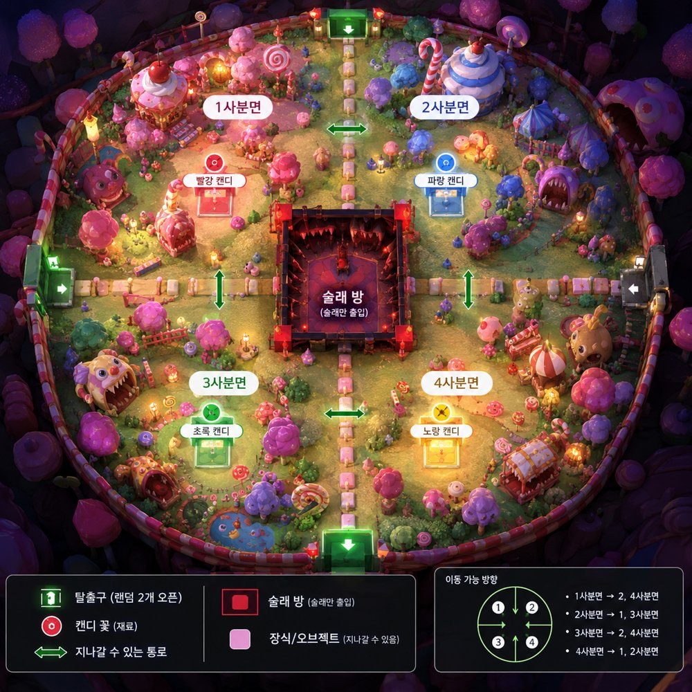

| 항목 | 그림 | 지금 테스트 맵 | 계획 |
|---|---|---|---|
| 맵 모양 | **둥근** 맵, 가장자리는 줄무늬 사탕 울타리, 바깥은 빽빽한 숲 | 141 m 정사각, 벽 | 둥근 울타리로 바꾼다(§28.6) |
| 가운데 | 술래방(술래만 출입), 네 모서리에 뾰족한 빨간 탑 | 24 m 방, 대각선 문 4개, 괴물만 통과(이미 구현) | 그대로 + 겉모습 교체 |
| 탈출구 | 동·서·남·북 4개(초록 문), 판마다 2개 열림 | 같음 | 위치 그대로, 모양 교체 |
| 큰길 | 술래방에서 탈출구까지 십자 큰길(분홍 돌 길) | 십자 축에 칸막이 28개 | 분홍 돌 길 + 길가 장식 |
| 사분면 이동 | 큰길 위 초록 화살표 = "지나갈 수 있는 통로" (1↔2 북쪽, 1↔3 서쪽, 2↔4 동쪽, 3↔4 남쪽 길 위에 하나씩) | 칸막이 틈으로 어디서나 | **Q7에서 확인** |
| 재료 건물 | 사분면마다 하나 — 1 빨강 · 2 파랑 · 3 초록 · 4 노랑 캔디 | 사분면 가운데(±41, ±41), 재료는 판마다 섞음 | 위치 그대로, 모양 교체 |
| 재료 | "캔디 꽃" 4색(빨강·파랑·초록·노랑) | 빨강·주황·노랑·초록 | 받은 막대사탕 4색과 같다 → 주황 → 파랑 |
| 사분면 장식 | 1: 체리 케이크 집·막대사탕 나무 / 2: 파랑 컵케이크 집·서커스 천막·지팡이 사탕 / 3: 연못·나무·버섯 / 4: 줄무늬 가게 천막·나무 | 장식 16개 | 받은 소품으로 같은 느낌 |
| 가장자리 괴물 입 건물 | 다섯 곳(분홍 돼지·보라 입·광대·주황 입·쿠키 괴물) | 없음 | **받은 모델에 없음 — Q9** |

## 28.3 받은 모델(11개)

v1에서 확인한 소품 8개(사진 `images/r28_candyforest_models.jpg`) + 새로 받은 3개:

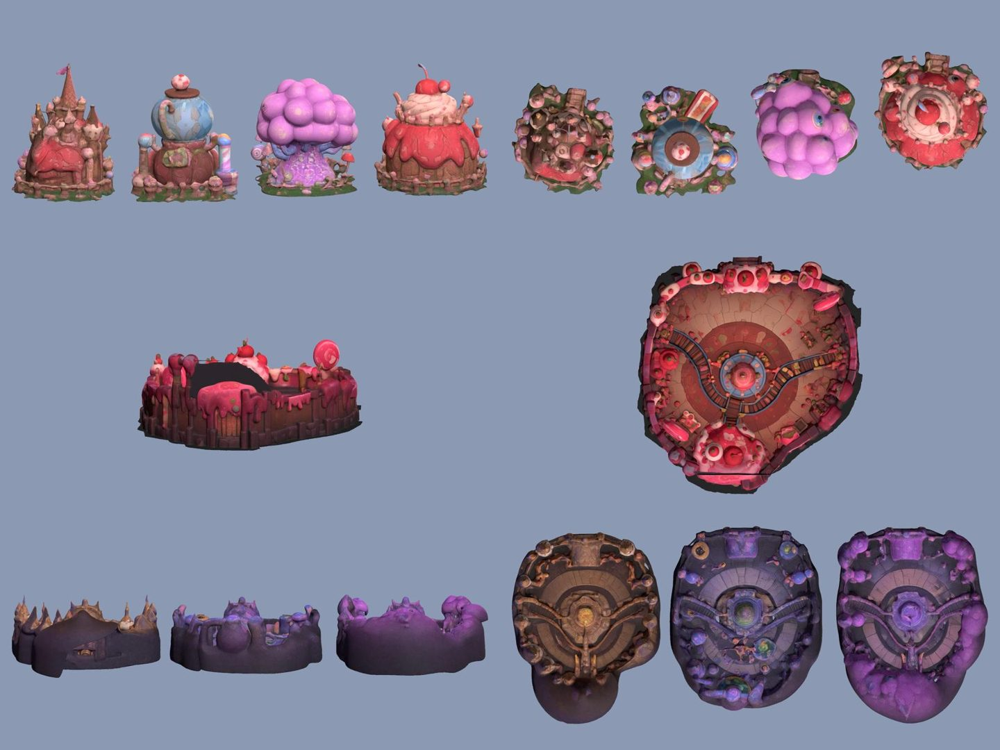

| 폴더 | 들어 있는 것 | 삼각형 | 메모 |
|---|---|---|---|
| 캔디숲재료건물 | 건물 4채: **과자 성**(분홍 깃발) · **유리 사탕병 집**(파랑) · **보라 나무 집** · **체리 컵케이크 집**(빨강) | 17.2만(4조각) | 겉 껍데기만 있음 — 문이 그려져 있지만 실제 구멍은 없다 |
| 캔디숲재료공간내부1 | 내부 1개: 하트 모양 분홍 방, 가운데 받침대, 선로 2줄, 아래쪽 입구 1개 | **41.4만**(한 덩어리) | 빨강 건물(1) 안 |
| 캔디숲재료공간내부234 | 내부 3개: 방패 모양 방 — 갈색·금색 / 보라·알록달록 / 보라·분홍 | 21.5만(3조각) | 2·3·4 건물 안, 각 입구 1개(아래쪽) |
| 사탕 나무 · 솜사탕 나무 | 나무 각 1 | 13~14만 | |
| 술래방출구탈출재료 | 막대사탕 재료 4색 · 작은 판 2 · 빨간 큰 문(닫힘) · 빨간 문틀(열림) | 5.2만(8조각) | |
| 캔디 하우스 | 체리 케이크 집 | 20만 | 그림 1사분면 집 |
| 캔디더미터널바닥 | 바닥 3종(용암·포장·풀밭) · 체크 터널 · 캔디 더미 | 4.8만(5조각) | |
| 캔디상점버섯식물울타리 | 보라 나무 덤불 · 사탕 가게 · 둥근 울타리 · 버섯 무리 | 33만(4조각) | |
| 캔디울타리가로등연못이정표벤치 | 벤치 · 이정표 · 연못 · 가로등 · 울타리 문 | 4.5만(5조각) | 그림 3사분면 연못 |
| 캔디텐트기둥괴물집 | 컵케이크 집 · 지팡이 사탕 기둥 · 서커스 천막 | 15만(3조각) | 그림 2사분면 |

공통: 파일마다 메시 하나(조각으로 나눠야 함), 긴 변 1.9 m로 맞춰짐(실제 크기 정해야 함), 삼각형이 많음(줄여야 함), 텍스처는 따로 연결해야 함.

## 28.4 재료 건물 + 내부(핵심)

**한 덩어리로 만든다(권장, Q4)**: 겉 건물 안에 내부 모델을 그 자리에 넣고, 겉 건물 벽의 입구 자리에 **실제 구멍**을 낸다(Blender에서 잘라 냄). 걸어서 들어가고, 괴물도 그대로 따라 들어온다. 순간이동 문 방식은 쫓기는 흐름이 끊기고 통행 검사도 어려워 쓰지 않는다.

| 항목 | 값(초안) | 이유 |
|---|---|---|
| 건물 바닥 넓이 | 지름 약 18 m | 지금 건물(15 m)보다 조금 큼 — 내부 길·받침대가 들어갈 자리 |
| 내부 벽 높이 | 8 m 이상 | 괴물 겉모습 높이 6.5 m |
| 입구 | **폭 6.5 m · 높이 7.4 m 이상**(지금 맵 문 기준), 내부 모델 입구 자리와 맞춤 | 괴물이 걸리지 않음 |
| 입구 수 | 내부 모델대로 1개(막다른 방) — **Q5** | 쿠키가 갇힐 위험이 있는 곳 = 긴장감. 괴물이 들어갈 수 있으니 "못 잡는 곳"은 아니다 |
| 입구 방향 | 맵 가운데(술래방) 쪽 | 그림의 건물 앞면 방향 |
| 수리 자리 | 내부 가운데 받침대 위(`Repair_Point`·`Socket_`·`ESC_Glow`) | 지금 게임 규칙 이름 그대로 |
| 지붕 | 겉 건물 지붕은 남긴다. 카메라가 지붕에 걸리면 안쪽에서는 겉 건물 지붕이 보이지 않게 한 면 그리기·카메라 충돌 레이어에서 뺀다 | 3인칭 카메라가 안에서 막히지 않게 |
| 바닥 충돌 | 내부 바닥은 **평평한 판 하나**(선로·장식 턱은 겉모습만) | 괴물 0.15 m 턱 문제 없앰 |
| 내부 벽 충돌 | 내부 모양을 따라 상자 여러 개로 둘러침 — 벽과 장식 사이 틈 0.5 m 미만 | 쿠키만 끼는 틈 없음 |
| 겉 건물 충돌 | 바깥 둘레만(입구 빼고), 지붕 위에 올라설 수 없게 둥글게/높게 | 지붕 위 피신 없음 |

건물·내부 짝(사분면 색): **Q2·Q3**에서 확정. 권장: 1 빨강 = 체리 컵케이크 집 + 내부1(분홍 하트) · 2 파랑 = 유리 사탕병 집 · 3 초록 = 보라 나무 집 · 4 노랑 = 과자 성, 내부234는 2·3·4에 하나씩.

## 28.5 재료(캔디 꽃)

- 받은 막대사탕 4색을 재료 아이템 모양으로 쓴다(지금 색 도형 대신). 아이콘도 다시 굽는다.
- 캔디숲 재료를 **빨강·파랑·초록·노랑**으로 바꾼다(주황 → 파랑, `EscapeAssetsBuilder`·레시피·로켓 칸).
- 지금은 판마다 재료와 건물 짝을 섞는다. 그림은 사분면마다 색이 정해져 있다 — **Q1**.

## 28.6 맵 모양 · 크기

| 항목 | 값(초안) |
|---|---|
| 모양 | 둥근 울타리(반지름 80 m, 지름 160 m). 지금 정사각(±70)보다 조금 넓다 — 건물이 18 m로 커지고 가장자리 둘레 길이 필요 |
| 울타리 | 줄무늬 지팡이 사탕 울타리(받은 울타리 문·지팡이 기둥을 이어 붙임), 충돌은 원을 따라 상자 48개(높이 7 m) |
| 탈출구 | 울타리 위 동·서·남·북 4곳(반지름 80 m) |
| 바깥 | 울타리 밖은 나무·솜사탕 나무 숲(겉모습만, 충돌 없음, 못 감) |
| 코드 | 맵 사각형(`MapRect`)을 쓰는 곳 — 헬리콥터 모자 탈출 방향(가장 가까운 가장자리 → **원 바깥 방향**), 맵 밖 판정, 순간이동·대체 위치 — 을 원으로도 계산하게 바꾼다 |
| 다시 놓을 자리 | 상자 40개 · 로켓 6 · 무지개 상자 8 · 쿠키 스폰 4가 지금 모서리(±62)에 있어 원 밖으로 나간다 → 원 안(반지름 70 m 이내)으로 다시 놓는다. 각 자리 둘레 3 m 비움 |

## 28.7 사분면 배치(그림 따라)

| 사분면 | 재료 건물 | 랜드마크 | 소품 |
|---|---|---|---|
| 1 (북서) 빨강 | 체리 컵케이크 집(권장) | 체리 케이크 집(캔디 하우스) | 막대사탕 나무 · 솜사탕 나무 · 가로등 · 벤치 |
| 2 (북동) 파랑 | 유리 사탕병 집 | 컵케이크 집(괴물집) · 서커스 천막 · 지팡이 사탕 | 파랑 계열 나무 · 버섯 |
| 3 (남서) 초록 | 보라 나무 집 | 연못 | 나무 · 버섯 · 막대사탕 · 이정표 |
| 4 (남동) 노랑 | 과자 성 | 사탕 가게 · 캔디 더미 | 나무 · 울타리 · 가로등 |

- 큰길(폭 10 m)은 분홍 돌 길(포장길 타일), 길가에 가로등·지팡이 사탕을 둔다(길 위에는 두지 않음).
- 사분면 사이 경계: Q7 답에 따라 "큰길 따라 낮은 울타리 + 지나가는 곳(폭 6 m 이상)만 열기" 또는 "어디서나 건너기".
- 술래방: 용암 바닥 + 네 모서리 빨간 탑(받은 빨간 큰 문을 탑처럼) + 문 4개(지금 문 동작 그대로).

## 28.8 바닥

- 걷는 면은 평평한 판 하나(원 모양). 바닥 타일은 **겉모습만**(충돌 없음).
- 풀밭 타일 = 사분면, 포장길 타일 = 큰길, 용암 타일 = 술래방, 건물 안은 내부 모델 바닥.
- 타일 약 6 × 10 m, 원 안 약 400장 → 장당 1.5천 삼각형으로 줄이고 같은 재질로 묶어 한 번에 그림. 5% 겹치고 180° 돌린 것을 섞어 이음매를 숨김.

## 28.9 모델 정리(공통)

1. 조각 나누기(떨어진 덩어리 + 3차원 겹침으로 묶기), 바닥 가운데로 기준점.
2. 삼각형 줄이기(Blender): 재료 건물 2.5만 · 내부 4만 · 랜드마크 2만 · 나무 1만 · 소품 3천 · 타일 1.5천 · 재료 1천. 화면 전체 150만 이하.
3. 겉 건물에 입구 구멍 내기, 내부와 맞추기(Blender).
4. 재질: Standard(색·노멀·금속+매끄러움 합침).
5. 위치: 원본 `Assets/09. Environment/CandyForest/Source~/`, 정리본 `.../CandyForest/Models/`, 프리팹 `Assets/04. Prefabs/Maps/CandyForest/`.

## 28.10 통행 안전 규칙(그대로 + 건물 내부 추가)

v1 §S1~S8 그대로:
- S1: 틈은 4 m 이상 또는 0.5 m 미만
- S2: 충돌체는 0.15 m 이하 또는 2.2 m 이상
- S3: 올라설 수 있는 윗면은 괴물 손 2.5 m 안
- S4: 닫힌 집·천막은 속이 찬 충돌체
- S5: 들어가는 곳은 폭 4 m·높이 7.4 m 이상
- S6: 6 m 위에 못 감
- S7: 나무 머리는 충돌 없음
- S8: 울타리와의 틈도 S1

추가:
- **S9 건물 안**: 내부 바닥은 평평한 판. 받침대(수리 자리)는 괴물이 손 닿는 높이·폭. 내부 벽 장식과 벽 사이 틈 0.5 m 미만. 입구 폭·높이 §28.4.
- **S10 둥근 울타리**: 원을 따르는 상자 사이 틈 없음(겹치게), 울타리와 건물·소품 사이 4 m 이상.
- **S11 술래방**: 쿠키는 못 들어감(지금 문 그대로) — 통행 검사에서 술래방은 "괴물 전용"으로 빼고 본다.

**앞으로 만들 캐릭터 4종**: 통행 검사(`MapPassabilityCheck`)를 캐릭터 몸 크기마다 돌리게 넓힌다.
- 설계 범위: 반경 0.35~0.6 m, 키 2.4 m 이하, 점프 1.8 m 이하
- 범위를 벗어난 캐릭터가 들어오면 시험이 실패해 알린다

**완료 기준**:
1. 몸 크기 5가지 모두 "갇힌 바닥 0 · 쿠키만 있는 자리 0 · 스폰 연결"
2. 모든 상자·수리 자리(건물 안)·탈출구·로켓·무지개 자리에 괴물·쿠키 모두 닿음
3. Play Mode에서 괴물·쿠키로 큰길·각 건물 안을 한 바퀴씩 자동 이동해 끼임 없음
4. 위에서 본 통행 지도를 그림으로 뽑아 확인

## 28.11 질문(답을 적어 주세요)

| 번호 | 질문 | 권장안 | 답 |
|---|---|---|---|
| Q1 | 재료 색을 그림처럼 **사분면마다 고정**(1 빨강·2 파랑·3 초록·4 노랑)할까, 지금처럼 **판마다 섞을까**? (건물은 판마다 일부만 켜지는 규칙 그대로) | 고정 — 그림과 같게, 외우기 쉬움 | | - 판마다 섞음
| Q2 | 재료 건물 4채 ↔ 사분면: 체리 컵케이크=1 빨강, 유리 사탕병=2 파랑, 보라 나무 집=3 초록, 과자 성=4 노랑 맞나? | 이대로 | | - 맞다.
| Q3 | 내부234의 세 가지(갈색·금색 / 보라·알록달록 / 보라·분홍)를 2·3·4 어디에? | 2 = 보라·알록달록, 3 = 보라·분홍, 4 = 갈색·금색 | | - 캔디숲재료공간내부1에 fbx 한개에 하나가 들어있고, 캔디숲재료공간내부234에 fbx에 내부의 모습 세가지가 들어있음. 확인 부탁함.
| Q4 | 건물 안: 겉 건물에 구멍을 내고 내부를 그 안에 넣기(걸어서 들어감) vs 문을 누르면 다른 곳의 내부로 순간이동 | 걸어서 들어감 | | - 걸어서 들어감
| Q5 | 입구 수: 내부 모델대로 **1개**(막다른 방) vs 2개(뒤쪽에 구멍 하나 더) | 1개 | | - 건물 안의 내부에 있는 입구 수를 말을 하는거면 두개로 한다. 뒤쪽에 구멍 하나 더
| Q6 | 맵을 **둥글게**(반지름 80 m) 바꿀까? 상자·로켓 자리를 원 안으로 다시 놓아야 한다 | 둥글게 | | - 맵을 둥글게
| Q7 | 사분면 사이 이동: 그림 화살표는 1↔2(북)·1↔3(서)·2↔4(동)·3↔4(남)인데 오른쪽 아래 설명은 "1→2,4 / 2→1,3 / 3→2,4 / 4→1,2"로 다르다. 어느 쪽인가? 그리고 큰길이 **경계**(통로로만 건넘)인가, **어디서나 건널 수 있는** 길인가? | 그림 화살표대로, 큰길은 낮은 울타리 경계 + 통로(폭 6 m) 하나씩 | | - 그림의 화살표를 토대로 따라가지 않는다. 원래 내가 말했던 설계 방향대로 간다.
| Q8 | 탈출구 모양: 받은 빨간 문틀을 **초록으로 다시 칠해** 쓸까(그림은 초록 문)? | 초록으로 | | - 3DTagOfChaos\TagOfChaos\Plan.md\images\탈출구.png 에 탈출구에 대한 이미지를 확인해주면 된다.
| Q9 | 그림 가장자리의 **괴물 입 모양 건물**(5곳)은 받은 모델에 없다 — 빼고 다른 소품으로 채울까, 모델이 올 때까지 자리만 둘까? | 자리만 비워 두고 소품으로 임시 채움 | | - 괴물입모양건물.png 를 참고해주면 된다. 이거로 대체를한다.
| Q10 | 회색·초록 **작은 판 2개** 쓰임은? | 술래방 문 앞 표지판 | | - 쓰임은 없다. 그냥 배치용품일 뿐
| Q11 | 어느 씬에? | `Test_CandyForest`를 복사한 새 씬 `CandyForest`, 확인 뒤 게임 맵 목록 교체 | | - 이대로 간다.
| Q12 | 예전 배경 나무·점광원 393개 | 새 배치에 맞춰 다시 둠(어두운 곳 검사 통과) | | - Q11에 답변 했던거처럼 새 배치에 맞춰 다시 둔다.
| Q13 | 새 캐릭터 4종의 대략 크기(키·몸 폭) | 모르면 §28.10 범위 | | - 일단 28.10 대로간다.

### 28.11.1 답 정리(2026-10-19)와 바뀐 설계

| 번호 | 답 | 계획에 반영 |
|---|---|---|
| Q1 | 판마다 섞음 | 재료 색은 사분면에 고정하지 않는다 — 지금 규칙 그대로(판마다 건물·재료 짝을 섞고 일부만 켬). 건물 겉모양 색과 필요한 재료 색이 다를 수 있으니, 필요한 재료는 지금처럼 쿠키에게만 보이는 받침 색·떠 있는 재료 모양으로 알린다. §28.5의 "고정"은 취소 |
| Q2 | 맞다 | 1 체리 컵케이크 · 2 유리 사탕병 · 3 보라 나무 집 · 4 과자 성 |
| Q3 | 내부234 파일 확인 요청 | 확인함: 파일 하나에 방 3개(갈색·금색 / 보라·알록달록 / 보라·분홍)가 나란히 들어 있다 → 조각으로 나눠 2·3·4에 하나씩. 짝은 추가 질문 F3 |
| Q4 | 걸어서 들어감 | §28.4 그대로 |
| Q5 | **입구 2개**(뒤쪽에 하나 더) | 겉 건물과 내부 모두 앞(맵 가운데 쪽)·뒤(가장자리 쪽)에 입구를 낸다 — 막다른 방이 아니게. 두 입구 모두 폭 6.5 m · 높이 7.4 m 이상 |
| Q6 | 둥글게 | 반지름 80 m 둥근 맵, 상자·로켓·무지개·스폰 자리 다시 놓기 |
| Q7 | 그림 화살표를 따르지 않음, **원래 설계대로** | §25 설계: 십자 경계 = 테마 소품 줄 + 지나갈 틈(이웃 사분면 1↔2·1↔3·2↔4·3↔4). 해석은 추가 질문 F1 |
| Q8 | `Plan.md/images/탈출구.png` 참고 | 열림 = 초록 문틀 + 아래 화살표, 닫힘 = 회색 돌 문 + 자물쇠 + 빨간 X(아래 그림). 받은 모델과 다름 → 추가 질문 F2 |
| Q9 | `괴물입모양 건물.png`로 대체 | 그림 = 받은 `캔디텐트기둥괴물집` 세 개(천막 · 지팡이 사탕 · **입 벌린 괴물집**). 가장자리 다섯 곳을 이것으로 채운다 → 추가 질문 F4 |
| Q10 | 쓰임 없음, 배치용 | 작은 판 2개는 장식 소품 |
| Q11 | 이대로 | 새 씬 `CandyForest` |
| Q12 | 새 배치에 맞춰 다시 둠 | 점광원·배경 다시 둠 |
| Q13 | §28.10대로 | 반경 0.35~0.6 m · 키 2.4 m 이하 범위로 설계·시험 |

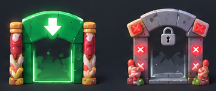

### 28.11.2 추가 질문(답을 적어 주세요)

| 번호 | 질문 | 권장안 | 답 |
|---|---|---|---|
| F1 | Q7 "원래 설계" 확인: 십자 큰길(술래방 → 탈출구)을 따라 **소품 줄을 두고 그 사이에 지나갈 틈 여러 개(폭 4 m 이상)** — 이웃 사분면끼리는 틈으로 오가고, 대각선 사분면은 술래방 둘레를 돌아서 간다. 이렇게 이해하면 되나? 아니면 큰길에 아무것도 두지 않아 **어디서나 건널 수 있게** 할까? | 소품 줄 + 틈 여러 개(지금 테스트 맵 칸막이와 같은 방식, 틈 간격 약 6 m) | | - 이웃 사분면끼리는 틈으로 오가고, 대각선 사분면은 술래방 둘레를 돌아서 간다. 이렇게 이해하면 된다.
| F2 | 탈출구 모양: 그림(초록 열림 / 회색 자물쇠 닫힘)과 받은 모델(빨간 문틀 / 빨간 큰 문)이 다르다. ① 받은 빨간 모델을 그림 색으로 다시 칠하고 화살표·자물쇠 표시를 붙여 쓸까, ② 그림과 같은 탈출구 모델을 따로 만들어 줄 때까지 기다릴까? | ① 다시 칠해 먼저 쓰고, 모델이 오면 바꿈 | | - 받은 빨간 모델을 그림 색으로 다시 칠하고 화살표·자물쇠 표시를 붙여 쓰면 될거같다.
| F3 | 내부 짝: 2 파랑(유리 사탕병) = 보라·알록달록, 3 초록(보라 나무 집) = 보라·분홍, 4 노랑(과자 성) = 갈색·금색 — 이대로 할까? | 이대로 | | - 이대로
| F4 | 가장자리 다섯 곳: 모두 **입 벌린 괴물집**으로 둘까, 괴물집·천막·지팡이 사탕을 섞을까? 그리고 괴물 입은 **막힌 장식**(못 들어감)으로 할까? | 다섯 곳 모두 괴물집(돌려 놓기) + 사이사이 지팡이 사탕, 입은 막힌 장식 | | - 다섯 곳 모두 입 벌린 괴물집이고, 괴물집과 천막 지팡이 사탕을 섞으면 좋을거같다. 그리고 괴물 입은 열린 장식으로 들어갈 수 있다. (재료 넣는공간은 아님.)

### 28.11.3 추가 답 정리(2026-10-19)

| 번호 | 답 | 계획에 반영 |
|---|---|---|
| F1 | 그렇게 이해하면 됨 | 십자 큰길을 따라 소품 줄 + 지나갈 틈 여러 개(폭 4 m 이상, 간격 약 6 m). 이웃 사분면은 틈으로, 대각선 사분면은 술래방 둘레로 |
| F2 | 받은 빨간 모델을 다시 칠해 표시를 붙여 씀 | 열림 = 빨간 문틀 → 초록 + 아래 화살표 표시, 닫힘 = 빨간 큰 문 → 회색 돌 + 자물쇠·빨간 X 표시. 탈출구가 열리면 닫힌 문 → 열린 문틀로 바뀐다 |
| F3 | 이대로 | 2 유리 사탕병 = 보라·알록달록 · 3 보라 나무 집 = 보라·분홍 · 4 과자 성 = 갈색·금색 |
| F4 | 다섯 곳 모두 입 벌린 괴물집 + 천막·지팡이 사탕 섞기, **괴물 입으로 들어갈 수 있음**(재료 넣는 곳은 아님) | 가장자리 다섯 곳 = 괴물집 중심 + 주변에 천막·지팡이 사탕. 괴물집은 입이 실제 입구인 빈 방(아래 G1·G2) |

### 28.11.4 추가 질문 2(답을 적어 주세요)

괴물집 안으로 들어갈 수 있게 되면서 "괴물이 못 잡는 곳이 없게" 규칙을 지키려면 크기·모양을 정해야 한다.
- 받은 괴물집은 겉 껍데기만 있고 입도 막힌 표면이다. 그래서 Blender에서 입 자리를 뚫고, 안에 단순한 방(둥근 벽·평평한 바닥·어두운 목구멍 색)을 만들어 넣어야 한다.
- 괴물 겉모습은 높이 6.5 m이고, 지금 맵의 문 기준은 폭 6.5 m·높이 7.4 m 이상이다.

| 번호 | 질문 | 권장안 | 답 |
|---|---|---|---|
| G1 | 괴물집 크기·안쪽: ① **크게**(지름 약 16 m, 입 폭 6.5 m·높이 7.4 m 이상) — 괴물도 걸어 들어온다, ② **작게**(지름 약 9 m, 입 높이 3 m) — 괴물은 못 들어가지만 안쪽 깊이를 2 m 이하로 얕게 해서 입 밖에서 손이 닿게 한다(잠깐 숨는 곳) | ② 작게·얕게 — 다섯 곳이 가장자리 둘레 길을 막지 않고, 숨어도 잡힐 수 있다 | | - 크게한다.
| G2 | 괴물집 입구 수: 입 하나(막다른 곳)로 괜찮은가? | ①이면 하나도 괜찮음(괴물이 들어옴), ②이면 얕아서 하나로 충분 | | - 입 하나에 뒤에는 그냥 일반적인 쿠키 문으로 해주면 좋을거같다.
| G3 | 천막(서커스 천막)에도 문 모양이 있다. 천막도 들어갈 수 있게 할까? | 막힌 장식(못 들어감) — 들어가는 곳을 늘리지 않음 | | - 들어갈 수 있게 해야된다.
| G4 | 각 가장자리 자리 구성: 괴물집 1 + 천막 1 + 지팡이 사탕 2 정도를 한 무리로, 다섯 무리를 울타리 안쪽 둘레에 고르게(탈출구 4곳은 피해서) 둘까? | 이대로 | | - 이대로

### 28.11.5 추가 답 정리 2(2026-10-19)

| 번호 | 답 | 계획에 반영 |
|---|---|---|
| G1 | 크게 | 괴물집 지름 약 16 m, 입 = 입구(폭 6.5 m · 높이 7.4 m 이상) — 괴물도 걸어 들어온다. 안은 Blender로 만든 단순한 방(둥근 벽 · 평평한 바닥 · 어두운 목구멍 색) | - 이대로 간다.
| G2 | 앞은 입 하나, 뒤에는 일반 쿠키 문 | 뒤쪽 벽에 쿠키 크기 문을 하나 더 낸다 → 막다른 방이 아니다(H2에서 문 방식 확인) | - 이대로 간다.
| G3 | 천막도 들어갈 수 있게 | 천막도 문 자리를 뚫고 안에 단순한 방(H1에서 크기 확인) | - 천막도 뚫는데, 천막도 문자리를뚫고 안에는 단순한 방으로 한다.
| G4 | 이대로 | 괴물집 1 + 천막 1 + 지팡이 사탕 2 = 한 무리, 다섯 무리를 울타리 안쪽 둘레에(탈출구·큰길·재료 건물 대각선은 피해서) | - 이대로간다.

배치 확인(계산): 재료 건물은 대각선 방향 반지름 58 m(건물 반지름 9 m → 67 m까지), 가장자리 무리는 큰길(0°·90°·180°·270°)과 대각선(45°…) 사이 각도(22.5° 간격 자리 중 다섯 곳)에 괴물집 중심 반지름 약 68 m로 두면 울타리(80 m)와 4 m 이상, 재료 건물과 약 35 m, 큰길과 약 26 m 떨어진다 — 반지름 80 m 그대로 들어간다.

### 28.11.6 추가 질문 3(답을 적어 주세요)

| 번호 | 질문 | 권장안 | 답 |
|---|---|---|---|
| H1 | 천막 크기: ① 괴물집처럼 **크게**(지름 약 14 m, 문 폭 6.5 m · 높이 7.4 m 이상 — 괴물도 들어감), ② **작게 얕게**(괴물은 못 들어가지만 안쪽 깊이 2 m 이하라 문 밖에서 손이 닿음) | ① 크게 — 괴물집과 같은 규칙이라 헷갈리지 않고 "괴물이 못 잡는 곳" 걱정이 없다. 천막도 뒤에 쿠키 문 하나(괴물집과 같게) | | - 크게한다.
| H2 | 뒤쪽 "일반 쿠키 문"은 ① **쿠키만 지나가는 좁은 열린 구멍**(폭 1.4 m · 높이 2.6 m — 괴물은 몸이 커서 못 지나감, 쿠키의 빠져나갈 길), ② **E로 여닫는 문짝**(지금 다른 맵의 `InteractableDoor`처럼 — 괴물도 열 수 있음) 중 어느 쪽? | ① 좁은 열린 구멍 — 쿠키는 뒤로 빠져나가고, 괴물은 돌아서 쫓는다. 구멍 안쪽 깊이가 얕아(벽 두께 1 m) 괴물 손이 닿으니 "못 잡는 곳"이 아니다 | | - 쿠키만 지나가는 좁은 열린 구멍으로 한다.

### 28.11.7 추가 답 정리 3 — 계획 확정

| 번호 | 답 | 계획에 반영 |
|---|---|---|
| G1~G4 | 이대로 | §28.11.5 그대로 |
| H1 | 크게 | 천막 지름 약 14 m, 앞 문 폭 6.5 m · 높이 7.4 m 이상(괴물도 들어감), 안은 단순한 방(평평한 바닥·둥근 벽). 뒤에 쿠키 구멍 하나 — 괴물집과 같은 규칙 |
| H2 | 좁은 열린 구멍 | 괴물집·천막 뒤쪽 벽에 폭 1.4 m · 높이 2.6 m 열린 구멍(문짝 없음). 벽 두께 1 m 이하로 만들어 구멍 안·바로 바깥 모두 괴물 손(2.5 m)이 닿게 한다. 통행 검사(C9)에서 "쿠키만 지나가는 칸"으로 나오되 주머니(괴물이 못 잡는 곳)로는 나오면 안 된다 |

**안전 확인(S1~S11)**: 큰 천막·괴물집은 괴물이 안까지 들어가고, 뒤 구멍은 얕아서 괴물 손이 닿으므로 "괴물이 못 잡는 곳"이 생기지 않는다. 새 캐릭터 크기 범위(§28.10, 반경 0.35~0.6 m · 키 2.4 m 이하)로 구멍을 지나가는지도 C9에서 함께 확인한다(반경 0.6 m 캐릭터 → 폭 1.2 m 필요, 1.4 m 구멍 통과).

→ 질문 끝. 계획 확정, C1부터 진행 가능.

## 28.12 단계

| 단계 | 내용 | 상태 |
|---|---|---|
| C0 | 질문 답 반영 | ✅ (§28.11.7) |
| C1 | 원본 11개 가져오기(`Source~`) · 조각 나누기 · 이름(폴더 기준) | ✅ 11개 → 32조각(§28.13) |
| C2 | 삼각형 줄이기 · 기준점 · 조각별 FBX(Blender) | ✅ `cf_build.py` 32개(§28.13) |
| C3 | 재료 건물: 겉 건물 입구 구멍 + 내부 맞추기 + 충돌체 + 수리 자리 이름 | ✅ 건물 4 · 괴물집 · 천막(§28.13) |
| C4 | 재질 · 크기 · 충돌체 · 소품 프리팹 | ✅ `CandyForestAssets` 프리팹 32개(§28.13) |
| C5 | 재료 4색(빨강·파랑·초록·노랑) 아이템 모양 · 아이콘 · 레시피 | ✅ 막대사탕 4색, 주황 → 파랑(§28.13) |
| C6 | 둥근 맵: 울타리 · 걷는 판 · 코드(맵 밖·모자 방향·대체 위치)를 원으로 | ✅ `MapArea`(§28.13) |
| C7 | 바닥 타일(겉모습만) | ✅ 415장(§28.13) |
| C8 | 배치(위치표 SO → 씬): 술래방 · 큰길 · 사분면 · 탈출구 · 상자/로켓/무지개/스폰 다시 놓기 | ✅ 위치표 165 · 표시 58(§28.13) |
| C9 | 통행 검사를 캐릭터 크기별로 확장 · 시험 · 깨끗할 때까지 고치기 | ✅ 몸 5가지 모두 깨끗(§28.13) |
| C10 | 조명(점광원 다시 두기) · 어두운 곳 검사 | ✅ 점광원 24 · 어두운 곳 0(§28.13) |
| C11 | Play Mode(쿠키·괴물 순회, 건물 안 수리, 모든 목표 지점) · 스크린샷 · 성능 | ✅ 쿠키 42/42 · 괴물 32/32 · 수리 OK(§28.13) |
| C12 | 전체 시험 · 빌드 · 문서 | ✅ 시험 309/310(남은 1개는 예전 놀이공원 맵 실패) · 빌드 성공(§28.13) |
| C13 | 멀티 확인(사용자) | ⬜ |

## 28.13 결과(2026-10-19)

### 만든 것

| 단계 | 내용 | 파일 |
|---|---|---|
| C1 | 원본 11개를 `Assets/09. Environment/CandyForest/Source~/<세트>/`로 복사(파일 이름은 세트 이름 — SwirlTree · BubblegumTree · GateItems · Cottage · Tiles · Trinkets · MatBuildings · Park · Whimsical · Interior1 · Interior234). 떨어진 덩어리를 3차원 겹침으로 묶어 **32조각**으로 나눔 | `Source~/Scripts/cf_split.py` |
| C2·C3 | 조각마다 실제 크기 · 기준점(바닥 가운데) · 삼각형 줄이기 · FBX(`Models/CF_*.fbx`) + 충돌용 정보(`CF_*.json`). 재료 건물 = 겉 건물(23 m) 안에 내부(17 m)를 넣고 앞·뒤 문(7.2 × 7.9 m)을 뚫음 + 안쪽 어두운 천장. 괴물집(16 m)·천막(14 m) = 앞 입구 + 뒤 쿠키 구멍 + 안쪽 천장 + 바닥 | `cf_build.py` |
| C4 | 텍스처(금속+매끄러움 합침) · 세트별 재질 · 충돌체 붙인 프리팹 32개(`Assets/04. Prefabs/Maps/CandyForest/`) | `Editor/Maps/CandyForestAssets.cs` |
| C5 | 재료 4색 = 받은 막대사탕(빨강·파랑·초록·노랑). 주황 → 파랑(같은 에셋을 옮겨 참조 유지), 이름 "OO 막대사탕", 아이템 모델 프리팹 `Assets/04. Prefabs/Items/ITEM_CandyCell_*`, 아이콘 다시 굽기 | `EscapeAssetsBuilder` · `EscapeModelBuilder`(프리팹 우선) |
| C6 | 둥근 맵 판정 `MapArea`(맵 밖 · 모자 비행 방향 = 바깥쪽 · 무작위 지점). `EscapeManager.mapRadius = 80` | `Escape/MapArea.cs` · `EscapeManager` · `HatFlight` |
| C7 | 바닥 타일 415장(풀밭 · 큰길 포장 · 술래방 용암, 겉모습만 — 걷는 면은 평평한 바닥 하나) | `CandyForestMapBuilder` |
| C8 | 위치표 SO(`Assets/03. SO/Maps/CandyForestLayout.asset`, 165개 — `locked`를 켜면 손으로 고친 위치를 지킴) → 씬 `Assets/Scenes/Maps/CandyForest.unity`. 상자 40 · 로켓 6 · 무지개 8 · 쿠키 스폰 4 다시 놓음. 판 맵 목록에서 `Test_CandyForest` → `CandyForest` | `CandyForestLayout.cs` · `CandyForestLayoutSO.cs` · `CandyForestMapBuilder.cs` |
| C9 | 통행 검사를 몸 크기 여러 개로(`MapPassabilityCheck.Options/Body`), 목표 지점 검사 · 통행 지도 그림 | `MapPassabilityCheck.cs` |
| C10 | 예전 점광원 393개 끔 → 가로등 10 · 괴물집·천막 10 · 재료 건물 안 4 = 점광원 24개. 지붕 아래 어두운 곳 검사 | `CandyForestMapBuilder.BuildLights` |
| C12 | 시험 `Request1019Tests` 6개 | `Editor/Tests/Request1019Tests.cs` |

에디터 메뉴: `Tools/TagOfChaos/CandyForest/1 Import Models` → `2 Build Map Scene` → `3 Check Passability (5 body sizes)`. Blender는 `cf_split.py` → `cf_build.py` 순서(다시 만들 때 같은 결과).

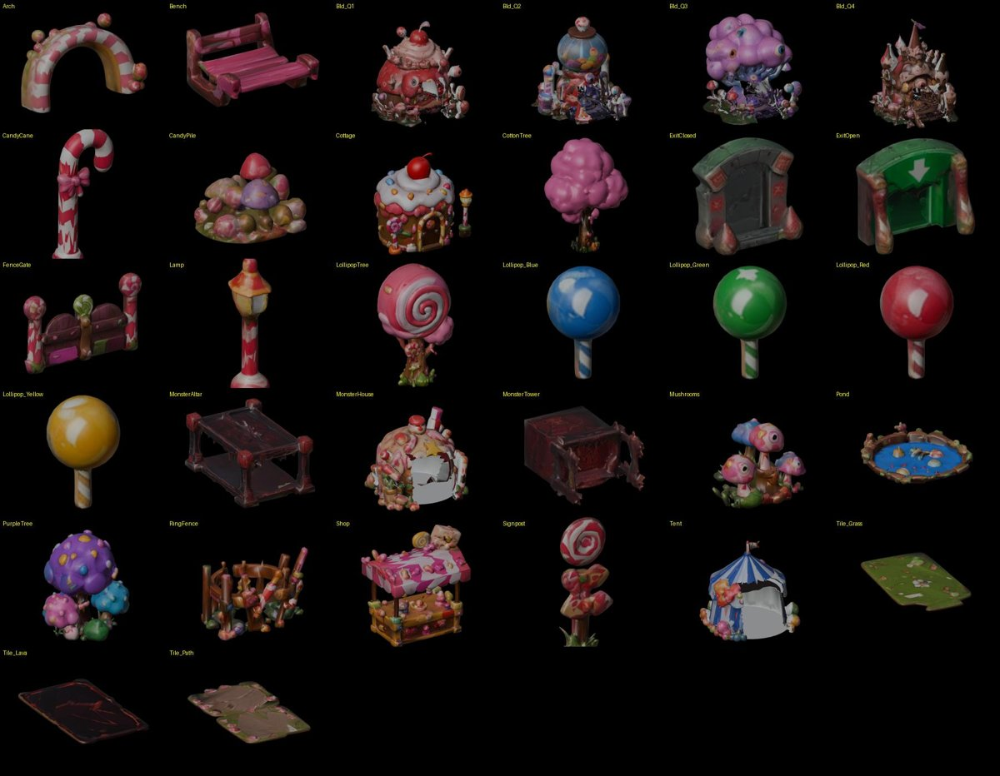

### 배치(위에서 본 모습)

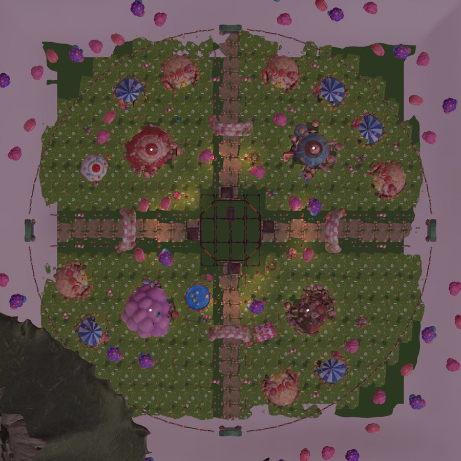

- 재료 건물 4채: 사분면 대각선 반지름 45 m, 앞문이 술래방(가운데) 쪽. 1 체리 컵케이크 + 하트 방 · 2 유리 사탕병 + 보라·알록달록 · 3 보라 나무 집 + 보라·분홍 · 4 과자 성 + 갈색·금색.
- 가장자리 다섯 무리(괴물집 1 + 천막 1 + 지팡이 사탕 2): 반지름 66~68 m, 큰길과 재료 건물에서 4 m 넘게 — 2사분면 두 무리(1사분면은 케이크 집 자리), 1·3·4사분면 한 무리씩.
- 큰길 4개(폭 10 m): 양쪽 가장자리에 울타리 문 · 가로등 · 지팡이 사탕 줄, 틈 5 m(이웃 사분면은 틈으로, 대각선 사분면은 술래방 둘레로 — F1). 길마다 사탕 아치 하나(아래 높이 7.7 m — 괴물 지나감).
- 술래방: 벽·문 그대로(괴물만), 바닥 용암 타일, 벽 바깥 가운데에 빨간 상자 4, 안에 제단.
- 탈출구 4: 받은 모델에 이미 초록 열림(아래 화살표)·회색 닫힘 무늬가 있어 다시 칠하지 않고 그대로 씀(F2). 닫힌 돌 문이 땅으로 내려가면 열린 문틀이 켜짐(`EscapeGate`의 `ExitOpenLook_`). 문 밖 받침은 양옆·뒤를 막아 괴물이 맵 밖으로 못 나감.
- 둥근 울타리(반지름 80 m): 겉모습 = 울타리 문 모델 76개, 충돌 = 겹친 상자 고리(탈출구 자리만 기둥으로).
- 울타리 밖 숲: 나무 64그루(충돌 없음), 예전 배경은 반지름 95 m 안을 지움.

### 계획과 다른 점

| 항목 | 계획 | 실제 | 이유 |
|---|---|---|---|
| 탈출구 색 | 빨간 모델을 다시 칠함(F2) | 그대로 씀 | 텍스처를 붙여 보니 이미 초록 열림 문틀(화살표)·회색 닫힘 문(그림과 같음) |
| 빨간 큰 문 | 술래방 네 모서리 탑 | 술래방 벽 바깥 장식 상자(높이 4 m) | 텍스처를 붙여 보니 탑이 아니라 큰 빨간 상자. 빨간 탁자 모델은 술래방 안 제단 |
| 재료 이름 | 그대로 | "빨간/파란/초록/노란 막대사탕" | 모양이 알사탕 전지에서 막대사탕으로 바뀜. 텍스처의 노랑이 황토색이라 재질에 아이템 색을 살짝 곱함 |
| 뒤 쿠키 구멍 | 폭 1.4 m 열린 구멍 | 1.4 m 구멍 + **괴물만 막는 보이지 않는 벽**(`CookieHole`) | 실제 괴물 충돌체는 반경 0.31 m라 1.4 m 틈도 지나감 — H2 "괴물은 못 지나감"을 지키려고. 술래방 문(`MonsterRoomDoor`)과 반대 동작 |
| 재료 건물 수리 자리 | 받침대 위 | 받침대 앞, 높이 1.3 m | 받침대 꼭대기(3.9 m)는 상호작용 높이 차(2.5 m)를 넘음 |
| 가장자리 무리 | 다섯 곳 고르게 | 2사분면 둘 · 나머지 하나씩 | 재료 건물(23 m)·큰길과 4 m를 지키며 들어가는 자리 |

### 통행 검사(C9) — 몸 5가지 모두 깨끗

| 몸 | 갇힌 바닥 | 쿠키 전용(3 m² 이상 무리) | 스폰 연결 | 목표 66곳(상자·수리 자리·탈출구·로켓·무지개·스폰)에 쿠키·괴물 모두 3 m 안 |
|---|---|---|---|---|
| 쿠키(반경 0.46 · 키 2.0) | 0 | 0 | 예 | 66/66 |
| 가늘고 작음(0.35 · 1.6) | 0 | 0 | 예 | 66/66 |
| 가늘고 큼(0.35 · 2.4) | 0 | 0 | 예 | 66/66 |
| 넓고 작음(0.6 · 1.6) | 0 | 0 | 예 | 66/66 |
| 넓고 큼(0.6 · 2.4) | 0 | 0 | 예 | 66/66 |

- 점프는 모두 1.8 m. 술래방은 괴물 전용으로 빼고, 울타리 밖은 놀이 공간이 아니므로 뺌(S11). 탈출구는 열린 것으로, 쿠키 구멍은 쿠키에게 열린 것으로 봄.
- 술래방 문(폭 3 m)은 괴물 통로 기준(4 m) 격자로는 막혀 있어 문 바로 바깥을 괴물 출발점으로 더함(실제 괴물은 지나감 — 기존 테스트 맵과 같은 문).
- 고친 것: 둥근 울타리 충돌 고리가 0°/360° 넘김 계산으로 동쪽 탈출구 옆 2° 틈이 생겨 쿠키가 맵 밖으로 나갔다 → 고침.

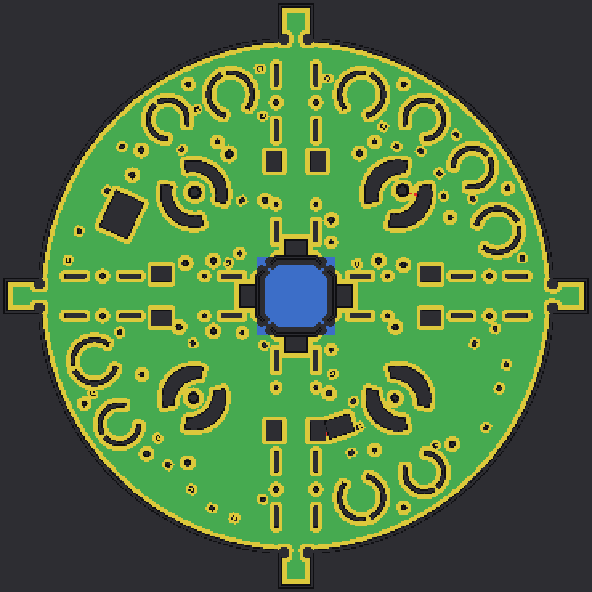

### Play Mode(C11)

- 쿠키(실제 프리팹, 통행 격자 경로): 재료 건물 4곳 앞문 → 수리 자리 → 뒷문, 괴물집·천막 10곳 입구 → 안 → **뒤 쿠키 구멍으로 나감** — **42/42 도착**(쿠키 구멍 벽을 넣은 뒤 다시 돌려도 42/42).
- 괴물: 재료 건물 4곳 앞문 → 수리 자리 → 뒷문, 괴물집·천막 10곳 입구 → 안 — **32/32 도착**.
- 건물 안 수리: 초록 막대사탕을 들고 받침대 앞에서 E를 누르고 있으면 "초록 막대사탕 0%" → 12초 뒤 "OK", 빛기둥이 지붕을 뚫고 켜짐.
- 콘솔 오류·경고 0. 전체 EditMode 시험 310개 중 309개 통과(실패 1개 = 예전 `MapCompactTests…CursedCandyCarnival`, 이번 작업 전부터). Windows 빌드 성공(오류·경고 0, 씬 7개). 놀이 공간 삼각형 약 126만(목표 150만 이하), 점광원 24.

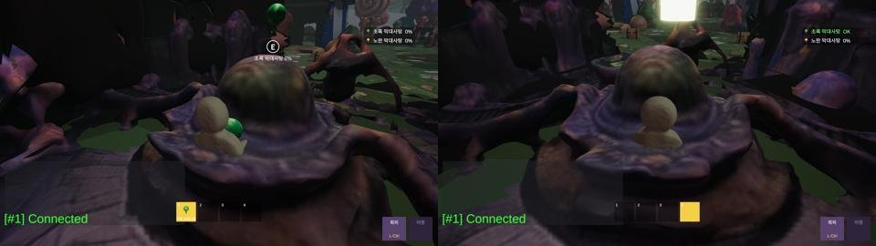
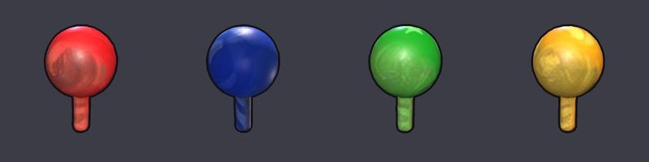
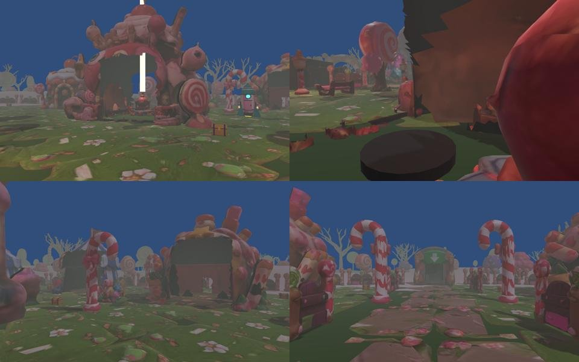

### 남은 것

- C13 멀티 확인(사용자): 여러 명이 같은 판에서 건물 안 수리·쿠키 구멍(괴물은 막힘)·탈출구 열림 모습을 확인.
- 겉모습 다듬기는 사용자 확인 뒤: 문 구멍 가장자리(잘라 낸 자리)가 거침, 내부 방의 원래 입구 장식은 충돌 벽 뒤에 남음.

### 28.14 2026-10-20 후속 요청(4건)

| 요청 | 원인 | 고친 것 |
|---|---|---|
| 메시 충돌체가 없는 구조물 — 그 속에 숨을 수 있음 | 작은 장식·나무 머리·건물 바닥 장식은 충돌이 없거나 기둥·상자만 있었다 | `cf_build.py`가 모델마다 **충돌용 메시**(`COL_*`, 겉모습에서 바닥 0.25 m 아래 면만 뺀 것)를 함께 내보내고, `CandyForestAssets`가 Mesh Collider로 붙인다(그리지는 않음). 소품 전부 · 괴물집 · 천막 · 재료 건물 겉. 바닥 근처 낮은 턱은 빼서 괴물(턱 0.15 m)이 걸리지 않는다. 연못·바닥 타일·움직이는 탈출구 문·아이템은 그대로 |
| ↳ 재료 건물 안 장식 | 장식에 메시 충돌을 붙였더니 장식과 벽 사이에 쿠키만 들어가는 틈이 생겼다(통행 검사) | 방 벽 충돌 고리를 **장식까지 두껍게**(5°마다 가장 가까운 장식, ±15° 최솟값 − 0.3 m). 장식 구역 전체가 막혀 숨을 수 없고, 가운데 방(반지름 6.8 m 이상 — 받침대 둘레를 괴물이 돈다)은 괴물이 다 닿는다. 겉 건물 메시가 방 안으로 들어온 부분(나무 집 줄기 등)은 충돌에서 뺌 |
| 술래방 바닥이 초록색 | 용암 타일의 붉은 면이 바닥보다 낮아 금 무늬만 보였다 | 붉은 용암 바닥판(`RoomLavaFloor`, 은은한 발광) + 용암 타일 13 cm 올림 |
| 재료를 넣으면 빛기둥이 공중에 떠 보임 | 빛기둥이 받침대 꼭대기(3.9 m)부터 시작해 지붕 위로 조금만 보였다 | 꽂는 자리(높이 1 m)에서 시작해 60 m까지 — 안에서는 넣은 막대사탕에서, 밖에서는 지붕을 뚫고 올라간다 |
| 새 초록 바닥(`CandyForest\바닥`) 재배치 | — | 윗면이 풀밭인 네모 흙덩이 하나 → 10 × 9 m 타일(`CF_Tile_Moss`, 높이를 눌러 풀 덤불을 낮춤)로 만들어 **풀밭 전체를 이 바닥으로 다시 깔았다**(예전 풀밭 타일 대신). 큰길·술래방 타일은 그대로 |

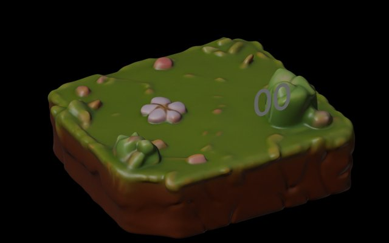

배치도 따라 바뀜: 바닥 장식까지 충돌이 생겨 재료 건물 충돌 반지름이 약 13 m가 되었다 → 재료 건물을 반지름 45 → **42 m**로(가장자리 무리와 4 m 넘게). 자리가 없어진 작은 소품 5개(보라 나무 2 · 둥근 울타리 1 · 버섯 1 · 막대사탕 나무 1)는 뺐고, 사탕 가게(4사분면)는 바깥쪽으로 옮겼다. 위치표 160개, 경고 0.

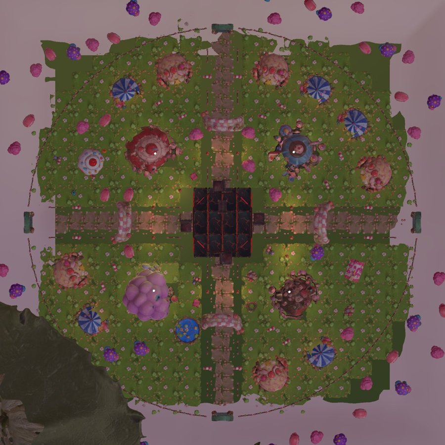

검증:
- 통행 검사 몸 5가지 모두 **깨끗**(갇힌 바닥 0 · 쿠키 전용 무리 0 · 목표 66곳 모두 쿠키·괴물 3 m 안).
- Play Mode: 쿠키 42/42 · 괴물 32/32 도착, 건물 안 수리 정상(빛기둥이 꽂는 자리에서 켜짐).
- 시험 `Request1019Tests` 8개(메시 충돌·빛기둥 시험 추가) 통과, 전체 312개 중 311개(남은 1개는 예전 놀이공원 맵), 빌드 성공.

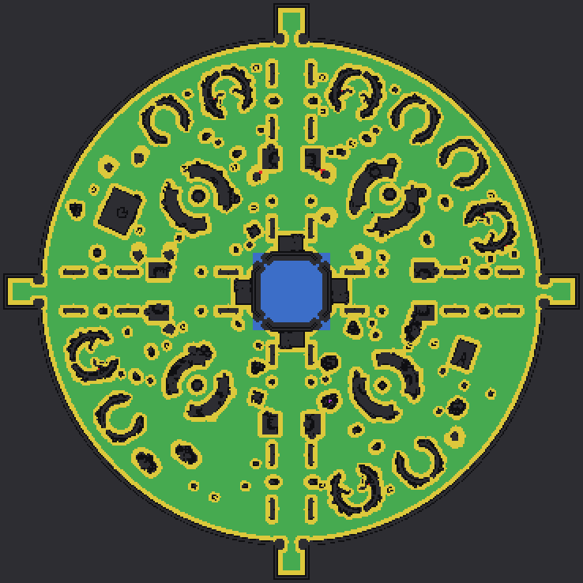
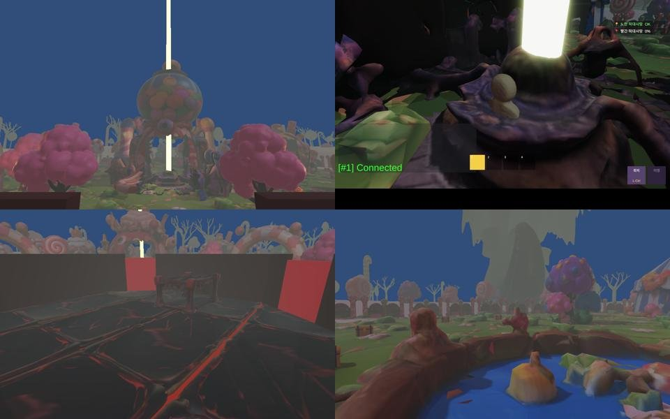

**10-21 추가(`탈출재료 빛 오브젝트.png`)**: 빛기둥이 받침대 옆(꽂는 자리 위)에 붙어 올라가 보였다 → 받침대 **한가운데** 바닥에서 시작해 받침대 속을 지나 꼭대기(돔)에서 솟고 지붕을 뚫게 옮김. 넣은 막대사탕·받침은 그대로 받침대 앞(쿠키 손 높이). 시험 `BuildingGlow_StartsAtSocket_AndClearsTheRoof`를 받침대 가운데 기준으로 바꿈(8/8 통과).

**10-21 추가 2(다른 건물 점검)**: 2·3·4번 건물도 빛기둥이 받침대 옆에 서 있었고, 4번은 받침대가 낮아 아예 못 찾고 있었다 → `cf_build.py`에 `find_pedestal`(방 가운데에서 가장 높은 칸부터 높이맵을 넓혀 가며 그 높이의 60% 이상인 칸만 받침대로 잡음)을 넣어 네 건물 받침대 중심·높이를 다시 구해 `COL_Pedestal`을 다시 내보냄(Q1 중심(0.49,0.05)·높이 3.79 / Q2 (0.05,-0.48)·2.34 / Q3 (0.11,1.59)·3.86 / Q4 (0.27,-0.57)·1.49, Blender 좌표). 공중에 떠 있던 꽂는 받침 원판(`Socket_Bld`)은 바닥에서 올라오는 기둥으로 바꿈. 통행 검사 5종 모두 막힘 없음(목표 66/66), `Request1019Tests` 8/8 통과.

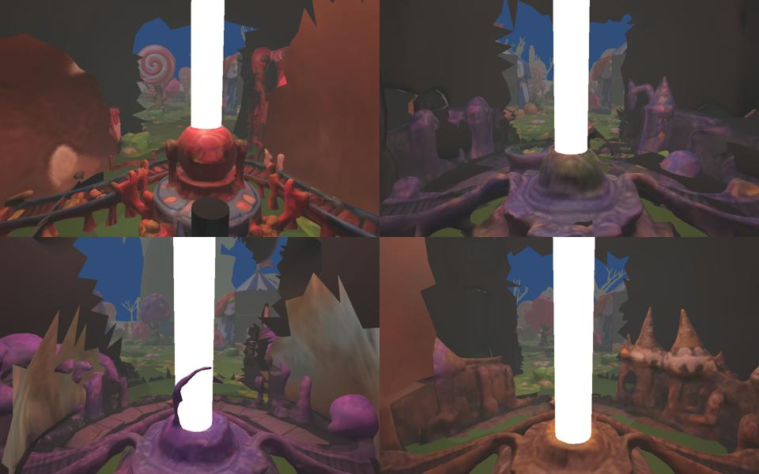

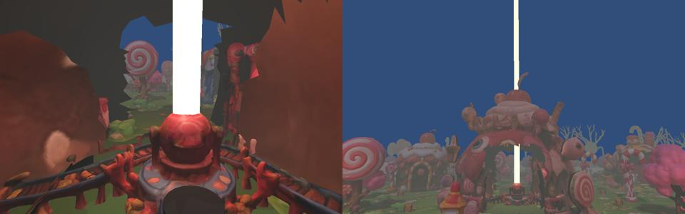


### 28.15 2026-10-21 후속 요청(2건)

1. **술래방에 쿠키·스파이가 어떻게든 들어갔을 때**(답: 1번 — 자동으로 밖으로 내보내기). 지금은 문이 쿠키에게 늘 벽이라 안에 갇히고, 용암 바닥도 겉모습뿐이다.
2. **흰 땅 어긋남**(`images/맵어긋남.png`): 탈출구 앞 흰 땅이 초록 바닥보다 높게 솟아 쿠키 다리가 묻혀 보인다. 원인 — 테스트 씬에서 가져온 옛 캔디숲 지형 고리(`Background/CAN_Terrain_Decor`, 충돌체 있음)가 울타리 안쪽 반지름 60~80 m까지 들어와 최대 1.45 m로 솟아 있다(울타리 밖은 반지름 90~130 m에서 5~7 m 언덕). 울타리 밖 숲(반지름 87~120 m)은 높이 0에 서 있어 언덕에 묻힌다.

**설계**
- E1 `MonsterRoomGuard`(술래방 루트에 붙음, 각 화면이 자기 캐릭터만): 내 캐릭터가 괴물이 아니고 살아 있고 들려 있지 않은데 술래방 **안쪽**(벽 안쪽 면·문 면 안)에 0.5초 넘게 있으면, 가장 가까운 술래방 문 바깥의 빈 자리(`EscapeManager.IsValidTeleport` — 맵 안·술래방 밖·끼지 않음)로 옮기고 되돌아오는 소리를 낸다. 방장 이동 속도 검사는 "술래방 안 → 바로 밖(10 m 안)" 이동을 예외로 둔다. 벽 안쪽 면은 맵 설정 도구가 `RoomWall_` 충돌체에서 재어 넣는다.
- E2 지형 고리를 이 맵에 맞게 다시 깐다(맵 만들기 도구가 원본에서 새 메시 `CF_TerrainRing`을 만든다): 울타리 안(반지름 80 m 안) 면은 지우고, 울타리 둘레~86 m는 바닥 높이로 평평하게(초록 타일이 그 위에 보임), 86~98 m에서 원래 언덕 높이로 부드럽게 올라간다. 탈출구 받침(울타리 밖 10 m)은 93 m까지 평평. 울타리 밖 숲·꾸미기는 그 자리 지형 높이에 세운다.
- E3 시험(편집 모드 + 통행 검사) · Play Mode 확인 · 문서.

**단계**
- [x] E1 술래방 안 쿠키 자동 내보내기
- [x] E2 흰 땅(옛 지형 고리) 다시 깔기 + 숲 높이 맞춤
- [x] E3 시험·Play Mode·문서

**결과(2026-10-21)**
- E1 `MonsterRoomGuard`(새 파일 `Assets/02. Scripts/Escape/MonsterRoomGuard.cs`): 술래방 루트에 붙는다(맵 설정 도구가 `RoomWall_`에서 벽 안쪽 면 11.7 m를 재어 넣음). 새 메뉴 `Tools/TagOfChaos/Escape/Setup Monster Room Guard (All Map Scenes)`로 맵 씬 5개(캔디숲·진저브레드·초콜릿 공장·저주받은 카니발·유령 베이커리)에 모두 붙였다. 방장 이동 속도 검사(`EscapeAuthority.TrackPositions`)는 `EscapeManager.IsRoomEjectMove`(방 안 → 문 바깥 8.5 m 안)를 예외로 둔다.
- E2 `CandyForestMapBuilder`: 옛 지형 고리를 원본에서 새 메시 `CF_TerrainRing`(Models)으로 다시 만든다 — 울타리 안 면 삭제, 반지름 86 m(탈출구 앞 93 m)까지 높이 0.015 m로 평평, 그 바깥 12 m에서 원래 언덕으로. 바닥판(220 m)은 흰 땅과 같은 재질, 울타리 안은 초록 원판 `CF_GrassDisc`(반지름 80.6 m). 울타리 밖 숲 64그루는 그 자리 언덕 높이에 세운다.
- 통행 검사(몸 5가지) 모두 CLEAN, 목표 66/66. 새 시험 `Request1021Tests` 3/3, 전체 EditMode 314/315(실패 1은 예전부터의 `MapCompactTests` CursedCandyCarnival 통행 검사).
- Play Mode(캔디숲, 오프라인): 술래방 가운데·제단 옆·동쪽 벽 옆에 옮긴 쿠키가 0.5초 안에 가장 가까운 문 바깥으로 나옴. 문 바깥·벽 바깥에 선 쿠키는 그대로. 이동 검사 경고·Console 오류/경고 없음. 탈출구 앞 땅 턱 없음.

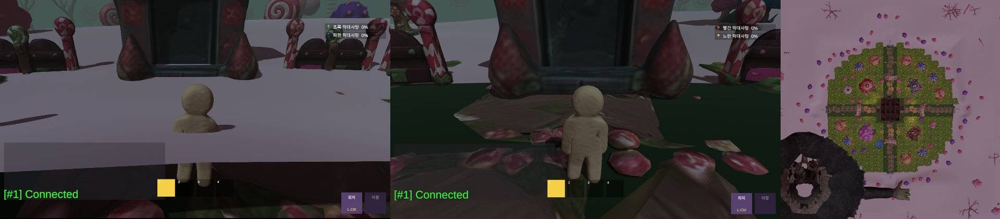

### 28.16 2026-10-21 바닥 타일·소품 뭉개짐(가공 방식 고치기)

사용자 사진(`images/3D땅 오브젝트 fbx.png` 원본 / `images/3D 땅 오브젝트 fbx 뭉게짐.png` 게임)과 비교 렌더(`images/r30_tile_compare.jpg`)로 본 원인 — 받은 FBX 문제가 아니라 `cf_build.py` 가공:
- 길 타일을 6×10 m에 맞추며 축마다 다른 배율(가로 21배·세로 19배)로 늘이고 두께 2.67 m → 0.3 m(약 9배 납작). 용암 2.0 → 0.3 m, 초록 바닥 높이 ×0.45.
- 면 수를 길 10,214 → 500(5%), 용암 6,176 → 500(8%), 초록 바닥 81,194 → 900(1%)으로 줄여 UV까지 뭉개져 틈 무늬가 큰 삼각형 위에서 번진다.
- 텍스처 공유(세트마다 2048 한 장)는 원인이 아니다(§ 답: 나눠도 픽셀은 같음 — 사용자 결정: 1번 가공 고치기부터).

재본 값(비율 유지): 길 5.49×10 m, 걷는 면 위 사탕 알 최대 1.14 m, 땅속 면 22% / 용암 5.9×10 m, 테두리 0.97 m / 초록 바닥 10×9 m, 덤불 최대 1.72 m, 땅속 면 40%.

**설계**
- 바닥 타일: 가로·세로·두께 같은 배율(원본 비율). 걷는 면을 바닥 충돌체 4 cm 위에 두고, 걷는 면 0.6 m 아래(땅속)는 잘라낸다. 걷는 면 위로 솟은 장식만 낮춘다(사탕 알·용암 테두리 ≤ 약 0.4 m, 덤불 ≤ 약 0.8 m — 충돌체 없는 높은 장식에 숨거나 통과하지 않게). 면 수 길 3000·용암 2500·풀 2500·초록 바닥 3500. 길 타일 간격 5.7 → 5.2 m(길이 5.49 m).
- 개수가 적은데 많이 줄였던 소품 면 수 올림: 가게 9000→20000, 버섯·링 울타리 3500→10000, 연못 4000→10000, 가로등 1500→원본(2888), 지팡이 사탕 2000→4500, 표지판·벤치 1500→4000, 아치·사탕 더미 3000→6000. 숲 나무·울타리 문·건물은 그대로.
- 전체 면 수 약 223만 → 약 300만 예상.

**단계**
- [x] T1 `cf_build.py` 바닥 타일·초록 바닥 가공 바꾸기 + 소품 면 수
- [x] T2 FBX 다시 내보내기 → 프리팹·맵 다시 만들기(길 간격) → 통행 검사
- [x] T3 비교 렌더·시험·Play Mode·문서

**결과(2026-10-21)**
- `cf_build.py`: 새 `ground_block`(한 배율·땅속 0.6 m 아래 잘라냄·걷는 면 위 장식만 낮춤). 길 5.48×10 m·면 3000(사탕 알은 타일 본체에 붙은 한 덩어리라 떼지 못해 1.14 → 0.6 m 젤리 모양), 용암 5.9×10 m·면 2500(테두리 0.97 → 0.4 m), 풀 2500, 초록 바닥 10×9 m·면 3500(덤불 1.77 → 0.8 m). 소품 10종 면 수 올림(위 설계대로). 맵: 길 간격 5.2 m, 용암 간격 5.8 m.
- 분석용 스크립트(Source~/Scripts): `cf_tilecompare.py`(원본/게임 비교 렌더), `cf_atlasprobe.py`(공용 텍스처 몫), `cf_tileprobe.py`(걷는 면·장식 높이), `cf_partprobe.py`(떨어진 조각).
- 전체 면 수 약 223만 → 약 312만(초록 바닥 80만 포함).
- 통행 검사(몸 5가지) 모두 CLEAN·목표 66/66, 위치표 경고 0. 전체 EditMode 314/315(실패 1은 예전부터의 `MapCompactTests` CursedCandyCarnival). Console 오류/경고 없음.
- Play Mode(캔디숲, 오프라인): 길·초록 바닥·탈출구 앞에서 쿠키가 바닥 높이 0.00에 섬(가라앉거나 뜨지 않음), 길 따라 걷기 도착. 틈 무늬·사탕 알·덤불이 살아남.

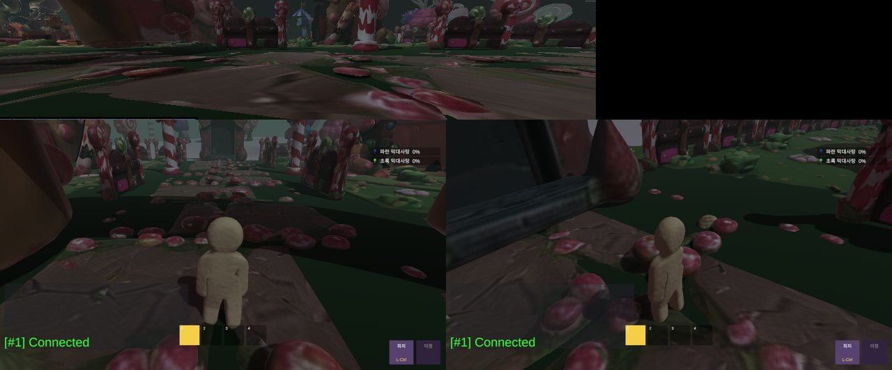

## 29. 2026-10-21 저주받은 놀이공원 회전목마 교체(받은 FBX 2개)

**요청**: `3DTagOfChaos\CursedCandyCarnival`의 FBX 두 개(회전목마의 목마·회전목마의 본체)를 Blender에서 조립해 `Game_CursedCandyCarnival` 씬의 `CUR_Carousel_Top` 대신 붙인다.

**지금**: `CUR_Carousel_Top`(지름 33.2 m·높이 18 m, 면 14,526) — `MapSceneBuilder.BuildAnimated`가 Animator(`Carousel_Top_Spin`, 40초에 −360°, 위에서 볼 때 반시계)·키네마틱 Rigidbody·볼록 MeshCollider를 붙인다. 바닥 `CUR_Carousel_Base`(지름 29.6 m·두께 0.47 m)는 그대로.

**받은 모델(원본 `Assets/Maps/CursedCandyCarnival/Source~/Carousel/Body`·`Horse`)**: 본체 = 3단 받침·가운데 기둥·기둥 16개(22.5° 간격)·줄무늬 지붕, 면 395,294, 텍스처 2048 4장. 목마 = 서 있는 유니콘 한 마리(머리 −Y), 면 633,232, 텍스처 4장.

**설계**
- Blender 스크립트 `Source~/Scripts/cur_carousel_build.py`: 본체를 지름 29.6 m(바닥 원판과 같은 지름, 원본 비율 — 높이 약 27.5 m)로, 목마는 기둥 사이 간격의 90% 길이로 한 배율. 목마 16마리를 기둥 16개에 꿰어(기둥이 몸통 가운데를 지남) 머리를 회전 방향(위에서 볼 때 반시계)으로, 높이를 번갈아 위아래로.
- 면 수: 본체 → 약 30,000, 목마 → 약 6,000 × 16. 바닥 타일에서 본 뭉개짐을 피하려고 **원본(고해상도)에서 텍스처를 새로 굽는다**(새 UV, 색 + 노멀, 본체 2048·목마 1024).
- 충돌: 단순 충돌 메시(본체를 줄인 것)를 Unity에서 볼록으로 — 지금처럼 들어갈 수 없는 단단한 놀이기구(숨을 곳 없음).
- Unity: 에디터 도구 `CarouselModelSwap` — `CUR_Carousel_Top`의 메시 겉모습을 끄고 새 모델을 자식으로 붙이고(돌기·Rigidbody·Animator는 그대로) 충돌 메시를 바꾼다. `MapSceneBuilder.BuildAnimated`에서도 불러 맵을 다시 만들어도 유지.

**단계**
- [x] K1 Blender 조립·텍스처 굽기·FBX 내보내기
- [x] K2 Unity 가져오기·재질·`CarouselModelSwap`·씬 적용
- [x] K3 시험·통행 검사·Play Mode(도는 방향·충돌)·문서

**결과(2026-10-21)**
- K1 `cur_carousel_build.py`(+ 살펴보기 `cur_carousel_probe.py`): 본체 배율 15.59(지름 29.6 m·높이 27.5 m), 받침 윗면 4.95 m·지붕 아래 14.98 m, 기둥 16개(반지름 11.66 m, 11.25°부터 22.5°마다). 목마 배율 2.11(길이 4.0 m·높이 3.4 m), 몸통이 기둥에 꿰이고 머리는 반시계 방향, 발이 받침 위 약 1.3 m에서 위아래 번갈아. 면 수 본체 30,000 + 목마 6,000×16 = 126,000(옛 14,526). 원본에서 새 UV로 색·노멀을 구움(본체·목마 각 2048). 충돌 `COL_Carousel` = 본체 바깥 점(높이 5단×24방향)의 볼록 껍질 110면(Unity 볼록 한도 256 안, 받침 바닥~꼭대기). 출력 `Assets/Maps/CursedCandyCarnival/Models/Carousel/`(FBX·PNG 4장·carousel.json), 재질 `M_CUR_CarouselBody`·`M_CUR_CarouselHorse`.
- K2 `Assets/Editor/Maps/CarouselModelSwap.cs`(메뉴 `Tools/TagOfChaos/Maps/Swap Carousel Model (Cursed Candy Carnival)`): `CUR_Carousel_Top`의 옛 MeshRenderer·MeshFilter를 지우고 `Model` 자식으로 새 모델, MeshCollider = `COL_Carousel`(볼록). Animator(`Carousel_Top_Spin`)·키네마틱 Rigidbody 그대로. `MapSceneBuilder.BuildAnimated`도 이 도구를 부름. 옛 바닥 원판 `CUR_Carousel_Base`는 새 받침 속에 들어감.
- 회전목마가 작아져(옛 지름 33.2 → 29.6 m) 옆 광대 간판·머리 없는 말과 사이에 괴물이 못 들어가는 좁은 틈이 생겨 → `TwistedPropPlacer`로 이 맵 소품만 다시 배치(같은 시드, 2.5 m 여유 규칙).
- 시험: `Request1021Tests.CarnivalCarousel_NewModelSpinsHorsesForward`(옛 메시 없음·돌기·볼록 충돌이 받침 바닥까지·목마 16마리 모두 진행 방향) 포함 4/4. 통행 검사 `MapCompactTests(CursedCandyCarnival)`은 교체 전과 같은 결과(예전부터의 (14, 69) 쿠키 전용 1곳만). 전체 EditMode 315/316(같은 실패 1).
- Play Mode(`Game_CursedCandyCarnival` 오프라인): yaw 232.6° → 176.4°(위에서 볼 때 반시계, 목마도 같이 돔), 쿠키가 반지름 17 m에서 걸어 들어가다 15.1 m에서 막힘. Console의 "missing script" 2건은 `EscapeSetup/ESC_CursedCandyCarnival_Root`의 예전 것(손대지 않은 `Game_HauntedBakery`·`Game_ChocolateFactory`에도 같은 GUID).
- 참고: 지금 판 맵 목록(`GameSettings.GameMapScenes`)은 `Test_CursedCandyCarnival`을 쓰고, 그 씬에는 회전목마 모델이 없다(조명·소리만).

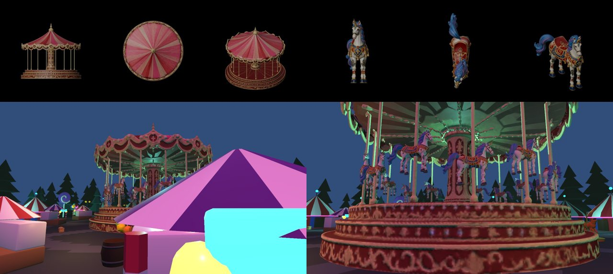

## 30. 2026-10-21 저주받은 놀이공원 롤러코스터 탈출구(받은 FBX: 입구·레일·지지대·Car)

**요청**: 루트의 `롤러코스터 3D 모델링.png`(빨간 트랙 + 보라 지지대 + 괴물 입 성 입구, 조립 예시)를 참고해 `3DTagOfChaos\CursedCandyCarnival`의 롤러코스터 입구·레일·지지대를 조립해 지금 롤러코스터의 탈출 용도 대신 쓴다. 입구는 뒤가 막혀 있으니 앞 계단처럼 뒤에도 계단을 만든다(Blender 재작업). 레일·지지대는 텍스처가 없으니 그림을 참고해 입힌다. 재료 끼우는 곳은 임시로(나중에 캔디숲처럼 1~4사분면 재료 + 탈출구 4개 중 2개로 바꿀 예정 — 지금은 정상 작동 확인). Car는 레일에 붙여 자연스럽게 움직이게 할 계획만 세운다.

**지금(`Game_CursedCandyCarnival`)**: 북쪽 큰길 끝 (7.7, 67.5)의 예전 롤러코스터 탈출 장치 `EscapeSetup/ESC_CursedCandyCarnival_Root`(역 건물·열차 3칸·맵 밖으로 가는 경로 점 44개)는 예전 방식(`Legacy~/CoasterSequence`) — 스크립트가 없어 동작하지 않는다(missing script 2). 현재 방식 `EscapeManager`는 있지만 재료 건물 0·탈출구 0이라 탈출구로 나갈 수 없다. 상자 20·스파이 로켓·마녀는 있다.

**받은 모델(원본 `Assets/Maps/CursedCandyCarnival/Source~/Coaster/`)**
- 입구(Entrance): 괴물 입 성, 면 578,774, 텍스처 4장. 앞(−Y) 계단이 입 안 통로 바닥까지, 통로는 뒤쪽 얇은 벽까지 이어지지만 폭 0.2·높이 0.28(원본 단위)로 좁고 뒤는 막힘.
- 레일(Track): 8자 고리 트랙, 면 71,614, UV·재질 없음, 1.89 × 0.29 × 0.78.
- 지지대(Support, 다시 받음): 비계 묶음 7덩어리(기둥·가로대), 면 199,066, UV·재질 없음, 1.9 × 1.6 × 1.11 — 레일(앞뒤 폭 0.29)과 바닥 모양이 맞지 않아 그대로 겹치면 레일 밑에 오지 않는다.
- Car: 머리(용 입) + 좌석 차량 줄 2편성, 면 89,298, 텍스처 4장.

**설계**
- Blender `Source~/Scripts/cur_coaster_build.py`:
  - 입구: 한 배율 9.0(높이 약 16.7 m), 원본에서 색·노멀을 새 UV로 굽고(§29와 같은 방법) 면 약 60,000. 통로 바닥 높이에 폭 3 m·높이 3 m 통로를 뒤까지 뚫고(안쪽 면은 어두운 재질), 앞 계단(난간 포함)을 앞뒤로 뒤집어 뒤쪽 출구 아래에 붙인다.
  - 레일: 길이 48 m(한 배율), 가장 낮은 곳 1.5 m 위. 빨간 플라스틱 재질 + 그늘(AO) 굽기.
  - 지지대: 받은 지지대 모델의 따로 떨어진 기둥 한 개(받침판·마디)를 잘라 레일 밑 일정 간격마다 땅~레일 높이로 세움(받침판·마디는 그대로, 몸통만 늘림) + 기둥 사이 가로대. 보라 재질 + AO.
- Unity 에디터 도구 `CoasterExitBuilder`: 예전 장치 삭제, 입구를 북쪽 큰길 끝(앞이 맵 가운데)에, 트랙은 그 뒤(맵 가장자리 밖 배경), `Exit_N`(입 안 내려가는 창살 문 `Door_N`·뒤 계단 아래 `ExitTrigger_N`·열리면 켜지는 초록 표시) + 걷는 충돌(계단 경사판·통로 바닥·건물 덩어리). 임시 재료 꽂는 곳 `Building_Q1~Q4`(받침·`Repair_Point`·`Socket_`·`ESC_Glow`)를 입구 앞 광장에. `EscapeManager`의 건물·탈출구 연결(상자·로켓·마녀는 그대로).

**단계**
- [x] R1 Blender 입구 재작업(통로·뒤 계단)·레일·지지대 조립·재질·내보내기
- [x] R2 Unity 가져오기·씬 적용(예전 장치 삭제·탈출구·임시 재료 받침·연결)
- [x] R3 시험·통행 검사·Play Mode(재료 넣기 → 탈출구 열림 → 통로·뒤 계단으로 탈출)
- [x] R4 Car를 레일에 붙여 움직이는 계획(코드 근거)

### 30.1 결과(2026-10-21) — R1~R3

- **R1 Blender** `Source~/Scripts/cur_coaster_build.py`(+ 살펴보기 `cur_coaster_probe.py`·`cur_entrance_probe.py`), 출력 `Assets/Maps/CursedCandyCarnival/Models/Coaster/`:
  - 입구 `CUR_CoasterEntrance.fbx`: 배율 9.0(15.2 × 15.2 × 16.7 m), 원본(578,774면)에서 새 UV로 색·노멀 구움(2048), 면 64,276. 통로 바닥 3.97 m, **통로 폭 4.4 m·높이 4.2 m**를 입에서 뒤 벽(7.15 m)까지 뚫음(안쪽은 어두운 재질). 앞 계단(난간 포함, 7,808면)을 뒤집어 뒤 출구 아래에 붙임 — 앞 계단 끝 −7.58 m, 뒤 계단 끝 +13.5 m(입구 중심 기준).
  - 트랙 `CUR_CoasterTrack.fbx`: 레일 길이 48 m(배율 25.4, 7.3 × 19.8 m, 바닥 1.5 m 위, 71,614면, 빨강). 지지대는 받은 지지대 모델의 따로 선 기둥 한 개(받침판·마디)로 레일 밑 21곳에 땅~레일 높이로 세움(몸통만 늘림) + 가로대 48개(보라, 64,428면). 레일·지지대 모두 그늘(AO) 1024 구움. 받은 지지대 묶음(1.9 × 1.6)은 레일 폭(0.29)과 맞지 않아 기둥 모양만 썼다.
- **R2 Unity** `Assets/Editor/Maps/CoasterExitBuilder.cs`(메뉴 `Tools/TagOfChaos/Maps/Build Coaster Exit (Cursed Candy Carnival)`, 여러 번 실행해도 같은 결과):
  - 예전 장치 `ESC_CursedCandyCarnival_Root`(missing script 2) 삭제. 입구를 (0, 0, 55)에 앞(계단)이 맵 가운데로, 트랙을 맵 경계 밖 z 76에.
  - 입구 자리에 걸리는 장식 텐트 `CUR_CircusTent_Small_06`·`_09` 삭제, 계단 앞 상자 `CHEST_Slot_05`는 (1, 41)로.
  - 탈출구 `Exit_N`: **앞 계단 아래 창살 문 `Door_N`**(폭 6 m·높이 3.6 m — 닫혀 있으면 계단에 못 오름, 열리면 땅속으로), 계단 양옆 난간 벽, `ExitTrigger_N` = 뒤 계단 아래(z 69.7), 열리면 통로 양옆 초록 빛줄 + 초록 빛(`ExitOpenLook_N`). 건물 뒤 마당은 양옆 쇠창살 울타리(맵 경계벽까지)로 막아 통로로만 간다.
  - 걷는 충돌: 계단 = 속이 찬 볼록 쐐기(계단 밑에 숨지 못함), 통로 바닥·지붕, 건물 양쪽 덩어리.
  - **임시 재료 꽂는 곳** `Map/TempSockets/Building_Q1~Q4`(받침·`Repair_Point`·`Socket_`·`ESC_Glow`) — 입구 앞 빈 자리 (−9, 46)·(7, 38)·(9, 48)·(−6, 35), 출발 자리·계단 앞길은 비움. `EscapeManager`에 건물 4·탈출구 1 연결(상자·로켓·마녀 그대로). 탈출구가 1개라 다 가동되면 그것이 열린다(`OpenExits`가 `Min(4, 탈출구 수)` 중 2개).
  - 통행 검사: 탈출 구역 표시 `ExitZone_N`(충돌체 없이 위치·크기만) 안은 쿠키 전용으로 따지지 않게 `MapPassabilityCheck`에 더함 — 괴물 몸(바닥 위 1.95 m의 반지름 1.8 m 구)은 32° 계단에 닿아 못 오르므로, 문을 계단 아래에 두어 닫혀 있을 때 아무도 들어가지 못하게 하고, 열린 뒤에는 캔디숲 울타리 밖 받침처럼 쿠키가 나가는 길로 본다.
- **R3 확인**
  - 전체 EditMode **317/317 통과**(예전부터 실패하던 `MapCompactTests` CursedCandyCarnival 포함). 시험 `Request1021Tests.CarnivalCoasterExit_WiredForEscape` 포함 5/5. `MapCompactTests` 25/25 — 저주받은 놀이공원 통행 검사가 이번에 처음 통과(예전 롤러코스터 역 옆 (14, 69) 쿠키 전용 구역이 장치 삭제로 사라짐).
  - Play Mode(`Game_CursedCandyCarnival` 오프라인, 쿠키 1명): 닫힌 문 앞에서 막힘 (0, 0, 46.4), 계단 옆으로는 땅 높이에서 건물 앞면에 막힘 (4.5, 0, 52.1) → 켜진 임시 받침 2개(Battery·Toolbox)에 재료를 들고 E 길게 → "All buildings running: exits 1 open", 문 −6.6 m로 내려감·충돌 꺼짐·초록 표시 켜짐 → 앞 계단·통로·뒤 계단을 걸어 "Actor 1 escaped through exit 0", 판 끝(AllResolved). Console 오류·경고 0.

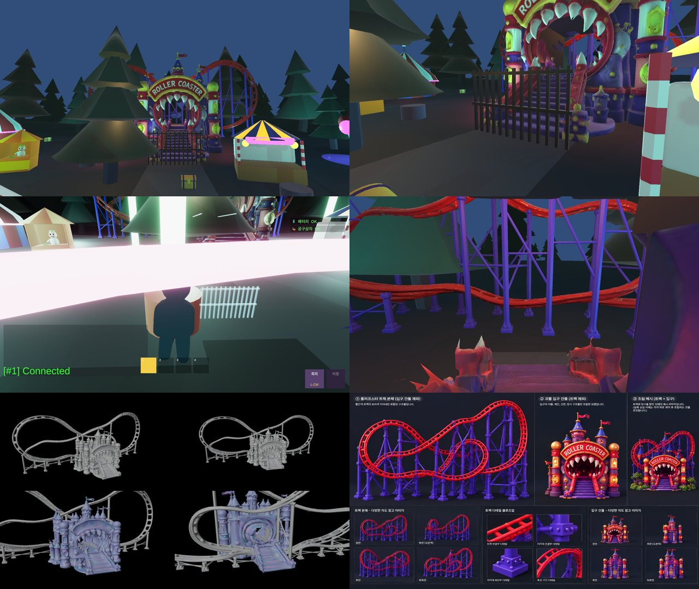

### 30.2 R4 계획 — Car(용 열차)를 레일에 붙여 자연스럽게 움직이기

**받은 Car**(`Source~/Coaster/Car/Car.fbx`): 한 덩어리 면 89,298, 1.90 × 0.21 × 0.31(원본 단위) — 앞에서 보면 용 머리 차 + 좌석 차 6칸이 두 줄(서로 반대를 보는 두 편성), 텍스처 4장.

**지금 코드에서 쓸 수 있는 것 / 없는 것**
- 예전 `Legacy~/Sequences/CoasterSequence`: 이름 붙인 경로 점(`Path_nn`) 사이를 **직선으로** 잇고 `0.5·a·t²`로만 가속, 차 방향은 `LookRotation(구간 방향, Vector3.up)` — 곡선·고리에서 꺾이고(점마다 방향이 튐), 기울기(뱅크)·뒤집힘(고리)이 없고, 칸마다 한 점이라 긴 칸이 레일을 벗어난다. 지금 판 규칙(§25)에서는 쓰지 않는다(Legacy~).
- 공통 시계: `WitchTimeline`처럼 `PhotonNetwork.Time` + 방 속성만으로 모든 화면이 같은 위치를 계산(늦게 들어온 사람·방장 교체에도 맞음) — 열차도 이 방식이면 네트워크 메시지가 필요 없다.
- 도는 물체: 회전목마·관람차는 `MapSceneBuilder.AttachLoopAnimator`(Animator 클립, 충돌체가 있으면 키네마틱 Rigidbody + 물리 스텝 갱신). 열차는 경로가 곡선이라 클립보다 스크립트가 맞다.
- 소리: `SoundId.CoasterStartup/CoasterDepart/CoasterLapBar/CoasterSparks/CoasterBulbOn`(710~714)이 있고, 움직이는 물체에 붙이는 `GameAudio.PlayOn(id, transform)`, 가까울 때만 반복음을 켜는 `AmbientEmitter`(회전목마 `AMB_Carousel`)가 있다. 달리는 소리·오르막 체인 소리는 새로 필요.
- **레일에는 경로 데이터가 없다**(한 덩어리 메시, UV·재질 없음) — 가운데 선을 메시에서 뽑아야 한다.

**설계**
1. **Blender: 레일 가운데 선 뽑기**(`cur_coaster_build.py`에 단계 추가 → `coaster_path.json`, Unity 축)
   - 레일 메시 꼭짓점을 0.4 m 격자로 묶어 무게중심 점들을 만들고, 가장 가까운 점을 차례로 이어 닫힌 고리 순서를 정한다(8자 교차는 높이가 달라 3D 거리로 구분). 순서가 끊기거나(이웃 거리 > 2 m) 되돌아가면 실패로 멈춘다.
   - 점마다 **위쪽 방향(up)** = 두 레일을 잇는 방향 × 진행 방향(레일 단면에서 양쪽 레일 꼭짓점을 찾아 계산) — 고리·기울어진 곡선에서 차가 레일 면을 따라 눕는다.
   - Catmull-Rom(centripetal)으로 매끄럽게 하고 0.5 m 간격으로 다시 뽑아 저장(점·up·누적 길이). 레일 두 줄 간격(궤간)도 잰다.
2. **Blender: 열차 나누기·굽기**(`cur_coaster_car_build.py`)
   - 한 덩어리 Car를 x 방향 빈틈으로 칸마다 자른다(머리 1 + 좌석 6 × 2편성 → 쓰는 것은 1편성, 나머지는 두 번째 열차 후보). 칸마다 원점을 바퀴 가운데 바닥으로.
   - 배율: 차 폭 = 궤간 + 0.4 m. 칸마다 면 약 3,000으로 줄이고 원본에서 색·노멀을 구움(§29 방식, 1편성이 한 텍스처 2048 공유).
3. **Unity 실행 코드**(`Assets/02. Scripts/Map/` 새 파일 3개, OOP·할당 없음)
   - `CoasterTrack`(MonoBehaviour, 데이터만): 점·up·누적 길이 배열. `Sample(s, out pos, out forward, out up)` — 길이 s를 이분 탐색으로 구간 찾고 Hermite 보간, up은 두 점 사이 Slerp 후 forward에 직교화. 닫힌 고리라 s는 전체 길이로 나머지.
   - `CoasterTrain`: 칸 목록(머리부터), 칸마다 **앞·뒤 바퀴 두 점**을 레일 위에 놓고 칸 방향 = (앞 바퀴 − 뒤 바퀴), up은 두 바퀴 up의 평균 → 곡선·고리에서도 칸이 레일 위에 딱 맞고 칸 사이가 자연스럽게 꺾인다. 칸 간격은 레일 길이로 고정.
   - 속도(자연스러움의 핵심): 에디터에서 미리 **시간표 t(s)** 를 만든다 — 오르막 체인 구간(경사가 큰 첫 오르막)은 일정 속도 2.5 m/s, 그 뒤는 에너지 보존 v = √(v₀² + 2g(h₀ − h(s))) − 마찰(구름 저항 0.015·g·거리 + 공기 저항 ∝ v²)로 내려가며 빨라지고 올라가며 느려짐, 최저 속도 아래로 떨어지면 체인으로 끌어올림, 한 바퀴 끝에 역(입구 뒤)에서 감속·정차 몇 초. 실행 중에는 `PhotonNetwork.Time`(방 속성 기준 시각부터)을 한 바퀴 시간으로 나눈 나머지로 s(t)를 표에서 찾기만 한다(모든 화면 같음, 프레임 비용 거의 0).
   - 연출 연결(나중에 정함 — 두 방식 모두 가능): ① 판 내내 도는 배경 놀이기구, ② 역에 서 있다가 탈출구가 열리면(`EscapeState.ExitsOpenedAt`) 출발 — 예전 연출(전구 켜짐·시동 떨림·불꽃·안전바)을 새 차에 옮김.
   - 소리: 앞 칸에 `GameAudio.PlayOn`으로 달리는 소리 반복(속도에 따라 음높이·크기), 체인 오르막 "딸각딸각", 내리막 바람 — 새 `SoundId` 2~3개 + `AudioCatalogBuilder` 등록, 멀면 끄기(`AmbientEmitter` 방식).
   - 물리: 트랙은 맵 경계 밖이라 쿠키·괴물이 닿지 않는다 → 차에 충돌체를 두지 않는다(트랙이 맵 안으로 들어오게 바꾸면 회전목마처럼 키네마틱 Rigidbody + 볼록 충돌체).
4. **에디터 도구**: `CoasterExitBuilder`에 열차 배치 단계 추가(`coaster_path.json`을 `CoasterTrack`에 굽고, 칸 프리팹을 `CoasterTrain` 아래에).
5. **시험**: EditMode — 경로가 닫혀 있고 이웃 간격 ≤ 0.6 m, `Sample` 연속(작은 s 변화에 위치 변화 작음), 시간표 단조 증가·한 바퀴 시간 > 0, 칸의 두 바퀴가 레일 가운데 선에서 0.05 m 안. Play Mode — 같은 `PhotonNetwork.Time`에서 두 번 계산해 같은 자리, 10초 동안 차 위치가 레일 메시에서 0.3 m 안, 고리에서 up이 뒤집힘, 프레임 시간 확인.

**정할 것(사용자)**: 열차를 판 내내 돌릴지(①) / 탈출구가 열릴 때 출발할지(②), 1편성(머리 + 6칸)만 쓸지 2편성 모두 쓸지, 쿠키가 타는 연출이 필요한지.

## 31. 2026-10-21 Test 씬에 롤러코스터(움직이는 놀이기구)·회전목마 넣기

**요청**: 앞으로 시험은 `Test_CursedCandyCarnival`에서만 하므로 롤러코스터와 회전목마를 그 씬에 넣는다. 롤러코스터는 탈출구가 아니라 **회전목마처럼 움직이는 일반 오브젝트** — 열차 2편성이 판 내내 돈다. 탈출은 캔디숲과 같은 사분면 재료 + 탈출구 4개 중 2개 방식 그대로. 롤러코스터의 모델·열차 2편성·소리·충돌을 구현한다. 자리는 **맵 안**(걸리는 상자·장식·표시는 가까운 빈 곳으로). `Game_CursedCandyCarnival`의 §30 탈출구 연결·안 쓰게 된 메서드·오브젝트 정리는 나중에 한다(지금은 손대지 않음).

**지금(`Test_CursedCandyCarnival`)**: 140 × 140 m 네모 맵(벽 ±70, 각 벽 가운데 탈출구 4), 가운데 술래방(±12.3), 사분면 건물 4곳 (±41, ±41)(15 m), 축 따라 칸막이 공, 사분면 장식 공 4개씩, 상자 40개(격자), 표시(무지개·로켓·쿠키 출발). 회전목마는 조명 `LGT_Carousel_Top`과 소리 `AMB_Carousel`(0, 4, 0)만 있고 모델이 없다.

**배치(맵 안)**
- 롤러코스터 = 남서(Q3) 구석: 트랙(길이 48 m·높이 21 m·폭 7.3 m의 세로 8자 고리)을 **서쪽 벽 띠**(x −64~−56, z −66~−18)에 세로로, 입구(괴물 입 성)를 **남쪽 띠**(z 약 −61)에 앞(계단)이 동쪽을 보게 — 통로를 지나 뒤 계단으로 내려가면 트랙 울타리 앞. 트랙 둘레는 쇠창살 울타리(벽까지)로 막아 달리는 열차·낮은 레일 밑에 들어가거나 숨지 못하게 한다.
- 회전목마 = 북동(Q2) 건물과 북쪽 칸막이 사이 (17.5, 45) 근처, 배율 0.65(지름 약 19 m·높이 18 m). 기존 회전(Animator `Carousel_Top_Spin`, 40초에 한 바퀴)·키네마틱 Rigidbody·볼록 충돌 그대로, `AMB_Carousel`·`LGT_Carousel_Top`을 그 자리로.
- 걸리는 상자·장식 공·무지개/로켓/쿠키 출발 표시는 가까운 빈 곳으로 옮긴다(술래·쿠키 출발 자리는 비움). 통행 검사(`MapPassabilityCheck`, 몸 5가지)로 쿠키 전용 틈이 없는지 확인.

**설계**
1. **레일 가운데 선**(에디터 `CoasterPathBaker`): 가져온 `CUR_CoasterTrack.fbx`의 레일 메시(Unity 축)에서 — 가장 낮은 점에서 시작해 반지름 1.5 m 안 꼭짓점의 주성분으로 진행 방향·레일 면 법선(위쪽)을 구하고, 0.5 m씩 나아가며 진행 방향에 수직인 얇은 판 안 꼭짓점 무게중심으로 가운데를 맞춘다(8자 교차는 이전 법선 기준 판 두께로 다른 줄을 거름) → 처음 자리로 돌아오면 닫힌 고리. 위쪽 방향은 앞 점과 같은 쪽으로 이어(고리 꼭대기에서 뒤집힘), 궤간을 잰다. 결과를 SO `Assets/03. SO/Maps/CUR_CoasterPath.asset`(`CoasterPathSO`: 점·위쪽·누적 길이·속도표)에 굽는다.
2. **속도표**(같은 도구): 가장 높은 점에서 체인 속도 2.5 m/s로 출발 → 에너지 보존 v² = v₀² + 2g(h₀ − h) − 마찰(구름 0.015·g·거리 + 공기 ∝ v²), 최저 속도(2.5 m/s) 아래면 체인/부스터가 끌어올림 → 한 바퀴 시간 T와 t(s) 표. 두 번째 편성은 T/2 늦게 — 두 열차 사이 최소 간격이 열차 길이 + 여유보다 큰지 확인.
3. **열차 모델**(Blender `Source~/Scripts/cur_coaster_car_build.py`): 받은 Car(한 덩어리)를 칸마다 빈틈으로 자르고 원점을 바퀴 가운데 바닥으로, 레일 폭에 맞춘 배율로 `Models/Coaster/CUR_CoasterTrain.fbx`(원래 UV·텍스처 그대로 — 면 수를 줄이지 않으므로 다시 굽지 않음). ※ 받은 Car는 **1편성(머리 + 좌석 6칸)** 이었다(§30.2에서 2편성으로 본 것은 앞·뒤 렌더를 나란히 붙인 그림을 잘못 읽은 것) → 2편성은 같은 모델을 두 번 쓴다.
4. **실행 코드**(`Assets/02. Scripts/Map/`): `CoasterPathSO.Sample(s, out pos, out fwd, out up)`(이분 탐색 + Hermite, 위쪽 Slerp 후 직교화), `CoasterTrain`(칸마다 앞·뒤 바퀴 두 점을 레일 위에 놓아 칸 방향·기울기, 키네마틱 Rigidbody `MovePosition/MoveRotation`), `CoasterRide`(편성 2개·공통 시계 `PhotonNetwork.Time`(방 밖이면 `Time.timeAsDouble`)를 T로 나눈 나머지 → 모든 화면이 같은 위치, 네트워크 메시지 없음).
5. **소리**: 새 `SoundId` — 달리는 소리(반복, 속도에 따라 크기·음높이), 체인 오르막 딸각(반복, 체인 구간에서만), 내리막 바람/비명(속도 클 때). 열차 앞 칸에 `GameAudio.StartLoop` + `SetLoopFade`, 멀면 끔(`AmbientEmitter`처럼 거리 기준). `AudioCatalogBuilder` 등록 + 시험음 합성.
6. **충돌**: 레일·지지대 = 고정 MeshCollider(볼록 아님), 입구 = §30처럼 걷는 충돌(계단 경사·통로 바닥·건물 덩어리 — 회전한 자리에 맞춰 입구 기준 로컬로), 칸 = 키네마틱 Rigidbody + BoxCollider, 트랙 둘레 울타리.
7. **에디터 도구** `CarnivalRidesBuilder`(메뉴, 여러 번 실행해도 같은 결과): Test 씬에 롤러코스터(입구·트랙·열차·울타리·소리)와 회전목마를 놓고 걸리는 것들을 옮긴다.

**단계**
- [x] Q1 레일 가운데 선·위쪽·궤간 뽑기 + 속도표 → `CoasterPathSO`
- [x] Q2 Blender 열차 나누기·배율·내보내기
- [x] Q3 실행 코드(`CoasterPathSO`·`CoasterTrain`·`CoasterRide`) + 소리(SoundId·카탈로그·시험음)
- [x] Q4 `CarnivalRidesBuilder` — Test 씬 배치(롤러코스터·회전목마·충돌·울타리·옮기기)
- [x] Q5 시험(EditMode·통행 검사)·Play Mode(두 열차가 레일 위·겹치지 않음·소리·충돌·회전목마 돎)·문서

### 31.1 결과(2026-10-21) — Q1~Q5

- **Q1 레일 가운데 선** `Assets/Editor/Maps/CoasterPathBaker.cs`(메뉴 `Tools/TagOfChaos/Maps/Bake Coaster Path (Cursed Candy Carnival)`) → `Assets/03. SO/Maps/CUR_CoasterPath.asset`(`CoasterPathSO`).
  - 받은 레일은 8자 하나가 아니라 **두 고리(A·B)가 아래쪽 한 구간을 같이 쓰는 θ 모양**(왼쪽 아래에서 합류, 오른쪽 아래에서 분기)이었다. 그래서 경로를 공용 구간 → A 고리 → 공용 구간 → B 고리로 번갈아 이었다 — 한 바퀴 **188.6 m**에 레일 전체를 지난다(레일 꼭짓점이 경로에서 1.8 m 넘게 떨어진 것 0개).
  - 따라가기: 0.5 m씩 나아가며 진행 방향에 수직인 얇은 상자(폭 2.8 · 두께 1.2 · 길이 0.5 m) 안 꼭짓점의 무게중심 → 가운데, 그 단면의 짧은 축 → 레일 면 법선(위쪽). 처음엔 넓은 공으로 찾아 8자 교차에서 다른 줄로 넘어갔다(108 m만 따라감). 메시 연결(측지 거리)도 교차에서 이어져 있어 쓸 수 없었다. 이음매 꺾임은 라플라스 다듬기 30번.
  - 레일 단면 폭 1.83 m, 가운데 선에서 윗면까지 0.40 m. 고리 꼭대기는 뒤집힘(위쪽 y −1).
  - 속도표: 가장 높은 곳(20.4 m)에서 출발, 에너지 보존 − 구름 저항 0.015·g − 공기 저항. 뒤집힌 고리 꼭대기 두 곳(각 약 9 m)은 부스터가 8 m/s를 지킨다. **한 바퀴 13.7초, 최고 19.9 m/s**.
  - 두 번째 편성: 반 바퀴 차이면 공용 구간에서 두 열차가 겹친다(최소 0.1 m). 한 바퀴 동안 두 열차 사이 최소 거리가 가장 큰 차이를 찾아 **0.8바퀴 앞(= 0.2바퀴 뒤), 최소 4.5 m**.
- **Q2 열차** `cur_coaster_car_build.py`(+ 살펴보기 `cur_car_probe.py`): 머리(용) 4.7 m + 좌석 칸 6개(2.5~3.1 m), 폭 1.8 m, 열차 길이 20 m(배율 10.5). 칸마다 바퀴 가운데 바닥이 원점, 머리가 +Z. `CUR_CoasterTrain.fbx`(Car_0~6, 89,298면 그대로)·`CoasterTrain_albedo/normal/metal.png`(금속·거칠기 → Unity Standard 금속 맵)·`coaster_train.json`(칸 사이 거리·바퀴 간격).
- **Q3 실행 코드**(`Assets/02. Scripts/Environment/`)
  - `CoasterPathSO`: `Sample`(이분 탐색 + Hermite, 위쪽 Slerp 후 직교화)·`DistanceAtTime`·`SpeedAt`·`IsChainAt`.
  - `CoasterRide`(트랙 루트): 공통 시계 = `PhotonNetwork.Time`(방 밖이면 `Time.timeAsDouble`), 화면 시계는 프레임 시간으로 흐르며 차이를 천천히 따라잡음(0.5초 넘으면 바로 맞춤) — 네트워크 메시지 없이 모든 화면이 같은 자리. 물리 스텝마다 두 편성을 놓는다.
  - `CoasterTrain`: 칸마다 앞·뒤 바퀴 두 점을 레일 윗면에 놓아 칸 방향·기울기를 정하고 키네마틱 Rigidbody `MovePosition/MoveRotation`(보간).
  - `CoasterTrainAudio`: 머리 칸을 따라가는 반복음 — `CoasterRoll`(715, 속도에 따라 25~100%)·`CoasterChain`(716, 부스터 구간에서만)과 15 m/s를 넘는 순간 `CoasterWhoosh`(717). 듣는 위치가 가까울 때만 켬(`AmbientEmitter.ShouldPlay`). 시험음 3개 합성(`audio/synth_coaster.py` → `Assets/10. Audio/SFX/Device/`), 카탈로그 등록(`AudioCatalogBuilder`: 거리 6~45·4~30·5~40 m).
- **Q4 배치** `Assets/Editor/Maps/CarnivalRidesBuilder.cs`(메뉴 `Tools/TagOfChaos/Maps/Build Carnival Rides (Test Cursed Candy Carnival)`, 여러 번 실행해도 같은 결과) → `Test_CursedCandyCarnival`의 `Map/Rides`:
  - 롤러코스터(남서 Q3 구석): 트랙을 서쪽 벽 띠(중심 (−62, −42.5), 90° 돌림)에, 레일·지지대 = 고정 MeshCollider, 열차 2편성 × 7칸(칸마다 키네마틱 Rigidbody + BoxCollider). 트랙 둘레 쇠창살 울타리(동쪽 x −56.6·북쪽 z −16, 높이 3.6 m — 나머지 두 변은 맵 벽).
  - 입구(괴물 입 성): 남쪽 벽에 붙여 (−38, −61.9), 앞(계단)이 동쪽. 탈출구가 아닌 장식이라 앞·뒤 계단 아래 창살 문은 늘 닫힘(괴물이 32° 계단을 못 올라 통로 위가 쿠키만의 피난처가 되지 않게), 건물 덩어리·계단 밑 쐐기·계단 옆 난간 벽.
  - 회전목마(북동 Q2, (17.5, 45), 배율 0.65 = 지름 19 m·높이 18 m): `CarouselModelSwap` + 기존 Animator 컨트롤러 `Carousel_Top_Spin`(40초 한 바퀴, Fixed 갱신)·키네마틱 Rigidbody·볼록 충돌. `AMB_Carousel`·`LGT_Carousel_Top`을 그 자리로.
  - 옮긴 것(같은 사분면 안, 놀이기구·사분면 건물·다른 장애물에서 괴물이 지나갈 4 m 이상, 출발 자리·술래방 둘레 비움): 상자 8개(Slot 11·12·24~29), 장식 기둥 2개(Q3 34_56·56_30), 무지개 상자 자리 1, 로켓 자리 2, 쿠키 출발 Q3.
  - `CarouselModelSwap.Apply`는 MeshCollider가 없는 `CUR_Carousel_Top`에서 멈춘다(`?? AddComponent`가 Unity의 가짜 null을 거르지 못함) — 이 도구에서는 미리 붙여 피했다(그 파일은 고치지 않음).
- **Q5 확인**
  - EditMode 전체 **319/319 통과**. 새 시험 `Request1021Tests.CoasterPath_ClosedSmoothAndTimed`(닫힌 고리·간격 < 0.6 m·위쪽 직교·뒤집힘·시간표 늘어남·한 바퀴마다 되풀이)·`TestCarnivalRides_CoasterAndCarousel`(2편성 × 7칸·충돌·울타리·문, 한 바퀴 120번 놓아 두 열차 최소 거리 > 3 m·칸이 레일 윗면 0.6 m 안, 회전목마 회전·소리 자리, 상자·표시가 놀이기구 자리에 없음).
  - 통행 검사(몸 5가지, 결과 `Temp/TestCarnival_Passability.txt`): 주머니 0, 목표 66곳 모두 쿠키·괴물이 닿음, 출발 자리 연결. 쿠키 전용 칸은 네 사분면에 똑같이(537칸씩) 나오는 맵 벽 바깥 띠뿐 — 놀이기구 둘레에는 없다.
  - Play Mode(`Test_CursedCandyCarnival` 오프라인): 두 열차가 레일을 따라 8~20 m/s로 돌고 고리 꼭대기에서 뒤집혀 지나감, 회전목마 돎(yaw 134° → 93°, 위에서 볼 때 반시계). 트랙 옆(14~26 m)에서 두 열차의 달리는 소리가 켜지고 멀리(70~90 m)서는 꺼짐. 쿠키가 걸어 들어가다 울타리(x −56.0, z −15.4)·입구 앞 문(x −29.4)·회전목마 가장자리(z 55.1)에서 막힘. Console 오류 0(경고는 시험 순간이동에 대한 NetGuard 2건).
  - `Game_CursedCandyCarnival`의 §30 탈출구 연결은 그대로 두었다(나중에 정리).

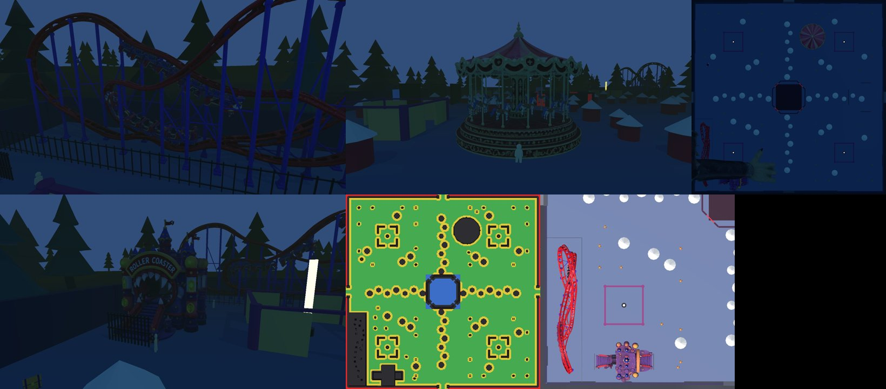

## 32. 2026-10-21 캔디숲 재료방 멀리·맵 확장·술래방 문 12·3·6·9시

**요청**: 캔디숲(`CandyForest` 씬)에서 술래방과 재료 넣는 곳이 너무 가까워 술래가 보면서 바로 잡을 수 있다. 재료방을 `Building_Q1` 기준 (−82.2, 0, 82.2) 정도로, 나머지 3개도 같은 거리로 옮기고 맵도 그에 맞춰 넓힌다. 술래방 문은 지금 대각선(재료방 쪽)이라 문에서 바로 꽂는 곳이 보인다 → 문을 12·3·6·9시 방향으로.

**지금**: 맵 반지름 80 m, 재료 건물 4채가 대각선 42 m((±29.7, ±29.7)), 술래방(±12 m) 문 4개가 대각선 (±9, ±9)(벽 가운데는 막힘, 큰길은 동서남북).

**정한 것(사용자)**: 맵 크기 = 건물 바깥 여유를 지금과 같게 → **반지름 155 m**(지름 310 m). 사이 배치(사분면 꾸미기·상자·로켓·무지개·쿠키 출발·큰길 소품·아치·가장자리 무리·울타리 밖 숲) = **가운데에서 바깥으로 같은 비율(155/80 = 1.94배)로 펼침**, 개수는 그대로.

**설계**
- `CandyForestLayout`: `MapRadius` 155, `BuildingRadius` 116.25(= (±82.2, ±82.2)), 나머지 거리 값은 `Spread`(= 155/80)를 곱한다(꾸미기 원하는 자리, 가장자리 무리 66~74 m, 큰길 소품 줄 17~74 m, 아치 42 m, 표시 자리 범위, 숲 87~109 m). 겹침 검사(빈자리 찾기)는 그대로.
- `CandyForestMapBuilder`: 반지름에 묶인 상수를 `MapRadius`에서 계산 — 배경 비우는 반지름, 흰 땅(지형 고리) 평평한 곳·안쪽 지우기, 바닥판 크기(사각 220 m → 맵을 덮게), 울타리 조각 수(둘레에 비례), 풀밭 타일 범위. 옛 지형 고리(반지름 약 132 m)는 울타리 안에 들어가므로 수평으로 늘려 언덕이 울타리 밖에서 시작하게.
- 술래방 문: 대각선 문 4곳은 막고(모서리 조각 사이를 벽으로), 동서남북 벽 가운데를 문 폭만큼 열어 문(`MonsterRoomDoor`)을 옮긴다. 벽 바깥 가운데 빨간 상자·안쪽 제단은 문 앞을 막지 않는 대각선 쪽으로. 술래방 자동 내보내기(`MonsterRoomGuard`)·통행 검사의 괴물 출발점도 새 문 기준으로.
- 마녀 자리·탈출 관리자 맵 반지름 등 맵 크기를 쓰는 곳 확인·조정.

**단계**
- [x] B1 배치 규칙(`CandyForestLayout`) 확장·재료 건물 (±82.2, ±82.2)
- [x] B2 맵 빌더 반지름 연동(바닥·흰 땅·울타리·타일·배경·숲·마녀)
- [x] B3 술래방 문 12·3·6·9시(벽·문·상자·제단·내보내기·통행 검사 괴물 출발점)
- [x] B4 씬 다시 만들기·통행 검사(몸 5가지)·시험
- [x] B5 Play Mode(문으로 나오기·재료방까지 거리·탈출구)·문서

### 32.1 결과(2026-10-22) — B1~B5

- **B1 배치 규칙** `CandyForestLayout`: `MapRadius` 155, `BuildingRadius` 116.25 → `Building_Q1~Q4` = (±82.2, 0, ±82.2)(앞문은 그대로 맵 가운데를 봄). 나머지 거리는 예전 80 m 맵 기준 값 × `Spread`(1.9375): 사분면 꾸미기·가장자리 무리(괴물집·천막·지팡이 사탕)·아치(81 m)·표시 자리 범위(상자·로켓·무지개·쿠키 출발), 큰길 소품 줄은 울타리 6 m 앞까지(줄 길이가 늘어 소품 44 → 116개), 울타리 밖 숲은 울타리 + 7~29 m. 위치표 232개, 겹침 경고 0.
  - 빌드가 멈춘 원인: 큰길 소품 줄에서 아치 자리를 건너뛸 때 옮긴 자리가 조건 경계와 같아, 아치 거리가 정수가 아니게 되자(42 × 1.9375) 부동소수 오차로 같은 자리를 끝없이 되풀이했다 → 경계보다 0.05 m 더 멀리 옮김.
- **B2 맵 빌더** `CandyForestMapBuilder`(반지름에 묶인 값을 모두 `MapRadius`에서 계산)
  - 바닥판은 400 m 사각, 초록 원판 반지름은 155.6 m.
  - 흰 땅 지형 고리는 수평으로 1.94배 늘려(±256 m) 울타리 둘레 6 m까지 평평하게 깔고(탈출구 앞 13 m), 그 바깥에서 언덕으로 이었다.
  - 울타리: 문 모델 147개, 충돌 조각 233개.
  - 풀밭 타일은 1.4배로 키워 634장(그대로면 약 1,100장이라 무거움).
  - 울타리·숲에 걸리던 먼 배경 나무는 바깥으로 75 m 밀었고, 마녀 자리는 울타리 밖 230 m로 옮겼다.
  - 배경 정리 기준(아주 큰 배경은 남김)을 190 m로 고정했다 — 반지름에 묶여 있어서 처음에 지형 고리까지 지워졌었다.
- **B3 술래방 문 12·3·6·9시**
  - 대각선 모서리 조각 8개와 대각선 문을 없애고 네모 방(벽 바깥 ±12.3 m)으로 바꿨다. 동서남북 벽은 가운데를 문 폭(4 m)만큼 비워 두 조각(10.3 m)으로 나눴고, 문 `MonsterDoor_0~3`(북·동·남·서)은 벽 가운데로 옮겼다.
  - 빨간 상자 4개는 문 앞을 막지 않게 바깥 모서리 대각선(모서리에서 4 m)에, 제단은 안쪽 북서 모서리에 두었다. 용암 타일은 4 × 2장으로 방 안에 맞췄다(예전 3줄은 북·남 벽 밖으로 2 m씩 나왔다).
  - 쿠키 내보내기(`MonsterRoomGuard`)는 그대로 쓴다 — 문 면과 벽 안쪽 면이 같은 네모라 판정이 방 모양과 일치한다. 통행 검사의 괴물 출발점도 네 문 바로 바깥으로 바꿨다.
- **B4 확인**
  - 통행 검사(몸 5가지) **5/5 깨끗**: 주머니 0, 쿠키 전용 덩어리 0, 목표 66곳 모두 쿠키·괴물이 3 m 안까지 닿음, 출발 자리 연결.
  - EditMode 전체 **320/320 통과**. 새 시험 `Request1021Tests.CandyForest_FarBuildingsAndCardinalRoomDoors`(건물 (±82.2, ±82.2), 모서리 조각 없음, 네 문이 12·3·6·9시, 대각선이 벽으로 막힘, 네모 방 안 판정)를 넣었고, 지형 높이 시험은 맵 반지름 기준으로 고쳤다.
- **B5 Play Mode**(`CandyForest` 오프라인, 쿠키)
  - 북문·동문 앞에서 막힘((0, 12.61)·(12.61, 0)). 예전 문 자리였던 북동 모서리도 벽으로 막힘((12.63, 12.63)).
  - 방 안 (0, 4)에 넣으면 0.5초 뒤 북문 앞 (0, 15)로 내보내짐. 서쪽 울타리에서 막힘(반지름 154.2 m).
  - 재료방까지 거리: 북문에서 Q1·Q2 108 m, Q3·Q4 125 m(예전 약 30 m).
  - Console 오류 0(경고는 시험 순간이동에 대한 NetGuard 1건).

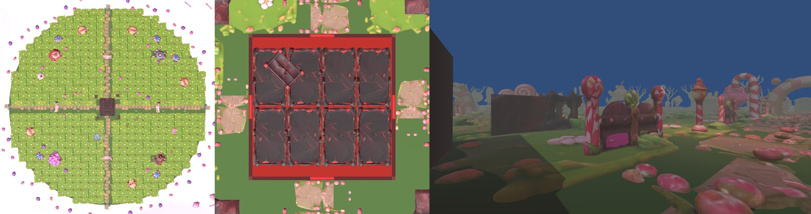


## 33. 2026-10-22 놀이공원 새 모델(자이로드롭·바이킹·맵 오브젝트) Unity로 옮기기 + 받은 바이킹 선체 확인

**요청**: Blender에서 만든 자이로드롭·바이킹·맵 오브젝트를 `Assets/Maps/CursedCandyCarnival/Models/`로 옮긴다. 그리고 받은 바이킹 선체 FBX(`CursedCandyCarnival/바이킹 선체/Meshy_AI_Infernal_Lantern_Long_…`)를 내가 그린 선체 대신 넣을 수 있는지 확인한다.

**단계**
- [x] V1 받은 선체 FBX 분석·바이킹 조립에 끼워 보기(팔·흔들림 여유)
- [x] V2 묶음 3개를 `Models/GyroDrop`·`Models/Viking`·`Models/MapObjects`로 옮기기(FBX·텍스처·재질 값), .blend·스크립트는 `Source~/Rides/`
- [x] V3 가져오기 도구 `Assets/Editor/Maps/CarnivalRideModelsImporter.cs`(재질 만들기·슬롯 다시 잇기·텍스처 설정)
- [x] V4 컴파일·Console·Unity 안 렌더 확인
- [ ] V5 맵 배치·움직임 코드(자이로드롭 오르내림·바이킹 흔들림) — 요청이 오면

### 33.1 결과(2026-10-22)

- **받은 선체**
  - 한 덩어리 메시이고 삼각형 158,264개, 정점 79,066개, UV 1개다. 텍스처는 2048 px 4장(색·노멀·금속·거칠기)이다.
  - 좌석 5줄, 해골 뱃머리, 랜턴 2개가 포함되어 있다. 원본 크기는 1.9 × 0.64 × 1.08이고, 뱃머리는 −X 쪽이다.
  - 길이 14 m로 맞추면(×7.367) 폭 4.69 m, 높이 7.95 m가 된다. 내 선체(14 × 4.4 m)와 거의 같은 비율이다.
- **끼워 보기**(`gyro/viking_meshy.py`)
  - 선체를 180° 돌려 뱃머리를 +X로 했다. 가운데 뱃전을 내 선체와 같은 높이(회전축 아래 9.1 m)에 맞췄다.
  - 팔은 측정한 뱃전(x = ±3 m)에 붙였다. 폭이 0.3 m 넓어 팔 간격은 ±2.65 m, A프레임은 ±3.7 m로 넓혔다.
  - 결과: 팔과 선체·좌석이 겹치는 정점 0개. ±75° 흔들림에서 가장 낮은 점은 바닥 위 2.32 m이고, 프레임과도 닿지 않는다. → **대체 가능.**
  - 주의할 점:
    - 선체 밑에 Meshy가 붙인 받침판이 있다(필요하면 잘라낸다. UV는 그대로).
    - 삼각형이 내 선체 전체의 약 50배다(줄이면 뭉개지므로 줄이지 않았다).
- **옮긴 것**

  | 폴더 | FBX | 재질 | 텍스처 |
  |---|---|---|---|
  | `Models/GyroDrop` | 5개 | 11 | 1024 px 10장 |
  | `Models/Viking` | 5개 | 17 | 13장 |
  | `Models/MapObjects` | 17개 | 25 | 17장 |

  - 각 폴더에 `materials.json`(Blender 재질 값)과 치수 json이 있다. 재질은 `Materials/M_*.mat`(Standard)에 있다.
- **도구** `Tools/TagOfChaos/Maps/Import Carnival Ride Models`
  - 재질 슬롯 185개를 모두 다시 이었다(빠진 재질 0).
  - 텍스처는 원본 크기 그대로, 밉맵, 이방성 8, Trilinear, Repeat로 설정했다.
  - 메시 압축은 끔이고, 인덱스는 자동(32비트 허용)이다.
- **확인**
  - 컴파일 오류 0, Console 오류·경고 0.
  - 미리보기 씬 렌더에서 잘못된 재질 0, 텍스처·발광이 정상이다.

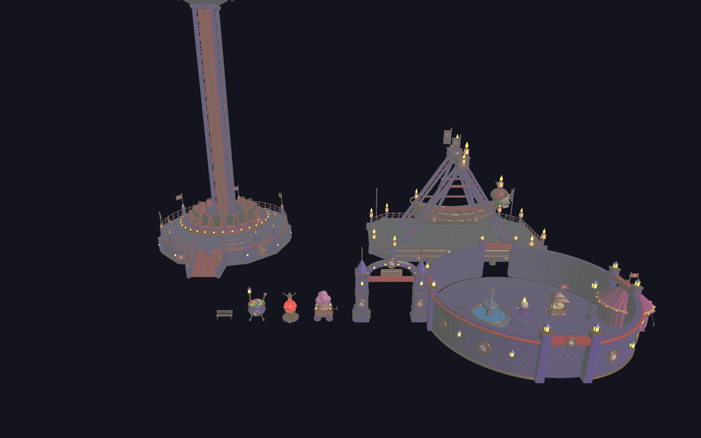
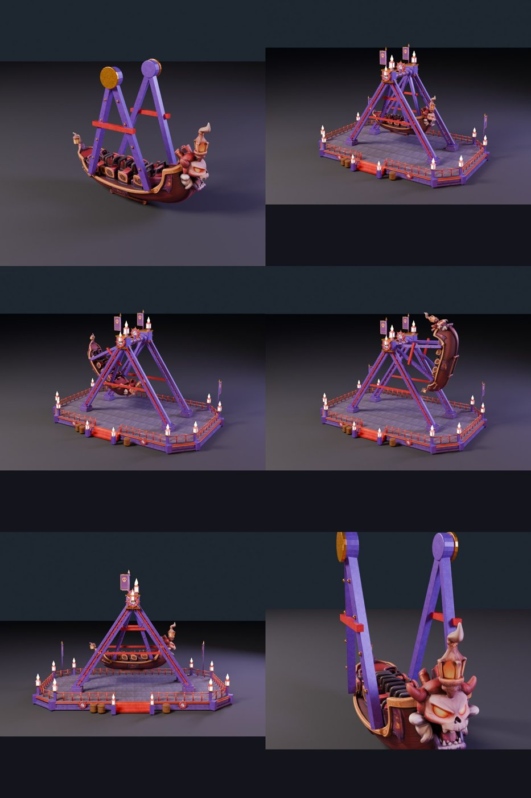


## 34. 2026-10-22 바이킹 받은 선체로 교체·숨을 수 있는 텐트·놀이공원 바닥 타일

**요청**
1. 바이킹 선체를 받은 Meshy 선체로 바꾸고, 받침판은 잘라낸다.
2. 텐트를 쿠키와 괴물이 모두 직접 들어가 숨을 수 있게 만든다. 입구는 앞·뒤 하나씩, 문은 찢어진 천막처럼.
3. 놀이공원 바닥 오브젝트를 만든다.
   - 지난번 바닥은 너무 크게 만들어 이질감이 있었다. 이번에는 캔디맵 크기에 맞게 촘촘하게 하고, 텍스처까지 꼼꼼히 입힌다.
   - 참고 그림의 종류: 기본·젖은·돌바닥·하수구 타일과 패턴 조합 4종.

**설계**
- **선체 교체**
  - 받침판(옆 막대 |y| 0.5~0.8 m, 끝 막대, 높이 0.25 m 아래)을 정점으로 잘라낸다. 남는 구멍은 메운다. UV·텍스처는 그대로 둔다.
  - `VK_Ship.fbx` = 팔(원점 = 회전축) + 자식 `VK_ShipHull`.
  - 선체 재질은 2048 px 색·노멀·금속+매끄러움 합본으로 만든다.
- **텐트(MO_Tent, 숨을 곳)**
  - 크기는 몸 크기를 재서 정했다.
    - 쿠키: 캡슐 지름 0.92 m·높이 2 m, 몸 메시 폭 1.88 m.
    - 괴물: 캡슐 지름 0.63 m·높이 1.1 m(겉모습은 6.5 m라 지붕을 뚫고 보일 수 있다).
  - 둥근 텐트: 반지름 4.2 m, 벽 3.2 m, 꼭대기 7 m.
  - 입구: 앞·뒤 문 폭 2.8 m·높이 2.9 m.
  - 문: 찢어진 천(아래가 들쭉날쭉, 구멍, 한쪽은 묶어 젖힘). 천에는 충돌체를 넣지 않아 지나갈 수 있다.
  - 숨을 곳 규칙은 기존 V4 텐트 규칙을 그대로 따른다.
    - `COL_*` → BoxCollider(벽 조각).
    - `Light_Inside`·`Light_Exit_*` → 빛.
    - `Zone_*` → `IndoorZone`(실내 소리).
  - 프리팹은 `TwistedPropBuilder.AddColliders`·`AddShelterParts`를 다시 쓰는 도구로 만든다.
- **바닥 타일**
  - 2 m 정사각 모듈(판석 1 m, 조약돌 0.3~0.4 m)로 만든다. 패턴 4종은 4 m(2×2 모듈)이다.
  - 평평한 판 + 2048 px 색·노멀·매끄러움 텍스처를 쓴다. 이음새는 줄눈 위에 오게 해 이어 붙여도 끊기지 않는다.
  - 종류:
    - `FL_Basic`·`FL_Wet`(물웅덩이 반짝임)·`FL_Cobble`·`FL_Sewer`(쇠 맨홀).
    - 패턴: `FL_PatternCompass`·`FL_PatternWheel`·`FL_PatternDiamond`·`FL_PatternFlower`.

**단계**
- [x] VH1 바이킹 선체 교체(받침판 제거)·Unity 반영
- [x] VH2 숨을 수 있는 텐트(앞뒤 찢어진 천막 문·충돌·빛·실내 소리)·프리팹
- [x] VH4 바닥 타일 8종(Blender·텍스처·FBX)·Unity 반영
- [x] VH3 컴파일·Console·Unity 렌더·Play Mode(텐트 출입: 쿠키·괴물)·문서

### 34.1 결과(2026-10-22) — VH1~VH4

- **VH1 바이킹 선체 교체**
  - 받침판(정점 2,318개)을 잘라냈고, 구멍 2곳을 메웠다. UV·텍스처는 그대로다.
  - `VK_Ship.fbx` = 팔(원점 = 회전축 14.7 m) + 자식 `VK_ShipHull`(정점 88,318개, 32비트 인덱스).
  - 선체 폭이 4.69 m라 팔 간격을 ±2.65 m, A프레임을 ±3.7 m로 넓혔다. 팔·선체 겹침 0, ±75° 흔들림에서 바닥과 2.32 m 떨어진다.
  - 선체 재질 `M_VK_ShipHull`: 색·노멀·금속+매끄러움, 2048 px.
  - 더는 안 쓰는 옛 선체 텍스처 5장·재질 7개를 지웠다.
  - 제작 스크립트 `viking_build.py`는 받은 선체 판으로 바꿨다(옛 판은 `viking_build_drawnhull.py.bak`).
- **VH2 숨을 수 있는 텐트**(`MO_Tent`)
  - 크기: 반지름 4.2 m, 벽 3.2 m, 앞·뒤 문 폭 2.8 m·높이 2.9 m.
  - 문: 찢어진 천막(양쪽을 밧줄 고리로 묶어 젖힘, 들쭉날쭉한 끝단, 구멍, 문틀 위 너덜 조각). 천에는 충돌체가 없다.
  - 안쪽 양옆에 상자·통을 두어 뒤에 숨을 수 있다. 문 사이 통로는 비웠다.
  - 프리팹 `Assets/04. Prefabs/Carnival/MO_Tent.prefab`(`CarnivalRideModelsImporter.BuildShelterPrefabs`, V4 숨을 곳 규칙)
    - 벽 BoxCollider 14 + 상자·통 2
    - 빛: `Light_Inside`, `Light_Exit_Front`·`Light_Exit_Back`
    - `IndoorZone`: 가운데는 실내, 6 m 밖은 실외
  - 문은 Unity ±Z 방향이다.
- **VH4 바닥 타일 8종**(`Models/Floor`)
  - 종류: `FL_Basic`·`FL_Wet`·`FL_Cobble`·`FL_Sewer`(2 m), `FL_PatternCompass`·`FL_PatternWheel`·`FL_PatternDiamond`·`FL_PatternFlower`(4 m).
  - 판석 줄 0.5 m, 조약돌 약 0.29 m, 텍스처 1 m당 1024 px(2048·4096 px)이다. 색·노멀(OpenGL)·금속+매끄러움 맵이 있다.
  - 모든 테두리가 줄눈이라 어떤 타일끼리 붙여도 이음새가 맞는다.
  - 젖은 타일은 전체가 젖어 반짝이고, 줄눈·움푹한 곳에 물이 고여 있다.
  - 생성기: `make_floor.py`·`floor_build.py`(`Source~/Rides/`).
- **가져오기 도구** `CarnivalRideModelsImporter`
  - 묶음에 `Floor`를 더했고, 텍스처 최대 크기를 4096으로 올렸다.
  - 숨을 곳 프리팹 만들기를 넣었다(`Import Carnival Ride Models` 메뉴 한 번에 처리).
- **VH3 확인**
  - 컴파일 오류 0, Console 오류·경고 0.
  - 파일 91개 크기 일치. 업로드 목록 마지막 줄이 빠진 것을 찾아 다시 올렸다.
  - 재질 연결: Viking 5·MapObjects 17·Floor 8 FBX 모두 빠진 재질 0.
  - Unity 렌더: 텐트 앞문·실내, 바닥, 바이킹.
  - **Play Mode**(빈 시험 씬, CharacterController)
    - 쿠키(r 0.46·h 2)·괴물(r 0.31·h 1.1) 모두 앞문→뒷문, 뒷문→앞문 끝까지 통과했다. 멈춘 걸음 0, 지나는 동안 실내 판정 됨.
    - 옆으로 오면 벽에서 멈춘다(쿠키 4.77 m, 괴물 4.62 m = 벽 + 몸 반지름).
    - 쿠키 팔 MeshCollider 크기(1.88 × 1.97 × 0.36) 상자도 두 문을 막힘 없이 지난다.
    - 시험 뒤 원래 씬(`Test_CursedCandyCarnival`)을 다시 열었다.
- **남은 것**
  - 괴물 겉모습(6.5 m)은 텐트 지붕 밖으로 보일 수 있다.
  - 맵 배치(텐트·바닥·바이킹)와 움직임 코드는 요청이 오면 한다.


## 35. 2026-10-22 놀이공원 재료 건물 4종 — 입구 뚫기·크기·텍스처

**요청**
- 받은 재료 건물 FBX 4개를 캔디숲 재료 건물처럼 드나들 수 있게 만든다: 레드버튼(CONTROL), 배터리(BATTERY), 수리도구(REPAIR), 안전벨트(SAFETY BELT).
- 동그라미 친 부분(패널·문·가게 카운터·좌석)의 공간을 없앤다.
- 캔디숲 재료 건물 크기로 늘렸을 때 괜찮은지 판단해 Blender로 다시 만든다.
- 크게 했을 때 텍스처가 깨지면 다시 입힌다.

**측정**

| 기준 | 크기 |
|---|---|
| 캔디숲 재료 건물(CF_Bld_Q1~Q4) | 바닥 약 22 × 22 m, 높이 21~25 m |
| 캔디숲 앞·뒤 문 | 6.6 × 7.6 m |
| 캔디숲 방 | 약 16 × 17 m |
| 캔디숲 방 최소 반지름 | 6.8 m (받침대 둘레를 괴물이 도는 넓이) |

받은 건물은 Meshy 한 덩어리 메시(삼각형 45~70만 개)이고, 텍스처는 2048 px 한 장이다.

| 가로 22 m로 맞춤 | 깊이 | 높이 | 동그라미 부분(폭 × 높이) |
|---|---|---|---|
| CONTROL | 15.4 m | 13.0 m | 7.8 × 4.4 m (차양 아래) |
| BATTERY | 20.6 m | 15.9 m | 문 3.5 × 5.3 m |
| REPAIR | 14.9 m | 12.8 m | 8.2 × 4.0 m (차양 아래) |
| SAFETY BELT | 18.6 m | 15.9 m | 8.2 × 4.2 m (차양 아래) |

- CONTROL 안쪽 빈 공간은 약 13 × 6 m(천장 5.5 m)이다.

**판단**

*캔디숲 가로(22 m)로만 늘리면 안 맞는다.*
- 높이가 13~16 m로 캔디숲(21~25 m)보다 낮다.
- 입구 높이가 4~5 m라 괴물 문(7.6 m, 괴물 겉모습 6.5 m)에 모자란다.
- 방이 좁아 받침대 둘레를 돌 수 없다.

*캔디숲 높이에 맞추려고 1.5배(가로 33 m)로 늘린다.*
- 높이 19~24 m로 캔디숲과 같아진다.
- 입구 높이 6~8 m, 방은 약 19 × 9 m 이상이 된다.

*텍스처는 다시 입혀야 한다.*
- 2048 px 한 장이 건물 전체(겉넓이 약 6,000 m²)를 덮는다. 33 m 크기에서 약 21 px/m이다.
- 지금까지 만든 소품은 512~1024 px/m이라, 그대로 쓰면 가까이서 크게 뭉개진다.

**설계**
- 입구
  - 앞: 동그라미 부분을 차양·간판 아래까지 잘라낸다. 그 폭 안의 계단·난간·카운터도 없앤다.
  - 뒤: 같은 방식으로 뒤쪽 가운데를 뚫는다(캔디숲처럼 앞·뒤로 드나듦).
- 방
  - 방 바닥이 땅(0 m)에 오게 건물을 내린다.
  - 안쪽 빈 공간을 재서 그 안쪽에 새 방을 만든다: 벽(나무)·허리 판(보라 금속)·평평한 천막 천장·바닥 타일(`FL_Basic`).
  - 문 통로 양옆과 위에 보라 기둥·금 테두리를 두어 잘린 가장자리를 가린다.
- 받침대(넣는 곳): 문과 문 사이 길을 막지 않게 넓은 쪽 옆에 둔다. 재료별 장식을 올린다.
  - 레드버튼: 빨간 큰 버튼
  - 배터리: 번개 충전기
  - 수리도구: 모루와 렌치
  - 안전벨트: 좌석 버클
- 텍스처
  - 원래 그림을 살리려고, 색 텍스처를 4096으로 키우고 선명하게 한다.
  - 세계 크기 세부 결 층(두 번째 UV, 0.75 m 반복, 1024 px)을 곱하고 노멀을 더해 가까이서도 표면이 살아 있게 한다. Unity Standard의 Detail Albedo/Normal, UV2로 연결한다.
  - 새로 만든 방·문틀·받침대는 1024 px 세계 크기 타일 텍스처를 쓴다.
  - 겉 메시는 줄이지 않는다(충돌용 사본만 8,000면).
- 내보내기: `CUR_Bld_<재료>.fbx`, 캔디숲과 같은 형식의 json을 함께 낸다(문·방·받침대·바깥 반지름).
  - 파일 속 물체: Exterior, Interior, COL_Exterior, Repair_Point

**단계**
- [x] MB1 받은 FBX 4개·캔디숲 건물 크기 측정·판단
- [x] MB2 4개 건물 뚫기·방·받침대·텍스처(Blender), 건물마다 완성 사진 먼저 보이기
- [x] MB3 문서·결과

### 35.1 결과(2026-10-22) — MB1~MB2

모두 받은 모델을 1.5배(가로 33 m)로 키웠고, 방 바닥 = 땅(0 m)이다.

| 건물 | 크기(가로×깊이×높이) | 앞문(폭×높이) | 뒷문 | 방 | 천장(가운데 / 벽 쪽) | 겉 삼각형 |
|---|---|---|---|---|---|---|
| 레드버튼 `CUR_Bld_RedButton` | 33 × 23.1 × 19.5 m | 11.7 × 5.7 m | 9.0 × 6.3 m | 21.4 × 7.9 m | 7.7 / 5.3 m | 43만 |
| 배터리 `CUR_Bld_Battery` | 33 × 30.8 × 23.9 m | 7.8 × 5.0 m | 7.2 × 7.6 m | 14.5 × 15.3 m | 13.4 / 5.3 m | 42만 |
| 수리도구 `CUR_Bld_RepairKit` | 33 × 22.3 × 19.3 m | 12.3 × 4.3 m | 9.0 × 4.7 m | 21.9 × 6.9 m | 6.0 / 5.3 m | 29만 |
| 안전벨트 `CUR_Bld_SafetyBelt` | 33 × 26.8 × 23.8 m | 12.3 × 4.7 m | 9.0 × 5.6 m | 15.6 × 11.4 m | 8.0 / 5.3 m | 54만 |

- **잘라낸 것**
  - 동그라미 부분: CONTROL 패널, BATTERY 문, REPAIR 가게 카운터·작업대, SAFETY BELT 좌석.
  - 그 폭 안의 계단·난간도 없앴다. 차양·간판은 남겼다.
  - 수리도구·안전벨트는 안이 물건으로 차 있어서 방 상자를 직접 정하고, 그 안의 원래 메시를 모두 지웠다.
- **방**
  - 안쪽 빈 공간을 걷는 높이(0.6~5.4 m)에서 재서 그 벽을 따라 만들었다(180방향).
  - 천장은 지붕 아래면을 따라 만들었다(천막·박공 지붕은 가운데가 높다).
  - 벽: 나무. 허리: 보라 금속. 천장: 줄무늬 천. 바닥: `FL_Basic` 타일. 문 통로: 보라 기둥·금 테두리·작은 빛 구슬.
- **받침대**(넣는 곳): 문과 문 사이 길을 막지 않게 넓은 쪽 옆에 두었다. 반지름 1.25 m, 높이 2.6 m.
  - 레드버튼: 빨간 큰 버튼
  - 배터리: 파란 빛 충전 셀·번개
  - 수리도구: 모루·렌치
  - 안전벨트: 좌석 등받이·버클
- **텍스처**
  - 원래 색 텍스처를 4096으로 키웠다(중간값 필터 + 강한 언샤프 = 가장자리 보존).
  - 세계 크기 세부 결 층(두 번째 UV `UVDetail`, 0.75 m 반복, 1024 px → 약 1,365 px/m)을 곱하고 결 범프를 더했다.
  - 원래 그림의 해상도 한계(33 m에서 21 → 42 px/m)는 남는다. 아주 가까이서는 색 경계가 부드럽지만, 표면은 결이 살아 있다.
- **파일**: `scratchpad/deliver/MaterialBuildings/`
  - 건물마다 `CUR_Bld_*.fbx`와 json(캔디숲 형식: 문·방·받침대·바깥 반지름·문 2개)이 있다.
  - FBX 속 물체: Exterior, Interior, COL_Exterior(충돌용 8,000면), Repair_Point
  - Textures(건물별 4096 색 / 노멀 / 금속+매끄러움, 공용 Detail 2장)
  - 스크립트: `mb_build.py`·`mb_tex.py`
- **남은 것**
  - 문 높이 4.3~7.6 m는 차양·간판 높이(동그라미 부분의 위 끝)로 정해진다. 캔디숲 괴물 문 7.6 m보다 낮은 곳은 괴물 겉모습(6.5 m)이 지나갈 때 차양에 닿아 보일 수 있다. 쿠키·괴물 충돌체(2 m·1.1 m)는 모두 지나간다.
  - Unity 반영(재질 Detail 맵 연결·충돌·받침대 자리)은 요청이 오면 한다.

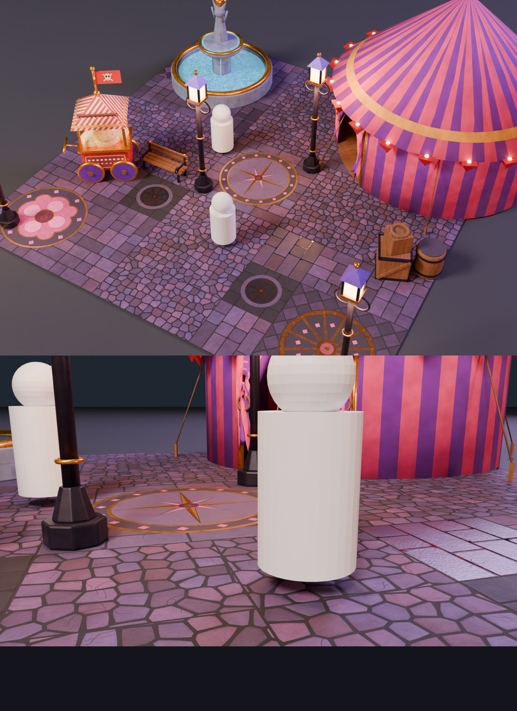

### 35.2 괴물 출입 확인(2026-10-22, Play Mode)

- **방법**
  - 건물마다 충돌 메시만 내보냈다: `COL_Exterior` + `Interior`(벽·문틀·받침대) + `Repair_Point`.
  - 임시 폴더(`Assets/__MBColTest`)에 넣고 빈 씬에서 MeshCollider로 세웠다.
  - 실제 괴물과 같은 Rigidbody 캡슐을 썼다: 괴물 r 0.314·h 1.1, 쿠키 r 0.46·h 2.
  - 앞·뒤에서 1 m 간격(x −10~10)으로 5 m/s로 걸어 방 한가운데까지 닿는지, 받침대까지 다가가는지 봤다.
  - 쿠키 팔 크기 상자(1.88 × 1.97 × 0.36 m)는 BoxCast로 따로 확인했다.
- **결과**: 괴물·쿠키 모두 네 건물 앞·뒤로 들어와 방 가운데까지 간다.
  - 괴물이 지나간 폭:

    | 건물 | 앞 | 뒤 |
    |---|---|---|
    | 레드버튼 | x −4~3 | x −5~3 |
    | 배터리 | x −2~3 | x −2~3 |
    | 수리도구 | x −4~5 | x −4~3 |
    | 안전벨트 | x −2~5 | x −2~4 |

  - 쿠키 팔 상자도 모든 문을 지난다(가장 좁은 배터리 앞뒤 2칸).
  - 받침대: 괴물은 넣는 곳에서 1.85~1.90 m, 쿠키는 1.75~1.80 m까지 간다(받침대 반지름 1.25 m — 바로 옆까지 닿음).
- **남는 점**: 문 높이가 괴물 겉모습(6.5 m)보다 낮은 곳은 지나갈 때 차양·간판에 겉모습이 걸쳐 보인다. 충돌은 없다.
  - 레드버튼 앞 5.7 m, 배터리 앞 5.0 m, 수리도구 4.3 / 4.7 m, 안전벨트 4.7 / 5.6 m
- 시험 뒤 임시 폴더를 지웠고 원래 씬을 다시 열었다. Console 오류 0.

### 35.3 1.7배·문 높이·괴물 카메라 근접 클립(2026-10-22)

**요청**
- 괴물 시점이 얼굴에서 보는 1인칭이라, 천장·문틀과 섞여 이상하게 보일 수 있다 → 1.7배로 키운다.
- 괴물 카메라 근접 클립을 0.1로 바꾼다.

**근거**
- 괴물 눈(EyeSocket) 3.27 m, 시야각 60°, 위로 최대 70°, 겉모습은 땅 위 약 5.5 m.
- 1.5배일 때 문틀은 눈 위 1.1~1.7 m(수리도구 4.3 m)였다 → 문을 지날 때 화면 위가 차양으로 가득 찼다.

**결과**

| 건물 | 크기(가로×깊이×높이) | 앞문(폭×높이) | 뒷문 | 방 | 천장(가운데 / 벽 쪽) |
|---|---|---|---|---|---|
| 레드버튼 | 37.4 × 26.2 × 22.1 m | 13.3 × 6.5 m | 10.2 × 7.2 m | 24.3 × 9.0 m | 8.7 / 6.0 m |
| 배터리 | 37.4 × 34.9 × 27.0 m | 8.8 × 8.8 m | 8.2 × 8.6 m | 16.4 × 17.4 m | 15.2 / 6.0 m |
| 수리도구 | 37.4 × 25.3 × 21.8 m | 13.9 × 5.8 m | 10.2 × 6.2 m | 24.8 × 7.8 m | 6.8 / 6.0 m |
| 안전벨트 | 37.4 × 30.4 × 27.0 m | 13.9 × 6.9 m | 10.2 × 6.3 m | 17.7 × 12.9 m | 9.0 / 6.0 m |

- **문 높이 계산을 고쳤다.**
  - 원래는 벽 쪽 천장 계산이 문 위를 깎았다. 이제 문은 차양·간판 높이까지 열린다(방 가운데 천장 −0.6 m 안).
  - 문 위 천장은 문 높이 + 0.6 m까지 올렸다.
  - 문 뒤 1.5 m 안에 매달린 원래 메시도 지웠다.
- **수리도구**: 앞 차양 끝 술 장식 0.5 m를 정리해 앞문이 5.8 m가 됐다.
- 모든 문틀이 괴물 눈보다 2.5 m 이상 높다(수리도구 앞 2.5 m, 나머지 3 m 이상). 수리도구 앞문(5.8 m)을 빼면 괴물 겉모습(5.5 m)도 걸리지 않는다.
- **괴물 출입 Play Mode 재확인**(§35.2와 같은 방법): 괴물·쿠키 모두 네 건물 앞·뒤로 방 가운데까지 들어간다. 받침대 옆 1.8~1.9 m까지 간다. 쿠키 팔 상자도 모든 문을 지난다.
- 시험용 임시 폴더는 지웠고 원래 씬을 다시 열었다.
- **근접 클립**: `MonsterFirstPersonCamera`
  - 1인칭이 켜지면 카메라 `nearClipPlane`을 0.1(`nearClip` 필드)로 바꾸고, 꺼지면(3인칭 `Camera_Ctrl`) 원래 값으로 되돌린다.
  - Play Mode 확인: 처음 0.3 → 1인칭 0.1 → 3인칭 0.3 → 1인칭 0.1. Console 오류 0.
- 가로가 캔디숲 건물(22 m)보다 커서, 맵 배치 때 건물 자리를 넓게 잡아야 한다.

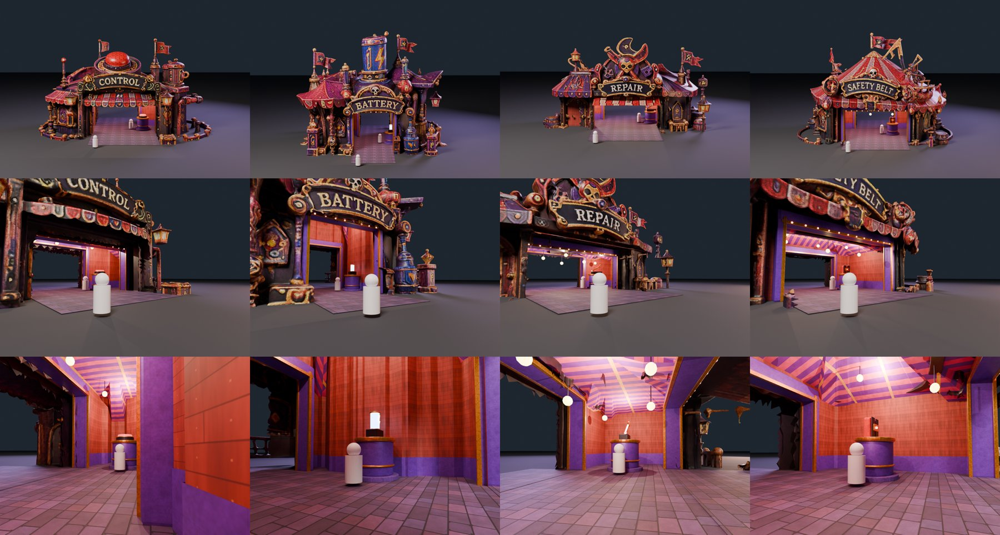

## 36. 2026-10-22 저주받은 놀이공원 실제 맵 — Unity 옮기기·배치·꾸미기

**요청**
- 만든 오브젝트를 예시 스크린샷대로 배치한다(가운데 술래방, 십자 큰길, 사분면 재료 건물, 가장자리 놀이기구).
  - 좌상 Q1 안전벨트, 우상 Q2 배터리, 좌하 Q3 수리, 우하 Q4 컨트롤(빨간 버튼).
- 맵 타일은 사분면마다 바닥 예시처럼 섞어 깐다.
- 사분면마다 쿠키가 숨을 수 있는 오브젝트(텐트)를 4개씩 둔다.
- 맵 크기를 캔디숲처럼 늘린다(반지름 155 m).
- 바이킹이 자연스럽게 흔들리고 자연스러운 효과음이 난다.
- 괴물이 쿠키를 잡을 수 없는 자리가 없어야 한다. 괴물·쿠키가 못 지나가는 공간이 없어야 한다.
- 재료 건물 방 안에 재료를 끼우는 오브젝트를 캔디숲처럼 자연스럽게 FBX로 만들어 둔다.
- 배치 미리보기(Blender)를 확인받은 뒤 꾸미기까지 이어서 한다.

**배치 미리보기(확인받음)**
- 재료 건물: 반지름 100 m, 사분면 가운데 방향, 정문이 술래방을 본다.
- 텐트: 사분면마다 4개(반지름 38·42·66·70 m).
- 놀이기구(가장자리): 바이킹 북(Q1 뒤), 회전목마 동(Q2 아래), 롤러코스터 서(Q3 위), 자이로드롭 남(Q4 아래).
- 반지름 80 m 둥근 산책길, 사분면 분수 광장, 노점·벤치·가로등·상자.

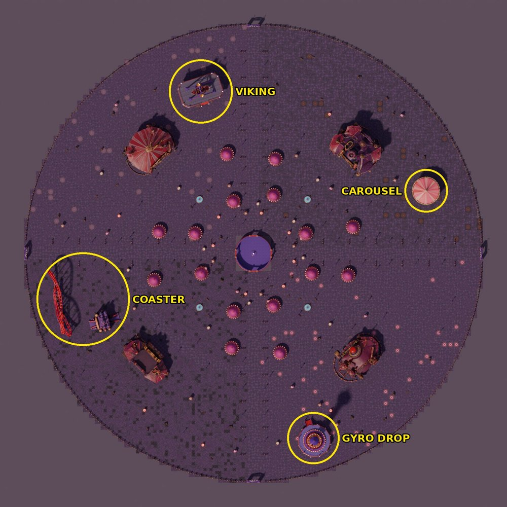

**설계**
- 재료와 건물: 지금 레시피는 재료 4종을 판마다 섞어 건물에 준다. 놀이공원 건물은 간판이 재료를 말하므로 레시피에 "건물 재료 고정" 값을 두고 Q1 안전벨트·Q2 배터리·Q3 수리 도구·Q4 빨간 버튼으로 고정한다(다른 맵은 그대로 섞음).
- 꽂는 오브젝트: 받침대 앞(방 가운데 쪽) 손 높이 받침. 재료가 놓이는 자리(Repair_Point + 0.2 m)에 맞춘 홈이 있고, 홈 안쪽 판(`Socket_`)이 쿠키에게만 재료 색으로 빛난다(QuadrantBuilding 규칙 그대로).
- 바이킹 움직임: 방장 시계(PhotonNetwork.Time)로 모든 화면이 같은 각도를 계산한다(롤러코스터와 같은 방식, 네트워크 메시지 없음). 출발 → 점점 커짐 → 최대 흔들림 → 줄어듦 → 쉼을 되풀이하는 진자 운동. 소리는 끝에서 나무 삐걱임, 아래를 지날 때 바람, 축 쇠 소리, 승객 비명.
- 놀이기구는 몸이 들어갈 수 없는 장애물로 둘러싼다(받침·레일 밑 틈이 숨는 곳이 되지 않게).
- 통행 검사: 캔디숲 `MapPassabilityCheck`(몸 크기 5가지)로 쿠키·괴물 모두 막힌 공간 0, 목표(상자·수리 자리·탈출구·로켓·무지개·스폰·텐트 안) 모두 닿음.

**단계**
- [x] CM1 꽂는 오브젝트 FBX 4종(Blender) — 완성 사진 먼저 보이기
- [x] CM2 꾸미기 소품 추가(Blender) — 완성 사진 먼저 보이기
- [x] CM3 Unity 반영: 재료 건물·꽂는 오브젝트·꾸미기 소품 텍스처·재질·프리팹(충돌)
- [x] CM4 레시피 건물 재료 고정 + 시험
- [x] CM5 바이킹 흔들림 + 효과음 + 시험
- [x] CM6 실제 맵 씬 `CursedCandyCarnival` 만들기(배치·바닥·텐트·놀이기구·탈출구·울타리·표시·조명·빌드 설정)
- [x] CM7 통행·잡기 검사와 수정
- [x] CM8 컴파일·Console·EditMode 시험·Play Mode 확인·사진·문서

### 36.1 결과(2026-10-22) — CM1~CM8

**새 씬** `Assets/Scenes/Maps/CursedCandyCarnival.unity`
- 빌드 설정과 판마다 고르는 맵 목록(`GameSettings.gameMapScenes`)에서 `Test_CursedCandyCarnival`을 대신한다. 테스트 씬은 빌드에서 꺼 두었다.
- `SceneNames.RealMapScenes`에 넣었다.
- 다시 만들기: `Tools/TagOfChaos/Maps/Build Carnival Map Prefabs` → `Build Cursed Candy Carnival Map Scene` → `Check Cursed Candy Carnival Passability`

| 항목 | 내용 |
|---|---|
| 크기 | 반지름 155 m(캔디숲과 같음), 둥근 울타리, 탈출구 4(동서남북), 울타리 밖 소나무 숲 84그루 |
| 가운데 | 둥근 술래방(`MO_MonsterRoom`), 문 4(12·3·6·9시, 괴물만 지나감), 술래방 지킴이 안쪽 8 m |
| 재료 건물 | 반지름 100 m, 정문이 가운데: Q1 안전벨트 · Q2 배터리 · Q3 수리 도구 · Q4 빨간 버튼 |
| 숨을 곳 | 사분면마다 텐트 4 = 16 |
| 놀이기구 | 바이킹(북, 흔들림·소리) · 회전목마(동) · 롤러코스터(서, 트랙 둘레 울타리) · 자이로드롭(남), 계단이 맵 안쪽 |
| 꾸미기 | 사분면 분수 광장(분수·벤치 3·가로등 2·화단 2), 노점 4, 매표소 2, 흩어 놓은 소품, 큰길 양옆 가로등·깃발 줄, 둥근 산책길 가로등, 이정표 4 — 모두 272개 |
| 바닥 | 큰길·산책길·탈출구 받침 = 기본 타일. Q1 조약돌+기본·나침반 무늬, Q2 기본+젖은 바닥·바퀴 무늬, Q3 조약돌+젖은 바닥+하수구·다이아 무늬, Q4 기본+조약돌·꽃 무늬. 18,473장, 32 m 조각 289개 |
| 표시 | 상자 40 · 로켓 6 · 무지개 8 · 쿠키 스폰 4 |
| 조명 | 점광원 63(큰길 가로등 둘에 하나, 광장·산책길 가로등, 놀이기구), 건물·텐트 안 빛은 프리팹 |

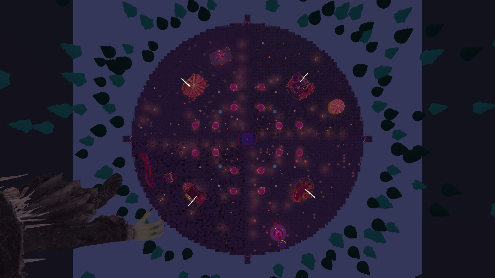
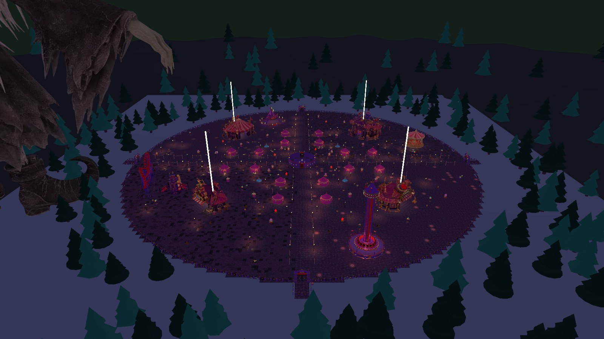
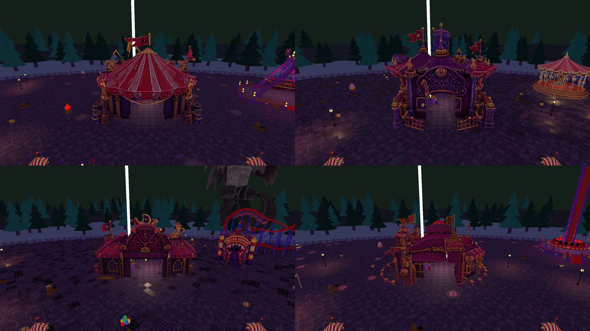
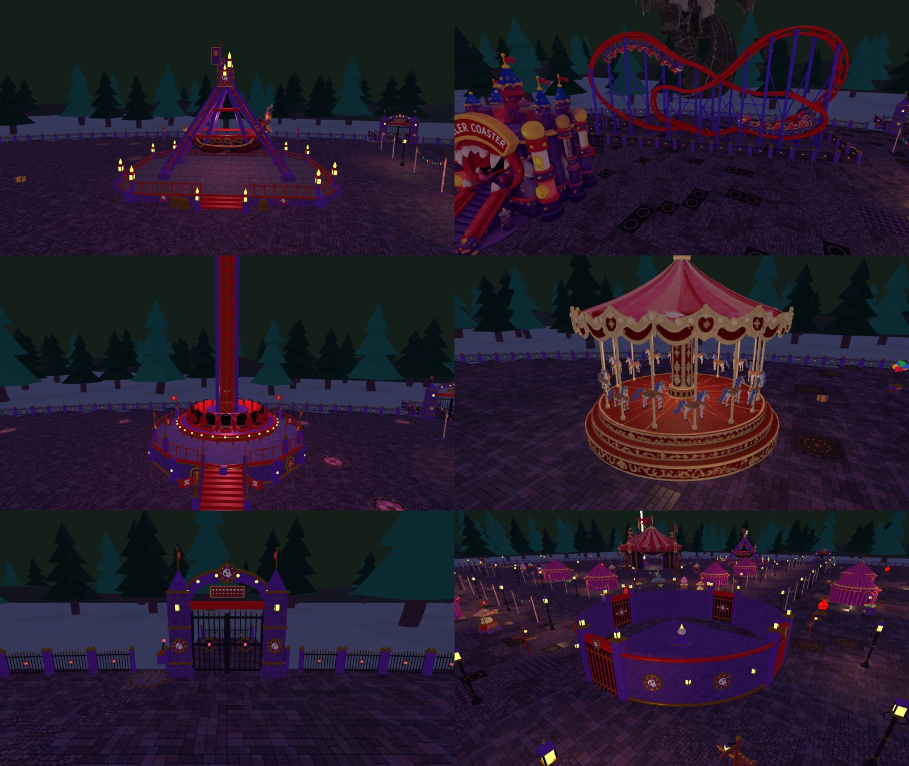

**CM1 재료 꽂는 오브젝트**
- `CUR_Socket_SafetyBelt`·`_Battery`·`_RepairKit`·`_RedButton`(Blender `decor_build.py`): 좌석 받침·충전대·작업대·조종대.
- 홈 판 `Socket_<재료>`를 QuadrantBuilding이 쿠키에게만 재료 색으로 칠한다.
- 받침대 앞, 방 가운데 쪽에 둔다. 수리 자리(`Repair_Point`)는 홈 위 1.3 m이고, 재료는 홈 위(1.5 m)에 놓인다.

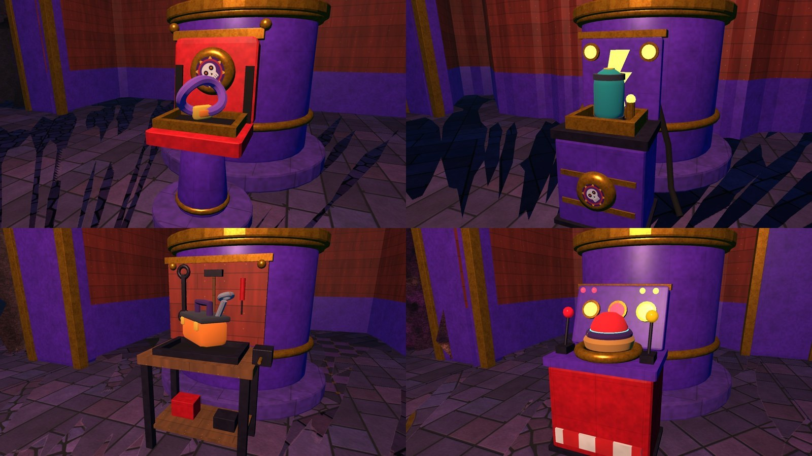

**CM2 꾸미기 소품**: 깃발 줄 `MO_Bunting`, 꽃 화단 `MO_Planter`, 이정표 `MO_Signpost`, 풍선 수레 `MO_BalloonCart`, 매표소 `MO_TicketBooth`.

**CM3 Unity 반영**
- **재료 건물** `Models/MaterialBuildings/`
  - FBX 4, 4K 텍스처, 재질 17. 겉 재질에 세부 결 층(UV2 Detail Albedo ×2·Detail Normal)을 넣었다 → `CarnivalRideModelsImporter`에 `detail`·`detailNormal`을 추가.
- **프리팹** `CarnivalMapAssets` → `Assets/04. Prefabs/Carnival/`: 재료 건물 4, 소품 14, `CUR_Viking`, `CUR_GyroDrop`.
- **건물 충돌**: 받은 모델의 바깥 메시 충돌은 쓰지 않는다. 계단·통·차양을 타고 올라 건물 속 빈 곳이나 지붕에 숨을 수 있었다(통행 검사).
  - 대신 0.5 m 격자로 건물 자리를 높이 9 m 상자로 채운다. 방 바닥과 앞·뒤 문 통로만 비운다.
  - 2.5 m보다 좁은 틈은 막는다. 좁은 방(수리 도구·빨간 버튼)은 받침대 뒤 막다른 곳도 막는다.
- **받침판 제거**: 받은 모델의 땅 높이 받침판(연보라 맨바닥으로 타일을 덮었다)을 뺀 메시 사본을 `Generated/`에 둔다.
- **받침대 x 부호**: json 받침대 x가 Blender 축 그대로여서(Unity x = −x) 꽂는 곳이 반대편에 놓였다. 방 단면을 재어 고쳤다.

**CM4 재료 고정**
- `EscapeRecipeSO.fixedBuildingOrder` 추가. 켜면 섞지 않고 `buildingMaterials` 순서대로 Building_Q1~Q4에 준다.
- 놀이공원 레시피 = 안전벨트·배터리·수리 도구·빨간 버튼. 다른 맵은 그대로 섞는다.

**CM5 바이킹**
- `VikingRide`: 롤러코스터와 같은 공통 시계(`CoasterRide.NetworkTime`)라 모든 화면에서 각도가 같다(네트워크 메시지 없음).
- 쉼 8초 → 점점 커짐 14초 → 최대 70° 18초 → 줄어듦 14초. 흔들림 주기 6.2초(팔 9.5 m 진자).
- 소리(합성, `SFX/Device/`):

  | 소리 | 나는 때 |
  |---|---|
  | `VikingBell` | 출발 종 |
  | `VikingHum` | 움직이는 동안 반복, 진폭에 따라 크기 |
  | `VikingCreak` ×3 | 끝에서 나무·쇠 삐걱 |
  | `VikingWhoosh` | 아래를 지날 때 바람 |

**CM7 통행·잡기 검사** `MapPassabilityCheck`, 몸 크기 5가지
- **5/5 CLEAN**: 갇힌 빈터 0, 괴물이 2.5 m 안으로 못 오는 쿠키 자리 0(3 m² 이상 무리 기준), 목표 66곳(상자·수리 자리·탈출구·로켓·무지개·스폰·텐트 안) 모두 쿠키·괴물이 닿음.
- 텐트 문(2.8 m)은 격자 괴물(지름 3.6 m)보다 좁다. 그래서 실제 괴물이 지나가는 것을 확인하고(§34.1), 괴물 출발점을 텐트 안에 더했다.

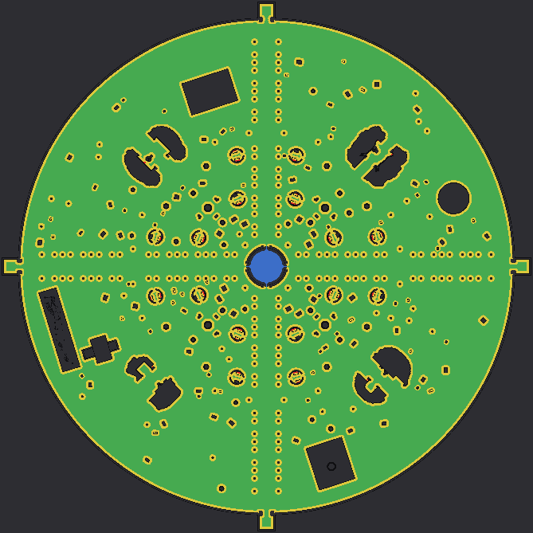

**바닥 깜빡임(Z-fighting) 수정**(Play Mode에서 발견)
- 원인: 바닥 타일(0.02 m)과 재료 건물 방 바닥(0.02~0.05 m)이 같은 높이였다.
- 고침:
  - 타일을 0.06 m로 올렸다. 방 바닥이 다 덮는 칸은 타일을 깔지 않는다.
  - 바닥 근처의 다른 평면(텐트 0.05·꽂는 곳 0.07·술래방 0.04·노점 0.07~0.10 m)과 1 cm 넘게 떨어진 것을 씬 전체에서 확인했다.
  - 타일을 맵 한 덩어리에서 32 m 조각으로 나눴다. 물체당 점광원 수 제한 때문에 가로등·방 빛이 바닥에 닿지 않던 것도 같이 고쳤다.

**CM8 시험**
- 컴파일 오류 0, EditMode 325/325 통과. 새 `CarnivalMapTests` 5개: 바이킹 각도·재료 고정·건물 프리팹·씬 배치·소리.
- Play Mode(오프라인 방):
  - 재료: Q1 Seatbelt·Q2 Battery·Q3 Toolbox·Q4 RedButton.
  - 바이킹: 흔들림(±70°, 쉼 0°)과 소리(Hum·Bell·Creak·Whoosh).
  - 걷기: 실제 쿠키·괴물이 네 건물 꽂는 곳(쿠키 1.1~1.7 m), 텐트 4곳 안, 탈출구까지 간다.
  - 술래방 안에 넣은 쿠키는 문 밖(15 m)으로 나온다.
  - Console: 시험용 순간이동 때문에 나온 `[NetGuard]` 경고만 있고 오류는 0.

**남은 것**
- 대관람차 모델은 없다(예시 스크린샷에는 있음).
- 두 사람 이상 멀티에서 바이킹 각도·소리가 화면끼리 같은지 확인.

## 37. 2026-10-22 놀이공원 탈출구가 잘 보이게·맵 밝게(가로등 늘리기)·술래방

> "지금 보면 탈출구가 열렸을 때 멀리서 잘 안보여. 선명하게 출입구가 어디인지에 대해 잘 보여야 되고, 또한 너무 어두워. MO_StreetLamp가 곳곳에 깔려서 Light가 지금보다 더 나오도록 해줘. 술래방도 마찬가지야."

**지금 상태**(게임 화면 그대로 후처리 포함해 찍음)
- 가로등 빛: 12 m·세기 1.6, 큰길 가로등은 둘에 하나만 → 바닥에 빛 웅덩이가 거의 안 보인다.
- 열린 탈출구: 문이 내려가고 투시 테두리만 생긴다. 안개(0.02) 때문에 맵 반대쪽에서는 보이지 않는다.
- 술래방: 둘레 가로등이 없고 안쪽 빛도 없다.

**고칠 것**
- 열린 탈출구 표시(`ExitOpenLook_<방향>`, 열리면 EscapeGate가 켠다)
  - 하늘까지 닿는 초록 빛기둥: 새 셰이더 `TagOfChaos/Beacon` — 더하기 섞기, 안개 영향 없음, 위로 갈수록 옅어짐.
  - 문틀 안쪽 초록 빛 띠.
  - 바닥 빛 원.
  - 강한 초록 점광원.
- 닫혀 있어도 자리를 알 수 있게 탈출구 안쪽 양옆에 가로등 2개씩.
- 가로등 늘리기:
  - 모든 가로등에 빛을 단다(세기·거리 올림).
  - 둥근 산책길 안쪽 줄을 더한다.
  - 사분면에 흩어 놓는 가로등을 늘린다.
  - 재료 건물 앞 양옆에도 가로등을 둔다.
- 술래방:
  - 둘레 가로등 8개.
  - 안쪽 빛.
  - 문마다 붉은 문 빛 — 문이 어디인지 보이게.
- 전체 밝기: 이 씬만 주변광을 조금 올리고 안개를 조금 옅게 한다. 분위기(밤·안개)는 유지한다.
- 새 가로등은 충돌체가 있으므로 통행 검사를 다시 한다.

**단계**
- [x] L1 Beacon 셰이더·열린 탈출구 표시(`ExitOpenLook_`)·탈출구 옆 가로등
- [x] L2 가로등 늘리기·모든 가로등 빛 세기 올림·주변광/안개 조정
- [x] L3 술래방 둘레 가로등·안쪽 빛·문 빛
- [x] L4 씬 다시 만들기·통행 검사·컴파일·Console·EditMode 시험·Play Mode(탈출구 열기)·사진·문서

### 37.1 결과(2026-10-23) — L1~L4

사진은 모두 게임 카메라(색보정·빛 번짐 후처리 포함)로 찍었다. Play Mode에서 방장이 동·남 탈출구를 연 상태다.

| 항목 | 전 | 후 |
|---|---|---|
| 가로등 | 큰길 가로등 둘에 하나만 빛 | **131개 모두 빛**(16 m, 세기 2.6) — 큰길·둥근 산책길 두 줄·탈출구 옆 8·사분면마다 10·술래방 둘레 8 |
| 점광원 | 63 | 139 |
| 주변광·안개 | (0.12, 0.31, 0.49), 0.02 | (0.17, 0.37, 0.56), 0.013 — 이 씬만 |
| 열린 탈출구 | 문이 내려가고 투시 테두리만 | 초록 빛기둥(120 m, 안개 무시)·문틀 빛 띠·바닥 빛 원·초록 점광원 |
| 술래방 | 둘레 빛 없음 | 둘레 가로등 8, 안쪽 빛, 문마다 문 위 붉은 빛·문 앞 붉은 바닥 빛 |

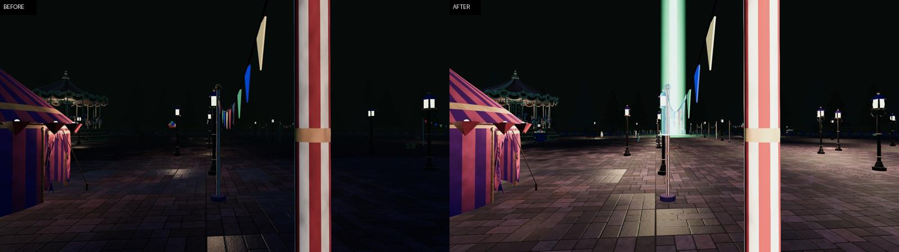
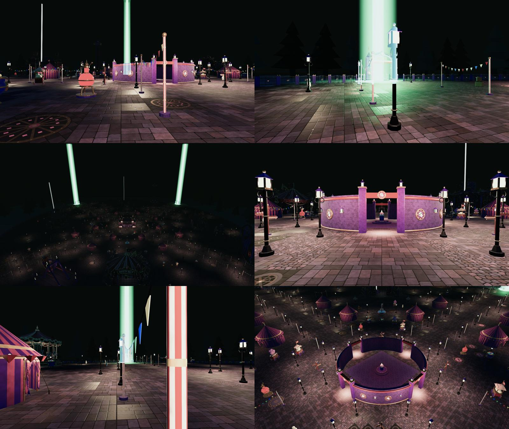

**L1 열린 탈출구**
- 새 셰이더 `TagOfChaos/Beacon`(`Assets/09. Environment/Shaders/`): 더하기 섞기, 안개를 받지 않는다. 기둥은 위로 갈수록 옅어지고 바닥 원은 가운데에서 바깥으로 옅어진다.
- `ExitOpenLook_<방향>`을 탈출구마다 만든다. EscapeGate가 원래 이 이름을 찾아 열릴 때만 켠다(캔디숲과 같은 규칙, 코드 변경 없음).
  - 빛기둥 둘(가운데 1.8 m·바깥 안개 6 m)
  - 문틀 빛 띠 3
  - 바닥 빛 원(지름 14 m)
  - 초록 점광원 26 m
- 충돌체는 없다. 재질은 `Generated/CUR_Exit*.mat`.
- 닫힌 탈출구도 자리가 보이도록 안쪽 양옆에 가로등을 둔다. 이 가로등은 탈출구 루트 밖(`Roads`)에 있어 열린 탈출구 투시 테두리에 들지 않는다.
- 맵 반대쪽에서도, 건물에 가려져도 기둥이 보인다. 가려진 부분은 기존 투시 테두리로 보인다.

**L2 가로등·밝기**
- 빈자리 검사(가로등 둘레 3 m — 괴물 지름 3.6 m 통로)를 지나야 놓는다:
  - 둥근 산책길 안쪽 줄(바깥 줄과 엇갈림)
  - 사분면에 흩어 놓는 가로등 4 → 8
- 바닥 하얀 네모를 고쳤다. 가로등이 세지자 매끈한 바닥 타일 하나하나가 하얀 네모로 튀었다. 그래서 바닥 세트만 매끈함 배율을 0.65로 낮췄다(`CarnivalRideModelsImporter.GlossScale`). 젖은 느낌은 남는다.
- 카메라는 이미 Deferred라 가로등 수가 늘어도 물체당 빛 수 제한이 없다.

**L3 술래방**
- 둘레 가로등 8(사분면 방향 ±20°, 반지름 16 m — 문·이정표를 피함)
- 안쪽 빛(6 m 높이, 15 m)
- 문 위 붉은 빛 4
- 문 앞 붉은 바닥 빛(`DoorGlow_0~3`, 겉모습만)

**L4 시험**
- 통행 검사 **5/5 CLEAN**: 목표 66곳 모두 쿠키·괴물이 닿는다.
- 컴파일 오류 0. EditMode **326/326 통과**(새 시험 `Scene_ExitsHaveOpenBeaconsAndEveryLampIsLit`).
- Play Mode:
  - 탈출구: 연 동·남만 표시가 켜지고 문이 6.6 m 내려간다. 닫힌 북·서는 꺼진 채다.
  - 걷기: 괴물·쿠키가 네 건물 꽂는 곳, 텐트 4곳, 동쪽 탈출구까지 간다.
  - 술래방 지킴이가 동작한다(15.2 m로 내보냄).
- Console 오류 0.
  - `[NetGuard]` 경고는 오프라인 시험에서만 나온다. 쿠키와 괴물이 같은 사람(Actor 1)이라, 둘 사이 거리를 이동으로 잘못 센다.

**남은 것**
- 실제 PC에서 프레임 확인. 점광원 139개(그림자 없음)라 Deferred에서 부담은 크지 않을 것으로 본다. 다만 아직 재 보지 않았다.
